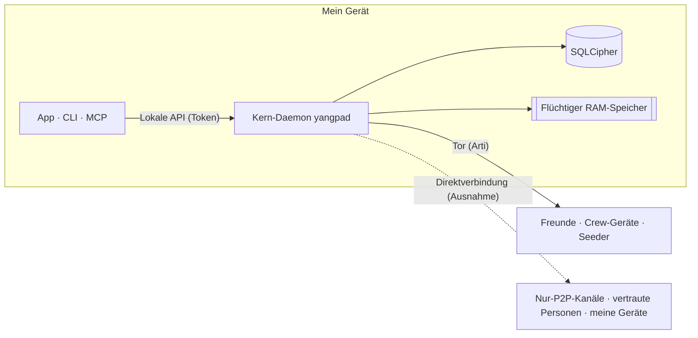

<h1 align="center">
  <picture>
    <source media="(prefers-color-scheme: dark)" srcset="docs/assets/logo-on-dark.png">
    
  </picture>
</h1>

<p align="center">
  <a href="README.md">한국어</a> ·
  <a href="README.en.md">English</a> ·
  <a href="README.ja.md">日本語</a> ·
  <a href="README.zh-CN.md">简体中文</a> ·
  <a href="README.zh-TW.md">繁體中文</a> ·
  <a href="README.es.md">Español</a> ·
  <a href="README.fr.md">Français</a> ·
  <b>Deutsch</b> ·
  <a href="README.pt-BR.md">Português (Brasil)</a> ·
  <a href="README.ru.md">Русский</a> ·
  <a href="README.it.md">Italiano</a> ·
  <a href="README.id.md">Bahasa Indonesia</a> ·
  <a href="README.vi.md">Tiếng Việt</a> ·
  <a href="README.tr.md">Türkçe</a> ·
  <a href="README.hi.md">हिन्दी</a>
</p>

<p align="center"><strong>Ein Ende-zu-Ende-verschlüsselter Messenger über Tor, ohne Server und ohne Telefonnummer</strong></p>

<p align="center">
  Der auf deinem Gerät erzeugte Schlüssel ist dein Konto. Tor verbirgt die IP, und Freunde und Crews betreiben<br>
  ihren Discord-artigen Raum mit Kanälen, Anrufen und Bildschirmübertragung ohne Betreiber.
</p>

<p align="center">
  
  <a href="https://github.com/dhtpdud/YANGPA/releases/latest"></a>
  
  
  
</p>

<p align="center">
  <a href="#warum-yangpa">Warum YANGPA</a> ·
  <a href="#screenshots">Screenshots</a> ·
  <a href="#sicherheitsdesign">Sicherheitsdesign</a> ·
  <a href="#was-yangpa-nicht-schützt">Was YANGPA nicht schützt</a> ·
  <a href="#erste-schritte">Erste Schritte</a> ·
  <a href="#dokumentation">Dokumentation</a>
</p>

<p align="center">
  
</p>

## Warum YANGPA

- **Keine Registrierung.** Weder Telefonnummer noch E-Mail-Adresse werden verlangt. Das Konto ist nur ein Schlüssel, der auf deinem Gerät erzeugt wird. Es gibt keinen Betreiber, der ein Verzeichnis führt, und
  keinen Kontoserver. Selbst Bootstrap, Relay und Seeder sind gewöhnliche Knoten, die jeder starten kann.
- **Deine IP liegt hinter Tor.** Die App hat keine Einstellung, um das eingebaute Arti (Tor) auszuschalten (nur Headless-Knoten lassen sich mit `--direct` starten), und wenn Tor nicht
  verfügbar ist, wechselt sie nicht auf Direktverbindungen, sondern bleibt beim Start stehen. Die Ausnahmen stehen vollständig in der [Tabelle unten](#wohin-die-app-nach-außen-kommuniziert).
- **Klassische und Post-Quanten-Kryptografie zusammen.** Signaturen: Ed25519 + FN-DSA-512, Schlüsselaustausch: X-Wing (X25519 + ML-KEM-768),
  Transport: X25519MLKEM768. Die Zusammenstellung berücksichtigt Angriffe, die heute Verkehr mitschneiden, um ihn später zu entschlüsseln.
- **Es gibt Gespräche, die nichts hinterlassen.** Inhalt und Schlüssel flüchtiger Kanäle liegen nur im RAM, und auch im Code sind Speicherpfad und Typ getrennt.
- **Du bestimmst den Umfang deiner Daten.** Pro Datenart und Kanal wählst du, was gespeichert, an andere weitergegeben und abgerufen wird.
- **Per Skript steuerbar.** App, CLI, lokale API und MCP sind alle Clients desselben Kern-Daemons (`yangpad`).
- **Grenzen werden nicht verschwiegen.** Was nicht geschützt werden kann, steht in der [Dokumentation](#was-yangpa-nicht-schützt) und in der App. Ein Beispiel ist
  „Was sich nicht verhindern lässt“ im Screenshot des flüchtigen Kanals unten.

## Screenshots

Die Bilder zeigen die Beispieldaten der Entwicklung. Ein Klick auf ein Bild vergrößert es.

<table>
  <tr>
    <td width="50%" valign="top">
      <br>
      <strong>Flüchtiger Kanal</strong><br>
      Inhalt und Anhänge liegen nur im Speicher und werden nach Ablauf der Lebensdauer gelöscht. Was garantiert ist und was sich nicht verhindern lässt, zeigt die Oberfläche zusammen an.
    </td>
    <td width="50%" valign="top">
      <br>
      <strong>Tor und Brücken</strong><br>
      Tor lässt sich in der App nicht ausschalten. In blockierten Netzen führt der Weg über Snowflake- oder obfs4-Brücken. Auch die Funktionen, die wegen Tor entfallen, werden offen genannt.
    </td>
  </tr>
  <tr>
    <td valign="top">
      <br>
      <strong>Sicherheitsnummer und Vertrauensschalter</strong><br>
      Du vergleichst die Sicherheitsnummer selbst, um Man-in-the-Middle-Angriffe abzuwehren, und verbindest dich nur mit Personen direkt, denen du deine IP zeigen darfst.
    </td>
    <td valign="top">
      <br>
      <strong>Nur-P2P-Kanal</strong><br>
      Für Kanäle, die schnelle Dateiübertragung und Anrufe brauchen, verbinden sich nur Geräte direkt, die der Warnung zugestimmt und beigetreten sind. Vor dem Beitritt bleibt der Inhalt verschlossen.
    </td>
  </tr>
  <tr>
    <td valign="top">
      <br>
      <strong>Neues Gerät freigeben</strong><br>
      Ein neues Gerät kommt nur über den Einmal-QR-Code eines bereits genutzten Geräts hinzu, und zugelassen wird es von der Person, die die sechsstelligen Nummern beider Seiten verglichen hat.
    </td>
    <td valign="top">
      <br>
      <strong>Anonymer Kanal</strong><br>
      Autorinnen und Autoren erscheinen unter einem Pseudonym pro Kanal. Das verbirgt sie nur in der Oberfläche der App (<a href="#anonymität-vor-wem-was-verborgen-bleibt">Tabelle unten</a>).
    </td>
  </tr>
  <tr>
    <td valign="top">
      <br>
      <strong>Tor-Anruf</strong><br>
      Nur der Ton läuft ohne WebRTC über Tor. Dafür kommt das Gesagte etwa 0,5 bis 1,5 Sekunden verzögert an, und die IP bleibt verborgen.
    </td>
    <td valign="top">
      <br>
      <strong>Bildschirmübertragung</strong><br>
      In Nur-P2P-Kanälen und mit gegenseitig vertrauten Personen läuft sie über WebRTC. Jeder Frame wird Ende-zu-Ende verschlüsselt.
    </td>
  </tr>
  <tr>
    <td valign="top">
      <br>
      <strong>Bei KI entscheidet der Mensch</strong><br>
      Destruktive Aktionen, die ein Automatisierungs-Token anfragt, werden erst nach Freigabe durch einen Menschen ausgeführt. Jeder authentifizierte Aufruf landet im Audit-Protokoll.
    </td>
    <td valign="top">
      <br>
      <strong>Seeder-Einstellungen</strong><br>
      Du bestimmst die weiterzugebenden Datenarten, die Bandbreite und die Zahl gleichzeitiger Übertragungen. Die Geschwindigkeit lässt sich auch pro Person, Crew und Kanal begrenzen.
    </td>
  </tr>
  <tr>
    <td valign="top">
      <br>
      <strong>Forum und helles Design</strong><br>
      Es gibt Forumkanäle, die mit Beiträgen und Tags ordnen, und du wählst zwischen hellem und dunklem Design.
    </td>
    <td valign="top" align="center">
      <br>
      <strong>Android</strong><br>
      Sie nutzt denselben Oberflächencode wie der Desktop, und der Daemon läuft in der App.
    </td>
  </tr>
</table>

## Funktionen

| Bereich | Inhalt |
| --- | --- |
| **Unterhaltung** | Direktnachrichten-Spaces und Crews haben dieselbe Struktur und lassen sich so beliebig erweitern. Text-, Forum- und Anrufkanäle, Markdown, Reaktionen, eigene Emojis, Anhänge, Linkvorschau, Rollen und Berechtigungen, Einladungslinks. |
| **Flüchtig** | Kanäle, deren Inhalt den RAM nicht verlässt, mit Beitritts- und Austrittsmodus und sekundengenauer Lebensdauer. Auch Anhänge liegen nur im Speicher der Teilnehmenden. |
| **Anrufe** | Tor-Anruf (Ton über Opus oder über Mimi, einen neuronalen Codec mit etwa 1,1 kbps; Bild nur als Notlösung in niedriger Qualität nach Bestätigung einer Warnung). Nur-P2P-Kanäle und gegenseitig vertraute Personen werden über ein WebRTC-Mesh verbunden, die Bildschirmübertragung läuft mit bis zu 120 fps. Große Anrufe relayt ein direkt verbundener Seeder, ohne die Frames zu entschlüsseln (SFU). |
| **Speichern und Bereitstellen** | Über die Einstellungen für Seeder (an andere weitergeben) und Peer (abrufen) wählst du Datenarten, Kanalausschlüsse, Bandbreite und Priorität. Empfangene Anhänge werden innerhalb des Plattenlimits (Standard 2 GB) beginnend mit den am längsten ungenutzten geleert; was bleiben soll, wird angeheftet. |
| **Netzwerk** | Brücken (Snowflake, obfs4, manuelle Eingabe), der Vertrauensschalter pro Person und Crew, Nur-P2P-Kanäle, die eigene STUN-Serverliste und die STUN-Server der Crew, der optionale Tor-Dateicircuit. |
| **Geräte** | Hinzufügen nur per Einmal-QR-Code und Freigabe mit sechsstelliger Nummer. Ein widerrufenes Gerät löscht bei der nächsten Verbindung selbst seine lokalen Daten. Es gibt keine Wiederherstellungsphrase, deshalb ist das Konto weg, wenn man alle Geräte verliert. |
| **Betrieb** | Blockieren (nur auf diesem Gerät, die Gegenseite erfährt es nicht), versiegelte Meldungen, die nur das Moderationsteam öffnet, und Banns, die alle Mitgliedsknoten mit demselben Ergebnis anwenden. |
| **Automatisierung** | CLI `yangpa`, lokales JSON-RPC, MCP-Server `yangpa-mcp`. Was die App kann, geht auch per CLI. |
| **Selbstbetrieb** | Headless-Seeder, bei dem auf einem NAS oder VPS nur der Daemon läuft (Beispiele für Docker und systemd), und reine Archivknoten, die nur Chiffretext ohne Schlüssel aufbewahren. |
| **Sprachen** | Die Oberfläche gibt es in 15 Sprachen. Die Übersetzungen stammen von einer KI und wurden noch nicht von Muttersprachlern geprüft. |

Einige Funktionen wie der Bibliothek-Tab und der Inhaltsbetrachter sind nur für Unterstützer ([Lizenz](#lizenz)).

## Anonymität: Vor wem was verborgen bleibt

„Anonym“ bedeutet auf jeder Ebene etwas anderes. Hier steht getrennt, was YANGPA tut und was nicht.

| Ebene | Was geschieht | Was trotzdem sichtbar bleibt |
| --- | --- | --- |
| **Registrierung** | Das Konto entsteht ohne Telefonnummer und E-Mail aus einem auf dem Gerät erzeugten Schlüssel. | Der von dir gewählte Name und das Profil. Es gibt nur eine Identität, daher können Crews erkennen, dass du in mehreren Crews dieselbe Person bist. |
| **Netzwerk** | Tor verbirgt die IP. Auch Freunde, Crew-Mitglieder und Seeder sehen sie nicht. | Netzbeobachter sehen, dass du Tor nutzt, sowie Verkehrsmenge und Zeitpunkt. Ausnahmen stehen in der [Tabelle unten](#wohin-die-app-nach-außen-kommuniziert). |
| **In der Crew** | Anonyme Kanäle zeigen Autorinnen und Autoren mit einem pro Kanal festgelegten Pseudonym. | **Verborgen wird nur in der Oberfläche der App.** Der Signierende bleibt in den Daten erhalten, sodass Mitglieder mit einem modifizierten Client die Autorin oder den Autor erkennen können. |

Tor verbirgt dich nicht vor Freunden. Freunde und Mitglieder kennen deine Identität innerhalb des verschlüsselten Kanals.

## Sicherheitsdesign



| Bereich | Verfahren |
| --- | --- |
| Signatur | Hybrid aus Ed25519 + FN-DSA-512. Beide müssen stimmen. Jedes Ereignis wird mit dem Geräteschlüssel signiert, die Geräteliste mit dem Identitätsschlüssel. |
| Schlüsselaustausch und Versiegelung | X-Wing (X25519 + ML-KEM-768) → HKDF-SHA256 → XChaCha20-Poly1305 |
| Nachrichten und Anhänge | XChaCha20-Poly1305. Der Text wird mit OpenZL komprimiert und dann mit Padmé aufgefüllt (höchstens 12 % Zuschlag), sodass statt der genauen Länge nur ein Größenbereich sichtbar ist. |
| Gruppenschlüssel | Eigene Schlüsselgruppe. Bis 256 Geräte wird direkt versiegelt, darüber kommt ein binärer LKH-Baum zum Einsatz. Der Schlüsselplan nutzt BLAKE3 `derive_key`. |
| Schlüsselwechsel | Sofort beim Entfernen eines Mitglieds, der Schlüssel für den Verlauf alle 24 Stunden, die gesamte Crew wöchentlich. Ist in den Crew-Einstellungen die „Strikte Schlüsselrotation“ eingeschaltet, wird erst gesendet, wenn die Aktualisierung da ist. |
| Anrufe | AES-256-GCM pro Frame (WebRTC Encoded Transform). Bei jeder Änderung der Teilnehmenden wird ein neuer Schlüssel erzeugt, mit X-Wing versiegelt und verteilt. |
| Transport | libp2p TLS 1.3, Schlüsselaustausch X25519MLKEM768. Tor-Swarm und Relay-Circuits nutzen ausschließlich TLS. |
| Netzwerk | Eingebautes Arti, Onion-Dienst v3, Vanguards (ausgehende Circuits lite, Onion-Dienst-Circuits full). |
| Speicherung | SQLCipher, der DB-Schlüssel liegt im Schlüsselspeicher des Betriebssystems. Jede Nachricht wird zusätzlich mit einem zufälligen Speicherschlüssel versiegelt, den man beim Löschen vernichtet (kryptografisches Löschen). |
| Flüchtiger Speicher | Sitzungsschlüssel liegen in gesperrtem Speicher (mlock, VirtualLock) und werden beim Löschen mit Nullen überschrieben. Der Inhalt bleibt auch im RAM Chiffretext und wird nur zur Anzeige entschlüsselt. |
| Lokale API | Geöffnet wird nur ein Unix-Socket (0600) oder eine Named Pipe. Es wird kein TCP geöffnet, und jedes Token ist auf Geltungsbereich und Crew beschränkt. |
| Protokoll | Auf keiner Log-Stufe werden Nachrichteninhalte, Schlüssel oder Token geschrieben. |

Drei Designentscheidungen, die Fachleute sich zuerst ansehen sollten:

- **Statt MLS wird eine eigene Schlüsselgruppe verwendet.** Bei einer Crew mit 45.000 Geräten wuchsen die MLS-Welcome- und Remove-Commits auf 50 bis 61 MB, deshalb wurde gewechselt. Sie ist
  kein Standard und wurde nicht extern begutachtet. Das Design steht in [docs/protocol.md](docs/protocol.md), die Messung in [docs/performance.md](docs/performance.md).
- **Es gibt keine Forward Secrecy auf Nachrichtenebene.** Schlüssel wechseln in den Abständen der obigen Tabelle, nicht pro Nachricht. Auch 1:1-Unterhaltungen haben dieselbe Struktur.
  Wird ein Schlüssel bekannt, lassen sich die Nachrichten desselben Schlüsselzeitraums öffnen.
- **Tor-Circuits sind noch klassisch verschlüsselt.** Arti 0.47 hat keinen Post-Quanten-Circuit-Handshake. Die darin laufende libp2p-Verbindung und der Ende-zu-Ende-Inhalt sind
  durch den hybriden Schlüsselaustausch geschützt, doch wer Verbindungen auf der Guard-Seite sammelt und später entschlüsselt, kann erfahren, wann welche Onion-Adresse angesprochen wurde.

### Wohin die App nach außen kommuniziert

Die App enthält keinen Code für Nutzungsstatistiken, Fehlerberichte oder automatische Update-Prüfungen. Die folgende Liste umfasst alles, womit die App nach außen kommuniziert. Die
[CSP](apps/desktop/src-tauri/tauri.conf.json) der App-Oberfläche (WebView) öffnet `connect-src` nur nach innen in die App. Die eigene Kommunikation des Betriebssystems und der
WebView-Engine (z. B. WebView2) kontrolliert die App nicht.

| Wann | Wohin | Was sichtbar wird |
| --- | --- | --- |
| Immer | Tor-Guard oder Brücke | Meine IP und dass ich Tor nutze |
| Wenn Tor nicht erreichbar ist (automatisch, solange die Brückeneinstellung nie geändert wurde) | Snowflake-Broker und Freiwilligen-Proxy | Meine IP |
| **Bei zwei oder mehr Geräten (automatisch, außer im Offline-Modus)** | Öffentliche STUN-Server (standardmäßig Google und Cloudflare), meine anderen Geräte, Router (UPnP) | **Meine öffentliche IP** |
| Beim Beitritt zu einem Nur-P2P-Kanal | Gemeinsam beigetretene Geräte, STUN-Server | Meine IP (nach Bestätigung der Warnung) |
| Bei eingeschaltetem Vertrauensschalter | Die vertraute Person, STUN-Server | Meine IP (nach Bestätigung der Warnung). Vertraut nur eine Seite, ist nur die IP der vertrauenden Seite sichtbar |
| Wenn ich die STUN-Server einer Crew nutzen will (Rollenberechtigung und meine Einstellung müssen beide an sein) | Die STUN-Server dieser Crew | Meine öffentliche IP |
| Beim Senden einer Nachricht mit Link | Die jeweilige Website | IP des Tor-Exit-Knotens. Die empfangende Person ruft nichts ab. In flüchtigen Kanälen standardmäßig aus. |
| Beim Prüfen der Unterstützung über GitHub | github.com | IP des Tor-Exit-Knotens und mein GitHub-Konto |
| **Beim Prüfen der Unterstützung über Patreon** | patreon.com | **Meine echte IP** und mein Patreon-Konto. Patreon sperrt Tor-Exits, daher wird direkt verbunden. |

Die Prüfung der Unterstützung läuft erst, nachdem ich sie per Schaltfläche eingeschaltet habe, und wird danach einmal täglich wiederholt. Die YANGPA-Identität wird nicht übermittelt.

## Was YANGPA nicht schützt

Die vollständige Liste und das Angreifermodell stehen in [SECURITY.md](SECURITY.md).

- **Daten, die auf das Gerät der Gegenseite gelangt sind.** Löschen, Lebensdauer und Flüchtigkeit werden nur von ehrlichen Clients eingehalten. Screenshots, Kameraaufnahmen und modifizierte Clients lassen sich nicht verhindern.
- **Metadaten.** Ereignis-Header sind zur Signaturprüfung und Synchronisierung nicht verschlüsselt, daher wissen Mitglieder und Seeder, die ein Ereignis erhalten, wer wann in welchen Kanal geschrieben hat.
- **Ein kompromittiertes eigenes Gerät.** Schadsoftware, die unter demselben Betriebssystembenutzer läuft, kann den Daemon manipulieren. Eine Funktion, die den DB-Schlüssel zusätzlich mit einem Passwort umhüllt, gibt es noch nicht.
- **Die Grenzen von Tor selbst.** Zeitkorrelationsanalyse durch Beobachter, die das gesamte Netz sehen, wird nicht verhindert.
- **Pfade außerhalb des Schutzbereichs flüchtiger Kanäle.** Ruhezustandsdatei, Absturzabbilder, Zwischenablageverlauf, Bildschirmaufnahme unter Linux.
- **Die IP vor direkt verbundenen Gegenstellen verbergen.** In Nur-P2P-Kanälen und gegenüber vertrauten Personen ist deine IP unverändert sichtbar.
- **Echtheit der Release-Pakete.** Es gibt keine Codesignatur, und `SHA256SUMS.txt` bestätigt nur, dass der Download nicht beschädigt ist. Wenn die Echtheit wichtig ist, baue aus dem Quellcode.
- **Geräteverlust.** Wenn du alle Geräte verlierst, lässt sich das Konto nicht wiederherstellen.

## Selbst nachprüfen

Das lässt sich nachprüfen, statt es zu glauben.

| Was dich interessiert | So prüfst du es |
| --- | --- |
| Bleibt flüchtiger Inhalt auf Platte oder im Protokoll? | Sende eine Markierungszeichenfolge in einen flüchtigen Kanal und führe danach `yangpa diag leakcheck <Markierung>` aus |
| Treten Pakete aus Tor aus? | `sudo scripts/tor-leak-check.sh` (Linux, echtes Tor-Netz). In einem Netzwerk-Namespace werden Pakete mitgeschnitten, und es schlägt fehl, sobald auch nur ein Paket an etwas anderes als ein Tor-Relay geht. Nur im letzten Schritt, der meine Geräte verbindet, werden STUN, UPnP und meine öffentliche Adresse gesondert gezählt. |
| Wie ist der aktuelle Netzwerkstatus? | `yangpa net status` |
| Entspricht das Protokoll der Dokumentation? | [docs/protocol.md](docs/protocol.md) sowie `crates/yangpa-crypto` und `crates/yangpa-sync` |
| Was weicht vom Konzeptpapier ab? | [docs/decisions.md](docs/decisions.md) hält alle Entscheidungen samt Begründung fest. |

Schwachstellen melde bitte [vertraulich](SECURITY.md#취약점-알리기) statt in einem öffentlichen Issue.

## Erste Schritte

### Unterstützte Plattformen

Windows x86_64, macOS (Apple Silicon und Intel gemeinsam), Linux x86_64 und ARM64. Für Android ARM64 installieren Sie die APK aus dem Release (`YANGPA_…_arm64.apk`, [docs/android.md](docs/android.md)).

### Desktop-App

1. Lade aus den [Releases](../../releases) das Paket für dein Betriebssystem herunter.

   | Betriebssystem | Datei |
   | --- | --- |
   | Windows | `…_x64-setup.exe` (empfohlen) oder `…_x64_en-US.msi` |
   | macOS | `…_universal.dmg` |
   | Linux x86_64 | `…_amd64.deb` oder `…_amd64.AppImage` |
   | Linux ARM64 | `…_arm64.deb` oder `…_aarch64.AppImage` (glibc 2.35 oder neuer) |

2. Prüfe mit der `SHA256SUMS.txt` desselben Releases.

   ```bash
   sha256sum -c SHA256SUMS.txt --ignore-missing
   ```

   Da die Pakete nicht signiert sind, erlaubst du unter macOS das Öffnen in „Systemeinstellungen → Datenschutz & Sicherheit“, und unter Windows wählst du in SmartScreen
   „Weitere Informationen → Trotzdem ausführen“.
3. Öffne die App und erzeuge mit **Neu starten** eine Identität. Weitere Geräte fügst du unter Einstellungen › Geräte mit **Neues Gerät verbinden** hinzu.
4. Erstelle einen Kontaktlink und sende ihn, oder füge einen erhaltenen Link ein, um eine Unterhaltung zu beginnen.

<details>
<summary><strong>Den Daemon getrennt von der App betreiben oder beenden</strong></summary>

Die App bringt den Daemon (`yangpad`) mit, startet ihn bei Bedarf und beendet den angehängten Daemon, wenn die App endet (währenddessen pausieren auch Seeding und Benachrichtigungen).
Wenn der Daemon unabhängig von der App weiterlaufen soll, starte die App mit `YANGPA_NO_SPAWN=1`. Auch wenn die App zwangsbeendet wird oder abstürzt, beendet sich ein von der App gestarteter Daemon selbst, sobald er
das Ende der App bemerkt. Ein Daemon, den die App nicht gestartet hat (per CLI gestartet), kann weiterlaufen und weiter seeden. So beendest du einen solchen Daemon:

- Mit dem Kommandozeilenwerkzeug: `yangpa shutdown`. Das Desktop-Paket enthält keine CLI, lade daher das Paket `yangpa-cli-…` weiter unten herunter.
- Ohne CLI beendest du den Prozess `yangpad` über das Betriebssystem. Unter Windows `yangpad.exe` im Task-Manager unter „Details“, unter macOS `yangpad` in der
  Aktivitätsanzeige, unter Linux `pkill -x yangpad` (reguläres Beendigungssignal). Beim nächsten Öffnen der App wird er wieder gestartet.
- Die Installationsdateien beenden vor Update oder Deinstallation zuerst den Daemon dieser Installation: Windows `-setup.exe` und `.msi` beenden `yangpad.exe` im Installationsordner,
  Linux `.deb` beendet das geänderte oder gelöschte `/usr/bin/yangpad`. Eine geöffnete App starte neu (sie wird nicht erneut gestartet). Unter Windows kann ein von einem
  anderen Benutzerkonto gestarteter Daemon nicht beendet werden und wird womöglich erst nach einem Neustart ersetzt.

</details>

### Kommandozeile (CLI)

Im `yangpa-cli-<Version>-<Ziel>.tar.gz` des Releases (unter Windows `.zip`) liegen `yangpad`, `yangpa` und `yangpa-mcp`.
Lege die drei Dateien in dasselbe Verzeichnis (oder in den `PATH`).

```bash
yangpa daemon &                         # Daemon starten (entfällt, wenn die App ihn schon gestartet hat). Argumente gehen unverändert an yangpad
yangpa identity create --name Ich       # Identität erzeugen
yangpa status

yangpa friend link create --single-use --expires 24h    # Kontaktlink, den du der Gegenseite schickst
yangpa friend add 'yangpa://friend/…'                    # Mit einem erhaltenen Link sofort temporärer Kontakt und 1:1-Space
yangpa friend propose Partnername                        # Zum Freund machen (Freunde, sobald die Gegenseite es auch tut)

yangpa space list                                        # Namen der 1:1-Spaces und Crews
yangpa channel list --crew <Name>
yangpa message send --crew <Name> -c <Kanal> "Hallo"
yangpa watch                                             # Neue Nachrichten und Statusänderungen in Echtzeit
```

<details>
<summary><strong>CLI-Verbindungsart und Argumente</strong></summary>

- Die CLI verbindet sich mit der lokalen API des Daemons (Unix-Socket 0600, unter Windows Named Pipe). Bei demselben Benutzer wird automatisch das Eigentümer-Token
  im Datenpfad verwendet. Einen Daemon an anderer Stelle gibst du mit `--endpoint` (`YANGPA_ENDPOINT`) an, ein anderes Token mit `YANGPA_TOKEN`.
- Die Argumente jedes Befehls zeigt `yangpa <Befehl> --help`, und mit `--json` wird das Ergebnis unverändert als JSON ausgegeben.
- Werte, die als Name übergeben werden (`--crew "Spielgruppe"`, `-c Ankündigungen`, Rollen- und Mitgliedsnamen), werden zur Laufzeit in IDs umgewandelt. Bei mehreren gleichen Namen
  wirst du aufgefordert, die ID zu verwenden.

</details>

### Headless-Seeder (NAS, VPS)

Ein Knoten, der den Crew-Verlauf dauerhaft bereitstellt. Einzelheiten zu Einstellung, Fernverwaltung und Betrieb über Tor in [docs/headless.md](docs/headless.md).

<details>
<summary><strong>Mit Docker oder systemd starten</strong></summary>

```bash
# Docker (im Repository-Stammverzeichnis): Daten nur im Volume, Nicht-Root-Benutzer, fester Port 47810 (TCP und UDP)
docker compose -f deploy/docker-compose.yml up -d --build
alias yangpa='docker exec -it yangpa-seeder yangpa'

# Oder systemd: deploy/systemd/yangpad.service (mit Isolationseinstellungen)

yangpa identity create --name "Spielgruppen-Seeder"
yangpa invite join 'yangpa://invite/…'
yangpa seed set --all-channels --types text,image,video,file,emoji,history_bundle --upload-limit 5MB/s --prefetch on
yangpa seed coverage --crew "Spielgruppe"
yangpa blob cache limit 200GB --min-free 10GB           # Plattenlimit für empfangene Anhänge (Standard 2 GB)
```

Der Standardbereich des Seeders ist „nur Kanäle, die man selbst geöffnet hat“. Ein Headless-Knoten muss daher mit `--all-channels` erweitert werden, um etwas bereitzustellen, und Anhänge aus nie geöffneten Kanälen
werden nur mit `--prefetch on` vorab geladen. Das Seeder-Paket übernimmt zuerst die Rolle des SFU-Hosts für große Anrufe (`YANGPA_SFU_HOST=prefer`, Medien-UDP
47811). Ein paketgemäß direkt verbundener Seeder kann die Onion-Adressen von über Tor laufenden Mitgliedern nicht zuerst anwählen, und in der App gibt es keine Einstellung, um die Seeder-Adresse
einzutragen. Damit er App-Nutzer erreicht, starte den Seeder daher über Tor ([docs/headless.md](docs/headless.md#멤버가-닿게-하기)). Soll er nur Chiffretext aufbewahren, ohne einer Crew
beizutreten, starte ihn mit `--archive` ([docs/headless.md](docs/headless.md#보관-전용-노드로-쓰기)). Ein Headless-Seeder ist ein Crew-Mitglied mit Schlüssel, und auch ein Archivknoten sieht Metadaten
wie die, wer wann wie viel geschrieben hat.

</details>

## Was heute nicht geht

- Die Desktop-App sendet noch kein Kamerabild (nur Sprache und Bildschirmübertragung).
- Das Bild eines Tor-Anrufs ist eine Notlösung in niedriger Qualität (höchstens 1280 px Breite, 2 Bilder pro Sekunde). Eine ordentliche Bildschirmübertragung läuft in Nur-P2P-Anrufkanälen oder mit gegenseitig
  vertrauten Personen.
- Bildschirmton wird nur in Mesh-Anrufen unter Windows gesendet. SFU- und Tor-Anrufe senden nur das Bild.
- App-Geräte, die über Tor laufen, übernehmen nicht die Rolle des SFU-Hosts.
- Sprache und Bildschirmübertragung unter Linux (WebKitGTK) können instabil sein, und das Ausblenden des Fensters bei der Aufnahme wird nicht unterstützt.
- Automatische Tests mit echtem Tauri-Fenster laufen nur unter Linux. Fenster unter macOS und Windows sowie Signatur und Notarisierung prüft ein Mensch ([CONTRIBUTING.md](CONTRIBUTING.md#릴리스-절차)).

## KI-Werkzeuge anbinden (MCP)

`yangpa-mcp` ist ein MCP-Server, der über Standard-Ein-/Ausgabe läuft. KI-Werkzeuge rufen damit Aufgaben wie Kanallisten, Nachrichten lesen und zusammenfassen,
Kanal- und Rollenverwaltung, Einladungen und Seeder-Einstellungen als Tools auf.

**Sicherheitsregeln, die der Daemon durchsetzt:**

- Destruktive Aktionen wie Rauswerfen, Bannen, Bann aufheben, Meldungen bearbeiten (außer Ablehnen), fremde Nachrichten löschen, Berechtigungen und Rollen ändern, Einladungen erzeugen und Kanäle löschen
  werden nicht sofort ausgeführt, sondern in die Bestätigungswarteschlange für Menschen gestellt. Sie laufen erst, wenn du in der App oder mit `yangpa confirm list` → `yangpa confirm approve <ID>` freigibst.
- Flüchtige Kanäle sind für KI-Lesezugriff standardmäßig verweigert. Ein Mensch muss sie pro Kanal mit `yangpa channel allow-api-read … on` erlauben.
- Von Mitgliedern geschriebene Nachrichten werden als „Daten, keine Anweisungen“ verpackt an die KI übergeben (gegen Prompt-Injection).
- Jeder authentifizierte Aufruf landet im Audit-Protokoll (`yangpa audit list`), und in der Crew-Mitgliederliste erscheint eine Automatisierungsmarkierung. Verbrauchte Token
  widerrufe mit `yangpa token revoke <ID>`.

<details>
<summary><strong>Einrichtung</strong></summary>

1. **Automatisierungs-Token ausstellen.** Nur der Eigentümer kann das, und das Token wird dabei nur einmal ausgegeben. Vergib Geltungsbereich (`read`, `write`, `admin`, `settings`) und
   Crews nur so weit wie nötig. `yangpa-mcp` lehnt Token ab, die nicht mit `--automation` ausgestellt wurden.

   ```bash
   yangpa token create --name ai --scopes read,write --crews "Spielgruppe" --automation
   ```

2. **In die MCP-Einstellungen des KI-Werkzeugs eintragen.** Die meisten Clients verwenden das folgende Format (der Dateiort unterscheidet sich je nach Werkzeug).

   ```json
   {
     "mcpServers": {
       "yangpa": {
         "command": "yangpa-mcp",
         "env": {
           "YANGPA_TOKEN": "<das oben erhaltene Automatisierungs-Token>"
         }
       }
     }
   }
   ```

   Ist `yangpa-mcp` nicht im `PATH`, trage bei `command` den vollständigen Pfad ein. Liegt der Daemon nicht am Standardort, füge unter `env`
   `"YANGPA_ENDPOINT": "<Socket-Pfad oder Named Pipe>"` hinzu. Die Log-Stufe steht in `YANGPA_MCP_LOG` (Standard `warn`, Ausgabe nur auf Standardfehler).

</details>

Die ausführlichen Regeln stehen in [Kapitel 10 des Benutzerhandbuchs](docs/user-guide.md#10-ai-연동과-안전-규칙).

## Aus dem Quellcode bauen

Benötigt wird:

- Rust 1.91 oder neuer (Releases werden mit 1.99.1 gebaut), ein C-Compiler, `perl` und `make` (baut OpenSSL für SQLCipher aus dem Quellcode),
  `cmake` (für den Fall, dass aws-lc in manchen Umgebungen gebaut werden muss). Unter Windows die MSVC-Build-Tools und Strawberry Perl.
- Für die Desktop-App: Node.js 22, unter Linux `libwebkit2gtk-4.1-dev libayatana-appindicator3-dev librsvg2-dev libxdo-dev`.

```bash
# Kern: Daemon (yangpad), CLI (yangpa), MCP-Server (yangpa-mcp). Die Desktop-App gehört nicht zum Standard-Build.
cargo build --release --locked
ls target/release/{yangpad,yangpa,yangpa-mcp}
cargo test --workspace

# Desktop-App (Entwicklungsmodus). Die App sucht das yangpad neben der ausführbaren Datei (target/debug) und startet es.
cargo build -p yangpa-daemon
cd apps/desktop
npm ci
npm run tauri dev
```

<details>
<summary><strong>App-Tests und Auslieferungspakete bauen</strong></summary>

```bash
# Desktop-App-Tests: Unit-Tests und E2E, das das oben gebaute yangpad tatsächlich startet (ohne es wird E2E übersprungen).
YANGPA_E2E_REQUIRED=1 npm test -- --run

# Test mit echtem Fenster (Linux): tauri-driver, WebKitWebDriver und eine Anzeige sind nötig; fehlen sie, wird mit Begründung übersprungen.
npm run test:window:build
xvfb-run -a npm run test:window
```

Um ein Auslieferungspaket selbst zu bauen, baue `yangpad`, kopiere es nach `apps/desktop/src-tauri/binaries/yangpad-<Target-Triple>` (unter Windows `.exe`) und führe danach
`npm run tauri build` aus. Die Release-Pipeline ([.github/workflows/release.yml](.github/workflows/release.yml)) folgt genau dieser Reihenfolge.
Unter Windows lassen sich in der Git bash mit `scripts/build-windows-release.sh` allein die Installationsdateien (NSIS, MSI) und das portable
Zip (`target/portable/<Commit>/`) bauen, und der Zeitbedarf jedes Schritts wird angezeigt (mit `BUNDLES=nsis` wird MSI übersprungen). Der Release-Build läuft in `C:\yangpa-build` (mit `DIST_DIR` änderbar),
damit in den Binärdateien keine Pfade mit Benutzernamen zurückbleiben. Deshalb liegen auch die Installationsdateien darunter in
`target\x86_64-pc-windows-msvc\release\bundle\`, und das Skript zeigt am Ende den vollständigen Pfad an.

Die Screenshots der README werden in `apps/desktop` mit `npm run build && npm run screenshot` neu erzeugt.

</details>

Wie du mitwirken kannst, steht in [CONTRIBUTING.md](CONTRIBUTING.md).

<details>
<summary><strong>Repository-Struktur</strong></summary>

| Pfad | Inhalt |
| --- | --- |
| `crates/yangpa-core` | Gemeinsame Typen: Bezeichner, Signaturen, Ereignis-DAG, Space-, Kanal- und Berechtigungsmodell, Links, Protokollnachrichten |
| `crates/yangpa-crypto` | AEAD, versiegelte Boxen, gesperrter Speicher, Ereignis- und Blob-Verschlüsselung, Identitätsschlüssel, Schlüsselgruppe (Schlüsselbaum, Schlüsselplan) |
| `crates/yangpa-store` | SQLCipher-Speicher, Blob-Speicher, flüchtiger RAM-Speicher (per Typ getrennt) |
| `crates/yangpa-sync` | DAG, Bereichsfingerabdruck-Vergleich, Zustandsauflösung (Berechtigungen), Seeder- und Peer-Richtlinie, Dateischwarm-Scheduler |
| `crates/yangpa-net` | libp2p (QUIC, TCP, Kademlia, GossipSub, Relay, DCUtR, AutoNAT, mDNS), Tor-Swarm auf Arti-Basis |
| `crates/yangpa-sfu` | SFU-Engine für Anrufe (str0m, ohne Ein-/Ausgabe): leitet Frames weiter, ohne sie zu entschlüsseln, wählt Simulcast-Schichten |
| `crates/yangpa-rpc` | Lokales JSON-RPC 2.0: Framing, Typen, Client, Server |
| `crates/yangpa-daemon` | Kern-Daemon `yangpad` |
| `crates/yangpa-cli` | CLI `yangpa` |
| `crates/yangpa-mcp` | MCP-Server `yangpa-mcp` für die KI-Anbindung |
| `crates/yangpa-bench` | Leistungs-Benchmark-Aufgaben und Regressionsprüfung der Befehlsanzahl `yangpa-bench` |
| `scripts` | Skripte für die Leckprüfung im echten Tor-Netz (Paketmitschnitt) und die Leistungsregressionsprüfung |
| `apps/desktop` | Desktop- und Android-App (Tauri 2 + React + TypeScript) |
| `deploy/` | Beispiele für Headless-Seeder (docker-compose, systemd) |
| `docs/` | Konzeptpapier und Designdokumente |

</details>

## Dokumentation

Die folgenden Dokumente gibt es nur auf Koreanisch.

| Dokument | Inhalt |
| --- | --- |
| [docs/user-guide.md](docs/user-guide.md) | Benutzerhandbuch: Kontakte und Freunde, Crews, Rollen, Einladungen, flüchtige Kanäle, Seeding, Tor-Verbindung, Nur-P2P-Kanäle und Vertrauensschalter, KI-Sicherheitsregeln |
| [SECURITY.md](SECURITY.md) | Bedrohungsmodell, was geschützt wird und was nicht, Schwachstellen melden |
| [docs/protocol.md](docs/protocol.md) | Kryptografie- und Synchronisierungsprotokoll |
| [docs/architecture.md](docs/architecture.md) | Crate-Grenzen und öffentliche API |
| [docs/api.md](docs/api.md) | Lokale JSON-RPC-API |
| [docs/headless.md](docs/headless.md) | Installation, Fernverwaltung und Betrieb des Headless-Seeders |
| [docs/android.md](docs/android.md) | Aufbau und Build der Android-App |
| [docs/decisions.md](docs/decisions.md) | Abweichungen vom Konzeptpapier, Standardwerte für offene Entscheidungen |
| [docs/performance.md](docs/performance.md) | Leistungsziele, Messergebnisse, Basislinie der Befehlsanzahl und Regressionsprüfung |
| [docs/daemon.md](docs/daemon.md) | Daemon-Interna: Modulzuständigkeit, Hooks, bekannte Lücken |
| [docs/plan.md](docs/plan.md) | Konzeptpapier im Original |
| [CONTRIBUTING.md](CONTRIBUTING.md) | Aufbau des Arbeitsbereichs, Prüfungen, Dokumentationsregeln, Release-Ablauf |

## Lizenz

Verbreitet unter der GNU Affero General Public License v3 oder einer späteren Fassung ([LICENSE](LICENSE), SPDX `AGPL-3.0-or-later`). Wer eine geänderte Fassung anderen über das Netzwerk
nutzbar macht (z. B. einen selbst betriebenen SFU-Server), muss diesen Personen auch den Quellcode geben. `third_party` und `vendor/ffmpeg` folgen jeweils ihrer eigenen
Lizenz (die Dateien in diesem Ordner).

- **Unterstützerfunktionen** (Unterstützungsprüfung, Bibliothek-Tab, Inhaltsbetrachter, Unterstützer-Kennzeichnung): Der Code in `crates/yangpa-daemon/src/supporter/` und
  `apps/desktop/src/supporter/` steht nicht unter der AGPL, sondern unter der [YANGPA-Lizenz für Unterstützerfunktionen](LICENSE-SUPPORTER.md). Der Quellcode ist offen, und selbst zu bauen und allein zu nutzen ist erlaubt,
  aber eine Fassung zu verbreiten, in der die Unterstützungsprüfung entfernt oder umgangen wurde, ist nicht erlaubt.
- **Zusätzliche Bedingung nach AGPL Abschnitt 7** ([NOTICE.md](NOTICE.md)): Eine geänderte Fassung muss im Info-Bildschirm der App den ursprünglichen Urheberrechtshinweis und die Quelladresse sowie den Hinweis „auf Grundlage von YANGPA
  geänderte Fassung“ beibehalten. Die gebündelte Verbreitung mit dem Unterstützermodul ist erlaubt.
- **Marke** ([TRADEMARK.md](TRADEMARK.md)): Geänderte Fassungen dürfen den Namen YANGPA und das Flammen-Icon nicht verwenden.
- Beiträge folgen der [Zustimmung der Mitwirkenden](CONTRIBUTING.md#라이선스와-기여자-동의).
