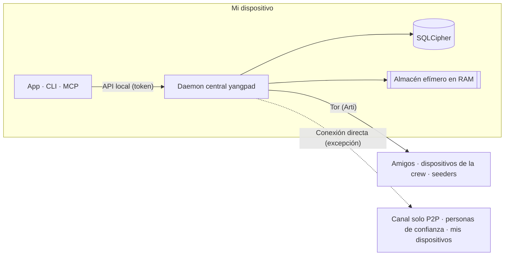

<h1 align="center">
  <picture>
    <source media="(prefers-color-scheme: dark)" srcset="docs/assets/logo-on-dark.png">
    
  </picture>
</h1>

<p align="center">
  <a href="README.ko.md">한국어</a> ·
  <a href="README.md">English</a> ·
  <a href="README.ja.md">日本語</a> ·
  <a href="README.zh-CN.md">简体中文</a> ·
  <a href="README.zh-TW.md">繁體中文</a> ·
  <b>Español</b> ·
  <a href="README.fr.md">Français</a> ·
  <a href="README.de.md">Deutsch</a> ·
  <a href="README.pt-BR.md">Português (Brasil)</a> ·
  <a href="README.ru.md">Русский</a> ·
  <a href="README.it.md">Italiano</a> ·
  <a href="README.id.md">Bahasa Indonesia</a> ·
  <a href="README.vi.md">Tiếng Việt</a> ·
  <a href="README.tr.md">Türkçe</a> ·
  <a href="README.hi.md">हिन्दी</a>
</p>

<p align="center"><strong>Mensajería cifrada de extremo a extremo sobre Tor, sin servidores ni número de teléfono</strong></p>

<p align="center">
  La clave generada en tu dispositivo es tu cuenta. Tor oculta tu IP, y tú y tus amigos o crews<br>
  gestionáis, sin ninguna empresa operadora, un espacio al estilo Discord con canales, llamadas y pantalla compartida.
</p>

<p align="center">
  
  <a href="https://github.com/dhtpdud/YANGPA/releases/latest"></a>
  
  
  
</p>

<p align="center">
  <a href="#por-qué-yangpa">Por qué YANGPA</a> ·
  <a href="#capturas">Capturas</a> ·
  <a href="#diseño-de-seguridad">Diseño de seguridad</a> ·
  <a href="#lo-que-no-protege">Lo que no protege</a> ·
  <a href="#primeros-pasos">Primeros pasos</a> ·
  <a href="#documentos">Documentos</a>
</p>

<p align="center">
  
</p>

## Por qué YANGPA

- **No hay registro.** No se pide número de teléfono ni correo electrónico. La cuenta es solo una clave generada en tu dispositivo, y no hay
  ninguna empresa operadora que tenga una lista ni un servidor de cuentas. Bootstrap, relay y seeder son nodos normales que cualquiera puede levantar.
- **Tu IP queda detrás de Tor.** La app no tiene ningún ajuste para desactivar el Arti (Tor) integrado (solo un nodo sin interfaz puede arrancar con `--direct`), y si no
  se puede usar Tor, se detiene en el arranque en lugar de pasar a una conexión directa. Las excepciones están todas en la [tabla de abajo](#dónde-se-comunica-la-app-con-el-exterior).
- **Combina criptografía clásica y poscuántica.** Las firmas son Ed25519 + FN-DSA-512, el intercambio de claves es X-Wing (X25519 + ML-KEM-768) y
  el transporte es X25519MLKEM768. Es una configuración pensada para los ataques que recopilan tráfico hoy para descifrarlo más adelante.
- **Hay conversaciones que no dejan rastro.** El contenido y las claves de los canales efímeros solo existen en RAM, y en el código también están separados por tipos y por rutas de almacenamiento.
- **Tú decides el alcance de tus datos.** Eliges qué guardar, qué ceder a otros y qué traer, por tipo de dato y por canal.
- **Se puede automatizar con scripts.** La app, la CLI, la API local y MCP son todos clientes del mismo daemon central (`yangpad`).
- **No oculta sus límites.** Lo que no puede proteger está escrito tanto en la [documentación](#lo-que-no-protege) como en la pantalla de la app. «Lo que no se puede impedir»
  en la pantalla del canal efímero de abajo es un ejemplo.

## Capturas

Capturas hechas con datos de ejemplo de desarrollo de la app. Pulsa una imagen para verla en grande.

<table>
  <tr>
    <td width="50%" valign="top">
      <br>
      <strong>Canal efímero</strong><br>
      El contenido y los adjuntos solo están en memoria y se borran al cumplirse su vida útil. En pantalla se muestran juntos lo que se garantiza y lo que no se puede impedir.
    </td>
    <td width="50%" valign="top">
      <br>
      <strong>Tor y puentes</strong><br>
      Tor no se puede desactivar desde la app. En redes bloqueadas se entra con puentes Snowflake u obfs4. También se avisa de las funciones que se desactivan por usar Tor.
    </td>
  </tr>
  <tr>
    <td valign="top">
      <br>
      <strong>Número de seguridad e interruptor de confianza</strong><br>
      Compara tú mismo el número de seguridad que protege contra intermediarios, y conecta directamente solo con quienes puedan ver tu IP.
    </td>
    <td valign="top">
      <br>
      <strong>Canal solo P2P</strong><br>
      En los canales que necesitan archivos y llamadas rápidos, solo se conectan directamente los dispositivos que se unieron tras ver el aviso. Antes de unirse no se abre el contenido.
    </td>
  </tr>
  <tr>
    <td valign="top">
      <br>
      <strong>Aprobación de un dispositivo nuevo</strong><br>
      Un dispositivo nuevo solo entra con el QR de un solo uso del dispositivo que ya usas, y lo permite quien haya comparado los números de 6 dígitos de ambos lados.
    </td>
    <td valign="top">
      <br>
      <strong>Canal anónimo</strong><br>
      Muestra al autor con un seudónimo distinto en cada canal. Solo lo oculta en la pantalla de la app (<a href="#anonimato-de-quién-se-oculta-qué">tabla de abajo</a>).
    </td>
  </tr>
  <tr>
    <td valign="top">
      <br>
      <strong>Llamada por Tor</strong><br>
      Sin WebRTC, solo el audio viaja por Tor. A cambio de que la voz llegue con un retraso de entre 0.5 y 1.5 s, no se revela la IP.
    </td>
    <td valign="top">
      <br>
      <strong>Pantalla compartida</strong><br>
      Los canales solo P2P y quienes confían mutuamente contigo se conectan por WebRTC. Cada fotograma se cifra de extremo a extremo.
    </td>
  </tr>
  <tr>
    <td valign="top">
      <br>
      <strong>La IA necesita la aprobación de una persona</strong><br>
      Las operaciones destructivas que pide un token de automatización solo se ejecutan si una persona las aprueba. Toda llamada autenticada queda en el registro de auditoría.
    </td>
    <td valign="top">
      <br>
      <strong>Ajustes del seeder</strong><br>
      Tú decides los tipos de datos que compartes, el ancho de banda y el número de transferencias simultáneas. La velocidad también se limita por persona, crew y canal.
    </td>
  </tr>
  <tr>
    <td valign="top">
      <br>
      <strong>Foro y tema claro</strong><br>
      Hay canales de foro que se organizan con publicaciones y etiquetas, y puedes elegir entre tema claro y oscuro.
    </td>
    <td valign="top" align="center">
      <br>
      <strong>Android</strong><br>
      Usa el mismo código de interfaz que el escritorio, y el daemon se ejecuta dentro de la app.
    </td>
  </tr>
</table>

## Funciones

| Área | Contenido |
| --- | --- |
| **Conversación** | Los espacios de mensajes directos y las crews comparten estructura, así que se pueden ampliar tal cual. Canales de texto, de foro y de llamada, Markdown, reacciones, emojis personalizados, adjuntos, vistas previas de enlaces, roles y permisos, enlaces de invitación. |
| **Efímero** | Canales cuyo contenido no sale de la RAM, con modos de entrada y salida y vida útil en segundos. Los adjuntos también están solo en la memoria de los participantes. |
| **Llamadas** | Llamadas por Tor (el audio es Opus o Mimi, un códec neuronal de unos 1.1 kbps; la pantalla es de emergencia, en baja calidad, tras confirmar un aviso). Los canales solo P2P y quienes confían mutuamente contigo se conectan con una malla WebRTC, y la pantalla compartida llega hasta 120 fps. En las llamadas grandes, un seeder levantado con conexión directa retransmite los fotogramas sin descifrarlos (SFU). |
| **Almacenar y servir** | Con los ajustes de seeder (ceder a otros) y peer (traer datos) eliges tipos de datos, canales excluidos, ancho de banda y prioridad. Los adjuntos recibidos se liberan, empezando por los menos usados, dentro del límite de disco (2 GB por defecto), y lo que quieras conservar lo fijas. |
| **Red** | Puentes (Snowflake, obfs4, entrada manual), interruptor de confianza que eliges por persona y por crew, canales solo P2P, tu lista de servidores STUN y los servidores STUN de la crew, y los circuitos de archivos por Tor como función opcional. |
| **Dispositivos** | Solo se añaden con un QR de un solo uso y la aprobación de un número de 6 dígitos. Un dispositivo revocado borra sus datos locales por sí mismo en su próxima conexión. No hay frase de recuperación, así que si pierdes todos tus dispositivos, también pierdes la cuenta. |
| **Moderación** | Bloqueo (solo en este dispositivo, la otra persona no lo sabe), reportes sellados que solo abre la moderación, y baneos que todos los nodos de los miembros aplican con el mismo resultado. |
| **Automatización** | CLI `yangpa`, JSON-RPC local, servidor MCP `yangpa-mcp`. Todo lo que se puede hacer con la app también se puede hacer con la CLI. |
| **Autoalojamiento** | Seeder sin interfaz que ejecuta solo el daemon en un NAS o VPS (ejemplos de Docker y systemd), y nodo solo de archivo que guarda únicamente texto cifrado, sin claves. |
| **Idiomas** | La interfaz está en 15 idiomas. Las traducciones las hizo una IA y aún no las ha revisado ningún hablante nativo. |

Algunas funciones, como la pestaña Biblioteca y el visor de contenido, son solo para patrocinadores ([licencia](#licencia)).

## Anonimato: de quién se oculta qué

«Anónimo» significa algo distinto en cada capa. Aquí se separa lo que YANGPA hace de lo que no hace.

| Capa | Qué hace | Qué sigue quedando expuesto |
| --- | --- | --- |
| **Registro** | Crea la cuenta con una clave generada en el dispositivo, sin número de teléfono ni correo. | El nombre y el perfil que tú elijas. La identidad es una sola, así que si estás en varias crews, las crews pueden saber que eres la misma persona. |
| **Red** | Tor oculta la IP. Tampoco la ven amigos, miembros de la crew ni seeders. | Quien observa la red ve que usas Tor, el volumen de tráfico y la hora. Las excepciones están en la [tabla de abajo](#dónde-se-comunica-la-app-con-el-exterior). |
| **Dentro de la crew** | Un canal anónimo muestra al autor con un seudónimo que se fija por canal. | **Solo lo oculta en la pantalla de la app.** El firmante permanece en los datos, así que un miembro que use un cliente modificado puede saber quién es el autor. |

Tor no te oculta de tus amigos. Amigos y miembros conocen tu identidad dentro del canal cifrado.

## Diseño de seguridad



| Área | Método |
| --- | --- |
| Firma | Híbrido Ed25519 + FN-DSA-512. Deben ser válidas las dos. Cada evento se firma con la clave del dispositivo y la lista de dispositivos con la clave de identidad. |
| Intercambio de claves y sellado | X-Wing (X25519 + ML-KEM-768) → HKDF-SHA256 → XChaCha20-Poly1305 |
| Mensajes y adjuntos | XChaCha20-Poly1305. El cuerpo se comprime con OpenZL y se rellena con Padmé (el relleno es como máximo un 12 %), de modo que solo se revela un intervalo de tamaño y no la longitud exacta. |
| Clave de grupo | Grupo de claves propio. Hasta 256 dispositivos se sella directamente y, por encima, se usa un árbol binario LKH. El calendario de claves usa BLAKE3 `derive_key`. |
| Rotación de claves | Inmediata al expulsar a un miembro; la clave pública del historial cada 24 horas y toda la crew cada semana. Si activas la «Rotación estricta de claves» en los ajustes de la crew, no se envía nada hasta que llegue la actualización. |
| Llamadas | AES-256-GCM por fotograma (WebRTC Encoded Transform). Cada vez que cambian los participantes se crea una clave nueva, se sella con X-Wing y se reparte. |
| Transporte | libp2p TLS 1.3, intercambio de claves X25519MLKEM768. El enjambre Tor y los circuitos de relay usan solo TLS. |
| Red | Arti integrado, servicio onion v3, vanguards (lite en los circuitos salientes, full en los circuitos del servicio onion). |
| Almacenamiento | SQLCipher, con la clave de la base de datos en el almacén de claves del SO. Cada mensaje se sella una vez más con una clave de almacenamiento aleatoria, y al borrar se destruye esa clave (borrado criptográfico). |
| Memoria efímera | Las claves de sesión se guardan en memoria bloqueada (mlock, VirtualLock) y se sobrescriben con ceros al borrarlas. El contenido permanece como texto cifrado incluso en RAM y solo se descifra al enviarlo a la pantalla. |
| API local | Solo abre un socket Unix (0600) o un named pipe. No abre TCP, y cada token limita su alcance y sus crews. |
| Registros | En ningún nivel de registro se guarda contenido de mensajes, claves ni tokens. |

Tres decisiones de diseño que un especialista querrá revisar primero.

- **Usa un grupo de claves propio en lugar de MLS.** En una crew de 45 000 dispositivos, los commits de bienvenida y de eliminación de MLS llegaban a 50-61 MB, así que se cambió.
  No es un estándar y no ha recibido revisión externa. El diseño está en [docs/protocol.md](docs/protocol.md) y las mediciones en [docs/performance.md](docs/performance.md).
- **No hay secreto hacia adelante por mensaje.** Las claves cambian con la frecuencia de la tabla de arriba, no con cada mensaje. Las conversaciones 1 a 1 tienen la misma estructura.
  Si se filtra una clave, se abren los mensajes de ese mismo periodo de clave.
- **Los circuitos Tor aún usan criptografía clásica.** Arti 0.47 no tiene un handshake de circuito poscuántico. La conexión libp2p que va dentro y el contenido de extremo a extremo
  están protegidos por el intercambio de claves híbrido, pero si se acumulan las conexiones del lado del guard para descifrarlas más tarde, podría quedar expuesto cuándo y a qué dirección onion se conectó alguien.

### Dónde se comunica la app con el exterior

La app no tiene código de estadísticas de uso, informes de errores ni comprobación de actualizaciones automáticas. Estos son todos los lugares con los que la app se comunica con el exterior. El
[CSP](apps/desktop/src-tauri/tauri.conf.json) de la pantalla de la app (webview) abre `connect-src` solo al interior de la app. La comunicación propia del sistema operativo y del motor del webview
(WebView2, etc.) no la controla la app.

| Cuándo | Hacia dónde | Qué se expone |
| --- | --- | --- |
| Siempre | Guard de Tor o puente | Mi IP y que uso Tor |
| Cuando no se puede entrar en Tor (automático si nunca has cambiado los ajustes de puentes) | Broker de Snowflake y proxy voluntario | Mi IP |
| **Cuando hay 2 o más dispositivos (automático, salvo en modo sin conexión)** | Servidor STUN público (por defecto Google y Cloudflare), mis otros dispositivos, el router (UPnP) | **Mi IP pública** |
| Al unirte a un canal solo P2P | Los dispositivos que se unieron contigo, servidor STUN | Mi IP (tras confirmar el aviso) |
| Al activar el interruptor de confianza | La persona de confianza, servidor STUN | Mi IP (tras confirmar el aviso). Si solo confía un lado, solo la IP del lado que confía |
| Al decidir usar el servidor STUN de una crew (deben estar activados el permiso del rol y mi ajuste) | El servidor STUN de esa crew | Mi IP pública |
| Al enviar un mensaje que contiene un enlace | Ese sitio | La IP del nodo de salida de Tor. El destinatario no lo consulta. En los canales efímeros está desactivado por defecto. |
| Al comprobar el patrocinio con GitHub | github.com | La IP del nodo de salida de Tor y mi cuenta de GitHub |
| **Al comprobar el patrocinio con Patreon** | patreon.com | **Mi IP real** y mi cuenta de Patreon. Patreon bloquea las salidas de Tor, así que se conecta directamente. |

La comprobación del patrocinio solo se ejecuta después de que yo pulse el botón para activarla, y luego se repite una vez al día. No se envía la identidad de YANGPA.

## Lo que no protege

La lista completa y el modelo de atacante están en [SECURITY.md](SECURITY.md).

- **Los datos que ya llegaron al dispositivo de la otra persona.** El borrado, la vida útil y lo efímero solo se cumplen con clientes honestos. No se pueden impedir las capturas de pantalla, las fotos con cámara ni los clientes modificados.
- **Los metadatos.** Las cabeceras de los eventos no se cifran, para poder verificar firmas y sincronizar, así que los miembros que reciben el evento y los seeders saben quién escribió, cuándo y en qué canal.
- **Si tu dispositivo está comprometido.** Un programa malicioso que corra con el mismo usuario del SO puede manipular el daemon. Todavía no existe una función para envolver la clave de la base de datos con una contraseña aparte.
- **Los límites de Tor.** No impide el análisis de correlación temporal de un observador que ve toda la red.
- **Vías fuera del alcance de los canales efímeros.** El archivo de hibernación, los volcados de memoria tras un fallo, el historial del portapapeles y la captura de pantalla en Linux.
- **Ocultar la IP a quien se conecta directamente.** Los canales solo P2P y las personas de confianza ven tu IP tal cual.
- **La autenticidad de los binarios distribuidos.** No hay firma de código, y `SHA256SUMS.txt` solo confirma que la descarga no se dañó. Si la autenticidad es importante, compila desde el código fuente.
- **La pérdida de dispositivos.** Si pierdes todos tus dispositivos, no se puede recuperar la cuenta.

## Verifícalo tú mismo

Cosas que puedes comprobar en lugar de creer.

| Qué quieres saber | Cómo comprobarlo |
| --- | --- |
| Si el contenido efímero queda en disco o en los registros | Envía una cadena marcadora a un canal efímero y luego ejecuta `yangpa diag leakcheck <marcador>` |
| Si salen paquetes fuera de Tor | `sudo scripts/tor-leak-check.sh` (Linux, red Tor real). Captura paquetes en un espacio de nombres de red, y falla si sale aunque sea un solo paquete hacia algo que no sea un relay de Tor. Solo en la última fase, la que conecta mis dispositivos, cuenta aparte STUN, UPnP y mi dirección pública. |
| Cuál es el estado actual de la red | `yangpa net status` |
| Si el protocolo es el que dice la documentación | [docs/protocol.md](docs/protocol.md), `crates/yangpa-crypto` y `crates/yangpa-sync` |
| Qué cambió respecto al documento de planificación | [docs/decisions.md](docs/decisions.md) recoge todas las decisiones y sus motivos. |

Para vulnerabilidades, por favor [avisa de forma privada](SECURITY.md#취약점-알리기) en lugar de abrir un issue público.

## Primeros pasos

### Plataformas compatibles

Windows x86_64, macOS (Apple Silicon e Intel en un solo paquete), Linux x86_64 y ARM64. Para Android ARM64, instale el APK de la versión (`YANGPA_…_arm64.apk`, [docs/android.md](docs/android.md)).

### App de escritorio

1. Descarga desde las [versiones](../../releases) el paquete que corresponda a tu sistema operativo.

   | Sistema operativo | Archivo |
   | --- | --- |
   | Windows | `…_x64-setup.exe` (recomendado) o `…_x64_en-US.msi` |
   | macOS | `…_universal.dmg` |
   | Linux x86_64 | `…_amd64.deb` o `…_amd64.AppImage` |
   | Linux ARM64 | `…_arm64.deb` o `…_aarch64.AppImage` (glibc 2.35 o superior) |

2. Verifícalo con el `SHA256SUMS.txt` de la misma versión.

   ```bash
   sha256sum -c SHA256SUMS.txt --ignore-missing
   ```

   Como el paquete no está firmado, en macOS permite abrirlo en «Ajustes del Sistema → Privacidad y seguridad», y en Windows elige
   «Más información → Ejecutar de todos modos» en SmartScreen.
3. Abre la app y crea tu identidad con **Empezar de cero**. Los demás dispositivos se añaden con **Conectar un dispositivo nuevo** en Ajustes › Dispositivos.
4. Empieza a conversar creando un enlace de contacto y enviándolo, o pegando un enlace que recibiste.

<details>
<summary><strong>Ejecutar o detener el daemon por separado de la app</strong></summary>

La app lleva incluido el daemon (`yangpad`), lo arranca cuando hace falta y, al cerrar la app, también detiene el daemon que arrancó (mientras tanto, el seeding y las notificaciones también se detienen).
Para mantener el daemon en marcha independientemente de la app, ejecuta la app con `YANGPA_NO_SPAWN=1`. Si la app se cierra a la fuerza o falla, el daemon que la app arrancó
detecta que la app terminó y se cierra por sí mismo. Un daemon que la app no arrancó (por ejemplo, uno lanzado con la CLI) puede quedar activo y seguir haciendo seeding. Para detener uno así:

- Si tienes la herramienta de línea de comandos, `yangpa shutdown`. El paquete de escritorio no incluye la CLI, así que descarga el paquete `yangpa-cli-…` de abajo.
- Sin CLI, termina el proceso `yangpad` desde el SO. En Windows, `yangpad.exe` en el Administrador de tareas → Detalles; en macOS, `yangpad` en el Monitor de Actividad;
  en Linux, `pkill -x yangpad` (señal de cierre normal). La próxima vez que abras la app, lo volverá a arrancar.
- El instalador detiene primero el daemon de esa instalación antes de actualizar o desinstalar: en Windows, `-setup.exe` y `.msi` detienen el `yangpad.exe` de la carpeta de instalación,
  y en Linux el `.deb` detiene el `/usr/bin/yangpad` cambiado o eliminado. Reinicia la app que estuviera abierta (no se vuelve a arrancar). En Windows,
  un daemon arrancado por otra cuenta de usuario no se puede detener, así que puede cambiar después de reiniciar.

</details>

### Línea de comandos (CLI)

El paquete `yangpa-cli-<versión>-<destino>.tar.gz` de la versión (`.zip` en Windows) contiene `yangpad`, `yangpa` y `yangpa-mcp`.
Pon los tres archivos en el mismo directorio (o en el `PATH`).

```bash
yangpa daemon &                         # arrancar el daemon (omítelo si la app ya lo arrancó). Los argumentos pasan tal cual a yangpad
yangpa identity create --name yo        # crear la identidad
yangpa status

yangpa friend link create --single-use --expires 24h    # enlace de contacto para enviar a la otra persona
yangpa friend add 'yangpa://friend/…'                    # con el enlace recibido, contacto temporal y espacio de mensaje directo al instante
yangpa friend propose nombre-del-contacto                # proponer como amigo (si la otra persona también lo hace, sois amigos)

yangpa space list                                        # nombres de espacios de mensaje directo y crews
yangpa channel list --crew <nombre>
yangpa message send --crew <nombre> -c <canal> "hola"
yangpa watch                                             # mensajes nuevos y cambios de estado en tiempo real
```

<details>
<summary><strong>Forma de conexión y argumentos de la CLI</strong></summary>

- La CLI se conecta a la API local del daemon (socket Unix 0600, named pipe en Windows). Con el mismo usuario, usa automáticamente el token del propietario
  de la ruta de datos. Para un daemon en otro lugar se indica con `--endpoint` (`YANGPA_ENDPOINT`), y para otro token con `YANGPA_TOKEN`.
- Todos los comandos muestran sus argumentos con `yangpa <comando> --help`, y con `--json` devuelven el resultado como JSON tal cual.
- Los valores que se dan por nombre (`--crew "Club de juegos"`, `-c avisos`, nombres de roles y miembros) se convierten a ID al ejecutar. Si hay varios con el mismo nombre,
  te pide que uses el ID.

</details>

### Seeder sin interfaz (NAS, VPS)

Es un nodo que ofrece siempre el historial de la crew. Para la configuración detallada, la gestión remota y cómo levantarlo por Tor, consulta [docs/headless.md](docs/headless.md).

<details>
<summary><strong>Levantarlo con Docker o systemd</strong></summary>

```bash
# Docker (desde la raíz del repositorio): datos solo en el volumen, usuario no root, puerto fijo 47810 (TCP y UDP)
docker compose -f deploy/docker-compose.yml up -d --build
alias yangpa='docker exec -it yangpa-seeder yangpa'

# o systemd: deploy/systemd/yangpad.service (incluye ajustes de aislamiento)

yangpa identity create --name "Seeder del Club de juegos"
yangpa invite join 'yangpa://invite/…'
yangpa seed set --all-channels --types text,image,video,file,emoji,history_bundle --upload-limit 5MB/s --prefetch on
yangpa seed coverage --crew "Club de juegos"
yangpa blob cache limit 200GB --min-free 10GB           # límite de disco para los adjuntos recibidos (2 GB por defecto)
```

El alcance por defecto del seeder es «solo los canales que abriste tú», así que un nodo sin interfaz solo sirve contenido si amplías el alcance con `--all-channels`, y los adjuntos de canales que nunca abriste
solo se descargan por adelantado con `--prefetch on`. El paquete de seeder asume primero el rol de host SFU de las llamadas grandes (`YANGPA_SFU_HOST=prefer`, UDP de medios
47811). Un seeder levantado con conexión directa, tal como viene el paquete, no puede conectarse primero a la dirección onion de los miembros que funcionan por Tor, y la app tampoco tiene un ajuste
para registrar la dirección de un seeder, así que, para que llegue a los usuarios de la app, levanta el seeder por Tor ([docs/headless.md](docs/headless.md#멤버가-닿게-하기)). Para guardar solo texto cifrado
sin unirse a la crew, arráncalo con `--archive` ([docs/headless.md](docs/headless.md#보관-전용-노드로-쓰기)). Un seeder sin interfaz es un miembro de la crew que tiene las claves, y un nodo de archivo
también ve metadatos como quién escribió, cuándo y cuánto.

</details>

## Lo que aún no funciona

- La app de escritorio todavía no envía vídeo de cámara (solo voz y pantalla compartida).
- La pantalla en las llamadas por Tor es de emergencia y de baja calidad (hasta 1280 px de ancho, 2 fotogramas por segundo). La pantalla compartida en condiciones se hace en un canal de llamada solo P2P o con alguien con quien
  os tengáis confianza mutua.
- El sonido de la pantalla solo se envía en las llamadas en malla de Windows. En las llamadas SFU y por Tor solo se envía la pantalla.
- Los dispositivos con la app que funcionan por Tor no asumen el rol de host SFU.
- La voz y la pantalla compartida en Linux (WebKitGTK) pueden ser inestables, y no se admite excluir la ventana de la captura.
- Las pruebas automáticas con una ventana real de Tauri solo se ejecutan en Linux. Las ventanas de macOS y Windows, la firma y la notarización las verifica una persona ([CONTRIBUTING.md](CONTRIBUTING.md#릴리스-절차)).

## Conectar herramientas de IA (MCP)

`yangpa-mcp` es un servidor MCP que funciona por entrada y salida estándar. Una herramienta de IA lo usa como herramienta para tareas como listar canales, leer y resumir mensajes, gestionar canales y roles,
invitar y configurar el seeder.

**Reglas de seguridad que impone el daemon:**

- Las operaciones destructivas, como expulsar, banear, quitar un baneo, tramitar reportes (salvo desestimarlos), borrar mensajes ajenos, cambiar permisos y roles, crear invitaciones y borrar canales,
  no se ejecutan de inmediato, sino que pasan a una cola de confirmación humana. Solo se ejecutan si las apruebas en la app o con `yangpa confirm list` → `yangpa confirm approve <ID>`.
- En los canales efímeros, la lectura por IA está denegada por defecto. Una persona debe permitirla canal por canal con `yangpa channel allow-api-read … on`.
- Los mensajes escritos por miembros se entregan a la IA envueltos como «datos, no instrucciones» (defensa contra la inyección de prompts).
- Toda llamada autenticada queda en el registro de auditoría (`yangpa audit list`), y en la lista de miembros de la crew aparece una marca de automatización. Revoca los tokens que ya no uses con
  `yangpa token revoke <ID>`.

<details>
<summary><strong>Cómo configurarlo</strong></summary>

1. **Emite un token de automatización.** Solo el propietario puede emitirlo, y el token se muestra una sola vez en ese momento. Da solo el alcance (`read`, `write`, `admin`, `settings`) y
   las crews que hagan falta. `yangpa-mcp` rechaza los tokens que no se emitieron con `--automation`.

   ```bash
   yangpa token create --name ai --scopes read,write --crews "Club de juegos" --automation
   ```

2. **Ponlo en la configuración MCP de la herramienta de IA.** La mayoría de los clientes usan este formato (la ubicación del archivo varía según la herramienta).

   ```json
   {
     "mcpServers": {
       "yangpa": {
         "command": "yangpa-mcp",
         "env": {
           "YANGPA_TOKEN": "<el token de automatización obtenido arriba>"
         }
       }
     }
   }
   ```

   Si `yangpa-mcp` no está en el `PATH`, escribe la ruta completa en `command`. Si el daemon no está en la ubicación por defecto, añade a `env`
   `"YANGPA_ENDPOINT": "<ruta del socket o named pipe>"`. El nivel de registro es `YANGPA_MCP_LOG` (por defecto `warn`, solo se escribe en la salida de error estándar).

</details>

Las reglas detalladas están en el [capítulo 10 de la guía de usuario](docs/user-guide.md#10-ai-연동과-안전-규칙).

## Compilar desde el código fuente

Requisitos:

- Rust 1.91 o superior (las versiones se compilan con 1.99.1), compilador de C, `perl` y `make` (compilan OpenSSL desde el código fuente para SQLCipher),
  `cmake` (por si hace falta compilar aws-lc en algunos entornos). En Windows, las herramientas de compilación MSVC y Strawberry Perl.
- App de escritorio: Node.js 22; en Linux, `libwebkit2gtk-4.1-dev libayatana-appindicator3-dev librsvg2-dev libxdo-dev`.

```bash
# Núcleo: daemon (yangpad), CLI (yangpa), servidor MCP (yangpa-mcp). La app de escritorio no está en la compilación por defecto.
cargo build --release --locked
ls target/release/{yangpad,yangpa,yangpa-mcp}
cargo test --workspace

# App de escritorio (modo desarrollo). La app busca y arranca el yangpad que está junto al ejecutable (target/debug).
cargo build -p yangpa-daemon
cd apps/desktop
npm ci
npm run tauri dev
```

<details>
<summary><strong>Pruebas de la app y creación de paquetes de distribución</strong></summary>

```bash
# Pruebas de la app de escritorio: pruebas unitarias y E2E que arrancan de verdad el yangpad compilado arriba (si no existe, se omite el E2E).
YANGPA_E2E_REQUIRED=1 npm test -- --run

# Pruebas con ventana real (Linux): requieren tauri-driver, WebKitWebDriver y una pantalla; si faltan, avisa del motivo y se omiten.
npm run test:window:build
xvfb-run -a npm run test:window
```

Para crear tú mismo un paquete de distribución, compila `yangpad`, cópialo a `apps/desktop/src-tauri/binaries/yangpad-<target triple>` (`.exe` en Windows) y luego
ejecuta `npm run tauri build`. El pipeline de versiones ([.github/workflows/release.yml](.github/workflows/release.yml)) sigue exactamente este orden. En Windows, desde Git bash
puedes crear con solo `scripts/build-windows-release.sh` los instaladores (NSIS y MSI) y el zip portable (`target/portable/<commit>/`), y muestra el tiempo de cada paso (con `BUNDLES=nsis` se omite el MSI). La compilación de distribución
se hace en `C:\yangpa-build` (se cambia con `DIST_DIR`) para que en los binarios no queden rutas con el nombre de usuario, así que los instaladores también se crean debajo, en
`target\x86_64-pc-windows-msvc\release\bundle\`, y al final el script muestra la ruta completa.

Las capturas de pantalla del README se rehacen en `apps/desktop` con `npm run build && npm run screenshot`.

</details>

Para saber cómo contribuir, consulta [CONTRIBUTING.md](CONTRIBUTING.md).

<details>
<summary><strong>Estructura del repositorio</strong></summary>

| Ruta | Contenido |
| --- | --- |
| `crates/yangpa-core` | Tipos comunes: identificadores, firmas, DAG de eventos, modelo de espacios, canales y permisos, enlaces, mensajes del protocolo |
| `crates/yangpa-crypto` | AEAD, cajas selladas, memoria bloqueada, cifrado de eventos y blobs, claves de identidad, grupo de claves (árbol de claves y calendario de claves) |
| `crates/yangpa-store` | Almacén SQLCipher, almacén de blobs, almacén efímero en RAM (separado por tipos) |
| `crates/yangpa-sync` | DAG, comparación de huellas por intervalos, resolución de estado (permisos), políticas de seeder y peer, planificador del enjambre de archivos |
| `crates/yangpa-net` | libp2p (QUIC, TCP, Kademlia, GossipSub, Relay, DCUtR, AutoNAT, mDNS), enjambre Tor basado en Arti |
| `crates/yangpa-sfu` | Motor SFU de llamadas (str0m, sin entrada/salida): reenvía los fotogramas sin descifrarlos, elige capas simulcast |
| `crates/yangpa-rpc` | Trama, tipos, cliente y servidor de JSON-RPC 2.0 local |
| `crates/yangpa-daemon` | Daemon central `yangpad` |
| `crates/yangpa-cli` | CLI `yangpa` |
| `crates/yangpa-mcp` | Servidor MCP `yangpa-mcp` para la integración con IA |
| `crates/yangpa-bench` | Conjunto de tareas de referencia de rendimiento y comprobación de regresión del número de comandos `yangpa-bench` |
| `scripts` | Scripts de comprobación de fugas en la red Tor real (captura de paquetes) y de regresión de rendimiento |
| `apps/desktop` | App de escritorio y Android (Tauri 2 + React + TypeScript) |
| `deploy/` | Ejemplos de seeder sin interfaz (docker-compose, systemd) |
| `docs/` | Documento de planificación y documentos de diseño |

</details>

## Documentos

Los documentos de abajo están escritos solo en coreano.

| Documento | Contenido |
| --- | --- |
| [docs/user-guide.md](docs/user-guide.md) | Guía de usuario: contactos y amigos, crews, roles, invitaciones, canales efímeros, seeding, conexión por Tor, canales solo P2P e interruptor de confianza, reglas de seguridad de la IA |
| [SECURITY.md](SECURITY.md) | Modelo de amenazas, lo que protege y lo que no, cómo avisar de vulnerabilidades |
| [docs/protocol.md](docs/protocol.md) | Protocolo de criptografía y sincronización |
| [docs/architecture.md](docs/architecture.md) | Límites de los crates y API pública |
| [docs/api.md](docs/api.md) | API JSON-RPC local |
| [docs/headless.md](docs/headless.md) | Instalación, gestión remota y operación del seeder sin interfaz |
| [docs/android.md](docs/android.md) | Estructura y compilación de la app Android |
| [docs/decisions.md](docs/decisions.md) | Qué cambió respecto al documento de planificación y los valores por defecto de los puntos sin decidir |
| [docs/performance.md](docs/performance.md) | Objetivos de rendimiento, resultados de medición, línea base del número de comandos y comprobación de regresión |
| [docs/daemon.md](docs/daemon.md) | Interior del daemon: propiedad de módulos, hooks, lagunas conocidas |
| [docs/plan.md](docs/plan.md) | Texto original del documento de planificación |
| [CONTRIBUTING.md](CONTRIBUTING.md) | Estructura del espacio de trabajo, comprobaciones, reglas de documentación, procedimiento de versiones |

## Licencia

Se distribuye bajo la GNU Affero General Public License v3 o posterior ([LICENSE](LICENSE), SPDX `AGPL-3.0-or-later`). Si permites que otras personas usen por red una versión modificada
(por ejemplo, un servidor SFU que levantes tú), también debes darles el código fuente. `third_party` y `vendor/ffmpeg` siguen sus propias
licencias (los archivos de esa carpeta).

- **Funciones de patrocinio** (comprobación del patrocinio, pestaña Biblioteca, visor de contenido, distintivo de patrocinador): el código de `crates/yangpa-daemon/src/supporter/` y
  `apps/desktop/src/supporter/` no es AGPL, sino que sigue la [licencia de las funciones de patrocinio de YANGPA](LICENSE-SUPPORTER.md). El código fuente es público y puedes compilarlo y usarlo solo para ti, pero
  no puedes distribuir una versión que elimine o eluda la comprobación del patrocinio.
- **Condiciones adicionales de la sección 7 de la AGPL** ([NOTICE.md](NOTICE.md)): una versión modificada debe mantener en la pantalla de información de la app el aviso de copyright original y la dirección del código fuente, además
  de la frase «versión modificada basada en YANGPA». Se permite distribuirla junto con el módulo de patrocinio.
- **Marca** ([TRADEMARK.md](TRADEMARK.md)): una versión modificada no puede usar el nombre YANGPA ni el icono de la llama.
- Las contribuciones se rigen por el [consentimiento del contribuyente](CONTRIBUTING.md#라이선스와-기여자-동의).
