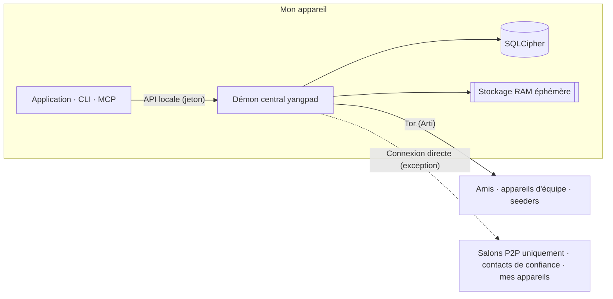

<h1 align="center">
  <picture>
    <source media="(prefers-color-scheme: dark)" srcset="docs/assets/logo-on-dark.png">
    
  </picture>
</h1>

<p align="center">
  <a href="README.ko.md">한국어</a> ·
  <a href="README.md">English</a> ·
  <a href="README.ja.md">日本語</a> ·
  <a href="README.zh-CN.md">简体中文</a> ·
  <a href="README.zh-TW.md">繁體中文</a> ·
  <a href="README.es.md">Español</a> ·
  <b>Français</b> ·
  <a href="README.de.md">Deutsch</a> ·
  <a href="README.pt-BR.md">Português (Brasil)</a> ·
  <a href="README.ru.md">Русский</a> ·
  <a href="README.it.md">Italiano</a> ·
  <a href="README.id.md">Bahasa Indonesia</a> ·
  <a href="README.vi.md">Tiếng Việt</a> ·
  <a href="README.tr.md">Türkçe</a> ·
  <a href="README.hi.md">हिन्दी</a>
</p>

<p align="center"><strong>Une messagerie chiffrée de bout en bout sur Tor, sans serveur ni numéro de téléphone</strong></p>

<p align="center">
  La clé créée sur votre appareil est votre compte. Votre IP est masquée par Tor, et vos amis et équipes font tourner<br>
  sans opérateur un espace de type Discord, avec salons, appels et partage d'écran.
</p>

<p align="center">
  
  <a href="https://github.com/dhtpdud/YANGPA/releases/latest"></a>
  
  
  
</p>

<p align="center">
  <a href="#pourquoi-yangpa">Pourquoi YANGPA</a> ·
  <a href="#captures-décran">Captures d'écran</a> ·
  <a href="#conception-de-la-sécurité">Conception de la sécurité</a> ·
  <a href="#ce-que-yangpa-ne-protège-pas">Ce que YANGPA ne protège pas</a> ·
  <a href="#premiers-pas">Premiers pas</a> ·
  <a href="#documentation">Documentation</a>
</p>

<p align="center">
  
</p>

## Pourquoi YANGPA

- **Pas d'inscription.** Ni numéro de téléphone ni e-mail. Votre compte n'est qu'une clé créée sur votre appareil, et il n'existe ni
  opérateur détenant un annuaire ni serveur de comptes. Les nœuds d'amorçage, les relais et même les seeders sont des nœuds ordinaires que
  tout le monde peut lancer.
- **Votre IP reste derrière Tor.** L'application n'a aucun réglage pour désactiver l'Arti (Tor) intégré (seuls les nœuds sans interface
  peuvent être lancés avec `--direct`), et si Tor est inutilisable, elle cesse de démarrer au lieu de basculer en connexion directe. Les
  exceptions sont toutes listées dans le [tableau ci-dessous](#où-lapplication-communique-avec-lextérieur).
- **Cryptographie classique et post-quantique combinées.** Signatures Ed25519 + FN-DSA-512, échange de clés X-Wing (X25519 + ML-KEM-768),
  transport X25519MLKEM768. Cette configuration vise les attaques qui collectent le trafic aujourd'hui pour le déchiffrer plus tard.
- **Des conversations qui ne laissent pas de traces.** Le contenu et les clés d'un salon éphémère ne vivent qu'en RAM, et le code sépare
  aussi les chemins de stockage par le typage.
- **Vous décidez de la portée de vos données.** Vous choisissez, par type de données et par salon, ce que vous stockez, ce que vous
  donnez aux autres et ce que vous récupérez.
- **Tout est scriptable.** L'application, la CLI, l'API locale et MCP sont tous des clients du même démon central (`yangpad`).
- **Les limites ne sont pas cachées.** Ce que YANGPA ne peut pas protéger est écrit dans la [documentation](#ce-que-yangpa-ne-protège-pas)
  comme à l'écran de l'application. Le « Ce qui ne peut pas être empêché » de la capture du salon éphémère ci-dessous en est un exemple.

## Captures d'écran

Captures réalisées avec les données d'exemple de développement de l'application. Cliquez sur une image pour l'agrandir.

<table>
  <tr>
    <td width="50%" valign="top">
      <br>
      <strong>Salon éphémère</strong><br>
      Contenu et pièces jointes ne vivent qu'en mémoire et sont effacés à la fin de leur durée de vie. Ce qui est garanti et ce qui ne peut pas être empêché sont affichés ensemble à l'écran.
    </td>
    <td width="50%" valign="top">
      <br>
      <strong>Tor et ponts</strong><br>
      Tor ne peut pas être désactivé dans l'application. Sur un réseau bloqué, on entre par les ponts Snowflake ou obfs4. Les fonctions désactivées à cause de Tor sont signalées telles quelles.
    </td>
  </tr>
  <tr>
    <td valign="top">
      <br>
      <strong>Numéro de sécurité et commutateur de confiance</strong><br>
      Vous comparez vous-même le numéro de sécurité contre l'homme du milieu, et ne vous connectez en direct qu'aux personnes à qui vous acceptez de montrer votre IP.
    </td>
    <td valign="top">
      <br>
      <strong>Salon P2P uniquement</strong><br>
      Pour un salon qui exige fichiers et appels rapides, seuls les appareils qui ont rejoint après l'avertissement se connectent directement. Le contenu reste fermé avant l'adhésion.
    </td>
  </tr>
  <tr>
    <td valign="top">
      <br>
      <strong>Approbation d'un nouvel appareil</strong><br>
      Un nouvel appareil n'entre qu'avec le QR à usage unique d'un appareil déjà en service, et la personne qui a comparé les codes à 6 chiffres des deux côtés autorise.
    </td>
    <td valign="top">
      <br>
      <strong>Salon anonyme</strong><br>
      L'auteur est affiché sous un pseudonyme propre au salon. Cela ne masque l'identité qu'à l'écran de l'application (<a href="#anonymat-de-qui-et-de-quoi">tableau ci-dessous</a>).
    </td>
  </tr>
  <tr>
    <td valign="top">
      <br>
      <strong>Appel Tor</strong><br>
      Sans WebRTC, seul le son passe par Tor. La parole a environ 0,5 à 1,5 s de retard, mais votre IP n'est pas exposée.
    </td>
    <td valign="top">
      <br>
      <strong>Partage d'écran</strong><br>
      Les salons P2P uniquement et les contacts qui se font mutuellement confiance se connectent en WebRTC. Chaque image est chiffrée de bout en bout.
    </td>
  </tr>
  <tr>
    <td valign="top">
      <br>
      <strong>L'IA a besoin de l'accord d'un humain</strong><br>
      Les actions destructrices demandées par un jeton d'automatisation ne s'exécutent qu'après approbation d'un humain. Tous les appels authentifiés sont consignés dans le journal d'audit.
    </td>
    <td valign="top">
      <br>
      <strong>Paramètres du seeder</strong><br>
      Vous décidez des types de données à partager, de la bande passante et du nombre de transferts simultanés. Le débit peut aussi être limité par personne, par équipe et par salon.
    </td>
  </tr>
  <tr>
    <td valign="top">
      <br>
      <strong>Forum et thème clair</strong><br>
      Il existe des salons forum organisés par publications et étiquettes, et vous choisissez entre un thème clair et un thème sombre.
    </td>
    <td valign="top" align="center">
      <br>
      <strong>Android</strong><br>
      Le même code d'interface que sur ordinateur, avec le démon qui tourne dans l'application.
    </td>
  </tr>
</table>

## Fonctionnalités

| Domaine | Contenu |
| --- | --- |
| **Conversation** | Les espaces 1 à 1 et les équipes ont la même structure, ce qui permet de les étendre tels quels. Salons textuels, forum et appel, Markdown, réactions, emojis personnalisés, pièces jointes, aperçus de liens, rôles et permissions, liens d'invitation. |
| **Éphémère** | Des salons dont le contenu ne quitte jamais la RAM, avec modes d'entrée et de sortie et durée de vie à la seconde. Les pièces jointes ne sont, elles aussi, que dans la mémoire des participants. |
| **Appels** | Appel Tor (audio en Opus ou avec Mimi, un codec neuronal d'environ 1,1 kbps ; vidéo en basse qualité de secours après confirmation de l'avertissement). Les salons P2P uniquement et les contacts qui se font mutuellement confiance sont reliés en maillage WebRTC, avec un partage d'écran jusqu'à 120 fps. Pour les gros appels, un seeder lancé en connexion directe relaie les images sans les déchiffrer (SFU). |
| **Stockage et partage** | Les réglages seeder (donner aux autres) et pair (récupérer) permettent de choisir types de données, salons exclus, bande passante et priorité. Les pièces jointes reçues sont purgées des moins récemment utilisées vers les plus récentes dans la limite de disque (2 Go par défaut), et celles à garder sont épinglées. |
| **Réseau** | Ponts (Snowflake, obfs4, saisie manuelle), commutateur de confiance réglable par personne et par équipe, salons P2P uniquement, votre liste de serveurs STUN et les serveurs STUN d'équipe, circuits Tor de fichiers en option. |
| **Appareils** | On n'en ajoute que par QR à usage unique et approbation par code à 6 chiffres. Un appareil révoqué efface lui-même ses données locales à sa prochaine connexion. Il n'y a pas de phrase de récupération : si vous perdez tous vos appareils, le compte disparaît aussi. |
| **Modération** | Blocage (cet appareil seulement, l'autre ne le sait pas), signalements scellés que seuls les modérateurs ouvrent, bannissement appliqué avec le même résultat par tous les nœuds membres. |
| **Automatisation** | CLI `yangpa`, JSON-RPC local, serveur MCP `yangpa-mcp`. Tout ce qu'on fait dans l'application, on peut le faire avec la CLI. |
| **Auto-hébergement** | Seeder sans interface qui ne fait tourner que le démon sur un NAS ou un VPS (exemples Docker et systemd), nœud d'archive qui ne garde que du texte chiffré, sans clé. |
| **Langues** | L'interface existe en 15 langues. Les traductions ont été faites par une IA et n'ont pas encore été relues par des locuteurs natifs. |

Certaines fonctions, comme l'onglet Bibliothèque et la visionneuse de contenu, sont réservées aux soutiens ([Licence](#licence)).

## Anonymat, de qui et de quoi

« Anonyme » n'a pas le même sens à chaque couche. Voici séparément ce que YANGPA fait et ne fait pas.

| Couche | Ce qui est fait | Ce qui reste visible |
| --- | --- | --- |
| **Inscription** | Le compte est créé avec une clé générée sur l'appareil, sans numéro de téléphone ni e-mail. | Le nom et le profil que vous choisissez. L'identité est unique : si vous êtes dans plusieurs équipes, elles peuvent savoir que c'est la même personne. |
| **Réseau** | Tor masque l'IP. Elle reste invisible, y compris pour vos amis, les membres d'équipe et les seeders. | Un observateur du réseau voit que vous utilisez Tor, ainsi que le volume et l'heure du trafic. Les exceptions sont dans le [tableau ci-dessous](#où-lapplication-communique-avec-lextérieur). |
| **Dans l'équipe** | Un salon anonyme affiche l'auteur sous un pseudonyme propre au salon. | **Cela ne masque qu'à l'écran de l'application.** Le signataire reste dans les données, et un membre qui utilise un client modifié peut connaître l'auteur. |

Tor ne vous cache pas de vos amis. Amis et membres connaissent votre identité à l'intérieur du canal chiffré.

## Conception de la sécurité



| Domaine | Méthode |
| --- | --- |
| Signature | Hybride Ed25519 + FN-DSA-512. Les deux doivent être valides. Chaque événement est signé avec la clé de l'appareil, et la liste des appareils avec la clé d'identité. |
| Échange de clés et scellement | X-Wing (X25519 + ML-KEM-768) → HKDF-SHA256 → XChaCha20-Poly1305 |
| Messages et pièces jointes | XChaCha20-Poly1305. Le corps est compressé avec OpenZL puis complété par Padmé (surcoût de 12 % au plus) ; seule une tranche de taille est révélée, pas la longueur exacte. |
| Clés de groupe | Groupe de clés maison. Jusqu'à 256 appareils, scellement direct ; au-delà, un arbre binaire LKH. Le calendrier des clés utilise BLAKE3 `derive_key`. |
| Rotation des clés | Immédiate au retrait d'un membre ; toutes les 24 heures pour la clé publique d'historique ; chaque semaine pour toute l'équipe. Avec « Rotation stricte des clés » activée dans les réglages d'équipe, rien n'est envoyé tant que la mise à jour n'est pas arrivée. |
| Appels | AES-256-GCM image par image (WebRTC Encoded Transform). À chaque changement de participants, une nouvelle clé est créée, scellée avec X-Wing et distribuée. |
| Transport | libp2p TLS 1.3, échange de clés X25519MLKEM768. L'essaim Tor et les circuits de relais n'utilisent que TLS. |
| Réseau | Arti intégré, service onion v3, vanguards (lite pour les circuits sortants, full pour les circuits de service onion). |
| Stockage | SQLCipher, clé de la base dans le magasin de clés de l'OS. Chaque message est de plus scellé par une clé de stockage aléatoire, effacée à la suppression (effacement cryptographique). |
| Mémoire éphémère | Les clés de session sont en mémoire verrouillée (mlock, VirtualLock) et écrasées par des zéros à l'effacement. Le contenu reste chiffré même en RAM et n'est déchiffré qu'au moment de l'envoyer à l'écran. |
| API locale | N'ouvre qu'un socket Unix (0600) ou un named pipe. N'ouvre pas de TCP, et chaque jeton est limité par portée et par équipe. |
| Journaux | À aucun niveau de journalisation, ni contenu de message, ni clé, ni jeton. |

Trois choix de conception que les experts voudront examiner en premier.

- **Un groupe de clés maison à la place de MLS.** Avec des équipes de 45 000 appareils, les commits MLS de bienvenue et de retrait
  atteignaient 50 à 61 Mo, d'où ce changement. Ce n'est pas un standard et il n'a pas été revu de l'extérieur. La conception est dans
  [docs/protocol.md](docs/protocol.md), les mesures dans [docs/performance.md](docs/performance.md).
- **Pas de confidentialité persistante message par message.** Les clés changent selon les périodes du tableau ci-dessus, mais pas à
  chaque message. Les conversations 1 à 1 ont la même structure. Si une clé fuite, les messages de la même période de clé s'ouvrent.
- **Les circuits Tor sont encore en cryptographie classique.** Arti 0.47 n'a pas de handshake de circuit post-quantique. Les connexions
  libp2p qui y circulent et le contenu de bout en bout sont protégés par l'échange de clés hybride, mais si l'on collecte les connexions
  côté garde pour les déchiffrer plus tard, le moment et l'adresse onion visés pourraient être révélés.

### Où l'application communique avec l'extérieur

L'application n'a aucun code de statistiques d'usage, de rapport d'erreurs ni de vérification de mise à jour automatique. Les lieux
suivants sont les seuls où elle communique avec l'extérieur. La [CSP](apps/desktop/src-tauri/tauri.conf.json) de l'interface (la
webview) n'ouvre `connect-src` que vers l'intérieur de l'application. Les communications propres au système d'exploitation et au moteur
de la webview (WebView2, etc.) ne sont pas contrôlées par l'application.

| Quand | Vers où | Ce qui est révélé |
| --- | --- | --- |
| Toujours | Garde Tor ou pont | Mon IP et le fait que j'utilise Tor |
| Quand l'accès à Tor est impossible (automatique si les réglages de ponts n'ont jamais été modifiés) | Courtier Snowflake et proxys bénévoles | Mon IP |
| **Quand il y a au moins 2 appareils (automatique, sauf en mode hors ligne)** | Serveurs STUN publics (par défaut Google et Cloudflare), mes autres appareils, routeur (UPnP) | **Mon IP publique** |
| Après avoir rejoint un salon P2P uniquement | Appareils qui l'ont rejoint avec moi, serveurs STUN | Mon IP (après confirmation de l'avertissement) |
| Quand le commutateur de confiance est activé | Contact de confiance, serveurs STUN | Mon IP (après confirmation de l'avertissement). Si un seul côté fait confiance, seule l'IP du côté qui fait confiance |
| Quand j'ai choisi d'utiliser les serveurs STUN d'équipe (la permission de rôle et mon réglage doivent tous deux être activés) | Serveurs STUN de cette équipe | Mon IP publique |
| À l'envoi d'un message contenant un lien | Ce site | L'IP du nœud de sortie Tor. Le destinataire ne le consulte pas. Désactivé par défaut dans les salons éphémères. |
| Pour vérifier un soutien via GitHub | github.com | L'IP du nœud de sortie Tor et mon compte GitHub |
| **Pour vérifier un soutien via Patreon** | patreon.com | **Mon IP réelle** et mon compte Patreon. Patreon bloque les sorties Tor, la connexion est donc directe. |

La vérification du soutien ne tourne qu'après activation par un clic de ma part, puis se refait une fois par jour. L'identité YANGPA n'est pas envoyée.

## Ce que YANGPA ne protège pas

La liste complète et le modèle d'attaquant sont dans [SECURITY.md](SECURITY.md).

- **Les données arrivées sur l'appareil de l'autre.** Suppression, durée de vie et caractère éphémère ne sont respectés que par un client honnête. Captures d'écran, photos avec une caméra et clients modifiés ne sont pas empêchés.
- **Les métadonnées.** Les en-têtes d'événements ne sont pas chiffrés, pour permettre la vérification des signatures et la synchronisation ; les membres et seeders qui reçoivent l'événement savent donc qui a écrit quand et dans quel salon.
- **Un appareil compromis.** Un programme malveillant qui tourne sous le même utilisateur de l'OS peut manipuler le démon. Il n'existe pas encore de fonction pour envelopper la clé de la base dans un mot de passe séparé.
- **Les limites de Tor lui-même.** L'analyse de corrélation temporelle par un observateur qui voit tout le réseau n'est pas empêchée.
- **Les chemins hors du périmètre éphémère.** Fichier d'hibernation, vidages sur incident, historique du presse-papiers, capture d'écran sous Linux.
- **Cacher son IP à une connexion directe.** Dans un salon P2P uniquement et pour un contact de confiance, mon IP est visible telle quelle.
- **L'authenticité des binaires.** Il n'y a pas de signature de code, et `SHA256SUMS.txt` ne vérifie que l'absence de corruption au téléchargement. Si l'authenticité compte, compilez depuis les sources.
- **La perte d'appareil.** Si vous perdez tous vos appareils, le compte ne peut pas être rétabli.

## Vérifier par soi-même

Des choses qu'on peut vérifier sans avoir à croire.

| Ce que l'on veut savoir | Comment vérifier |
| --- | --- |
| Le contenu éphémère reste-t-il sur le disque ou dans les journaux ? | Envoyez une chaîne repère dans un salon éphémère, puis `yangpa diag leakcheck <repère>` |
| Des paquets fuient-ils hors de Tor ? | `sudo scripts/tor-leak-check.sh` (Linux, réseau Tor réel). Capture les paquets dans un espace de noms réseau et échoue si un seul paquet sort ailleurs que vers un relais Tor. Seule la dernière étape, qui relie mes appareils, compte séparément STUN, UPnP et mon adresse publique. |
| Quel est l'état actuel du réseau ? | `yangpa net status` |
| Le protocole est-il conforme à la documentation ? | [docs/protocol.md](docs/protocol.md), `crates/yangpa-crypto` et `crates/yangpa-sync` |
| Qu'est-ce qui a changé par rapport au cahier des charges ? | [docs/decisions.md](docs/decisions.md) consigne toutes les décisions et leurs raisons. |

Pour une vulnérabilité, plutôt qu'un ticket public, [signalez-la en privé](SECURITY.md#취약점-알리기).

## Premiers pas

### Plateformes prises en charge

Windows x86_64, macOS (Apple Silicon et Intel dans un seul paquet), Linux x86_64 et ARM64. Pour Android ARM64, installez l'APK de la version (`YANGPA_…_arm64.apk`, [docs/android.md](docs/android.md)).

### Application de bureau

1. Téléchargez depuis les [versions](../../releases) le paquet correspondant à votre système.

   | Système | Fichier |
   | --- | --- |
   | Windows | `…_x64-setup.exe` (recommandé) ou `…_x64_en-US.msi` |
   | macOS | `…_universal.dmg` |
   | Linux x86_64 | `…_amd64.deb` ou `…_amd64.AppImage` |
   | Linux ARM64 | `…_arm64.deb` ou `…_aarch64.AppImage` (glibc 2.35 ou plus) |

2. Vérifiez avec le `SHA256SUMS.txt` de la même version.

   ```bash
   sha256sum -c SHA256SUMS.txt --ignore-missing
   ```

   Les paquets n'étant pas signés, sous macOS autorisez l'ouverture dans « Réglages Système → Confidentialité et sécurité », et sous
   Windows choisissez « Informations complémentaires → Exécuter quand même » dans SmartScreen.
3. Ouvrez l'application et créez votre identité avec **Commencer**. Ajoutez vos autres appareils avec **Connecter un nouvel appareil**
   dans Paramètres › Appareils.
4. Créez un lien de contact et envoyez-le, ou collez un lien reçu, pour démarrer une conversation.

<details>
<summary><strong>Faire tourner le démon séparément de l'application, ou l'arrêter</strong></summary>

L'application embarque le démon (`yangpad`), le lance au besoin, et l'arrête avec elle à sa fermeture (le seeding et les notifications
s'arrêtent alors aussi). Pour que le démon continue de tourner indépendamment de l'application, lancez celle-ci avec `YANGPA_NO_SPAWN=1`.
Même si l'application est tuée ou plante, le démon qu'elle a lancé constate qu'elle s'est arrêtée et se termine de lui-même. Un démon que
l'application n'a pas lancé (lancé par la CLI) peut rester et continuer le seeding. Pour arrêter un tel démon :

- Si vous avez l'outil en ligne de commande, `yangpa shutdown`. Le paquet de bureau ne contient pas la CLI : téléchargez le paquet `yangpa-cli-…` ci-dessous.
- Sans CLI, terminez le processus `yangpad` depuis l'OS. Sous Windows, `yangpad.exe` dans le Gestionnaire des tâches → Détails ; sous
  macOS, `yangpad` dans le Moniteur d'activité ; sous Linux, `pkill -x yangpad` (signal d'arrêt normal). Il sera relancé à la prochaine
  ouverture de l'application.
- Les programmes d'installation arrêtent d'abord le démon de cette installation avant une mise à jour ou une désinstallation : sous
  Windows, `-setup.exe` et `.msi` arrêtent le `yangpad.exe` du dossier d'installation, et sous Linux le `.deb` arrête le
  `/usr/bin/yangpad` modifié ou supprimé. Redémarrez l'application qui était ouverte (elle ne le relance pas). Sous Windows, un démon
  lancé par un autre compte utilisateur ne peut pas être arrêté et peut être remplacé après un redémarrage.

</details>

### Ligne de commande (CLI)

L'archive `yangpa-cli-<version>-<cible>.tar.gz` de la version (`.zip` pour Windows) contient `yangpad`, `yangpa` et `yangpa-mcp`.
Placez les trois fichiers dans le même répertoire (ou dans le `PATH`).

```bash
yangpa daemon &                         # lancer le démon (inutile si l'application l'a déjà lancé). Les arguments sont transmis tels quels à yangpad
yangpa identity create --name moi        # créer l'identité
yangpa status

yangpa friend link create --single-use --expires 24h    # lien de contact à envoyer à l'autre personne
yangpa friend add 'yangpa://friend/…'                    # contact temporaire et espace 1 à 1 directement avec un lien reçu
yangpa friend propose nom-de-l-autre                     # proposer l'amitié (ami si l'autre le fait aussi)

yangpa space list                                        # espaces 1 à 1 et noms d'équipes
yangpa channel list --crew <nom>
yangpa message send --crew <nom> -c <salon> "salut"
yangpa watch                                             # nouveaux messages et changements d'état en temps réel
```

<details>
<summary><strong>Mode de connexion et arguments de la CLI</strong></summary>

- La CLI se connecte à l'API locale du démon (socket Unix 0600, named pipe sous Windows). Pour le même utilisateur, elle utilise
  automatiquement le jeton du propriétaire dans le chemin de données. Pour un démon situé ailleurs, indiquez `--endpoint`
  (`YANGPA_ENDPOINT`) ; pour un autre jeton, `YANGPA_TOKEN`.
- Pour tout argument, `yangpa <commande> --help` les affiche, et avec `--json` le résultat sort en JSON tel quel.
- Les valeurs données par nom (`--crew "Groupe de jeu"`, `-c annonces`, noms de rôles et de membres) sont converties en ID à
  l'exécution. S'il y a plusieurs noms identiques, il vous est demandé d'utiliser l'ID.

</details>

### Seeder sans interface (NAS, VPS)

Un nœud qui fournit en permanence l'historique de l'équipe. Pour les réglages détaillés, l'administration à distance et le lancement via Tor : [docs/headless.md](docs/headless.md).

<details>
<summary><strong>Lancer avec Docker ou systemd</strong></summary>

```bash
# Docker (depuis la racine du dépôt) : données dans le volume seulement, utilisateur non root, port fixe 47810 (TCP et UDP)
docker compose -f deploy/docker-compose.yml up -d --build
alias yangpa='docker exec -it yangpa-seeder yangpa'

# ou systemd : deploy/systemd/yangpad.service (avec réglages d'isolation)

yangpa identity create --name "Seeder du groupe de jeu"
yangpa invite join 'yangpa://invite/…'
yangpa seed set --all-channels --types text,image,video,file,emoji,history_bundle --upload-limit 5MB/s --prefetch on
yangpa seed coverage --crew "Groupe de jeu"
yangpa blob cache limit 200GB --min-free 10GB           # limite de disque pour les pièces jointes reçues (2 Go par défaut)
```

La portée par défaut du seeder est « seulement les salons ouverts par l'utilisateur », donc un nœud sans interface ne fournit que si
l'on élargit la portée avec `--all-channels`, et les pièces jointes des salons jamais ouverts ne sont récupérées à l'avance qu'avec
`--prefetch on`. Le paquet seeder prend en priorité le rôle d'hôte SFU des gros appels (`YANGPA_SFU_HOST=prefer`, UDP média 47811). Un
seeder lancé en connexion directe comme dans le paquet ne peut pas d'abord se connecter à l'adresse onion des membres qui passent par
Tor, et l'application n'a aucun réglage pour enregistrer l'adresse d'un seeder ; pour le rendre joignable par les utilisateurs de
l'application, lancez donc le seeder via Tor ([docs/headless.md](docs/headless.md#멤버가-닿게-하기)). Pour ne garder que du texte chiffré
sans rejoindre l'équipe, lancez-le avec `--archive` ([docs/headless.md](docs/headless.md#보관-전용-노드로-쓰기)). Un seeder sans interface
est un membre d'équipe qui détient les clés, et même un nœud d'archive voit des métadonnées comme qui a écrit, quand et combien.

</details>

## Ce qui ne marche pas encore

- L'application de bureau n'envoie pas encore la vidéo de la caméra (seulement la voix et le partage d'écran).
- L'écran d'un appel Tor est en basse qualité de secours (1280 px de large au plus, 2 images par seconde). Pour un vrai partage d'écran,
  utilisez un salon d'appel P2P uniquement ou un contact qui vous fait mutuellement confiance.
- Le son de l'écran n'est envoyé que dans les appels en maillage sous Windows. Les appels SFU et Tor n'envoient que l'écran.
- Un appareil d'application qui passe par Tor ne prend pas le rôle d'hôte SFU.
- La voix et le partage d'écran sous Linux (WebKitGTK) peuvent être instables, et l'exclusion de la fenêtre de la capture n'est pas prise en charge.
- Le test automatique avec une vraie fenêtre Tauri ne tourne que sous Linux. Les fenêtres macOS et Windows, la signature et la notarisation sont vérifiées par un humain ([CONTRIBUTING.md](CONTRIBUTING.md#릴리스-절차)).

## Connexion d'outils d'IA (MCP)

`yangpa-mcp` est un serveur MCP qui tourne sur l'entrée et la sortie standard. Un outil d'IA l'appelle comme outil pour lister les
salons, lire et résumer des messages, gérer salons et rôles, inviter, régler le seeder, etc.

**Règles de sécurité imposées par le démon :**

- Les actions destructrices (expulser, bannir, lever un bannissement, traiter un signalement (sauf le rejeter), supprimer le message
  d'un autre, changer permissions et rôles, créer une invitation, supprimer un salon) ne s'exécutent pas immédiatement et entrent dans
  la file de confirmation humaine. Il faut les approuver dans l'application ou avec `yangpa confirm list` → `yangpa confirm approve <ID>`.
- Les salons éphémères refusent par défaut la lecture par l'IA. Une personne doit l'autoriser salon par salon avec
  `yangpa channel allow-api-read … on`.
- Les messages écrits par les membres sont transmis à l'IA enveloppés comme « données, pas instructions » (contre l'injection de prompt).
- Tout appel authentifié est consigné dans le journal d'audit (`yangpa audit list`), et la liste des membres de l'équipe porte une
  marque d'automatisation. Révoquez un jeton dont vous n'avez plus besoin avec `yangpa token revoke <ID>`.

<details>
<summary><strong>Comment configurer</strong></summary>

1. **Émettez un jeton d'automatisation.** Seul le propriétaire peut en émettre, et le jeton n'est affiché qu'une seule fois, à ce
   moment. Ne donnez que les portées (`read`, `write`, `admin`, `settings`) et les équipes nécessaires. `yangpa-mcp` refuse tout jeton
   non émis avec `--automation`.

   ```bash
   yangpa token create --name ai --scopes read,write --crews "Groupe de jeu" --automation
   ```

2. **Placez-le dans la configuration MCP de l'outil d'IA.** La plupart des clients utilisent le format suivant (l'emplacement du fichier varie selon l'outil).

   ```json
   {
     "mcpServers": {
       "yangpa": {
         "command": "yangpa-mcp",
         "env": {
           "YANGPA_TOKEN": "<jeton d'automatisation obtenu ci-dessus>"
         }
       }
     }
   }
   ```

   Si `yangpa-mcp` n'est pas dans le `PATH`, indiquez le chemin complet dans `command`. Si le démon n'est pas à l'emplacement par défaut,
   ajoutez dans `env` `"YANGPA_ENDPOINT": "<chemin du socket ou named pipe>"`. Le niveau de journalisation se règle avec
   `YANGPA_MCP_LOG` (par défaut `warn`, sortie uniquement sur l'erreur standard).

</details>

Les règles détaillées sont au [chapitre 10 du guide utilisateur](docs/user-guide.md#10-ai-연동과-안전-규칙).

## Compiler depuis les sources

Prérequis :

- Rust 1.91 ou plus (les versions sont compilées avec 1.99.1), un compilateur C, `perl` et `make` (pour compiler depuis les sources l'OpenSSL de SQLCipher),
  `cmake` (au cas où aws-lc devrait se compiler dans certains environnements). Sous Windows, les outils de compilation MSVC et Strawberry Perl.
- Application de bureau : Node.js 22 ; sous Linux, `libwebkit2gtk-4.1-dev libayatana-appindicator3-dev librsvg2-dev libxdo-dev`.

```bash
# Cœur : démon (yangpad), CLI (yangpa), serveur MCP (yangpa-mcp). L'application de bureau n'est pas une cible de compilation par défaut.
cargo build --release --locked
ls target/release/{yangpad,yangpa,yangpa-mcp}
cargo test --workspace

# Application de bureau (mode développement). L'application cherche yangpad à côté de l'exécutable (target/debug) et le lance.
cargo build -p yangpa-daemon
cd apps/desktop
npm ci
npm run tauri dev
```

<details>
<summary><strong>Tester l'application et fabriquer les paquets de distribution</strong></summary>

```bash
# Tests de l'application de bureau : tests unitaires, et E2E qui lance réellement le yangpad compilé ci-dessus (l'E2E est ignoré s'il est absent).
YANGPA_E2E_REQUIRED=1 npm test -- --run

# Test avec une vraie fenêtre (Linux) : exige tauri-driver, WebKitWebDriver et un écran ; s'ils manquent, il l'indique et s'ignore.
npm run test:window:build
xvfb-run -a npm run test:window
```

Pour fabriquer soi-même un paquet de distribution, compilez `yangpad`, copiez-le vers `apps/desktop/src-tauri/binaries/yangpad-<triplet cible>`
(`.exe` sous Windows), puis lancez `npm run tauri build`. Le pipeline de version ([.github/workflows/release.yml](.github/workflows/release.yml))
suit exactement cet ordre. Sous Windows, depuis Git bash, le seul `scripts/build-windows-release.sh` produit les programmes d'installation
(NSIS et MSI) et le zip portable (`target/portable/<commit>/`), en affichant le temps de chaque étape (avec `BUNDLES=nsis`, MSI est
ignoré). Pour qu'aucun chemin contenant le nom d'utilisateur ne reste dans les binaires, la compilation de distribution se fait dans
`C:\yangpa-build` (modifiable avec `DIST_DIR`) ; les programmes d'installation se trouvent donc dessous, dans
`target\x86_64-pc-windows-msvc\release\bundle\`, et le script affiche le chemin complet à la fin.

Les captures d'écran du README se refont depuis `apps/desktop` avec `npm run build && npm run screenshot`.

</details>

Pour contribuer, voir [CONTRIBUTING.md](CONTRIBUTING.md).

<details>
<summary><strong>Structure du dépôt</strong></summary>

| Chemin | Contenu |
| --- | --- |
| `crates/yangpa-core` | Types communs : identifiants, signatures, DAG d'événements, modèle d'espaces, salons et permissions, liens, messages de protocole |
| `crates/yangpa-crypto` | AEAD, boîte de scellement, mémoire verrouillée, chiffrement des événements et blobs, clé d'identité, groupe de clés (arbre de clés et calendrier des clés) |
| `crates/yangpa-store` | Stockage SQLCipher, stockage de blobs, stockage RAM éphémère (séparé par le typage) |
| `crates/yangpa-sync` | DAG, comparaison d'empreintes par intervalle, résolution d'état (permissions), politique seeder et pair, ordonnanceur d'essaim de fichiers |
| `crates/yangpa-net` | libp2p (QUIC, TCP, Kademlia, GossipSub, Relay, DCUtR, AutoNAT, mDNS), essaim Tor basé sur Arti |
| `crates/yangpa-sfu` | Moteur SFU d'appels (str0m, sans entrées-sorties) : relaie les images sans les déchiffrer, choix des couches simulcast |
| `crates/yangpa-rpc` | Trame, types, client et serveur JSON-RPC 2.0 local |
| `crates/yangpa-daemon` | Démon central `yangpad` |
| `crates/yangpa-cli` | CLI `yangpa` |
| `crates/yangpa-mcp` | Serveur MCP d'intégration IA `yangpa-mcp` |
| `crates/yangpa-bench` | Lot de tâches de référence de performance et contrôle de régression du nombre de commandes `yangpa-bench` |
| `scripts` | Scripts de contrôle des fuites sur le vrai réseau Tor (capture de paquets) et de régression de performance |
| `apps/desktop` | Application de bureau et Android (Tauri 2 + React + TypeScript) |
| `deploy/` | Exemples de seeder sans interface (docker-compose, systemd) |
| `docs/` | Cahier des charges et documents de conception |

</details>

## Documentation

Les documents ci-dessous sont rédigés en coréen uniquement.

| Document | Contenu |
| --- | --- |
| [docs/user-guide.md](docs/user-guide.md) | Guide utilisateur : contacts et amis, équipes, rôles, invitations, salons éphémères, seeding, connexion Tor, salons P2P uniquement et commutateur de confiance, règles de sécurité de l'IA |
| [SECURITY.md](SECURITY.md) | Modèle de menace, ce qui est protégé et ce qui ne l'est pas, signalement de vulnérabilités |
| [docs/protocol.md](docs/protocol.md) | Protocole de chiffrement et de synchronisation |
| [docs/architecture.md](docs/architecture.md) | Frontières des crates et API publique |
| [docs/api.md](docs/api.md) | API JSON-RPC locale |
| [docs/headless.md](docs/headless.md) | Installation, administration à distance et exploitation du seeder sans interface |
| [docs/android.md](docs/android.md) | Structure et compilation de l'application Android |
| [docs/decisions.md](docs/decisions.md) | Ce qui diffère du cahier des charges, valeurs par défaut choisies pour les points non tranchés |
| [docs/performance.md](docs/performance.md) | Objectifs de performance, résultats de mesure, référence du nombre de commandes et contrôle de régression |
| [docs/daemon.md](docs/daemon.md) | Intérieur du démon : propriété des modules, hooks, lacunes connues |
| [docs/plan.md](docs/plan.md) | Texte original du cahier des charges |
| [CONTRIBUTING.md](CONTRIBUTING.md) | Structure de l'espace de travail, vérifications, règles de documentation, procédure de version |

## Licence

Distribué sous la GNU Affero General Public License v3 ou toute version ultérieure ([LICENSE](LICENSE), SPDX `AGPL-3.0-or-later`). Si
vous faites utiliser par d'autres via le réseau une version modifiée (par exemple un serveur SFU que vous avez lancé), vous devez leur
fournir aussi les sources. `third_party` et `vendor/ffmpeg` suivent chacun leur propre licence (les fichiers de ce dossier).

- **Les fonctions de soutien** (vérification du soutien, onglet Bibliothèque, visionneuse de contenu, marque de soutien) dont le code se
  trouve dans `crates/yangpa-daemon/src/supporter/` et `apps/desktop/src/supporter/` suivent non pas l'AGPL mais la [licence des
  fonctions de soutien de YANGPA](LICENSE-SUPPORTER.md). Les sources sont publiques et l'on peut les compiler soi-même pour son seul
  usage, mais on ne peut pas distribuer une version qui supprime ou contourne la vérification du soutien.
- **Conditions supplémentaires de l'article 7 de l'AGPL** ([NOTICE.md](NOTICE.md)) : une version modifiée doit conserver dans l'écran
  d'informations de l'application la mention de droit d'auteur d'origine, l'adresse des sources et la mention « version modifiée
  basée sur YANGPA ». La distribution groupée avec le module de soutien est permise.
- **Marque** ([TRADEMARK.md](TRADEMARK.md)) : une version modifiée ne peut pas utiliser le nom YANGPA ni l'icône de flamme.
- Les contributions suivent l'[accord du contributeur](CONTRIBUTING.md#라이선스와-기여자-동의).
