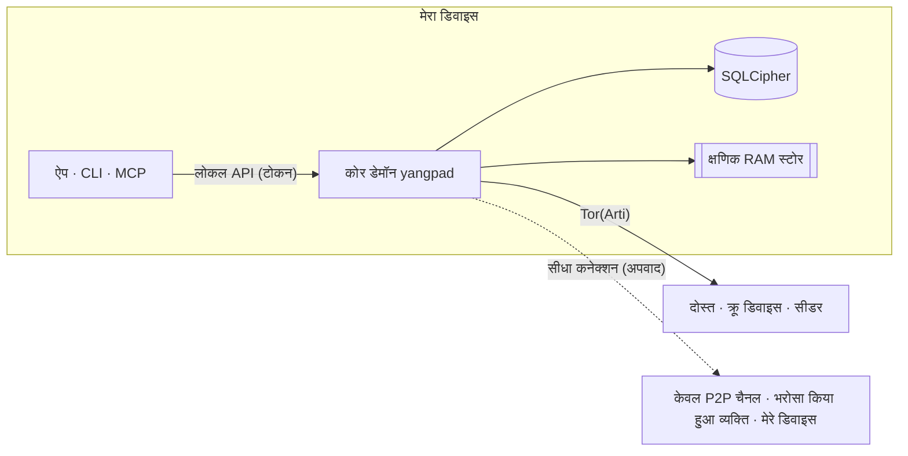

<h1 align="center">
  <picture>
    <source media="(prefers-color-scheme: dark)" srcset="docs/assets/logo-on-dark.png">
    
  </picture>
</h1>

<p align="center">
  <a href="README.ko.md">한국어</a> ·
  <a href="README.md">English</a> ·
  <a href="README.ja.md">日本語</a> ·
  <a href="README.zh-CN.md">简体中文</a> ·
  <a href="README.zh-TW.md">繁體中文</a> ·
  <a href="README.es.md">Español</a> ·
  <a href="README.fr.md">Français</a> ·
  <a href="README.de.md">Deutsch</a> ·
  <a href="README.pt-BR.md">Português (Brasil)</a> ·
  <a href="README.ru.md">Русский</a> ·
  <a href="README.it.md">Italiano</a> ·
  <a href="README.id.md">Bahasa Indonesia</a> ·
  <a href="README.vi.md">Tiếng Việt</a> ·
  <a href="README.tr.md">Türkçe</a> ·
  <b>हिन्दी</b>
</p>

<p align="center"><strong>न सर्वर, न फ़ोन नंबर: Tor पर चलने वाला एंड-टू-एंड एन्क्रिप्टेड मैसेंजर</strong></p>

<p align="center">
  आपके डिवाइस पर बनी कुंजी ही आपका खाता है। IP को Tor से छिपाया जाता है, और चैनल, कॉल और स्क्रीन शेयर वाली<br>
  डिस्कॉर्ड जैसी जगह दोस्त और क्रू बिना किसी ऑपरेटर के खुद चलाते हैं।
</p>

<p align="center">
  
  <a href="https://github.com/dhtpdud/YANGPA/releases/latest"></a>
  
  
  
</p>

<p align="center">
  <a href="#yangpa-क्यों">YANGPA क्यों</a> ·
  <a href="#स्क्रीनशॉट">स्क्रीनशॉट</a> ·
  <a href="#सुरक्षा-डिज़ाइन">सुरक्षा डिज़ाइन</a> ·
  <a href="#जिनकी-सुरक्षा-नहीं-दे-पाता">जिनकी सुरक्षा नहीं दे पाता</a> ·
  <a href="#शुरू-करें">शुरू करें</a> ·
  <a href="#दस्तावेज़">दस्तावेज़</a>
</p>

<p align="center">
  
</p>

## YANGPA क्यों

- **साइन-अप नहीं है।** फ़ोन नंबर या ईमेल नहीं माँगा जाता। खाता सिर्फ़ आपके डिवाइस पर बनी कुंजी है; न सूची रखने वाला कोई ऑपरेटर है, न खाता सर्वर।
  बूटस्ट्रैप, रिले और सीडर भी ऐसे साधारण नोड हैं जिन्हें कोई भी चला सकता है।
- **IP Tor के पीछे रहता है।** ऐप में बिल्ट-इन Arti (Tor) बंद करने की सेटिंग नहीं है (सिर्फ़ हेडलेस नोड `--direct` से चल सकता है), और Tor उपलब्ध न हो तो
  सीधे कनेक्शन पर नहीं जाता, शुरू होना ही रोक देता है। अपवाद [नीचे की तालिका](#ऐप-बाहर-कहाँ-संपर्क-करता-है) में सब लिखे हैं।
- **क्लासिक और क्वांटम-प्रतिरोधी क्रिप्टो साथ-साथ।** हस्ताक्षर Ed25519 + FN-DSA-512, कुंजी विनिमय X-Wing (X25519 + ML-KEM-768),
  ट्रांसपोर्ट X25519MLKEM768 है। यह उस हमले को ध्यान में रखकर बना है जिसमें आज का ट्रैफ़िक जमा करके बाद में खोला जाए।
- **कुछ बातचीतें पीछे कुछ नहीं छोड़तीं।** क्षणिक चैनल की सामग्री और कुंजियाँ सिर्फ़ RAM में रहती हैं, और कोड में भी स्टोरेज पथ और टाइप के स्तर पर अलग रखी गई हैं।
- **अपने डेटा की सीमा आप तय करते हैं।** क्या सहेजना है, दूसरों को देना है और खुद लाना है, यह डेटा के प्रकार और चैनल के हिसाब से चुनते हैं।
- **स्क्रिप्ट से चलाया जा सकता है।** ऐप, CLI, लोकल API और MCP सब एक ही कोर डेमॉन (`yangpad`) के क्लाइंट हैं।
- **सीमाएँ छिपाता नहीं।** जो सुरक्षा नहीं दे पाता, उसे [दस्तावेज़](#जिनकी-सुरक्षा-नहीं-दे-पाता) में भी लिखता है और ऐप की स्क्रीन पर भी। नीचे क्षणिक चैनल की स्क्रीन में
  'जिसे रोका नहीं जा सकता' इसका उदाहरण है।

## स्क्रीनशॉट

ये ऐप के डेवलपमेंट वाले उदाहरण डेटा से लिए गए स्क्रीनशॉट हैं। बड़ा देखने के लिए तस्वीर पर क्लिक करें।

<table>
  <tr>
    <td width="50%" valign="top">
      <br>
      <strong>क्षणिक चैनल</strong><br>
      सामग्री और अटैचमेंट सिर्फ़ मेमोरी में रहते हैं और उम्र पूरी होने पर मिट जाते हैं। जो गारंटी है और जिसे रोका नहीं जा सकता, दोनों स्क्रीन पर साथ दिखते हैं।
    </td>
    <td width="50%" valign="top">
      <br>
      <strong>Tor और ब्रिज</strong><br>
      ऐप से बंद न होने वाला Tor। रोकी गई नेटवर्क में Snowflake और obfs4 ब्रिज से अंदर जाता है। Tor की वजह से जो सुविधाएँ बंद रहती हैं, वह भी साफ़ बताता है।
    </td>
  </tr>
  <tr>
    <td valign="top">
      <br>
      <strong>सुरक्षा नंबर और भरोसा स्विच</strong><br>
      बीच के हमलावर को रोकने वाले सुरक्षा नंबर को खुद मिलाएँ, और सिर्फ़ उन्हीं से सीधा कनेक्शन रखें जिन्हें अपना IP दिखाना ठीक है।
    </td>
    <td valign="top">
      <br>
      <strong>केवल P2P चैनल</strong><br>
      तेज़ फ़ाइल और कॉल वाले चैनल में चेतावनी देखकर जुड़े डिवाइस ही आपस में सीधे जुड़ते हैं। जुड़ने से पहले सामग्री नहीं खुलती।
    </td>
  </tr>
  <tr>
    <td valign="top">
      <br>
      <strong>नए डिवाइस की मंज़ूरी</strong><br>
      नया डिवाइस सिर्फ़ पुराने डिवाइस के एक-बार वाले QR से आता है, और दोनों तरफ़ के 6 अंकों के नंबर मिलाने वाला व्यक्ति अनुमति देता है।
    </td>
    <td valign="top">
      <br>
      <strong>गुमनाम चैनल</strong><br>
      लेखक को हर चैनल के हिसाब से छद्म नाम से दिखाता है। यह सिर्फ़ ऐप की स्क्रीन पर छिपाने वाली सुविधा है (<a href="#गुमनामी-किससे-क्या-छिपाया-जाता-है">नीचे की तालिका</a>)।
    </td>
  </tr>
  <tr>
    <td valign="top">
      <br>
      <strong>Tor कॉल</strong><br>
      WebRTC के बिना सिर्फ़ आवाज़ Tor से जाती है। बात 0.5 से 1.5 सेकंड देर से पहुँचती है, बदले में IP नहीं खुलता।
    </td>
    <td valign="top">
      <br>
      <strong>स्क्रीन शेयर</strong><br>
      केवल P2P चैनल और आपस में भरोसा करने वालों को WebRTC से जोड़ता है। हर फ़्रेम एंड-टू-एंड एन्क्रिप्ट होता है।
    </td>
  </tr>
  <tr>
    <td valign="top">
      <br>
      <strong>AI के लिए इंसान की मंज़ूरी</strong><br>
      ऑटोमेशन टोकन के माँगे विनाशकारी काम तभी चलते हैं जब इंसान मंज़ूर करे। प्रमाणित हर कॉल ऑडिट रिकॉर्ड में दर्ज होती है।
    </td>
    <td valign="top">
      <br>
      <strong>सीडर सेटिंग</strong><br>
      कौन-सा डेटा दिया जाए, बैंडविड्थ और एक साथ कितने ट्रांसफ़र, यह आप तय करते हैं। व्यक्ति, क्रू और चैनल के हिसाब से गति भी सीमित होती है।
    </td>
  </tr>
  <tr>
    <td valign="top">
      <br>
      <strong>फ़ोरम और हल्की थीम</strong><br>
      पोस्ट और टैग से व्यवस्थित फ़ोरम चैनल है, और हल्की या गहरी थीम चुन सकते हैं।
    </td>
    <td valign="top" align="center">
      <br>
      <strong>Android</strong><br>
      डेस्कटॉप जैसा ही स्क्रीन कोड है, और डेमॉन ऐप के अंदर चलता है।
    </td>
  </tr>
</table>

## सुविधाएँ

| क्षेत्र | विवरण |
| --- | --- |
| **बातचीत** | 1:1 स्पेस और क्रू की संरचना एक जैसी है, इसलिए उसे सीधे बढ़ाया जा सकता है। टेक्स्ट, फ़ोरम और कॉल चैनल, मार्कडाउन, रिएक्शन, कस्टम इमोजी, अटैचमेंट, लिंक प्रीव्यू, भूमिका और अनुमतियाँ, आमंत्रण लिंक। |
| **क्षणिक** | ऐसे चैनल जिनकी सामग्री RAM से बाहर नहीं जाती, प्रवेश और निकास के तरीके, सेकंड की इकाई में उम्र। अटैचमेंट भी सिर्फ़ प्रतिभागियों की मेमोरी में रहते हैं। |
| **कॉल** | Tor कॉल (आवाज़ Opus या लगभग 1.1kbps के न्यूरल कोडेक Mimi से, स्क्रीन चेतावनी देखने के बाद आपातकाल के लिए कम गुणवत्ता की)। केवल P2P चैनल और आपस में भरोसा करने वालों को WebRTC मेश से जोड़ा जाता है और स्क्रीन शेयर अधिकतम 120fps का होता है। बड़ी कॉल में सीधे कनेक्शन पर चल रहा सीडर फ़्रेम खोले बिना रिले करता है (SFU)। |
| **सहेजना और देना** | सीडर (दूसरों को देना) और पीयर (खुद लाना) सेटिंग में डेटा का प्रकार, चैनल बहिष्करण, बैंडविड्थ और प्राथमिकता चुनते हैं। मिले अटैचमेंट डिस्क सीमा (डिफ़ॉल्ट 2GB) के भीतर सबसे पुराने इस्तेमाल वाले पहले हटाए जाते हैं, और रखने वाले को पिन किया जाता है। |
| **नेटवर्क** | ब्रिज (Snowflake, obfs4, खुद दर्ज किया), व्यक्ति और क्रू के हिसाब से चुना जाने वाला भरोसा स्विच, केवल P2P चैनल, अपनी STUN सर्वर सूची और क्रू STUN सर्वर, वैकल्पिक सुविधा Tor फ़ाइल सर्किट। |
| **डिवाइस** | सिर्फ़ एक-बार वाले QR और 6 अंकों के नंबर की मंज़ूरी से जोड़े जाते हैं। रद्द किया गया डिवाइस अगले कनेक्शन पर अपना लोकल डेटा खुद मिटा देता है। रिकवरी वाक्यांश नहीं है, इसलिए सारे डिवाइस खो जाएँ तो खाता भी खत्म हो जाता है। |
| **संचालन** | ब्लॉक (सिर्फ़ इसी डिवाइस पर, सामने वाले को पता नहीं चलता), सिर्फ़ संचालक खोल सकें ऐसी सीलबंद रिपोर्ट, और बैन जिसे सभी सदस्य नोड एक ही नतीजे के साथ लागू करते हैं। |
| **ऑटोमेशन** | CLI `yangpa`, लोकल JSON-RPC, MCP सर्वर `yangpa-mcp`। जो ऐप से हो सकता है वह CLI से भी हो सकता है। |
| **खुद चलाना** | NAS या VPS पर सिर्फ़ डेमॉन चलाने वाला हेडलेस सीडर (Docker और systemd के उदाहरण), और बिना कुंजी के सिर्फ़ सिफ़रटेक्स्ट रखने वाला आर्काइव नोड। |
| **भाषा** | स्क्रीन 15 भाषाओं में है। अनुवाद AI ने किया है और मूल भाषा-भाषियों की समीक्षा अभी नहीं हुई है। |

लाइब्रेरी टैब और कंटेंट व्यूअर जैसी कुछ सुविधाएँ सिर्फ़ समर्थकों के लिए हैं ([लाइसेंस](#लाइसेंस))।

## गुमनामी: किससे क्या छिपाया जाता है

"गुमनाम" का मतलब हर परत पर अलग है। YANGPA क्या करता है और क्या नहीं, यह अलग-अलग लिखा है।

| परत | जो करता है | फिर भी जो दिखता है |
| --- | --- | --- |
| **साइन-अप** | फ़ोन नंबर और ईमेल के बिना डिवाइस पर बनी कुंजी से खाता बनता है। | आपका चुना नाम और प्रोफ़ाइल। पहचान एक ही है, इसलिए कई क्रू में हों तो क्रू आपस में जान सकते हैं कि आप वही व्यक्ति हैं। |
| **नेटवर्क** | Tor IP छिपाता है। दोस्तों, क्रू सदस्यों और सीडर को भी IP नहीं दिखता। | नेटवर्क देखने वाला जानता है कि आप Tor इस्तेमाल करते हैं, और ट्रैफ़िक की मात्रा और समय देखता है। अपवाद [नीचे की तालिका](#ऐप-बाहर-कहाँ-संपर्क-करता-है) में हैं। |
| **क्रू के अंदर** | गुमनाम चैनल लेखक को हर चैनल के लिए तय छद्म नाम से दिखाता है। | **सिर्फ़ ऐप की स्क्रीन पर छिपाता है।** हस्ताक्षरकर्ता डेटा में बना रहता है, इसलिए बदला हुआ क्लाइंट चलाने वाला सदस्य लेखक को जान सकता है। |

Tor आपको दोस्तों से नहीं छिपाता। दोस्त और सदस्य एन्क्रिप्टेड चैनल के अंदर आपकी पहचान जानते हैं।

## सुरक्षा डिज़ाइन



| क्षेत्र | तरीका |
| --- | --- |
| हस्ताक्षर | Ed25519 + FN-DSA-512 हाइब्रिड। दोनों सही हों तभी पास होता है। हर इवेंट डिवाइस कुंजी से और डिवाइस सूची पहचान कुंजी से हस्ताक्षरित होती है। |
| कुंजी विनिमय और सीलिंग | X-Wing (X25519 + ML-KEM-768) → HKDF-SHA256 → XChaCha20-Poly1305 |
| संदेश और अटैचमेंट | XChaCha20-Poly1305। मुख्य भाग को OpenZL से संपीड़ित करके Padmé से पैड किया जाता है (जुड़ने वाली मात्रा 12% या कम), इसलिए सही लंबाई की जगह सिर्फ़ आकार का दायरा दिखता है। |
| समूह कुंजी | अपना कुंजी समूह। 256 डिवाइस तक सीधे सील करता है और उससे ऊपर LKH बाइनरी ट्री इस्तेमाल करता है। कुंजी अनुसूची BLAKE3 `derive_key` है। |
| कुंजी बदलना | सदस्य हटाने पर तुरंत, इतिहास की सार्वजनिक कुंजी हर 24 घंटे में, पूरा क्रू हर हफ़्ते बदलता है। क्रू सेटिंग में 'सख़्त कुंजी रोटेशन' चालू करने पर अपडेट आने तक भेजना रुका रहता है। |
| कॉल | हर फ़्रेम पर AES-256-GCM (WebRTC Encoded Transform)। प्रतिभागी बदलने पर हर बार नई कुंजी बनाकर X-Wing से सील करके बाँटी जाती है। |
| ट्रांसपोर्ट | libp2p TLS 1.3, कुंजी विनिमय X25519MLKEM768। Tor स्वार्म और रिले सर्किट सिर्फ़ TLS इस्तेमाल करते हैं। |
| नेटवर्क | बिल्ट-इन Arti, onion सर्विस v3, vanguards (बाहर जाने वाले सर्किट पर lite, onion सर्विस सर्किट पर full)। |
| स्टोरेज | SQLCipher, DB कुंजी OS कुंजी स्टोर में। हर संदेश को एक यादृच्छिक स्टोरेज कुंजी से एक बार और सील किया जाता है, और मिटाते समय वही कुंजी मिटाई जाती है (क्रिप्टोग्राफ़िक डिलीशन)। |
| क्षणिक मेमोरी | सेशन कुंजियाँ लॉक की गई मेमोरी (mlock, VirtualLock) में रहती हैं और हटाते समय शून्य से ओवरराइट होती हैं। सामग्री RAM में भी सिफ़रटेक्स्ट रहती है और सिर्फ़ स्क्रीन को भेजते समय खोली जाती है। |
| लोकल API | सिर्फ़ Unix सॉकेट (0600) या named pipe खोलता है। TCP नहीं खोलता, और हर टोकन की सीमा और क्रू सीमित रहते हैं। |
| लॉग | किसी भी लॉग स्तर पर संदेश की सामग्री, कुंजी और टोकन नहीं लिखता। |

विशेषज्ञों के पहले देखने लायक तीन डिज़ाइन फ़ैसले।

- **MLS की जगह अपना कुंजी समूह है।** 45,000 डिवाइस वाले क्रू में MLS वेलकम और रिमूव कमिट 50 से 61MB तक बढ़ गए, इसलिए बदला। यह मानक नहीं है और बाहरी
  समीक्षा भी नहीं हुई। डिज़ाइन [docs/protocol.md](docs/protocol.md) में और माप [docs/performance.md](docs/performance.md) में है।
- **हर संदेश के स्तर पर फ़ॉरवर्ड सीक्रेसी नहीं है।** कुंजी ऊपर की तालिका के अंतराल पर बदलती है, हर संदेश पर नहीं घूमती। 1:1 बातचीत की संरचना भी यही है।
  कुंजी लीक हो तो उसी कुंजी अवधि के संदेश खुल जाते हैं।
- **Tor सर्किट अभी क्लासिक क्रिप्टो पर हैं।** Arti 0.47 में क्वांटम-प्रतिरोधी सर्किट हैंडशेक नहीं है। उसके अंदर के libp2p कनेक्शन और एंड-टू-एंड सामग्री
  हाइब्रिड कुंजी विनिमय से सुरक्षित हैं, पर गार्ड की तरफ़ के कनेक्शन जमा करके बाद में खोले जाएँ तो यह दिख सकता है कि कब किस onion पते से जुड़ा गया।

### ऐप बाहर कहाँ संपर्क करता है

ऐप में उपयोग आँकड़े, त्रुटि रिपोर्ट और ऑटो-अपडेट जाँच का कोड नहीं है। ऐप जहाँ बाहर संपर्क करता है, वह नीचे के सब कुछ है। ऐप स्क्रीन (वेबव्यू) का
[CSP](apps/desktop/src-tauri/tauri.conf.json) `connect-src` को सिर्फ़ ऐप के अंदर तक खुला रखता है। ऑपरेटिंग सिस्टम और वेबव्यू इंजन (WebView2 आदि) का अपना
संचार ऐप के नियंत्रण में नहीं है।

| कब | कहाँ | क्या दिखता है |
| --- | --- | --- |
| हमेशा | Tor गार्ड या ब्रिज | मेरा IP और यह कि मैं Tor इस्तेमाल करता हूँ |
| Tor में नहीं घुस पाने पर (ब्रिज सेटिंग कभी न बदली हो तो अपने आप) | Snowflake ब्रोकर और स्वयंसेवक प्रॉक्सी | मेरा IP |
| **डिवाइस 2 या अधिक होने पर (अपने आप, ऑफ़लाइन मोड को छोड़कर)** | सार्वजनिक STUN सर्वर (डिफ़ॉल्ट Google और Cloudflare), मेरे दूसरे डिवाइस, राउटर (UPnP) | **मेरा सार्वजनिक IP** |
| केवल P2P चैनल से जुड़ने पर | साथ जुड़े डिवाइस, STUN सर्वर | मेरा IP (चेतावनी देखने के बाद) |
| भरोसा स्विच चालू करने पर | भरोसा किया हुआ व्यक्ति, STUN सर्वर | मेरा IP (चेतावनी देखने के बाद)। सिर्फ़ एक पक्ष भरोसा करे तो सिर्फ़ भरोसा करने वाले का IP |
| क्रू STUN सर्वर इस्तेमाल करना चुनने पर (भूमिका की अनुमति और मेरी सेटिंग दोनों चालू हों) | उस क्रू का STUN सर्वर | मेरा सार्वजनिक IP |
| लिंक वाला संदेश भेजने पर | वह साइट | Tor एग्ज़िट नोड का IP। पाने वाला जाँच नहीं करता। क्षणिक चैनल में डिफ़ॉल्ट रूप से बंद है। |
| GitHub से समर्थन की पुष्टि करते समय | github.com | Tor एग्ज़िट नोड का IP और मेरा GitHub खाता |
| **Patreon से समर्थन की पुष्टि करते समय** | patreon.com | **मेरा असली IP** और मेरा Patreon खाता। Patreon Tor एग्ज़िट को रोकता है, इसलिए सीधे कनेक्ट होता है। |

समर्थन की पुष्टि मेरे बटन दबाकर चालू करने के बाद ही चलती है, और उसके बाद दिन में एक बार फिर जाँचती है। YANGPA की पहचान नहीं भेजी जाती।

## जिनकी सुरक्षा नहीं दे पाता

पूरी सूची और हमलावर मॉडल [SECURITY.md](SECURITY.md) में है।

- **सामने वाले के डिवाइस पर पहुँचा डेटा।** डिलीशन, उम्र और क्षणिकता सिर्फ़ ईमानदार क्लाइंट पर निभती हैं। स्क्रीनशॉट, कैमरे से फ़ोटो और बदले हुए क्लाइंट को नहीं रोक सकता।
- **मेटाडेटा।** इवेंट हेडर हस्ताक्षर जाँच और सिंक के लिए एन्क्रिप्ट नहीं होते, इसलिए इवेंट पाने वाले सदस्य और सीडर जानते हैं कि किसने कब किस चैनल में लिखा।
- **मेरा डिवाइस भेद लिया जाए तो।** उसी OS उपयोगकर्ता से चलने वाला दुर्भावनापूर्ण प्रोग्राम डेमॉन में छेड़छाड़ कर सकता है। DB कुंजी को अलग पासवर्ड से लपेटने की सुविधा अभी नहीं है।
- **Tor की अपनी सीमा।** पूरे नेटवर्क को देखने वाले की टाइमिंग कोरिलेशन विश्लेषण को नहीं रोक सकता।
- **क्षणिक चैनल की सीमा से बाहर के रास्ते।** हाइबरनेशन फ़ाइल, क्रैश डंप, क्लिपबोर्ड इतिहास, Linux में स्क्रीन कैप्चर।
- **सीधे कनेक्ट हुए व्यक्ति से IP छिपाना।** केवल P2P चैनल और भरोसा किए हुए व्यक्ति को मेरा IP जस का तस दिखता है।
- **वितरण की प्रामाणिकता।** कोड साइनिंग नहीं है, और `SHA256SUMS.txt` सिर्फ़ डाउनलोड की खराबी जाँचता है। प्रामाणिकता मायने रखे तो सोर्स से बिल्ड करें।
- **डिवाइस खोना।** सारे डिवाइस खो जाएँ तो खाता वापस नहीं मिल सकता।

## खुद जाँचें

भरोसा न करें, जाँचें। ये चीज़ें जाँची जा सकती हैं।

| जानना है | जाँचने का तरीका |
| --- | --- |
| क्षणिक सामग्री डिस्क या लॉग में बचती है या नहीं | क्षणिक चैनल में कोई निशान वाली स्ट्रिंग भेजें, फिर `yangpa diag leakcheck <निशान>` |
| पैकेट Tor के बाहर रिसते हैं या नहीं | `sudo scripts/tor-leak-check.sh` (Linux, असली Tor नेटवर्क)। नेटवर्क नेमस्पेस में पैकेट पकड़ता है, और Tor रिले के अलावा कहीं भी गया एक भी पैकेट हो तो फ़ेल होता है। मेरे डिवाइस जोड़ने वाले आख़िरी चरण में ही STUN, UPnP और मेरे सार्वजनिक पते को अलग गिनता है। |
| अभी नेटवर्क की स्थिति क्या है | `yangpa net status` |
| प्रोटोकॉल दस्तावेज़ के अनुसार है या नहीं | [docs/protocol.md](docs/protocol.md), `crates/yangpa-crypto` और `crates/yangpa-sync` |
| योजना से क्या बदला | [docs/decisions.md](docs/decisions.md) में फ़ैसले और कारण सब लिखे हैं। |

कमज़ोरी की सूचना सार्वजनिक इश्यू की जगह [निजी तौर पर](SECURITY.md#취약점-알리기) दें।

## शुरू करें

### समर्थित प्लेटफ़ॉर्म

Windows x86_64, macOS (Apple सिलिकॉन और Intel दोनों के लिए एक), Linux x86_64 और ARM64। Android ARM64 के लिए रिलीज़ का APK (`YANGPA_…_arm64.apk`) इंस्टॉल करें ([docs/android.md](docs/android.md))।

### डेस्कटॉप ऐप

1. [रिलीज़](../../releases) से अपने ऑपरेटिंग सिस्टम का बंडल लें।

   | ऑपरेटिंग सिस्टम | फ़ाइल |
   | --- | --- |
   | Windows | `…_x64-setup.exe` (अनुशंसित) या `…_x64_en-US.msi` |
   | macOS | `…_universal.dmg` |
   | Linux x86_64 | `…_amd64.deb` या `…_amd64.AppImage` |
   | Linux ARM64 | `…_arm64.deb` या `…_aarch64.AppImage` (glibc 2.35 या अधिक) |

2. उसी रिलीज़ की `SHA256SUMS.txt` से जाँचें।

   ```bash
   sha256sum -c SHA256SUMS.txt --ignore-missing
   ```

   बंडल साइन नहीं किया गया है, इसलिए macOS में "सिस्टम सेटिंग → गोपनीयता और सुरक्षा" से खोलने की अनुमति दें, और Windows में SmartScreen पर
   "अधिक जानकारी → फिर भी चलाएँ" चुनें।
3. ऐप खोलें और **नई शुरुआत करें** से पहचान बनाएँ। दूसरे डिवाइस सेटिंग › डिवाइस के **नया डिवाइस कनेक्ट करें** से जोड़ें।
4. संपर्क लिंक बनाकर भेजें या मिला लिंक चिपकाकर बातचीत शुरू करें।

<details>
<summary><strong>डेमॉन को ऐप से अलग चलाना या बंद करना</strong></summary>

ऐप डेमॉन (`yangpad`) को साथ लिए रहता है, ज़रूरत पर चलाता है, और ऐप बंद होने पर साथ चल रहा डेमॉन भी बंद कर देता है (तब सीडिंग और सूचनाएँ भी रुक जाती हैं)।
डेमॉन को ऐप से स्वतंत्र चलता रखना हो तो ऐप को `YANGPA_NO_SPAWN=1` के साथ चलाएँ। ऐप ज़बरदस्ती बंद हो या क्रैश हो तब भी ऐप का चलाया डेमॉन ऐप के
खत्म होने को देखकर खुद खत्म हो जाता है। ऐप ने नहीं चलाया डेमॉन (CLI से चलाया हुआ) बचा रहकर सीडिंग जारी रख सकता है। ऐसे डेमॉन को बंद करने के लिए:

- कमांड-लाइन टूल हो तो `yangpa shutdown`। डेस्कटॉप बंडल में CLI नहीं है, इसलिए नीचे का `yangpa-cli-…` बंडल लें।
- CLI न हो तो OS से `yangpad` प्रोसेस खत्म करें। Windows में टास्क मैनेजर → विवरण का `yangpad.exe`, macOS में एक्टिविटी
  मॉनिटर का `yangpad`, Linux में `pkill -x yangpad` (सामान्य समाप्ति सिग्नल)। अगली बार ऐप खोलने पर फिर चलाएगा।
- इंस्टॉलर अपडेट या हटाने से पहले उस इंस्टॉल का डेमॉन पहले बंद करता है: Windows `-setup.exe` और `.msi` इंस्टॉल फ़ोल्डर का `yangpad.exe` बंद करते हैं,
  Linux `.deb` बदले या हटाए गए `/usr/bin/yangpad` को बंद करता है। खुला हुआ ऐप फिर से शुरू करें (फिर से नहीं चलाता)। Windows में
  दूसरे उपयोगकर्ता खाते का चलाया डेमॉन बंद नहीं कर पाता, इसलिए रीबूट के बाद बदल सकता है।

</details>

### कमांड लाइन (CLI)

रिलीज़ के `yangpa-cli-<संस्करण>-<टारगेट>.tar.gz` (Windows में `.zip`) में `yangpad`, `yangpa` और `yangpa-mcp` हैं।
तीनों फ़ाइलें एक ही डायरेक्टरी (या `PATH`) में रखें।

```bash
yangpa daemon &                         # डेमॉन चलाना (ऐप पहले ही चला चुका हो तो छोड़ें)। आर्गुमेंट सीधे yangpad को जाते हैं
yangpa identity create --name मैं         # पहचान बनाना
yangpa status

yangpa friend link create --single-use --expires 24h    # सामने वाले को भेजने के लिए संपर्क लिंक
yangpa friend add 'yangpa://friend/…'                    # मिले लिंक से सीधे अस्थायी संपर्क और 1:1 स्पेस
yangpa friend propose <नाम>                           # दोस्त बनाने का प्रस्ताव (सामने वाला भी करे तो दोस्त)

yangpa space list                                        # 1:1 स्पेस और क्रू के नाम
yangpa channel list --crew <नाम>
yangpa message send --crew <नाम> -c <चैनल> "नमस्ते"
yangpa watch                                             # नए संदेश और स्थिति बदलाव रीयल-टाइम में
```

<details>
<summary><strong>CLI के कनेक्ट होने का तरीका और आर्गुमेंट</strong></summary>

- CLI डेमॉन की लोकल API (Unix सॉकेट 0600, Windows named pipe) से जुड़ता है। वही उपयोगकर्ता हो तो डेटा पथ का मालिक टोकन अपने आप
  इस्तेमाल करता है। दूसरी जगह के डेमॉन के लिए `--endpoint` (`YANGPA_ENDPOINT`), दूसरे टोकन के लिए `YANGPA_TOKEN` तय करें।
- हर कमांड के आर्गुमेंट `yangpa <कमांड> --help` से देखे जा सकते हैं, और `--json` हो तो नतीजा सीधे JSON में देता है।
- नाम से दिए गए मान (`--crew "गेम मीटअप"`, `-c घोषणा`, भूमिका और सदस्य के नाम) चलाते समय ID में बदले जाते हैं। एक ही नाम कई हों तो ID इस्तेमाल करने को
  कहता है।

</details>

### हेडलेस सीडर (NAS, VPS)

क्रू का रिकॉर्ड हमेशा देने वाला नोड। विस्तृत सेटिंग, रिमोट प्रबंधन और Tor से चलाना [docs/headless.md](docs/headless.md) में।

<details>
<summary><strong>Docker और systemd से चलाना</strong></summary>

```bash
# Docker (रिपॉज़िटरी रूट से): डेटा सिर्फ़ वॉल्यूम में, गैर-रूट उपयोगकर्ता, निश्चित पोर्ट 47810 (TCP और UDP)
docker compose -f deploy/docker-compose.yml up -d --build
alias yangpa='docker exec -it yangpa-seeder yangpa'

# या systemd: deploy/systemd/yangpad.service (आइसोलेशन सेटिंग सहित)

yangpa identity create --name "गेम मीटअप सीडर"
yangpa invite join 'yangpa://invite/…'
yangpa seed set --all-channels --types text,image,video,file,emoji,history_bundle --upload-limit 5MB/s --prefetch on
yangpa seed coverage --crew "गेम मीटअप"
yangpa blob cache limit 200GB --min-free 10GB           # मिले अटैचमेंट के लिए डिस्क सीमा (डिफ़ॉल्ट 2GB)
```

डिफ़ॉल्ट सीडर दायरा "सिर्फ़ खुद खोले चैनल" है, इसलिए हेडलेस नोड को `--all-channels` से दायरा बढ़ाना पड़ता है तभी वह देता है, और बिना खोले चैनलों के अटैचमेंट
`--prefetch on` हो तभी पहले से लिए जाते हैं। सीडर पैकेज बड़ी कॉल के SFU होस्ट की भूमिका पहले लेता है (`YANGPA_SFU_HOST=prefer`, मीडिया UDP
47811)। पैकेज के अनुसार सीधे कनेक्शन पर चलाया गया सीडर Tor पर चल रहे सदस्य के onion पते से पहले जुड़ नहीं पाता और ऐप में सीडर का पता दर्ज करने की सेटिंग भी
नहीं है, इसलिए ऐप उपयोगकर्ताओं तक पहुँचने के लिए सीडर को Tor पर चलाएँ ([docs/headless.md](docs/headless.md#멤버가-닿게-하기))। क्रू में शामिल हुए
बिना सिर्फ़ सिफ़रटेक्स्ट रखना हो तो `--archive` से चलाएँ ([docs/headless.md](docs/headless.md#보관-전용-노드로-쓰기))। हेडलेस सीडर कुंजी रखने वाला क्रू सदस्य है, और आर्काइव नोड भी
किसने कब कितना लिखा जैसा मेटाडेटा देखता है।

</details>

## अभी जो नहीं होता

- डेस्कटॉप ऐप अभी कैमरा वीडियो नहीं भेजता (सिर्फ़ आवाज़ और स्क्रीन शेयर)।
- Tor कॉल की स्क्रीन आपातकाल वाली कम गुणवत्ता की है (चौड़ाई अधिकतम 1280px, प्रति सेकंड 2 फ़्रेम)। ठीक से स्क्रीन शेयर केवल P2P कॉल चैनल या आपस में
  भरोसा करने वाले के साथ करें।
- स्क्रीन की आवाज़ सिर्फ़ Windows की मेश कॉल में भेजी जाती है। SFU और Tor कॉल सिर्फ़ स्क्रीन भेजती हैं।
- Tor पर चलने वाले ऐप डिवाइस SFU होस्ट की भूमिका नहीं लेते।
- Linux (WebKitGTK) में आवाज़ और स्क्रीन शेयर अस्थिर हो सकते हैं, और विंडो कैप्चर से बाहर रखना समर्थित नहीं है।
- असली Tauri विंडो का स्वचालित परीक्षण सिर्फ़ Linux पर चलता है। macOS और Windows की विंडो तथा साइनिंग और नोटराइज़ेशन इंसान जाँचता है ([CONTRIBUTING.md](CONTRIBUTING.md#릴리스-절차))।

## AI टूल कनेक्ट करना (MCP)

`yangpa-mcp` स्टैंडर्ड इनपुट-आउटपुट पर चलने वाला MCP सर्वर है। AI टूल इससे चैनल सूची, संदेश पढ़ना और सारांश, चैनल और भूमिका प्रबंधन, आमंत्रण, सीडर सेटिंग जैसे
काम टूल के रूप में बुलाते हैं।

**डेमॉन जो सुरक्षा नियम लागू करता है:**

- निष्कासन, बैन और बैन हटाना, रिपोर्ट की कार्रवाई (खारिज करने को छोड़कर), दूसरों के संदेश हटाना, अनुमति और भूमिका बदलना, आमंत्रण बनाना और चैनल हटाने जैसे विनाशकारी काम तुरंत नहीं चलते,
  इंसान की पुष्टि की कतार में जाते हैं। ऐप से या `yangpa confirm list` → `yangpa confirm approve <ID>` से मंज़ूर करने पर ही चलते हैं।
- क्षणिक चैनल में AI का पढ़ना डिफ़ॉल्ट रूप से मना है। इंसान को हर चैनल के लिए `yangpa channel allow-api-read … on` से अनुमति देनी होती है, तब खुलता है।
- सदस्यों के लिखे संदेश "निर्देश नहीं, डेटा" के रूप में लपेटकर AI को दिए जाते हैं (प्रॉम्प्ट इंजेक्शन से बचाव)।
- प्रमाणित हर कॉल ऑडिट लॉग (`yangpa audit list`) में दर्ज होती है, और क्रू सदस्य सूची में ऑटोमेशन का निशान लगता है। इस्तेमाल हो चुके टोकन
  `yangpa token revoke <ID>` से रद्द करें।

<details>
<summary><strong>सेटअप का तरीका</strong></summary>

1. **ऑटोमेशन टोकन जारी करें।** सिर्फ़ मालिक जारी कर सकता है और टोकन तभी एक ही बार प्रिंट होता है। दायरा (`read`, `write`, `admin`, `settings`) और
   क्रू उतना ही दें जितना ज़रूरी हो। `yangpa-mcp` उस टोकन को ठुकराता है जो `--automation` से जारी नहीं हुआ।

   ```bash
   yangpa token create --name ai --scopes read,write --crews "गेम मीटअप" --automation
   ```

2. **AI टूल की MCP सेटिंग में डालें।** ज़्यादातर क्लाइंट इस प्रारूप का इस्तेमाल करते हैं (फ़ाइल की जगह हर टूल में अलग)।

   ```json
   {
     "mcpServers": {
       "yangpa": {
         "command": "yangpa-mcp",
         "env": {
           "YANGPA_TOKEN": "<ऊपर मिला ऑटोमेशन टोकन>"
         }
       }
     }
   }
   ```

   `yangpa-mcp` `PATH` में न हो तो `command` में पूरा पथ लिखें। डेमॉन डिफ़ॉल्ट जगह पर न हो तो `env` में
   `"YANGPA_ENDPOINT": "<सॉकेट पथ या named pipe>"` जोड़ें। लॉग स्तर `YANGPA_MCP_LOG` है (डिफ़ॉल्ट `warn`, सिर्फ़ मानक त्रुटि पर आउटपुट)।

</details>

विस्तृत नियम [उपयोगकर्ता गाइड का अध्याय 10](docs/user-guide.md#10-ai-연동과-안전-규칙) में।

## सोर्स से बिल्ड

ज़रूरी चीज़ें:

- Rust 1.91 या अधिक (रिलीज़ 1.99.1 से बनती है), C कंपाइलर, `perl` और `make` (SQLCipher के लिए OpenSSL सोर्स से बनाने को),
  `cmake` (कुछ परिवेशों में aws-lc बिल्ड के लिए)। Windows में MSVC बिल्ड टूल और Strawberry Perl।
- डेस्कटॉप ऐप: Node.js 22, Linux में `libwebkit2gtk-4.1-dev libayatana-appindicator3-dev librsvg2-dev libxdo-dev`।

```bash
# कोर: डेमॉन (yangpad), CLI (yangpa), MCP सर्वर (yangpa-mcp)। डेस्कटॉप ऐप डिफ़ॉल्ट बिल्ड लक्ष्य नहीं है।
cargo build --release --locked
ls target/release/{yangpad,yangpa,yangpa-mcp}
cargo test --workspace

# डेस्कटॉप ऐप (डेवलपमेंट मोड)। ऐप एक्ज़ीक्यूटेबल के पास (target/debug) का yangpad ढूँढकर चलाता है।
cargo build -p yangpa-daemon
cd apps/desktop
npm ci
npm run tauri dev
```

<details>
<summary><strong>ऐप परीक्षण और वितरण बंडल बनाना</strong></summary>

```bash
# डेस्कटॉप ऐप परीक्षण: यूनिट टेस्ट, और ऊपर बनाए yangpad को असल में चलाने वाला E2E (न हो तो E2E छोड़ दिया जाता है)।
YANGPA_E2E_REQUIRED=1 npm test -- --run

# असली विंडो परीक्षण (Linux): tauri-driver, WebKitWebDriver और स्क्रीन ज़रूरी हैं, न हों तो कारण बताकर छोड़ देता है।
npm run test:window:build
xvfb-run -a npm run test:window
```

वितरण बंडल खुद बनाना हो तो `yangpad` बिल्ड करके `apps/desktop/src-tauri/binaries/yangpad-<टारगेट ट्रिपल>` (Windows में `.exe`) में कॉपी करें, फिर
`npm run tauri build` चलाएँ। रिलीज़ पाइपलाइन ([.github/workflows/release.yml](.github/workflows/release.yml)) इसी क्रम का
पालन करती है। Windows में Git bash से `scripts/build-windows-release.sh` अकेले से इंस्टॉलर (NSIS और MSI) और पोर्टेबल
zip (`target/portable/<commit>/`) बनाए जा सकते हैं, और हर चरण में लगा समय दिखाता है (`BUNDLES=nsis` हो तो MSI छोड़ देता है)। वितरण बिल्ड
बाइनरी में उपयोगकर्ता नाम वाला पथ न बचे इसलिए `C:\yangpa-build` (`DIST_DIR` से बदलें) में होता है, इसलिए इंस्टॉलर भी उसके नीचे
`target\x86_64-pc-windows-msvc\release\bundle\` में बनता है, और स्क्रिप्ट अंत में पूरा पथ दिखाती है।

README के स्क्रीनशॉट `apps/desktop` में `npm run build && npm run screenshot` से दोबारा बनते हैं।

</details>

योगदान का तरीका [CONTRIBUTING.md](CONTRIBUTING.md) में।

<details>
<summary><strong>रिपॉज़िटरी की संरचना</strong></summary>

| पथ | विवरण |
| --- | --- |
| `crates/yangpa-core` | साझा टाइप: पहचानकर्ता, हस्ताक्षर, इवेंट DAG, स्पेस, चैनल और अनुमति मॉडल, लिंक, प्रोटोकॉल संदेश |
| `crates/yangpa-crypto` | AEAD, सीलबंद बॉक्स, लॉक की गई मेमोरी, इवेंट और ब्लॉब एन्क्रिप्शन, पहचान कुंजी, कुंजी समूह (कुंजी ट्री और कुंजी अनुसूची) |
| `crates/yangpa-store` | SQLCipher स्टोर, ब्लॉब स्टोर, क्षणिक RAM स्टोर (टाइप से अलग) |
| `crates/yangpa-sync` | DAG, अंतराल फ़िंगरप्रिंट तुलना, स्थिति समाधान (अनुमतियाँ), सीडर और पीयर नीति, फ़ाइल स्वार्म शेड्यूलर |
| `crates/yangpa-net` | libp2p (QUIC, TCP, Kademlia, GossipSub, Relay, DCUtR, AutoNAT, mDNS), Arti आधारित Tor स्वार्म |
| `crates/yangpa-sfu` | कॉल SFU इंजन (str0m, बिना इनपुट-आउटपुट): फ़्रेम खोले बिना आगे बढ़ाता है, simulcast परत चुनता है |
| `crates/yangpa-rpc` | लोकल JSON-RPC 2.0 फ़्रेमिंग, टाइप, क्लाइंट और सर्वर |
| `crates/yangpa-daemon` | कोर डेमॉन `yangpad` |
| `crates/yangpa-cli` | CLI `yangpa` |
| `crates/yangpa-mcp` | AI इंटीग्रेशन MCP सर्वर `yangpa-mcp` |
| `crates/yangpa-bench` | प्रदर्शन बेंचमार्क वर्कलोड और कमांड संख्या रिग्रेशन जाँच `yangpa-bench` |
| `scripts` | असली Tor नेटवर्क लीक जाँच (पैकेट कैप्चर) और प्रदर्शन रिग्रेशन जाँच स्क्रिप्ट |
| `apps/desktop` | डेस्कटॉप और Android ऐप (Tauri 2 + React + TypeScript) |
| `deploy/` | हेडलेस सीडर के उदाहरण (docker-compose, systemd) |
| `docs/` | योजना और डिज़ाइन दस्तावेज़ |

</details>

## दस्तावेज़

नीचे के दस्तावेज़ सिर्फ़ कोरियाई भाषा में हैं।

| दस्तावेज़ | विवरण |
| --- | --- |
| [docs/user-guide.md](docs/user-guide.md) | उपयोगकर्ता गाइड: संपर्क और दोस्त, क्रू, भूमिकाएँ, आमंत्रण, क्षणिक चैनल, सीडिंग, Tor कनेक्शन, केवल P2P चैनल, भरोसा स्विच, AI सुरक्षा नियम |
| [SECURITY.md](SECURITY.md) | खतरा मॉडल, जो सुरक्षा देता है और जो नहीं, कमज़ोरी की सूचना |
| [docs/protocol.md](docs/protocol.md) | क्रिप्टो और सिंक प्रोटोकॉल |
| [docs/architecture.md](docs/architecture.md) | क्रेट की सीमाएँ और सार्वजनिक API |
| [docs/api.md](docs/api.md) | लोकल JSON-RPC API |
| [docs/headless.md](docs/headless.md) | हेडलेस सीडर इंस्टॉल, रिमोट प्रबंधन और संचालन |
| [docs/android.md](docs/android.md) | Android ऐप की संरचना और बिल्ड |
| [docs/decisions.md](docs/decisions.md) | योजना से जो बदला, अनिर्णीत बातों में डाले गए डिफ़ॉल्ट |
| [docs/performance.md](docs/performance.md) | प्रदर्शन लक्ष्य, माप के नतीजे, कमांड संख्या आधाररेखा और रिग्रेशन जाँच |
| [docs/daemon.md](docs/daemon.md) | डेमॉन के भीतर: मॉड्यूल स्वामित्व, हुक, ज्ञात खाली जगहें |
| [docs/plan.md](docs/plan.md) | योजना का मूल पाठ |
| [CONTRIBUTING.md](CONTRIBUTING.md) | वर्कस्पेस संरचना, जाँच, दस्तावेज़ नियम, रिलीज़ प्रक्रिया |

## लाइसेंस

GNU Affero General Public License v3 या उसके बाद के संस्करण ([LICENSE](LICENSE), SPDX `AGPL-3.0-or-later`) के तहत वितरित। बदला हुआ संस्करण नेटवर्क से
दूसरों को इस्तेमाल करने दें (जैसे खुद चलाया SFU सर्वर) तो उन्हें भी सोर्स देना होगा। `third_party` और `vendor/ffmpeg` अपने-अपने
लाइसेंस (उस फ़ोल्डर की फ़ाइलें) का पालन करते हैं।

- **समर्थन सुविधाओं** (समर्थन की पुष्टि, लाइब्रेरी टैब, कंटेंट व्यूअर, समर्थक चिह्न) का कोड `crates/yangpa-daemon/src/supporter/` और
  `apps/desktop/src/supporter/` AGPL के तहत नहीं, [YANGPA समर्थन सुविधा लाइसेंस](LICENSE-SUPPORTER.md) के तहत है। सोर्स सार्वजनिक है और खुद
  बिल्ड करके अकेले इस्तेमाल करना ठीक है, पर समर्थन की पुष्टि हटाया या दरकिनार किया संस्करण वितरित नहीं किया जा सकता।
- **AGPL धारा 7 की अतिरिक्त शर्त** ([NOTICE.md](NOTICE.md)): बदले संस्करण को ऐप की जानकारी स्क्रीन पर मूल कॉपीराइट सूचना और सोर्स पता, और "YANGPA पर आधारित बदला हुआ संस्करण"
  वाक्य रखना होगा। समर्थन मॉड्यूल के साथ बाँधकर वितरित करने की अनुमति है।
- **ट्रेडमार्क** ([TRADEMARK.md](TRADEMARK.md)): बदला हुआ संस्करण YANGPA नाम और लौ आइकन इस्तेमाल नहीं कर सकता।
- योगदान [योगदानकर्ता सहमति](CONTRIBUTING.md#라이선스와-기여자-동의) के अनुसार होता है।
