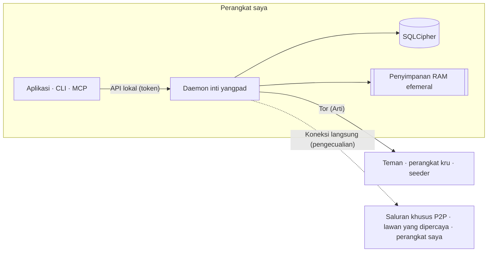

<h1 align="center">
  <picture>
    <source media="(prefers-color-scheme: dark)" srcset="docs/assets/logo-on-dark.png">
    
  </picture>
</h1>

<p align="center">
  <a href="README.md">한국어</a> ·
  <a href="README.en.md">English</a> ·
  <a href="README.ja.md">日本語</a> ·
  <a href="README.zh-CN.md">简体中文</a> ·
  <a href="README.zh-TW.md">繁體中文</a> ·
  <a href="README.es.md">Español</a> ·
  <a href="README.fr.md">Français</a> ·
  <a href="README.de.md">Deutsch</a> ·
  <a href="README.pt-BR.md">Português (Brasil)</a> ·
  <a href="README.ru.md">Русский</a> ·
  <a href="README.it.md">Italiano</a> ·
  <b>Bahasa Indonesia</b> ·
  <a href="README.vi.md">Tiếng Việt</a> ·
  <a href="README.tr.md">Türkçe</a> ·
  <a href="README.hi.md">हिन्दी</a>
</p>

<p align="center"><strong>Pesan terenkripsi ujung ke ujung di atas Tor, tanpa server dan tanpa nomor telepon</strong></p>

<p align="center">
  Kunci yang dibuat di perangkat Anda adalah akun Anda. IP disembunyikan lewat Tor, dan ruang bergaya Discord<br>
  dengan saluran, panggilan, dan berbagi layar dijalankan oleh teman dan kru sendiri, tanpa operator.
</p>

<p align="center">
  
  <a href="https://github.com/dhtpdud/YANGPA/releases/latest"></a>
  
  
  
</p>

<p align="center">
  <a href="#mengapa-yangpa">Mengapa YANGPA</a> ·
  <a href="#tampilan">Tampilan</a> ·
  <a href="#desain-keamanan">Desain keamanan</a> ·
  <a href="#yang-tidak-dapat-kami-lindungi">Yang tidak dapat kami lindungi</a> ·
  <a href="#memulai">Memulai</a> ·
  <a href="#dokumen">Dokumen</a>
</p>

<p align="center">
  
</p>

## Mengapa YANGPA

- **Tanpa pendaftaran.** Tidak meminta nomor telepon maupun email. Akun hanyalah kunci yang dibuat di perangkat Anda; tidak ada
  operator yang memegang daftar pengguna dan tidak ada server akun. Bahkan bootstrap, relay, dan seeder adalah node biasa yang
  dapat dijalankan siapa pun.
- **IP Anda berada di balik Tor.** Aplikasi tidak punya pengaturan untuk mematikan Arti (Tor) bawaannya (hanya node headless yang
  dapat dijalankan dengan `--direct`), dan bila Tor tidak dapat dipakai, aplikasi berhenti saat mulai alih-alih beralih ke koneksi
  langsung. Pengecualiannya tercantum lengkap di [tabel di bawah](#ke-mana-saja-aplikasi-berkomunikasi).
- **Kriptografi klasik dan tahan kuantum dipakai bersamaan.** Tanda tangan memakai Ed25519 + FN-DSA-512, pertukaran kunci memakai
  X-Wing (X25519 + ML-KEM-768), dan transportnya X25519MLKEM768. Susunan ini dirancang dengan serangan "kumpulkan lalu baca
  nanti" dalam pikiran.
- **Ada percakapan yang tidak meninggalkan jejak.** Isi dan kunci saluran efemeral hanya ada di RAM, dan di kode pun jalur
  penyimpanannya dipisahkan lewat tipe.
- **Anda yang menentukan cakupan data Anda.** Anda memilih apa yang disimpan, dibagikan kepada orang lain, dan diambil, per jenis
  data dan per saluran.
- **Bisa diskrip.** Aplikasi, CLI, API lokal, dan MCP semuanya klien dari satu daemon inti yang sama (`yangpad`).
- **Keterbatasan tidak disembunyikan.** Apa yang tidak dapat dilindungi dituliskan di [dokumen](#yang-tidak-dapat-kami-lindungi)
  dan juga di layar aplikasi. "Yang tidak dapat dicegah" pada layar saluran efemeral di bawah adalah contohnya.

## Tampilan

Tangkapan layar dibuat dengan data contoh pengembangan aplikasi. Klik gambar untuk melihatnya lebih besar.

<table>
  <tr>
    <td width="50%" valign="top">
      <br>
      <strong>Saluran efemeral</strong><br>
      Isi dan lampiran hanya ada di memori dan dihapus setelah masa berlakunya habis. Apa yang dijamin dan apa yang tidak dapat dicegah ditampilkan bersama di layar.
    </td>
    <td width="50%" valign="top">
      <br>
      <strong>Tor dan jembatan</strong><br>
      Tor tidak dapat dimatikan dari aplikasi. Di jaringan yang diblokir, masuk lewat jembatan Snowflake atau obfs4. Fitur yang mati karena Tor juga diberitahukan apa adanya.
    </td>
  </tr>
  <tr>
    <td valign="top">
      <br>
      <strong>Nomor keamanan dan sakelar kepercayaan</strong><br>
      Bandingkan sendiri nomor keamanan untuk mencegah man-in-the-middle, dan hubungkan langsung hanya dengan orang yang boleh melihat IP Anda.
    </td>
    <td valign="top">
      <br>
      <strong>Saluran khusus P2P</strong><br>
      Untuk saluran yang butuh file dan panggilan cepat, hanya perangkat yang bergabung setelah membaca peringatan yang terhubung langsung. Isinya tidak terbuka sebelum bergabung.
    </td>
  </tr>
  <tr>
    <td valign="top">
      <br>
      <strong>Persetujuan perangkat baru</strong><br>
      Perangkat baru hanya masuk lewat QR sekali pakai dari perangkat lama, dan orang yang telah mencocokkan nomor 6 digit di kedua sisi yang mengizinkannya.
    </td>
    <td valign="top">
      <br>
      <strong>Saluran anonim</strong><br>
      Penulis ditampilkan dengan nama samaran per saluran. Ini hanya menyembunyikan di layar aplikasi (<a href="#anonimitas-menyembunyikan-apa-dari-siapa">tabel di bawah</a>).
    </td>
  </tr>
  <tr>
    <td valign="top">
      <br>
      <strong>Panggilan Tor</strong><br>
      Tanpa WebRTC, hanya suara yang dikirim lewat Tor. Ucapan tertunda sekitar 0,5~1,5 detik, tetapi IP tidak terungkap.
    </td>
    <td valign="top">
      <br>
      <strong>Berbagi layar</strong><br>
      Saluran khusus P2P dan lawan bicara yang saling dipercaya dihubungkan lewat WebRTC. Setiap frame dienkripsi ujung ke ujung.
    </td>
  </tr>
  <tr>
    <td valign="top">
      <br>
      <strong>AI perlu persetujuan manusia</strong><br>
      Tindakan merusak yang diminta token otomasi baru berjalan setelah disetujui manusia. Semua panggilan terautentikasi tercatat di catatan audit.
    </td>
    <td valign="top">
      <br>
      <strong>Pengaturan seeder</strong><br>
      Anda menentukan jenis data yang dibagikan, bandwidth, dan jumlah transfer bersamaan. Kecepatan juga dapat dibatasi per orang, kru, dan saluran.
    </td>
  </tr>
  <tr>
    <td valign="top">
      <br>
      <strong>Forum dan tema terang</strong><br>
      Ada saluran forum yang diatur dengan postingan dan tag, dan Anda dapat memilih tema terang atau gelap.
    </td>
    <td valign="top" align="center">
      <br>
      <strong>Android</strong><br>
      Memakai kode layar yang sama dengan desktop, dan daemon berjalan di dalam aplikasi.
    </td>
  </tr>
</table>

## Fitur

| Bidang | Isi |
| --- | --- |
| **Percakapan** | Ruang 1-lawan-1 dan kru memiliki struktur yang sama sehingga dapat diperluas apa adanya. Saluran teks, forum, dan panggilan, markdown, reaksi, emoji kustom, lampiran, pratinjau tautan, peran dan izin, tautan undangan. |
| **Efemeral** | Saluran yang isinya tidak keluar dari RAM, cara masuk dan keluar, masa berlaku dalam hitungan detik. Lampiran pun hanya ada di memori peserta. |
| **Panggilan** | Panggilan Tor (suara dengan Opus atau Mimi, codec saraf sekitar 1,1kbps; layar berupa kualitas rendah untuk darurat setelah peringatan dikonfirmasi). Saluran khusus P2P dan lawan bicara yang saling dipercaya dihubungkan lewat mesh WebRTC, dan berbagi layar hingga 120fps. Untuk panggilan besar, seeder yang berjalan dengan koneksi langsung meneruskan frame tanpa membukanya (SFU). |
| **Penyimpanan dan penyajian** | Lewat pengaturan seeder (memberi ke orang lain) dan peer (mengambil), Anda memilih jenis data, pengecualian saluran, bandwidth, dan prioritas. Lampiran yang diterima dibersihkan mulai dari yang paling lama tak dipakai dalam batas disk (default 2GB), dan yang ingin dipertahankan dapat disematkan. |
| **Jaringan** | Jembatan (Snowflake, obfs4, input manual), sakelar kepercayaan yang dipilih per orang dan per kru, saluran khusus P2P, daftar server STUN saya dan server STUN kru, serta sirkuit file Tor sebagai fitur opsional. |
| **Perangkat** | Hanya ditambahkan lewat QR sekali pakai dan persetujuan nomor 6 digit. Perangkat yang dicabut menghapus sendiri data lokalnya pada koneksi berikutnya. Tidak ada frasa pemulihan, jadi bila semua perangkat hilang, akun pun hilang. |
| **Moderasi** | Blokir (hanya di perangkat ini, lawan tidak tahu), laporan tersegel yang hanya dibuka pengurus, dan larangan yang diterapkan dengan hasil sama oleh semua node anggota. |
| **Otomasi** | CLI `yangpa`, JSON-RPC lokal, server MCP `yangpa-mcp`. Apa pun yang bisa dilakukan lewat aplikasi bisa dilakukan lewat CLI. |
| **Dijalankan sendiri** | Seeder headless yang hanya menjalankan daemon di NAS atau VPS (contoh Docker dan systemd), dan node khusus arsip yang menyimpan ciphertext saja tanpa kunci. |
| **Bahasa** | Tampilan tersedia dalam 15 bahasa. Terjemahannya dibuat AI dan belum ditinjau penutur asli. |

Sebagian fitur seperti tab pustaka dan penampil konten khusus untuk pendukung ([lisensi](#lisensi)).

## Anonimitas: menyembunyikan apa dari siapa

"Anonim" artinya berbeda di tiap lapisan. Berikut yang dilakukan dan yang tidak dilakukan YANGPA.

| Lapisan | Yang dilakukan | Yang tetap terungkap |
| --- | --- | --- |
| **Pendaftaran** | Membuat akun dengan kunci yang dibuat di perangkat, tanpa nomor telepon atau email. | Nama dan profil yang Anda tentukan. Identitasnya satu, sehingga bila Anda ada di beberapa kru, antarkru dapat tahu Anda orang yang sama. |
| **Jaringan** | Tor menyembunyikan IP. IP juga tidak terlihat oleh teman, anggota kru, dan seeder. | Pengamat jaringan melihat fakta bahwa Anda memakai Tor serta volume dan waktu lalu lintas. Pengecualian ada di [tabel di bawah](#ke-mana-saja-aplikasi-berkomunikasi). |
| **Di dalam kru** | Saluran anonim menampilkan penulis dengan nama samaran yang ditetapkan per saluran. | **Hanya disembunyikan di layar aplikasi.** Penanda tangan tetap ada di data, sehingga anggota yang memakai klien yang dimodifikasi dapat mengetahui penulisnya. |

Tor tidak menyembunyikan Anda dari teman. Teman dan anggota mengetahui identitas Anda di dalam saluran terenkripsi.

## Desain keamanan



| Bidang | Cara |
| --- | --- |
| Tanda tangan | Hibrida Ed25519 + FN-DSA-512. Keduanya harus valid agar lolos. Setiap event ditandatangani dengan kunci perangkat, dan daftar perangkat dengan kunci identitas. |
| Pertukaran kunci dan penyegelan | X-Wing (X25519 + ML-KEM-768) → HKDF-SHA256 → XChaCha20-Poly1305 |
| Pesan dan lampiran | XChaCha20-Poly1305. Isi dikompresi dengan OpenZL lalu diberi padding dengan Padmé (tambahan paling banyak 12%), sehingga yang terungkap hanya rentang ukuran, bukan panjang persisnya. |
| Kunci grup | Grup kunci buatan sendiri. Hingga 256 perangkat disegel langsung, dan di atas itu dipakai pohon biner LKH. Jadwal kunci memakai BLAKE3 `derive_key`. |
| Rotasi kunci | Langsung saat anggota dikeluarkan, kunci publik riwayat setiap 24 jam, dan seluruh kru setiap minggu. Bila 'Rotasi kunci ketat' di pengaturan kru dinyalakan, tidak ada yang dikirim sampai pembaruan tiba. |
| Panggilan | AES-256-GCM per frame (WebRTC Encoded Transform). Setiap kali peserta berubah, kunci baru dibuat, disegel dengan X-Wing, lalu dibagikan. |
| Transport | libp2p TLS 1.3, pertukaran kunci X25519MLKEM768. Swarm Tor dan sirkuit relay hanya memakai TLS. |
| Jaringan | Arti bawaan, layanan onion v3, vanguards (sirkuit keluar lite, sirkuit layanan onion full). |
| Penyimpanan | SQLCipher, kunci DB di penyimpanan kunci OS. Setiap pesan disegel sekali lagi dengan kunci simpan acak, dan kunci itu dihapus saat penghapusan (penghapusan kriptografis). |
| Memori efemeral | Kunci sesi ditaruh di memori terkunci (mlock, VirtualLock) dan ditimpa nol saat dihapus. Isi tetap berupa ciphertext bahkan di RAM dan baru dibuka saat dikirim ke layar. |
| API lokal | Hanya membuka soket Unix (0600) atau named pipe. Tidak membuka TCP, dan cakupan serta kru dibatasi per token. |
| Log | Pada tingkat log apa pun, isi pesan, kunci, dan token tidak dicatat. |

Tiga keputusan desain yang layak dilihat pakar lebih dulu.

- **Memakai grup kunci buatan sendiri, bukan MLS.** Pada kru berisi 45 ribu perangkat, welcome dan commit penghapusan MLS membengkak
  hingga 50~61MB sehingga kami menggantinya. Ini bukan standar dan belum ditinjau pihak luar. Desainnya ada di
  [docs/protocol.md](docs/protocol.md), pengukurannya di [docs/performance.md](docs/performance.md).
- **Tidak ada forward secrecy per pesan.** Kunci berganti pada interval di tabel di atas, bukan per pesan. Percakapan 1-lawan-1 juga
  berstruktur sama. Bila kunci bocor, pesan dalam periode kunci yang sama dapat dibuka.
- **Sirkuit Tor masih memakai kriptografi klasik.** Arti 0.47 belum punya handshake sirkuit tahan kuantum. Koneksi libp2p di
  dalamnya dan isi ujung ke ujung dilindungi oleh pertukaran kunci hibrida, tetapi bila koneksi di sisi guard dikumpulkan lalu
  dibuka kemudian, kapan Anda terhubung ke alamat onion mana dapat terungkap.

### Ke mana saja aplikasi berkomunikasi

Aplikasi tidak memiliki kode statistik penggunaan, pelaporan kesalahan, maupun pemeriksaan pembaruan otomatis. Tempat aplikasi
berkomunikasi ke luar hanyalah yang berikut. [CSP](apps/desktop/src-tauri/tauri.conf.json) layar aplikasi (webview) hanya membuka
`connect-src` ke bagian dalam aplikasi. Komunikasi bawaan sistem operasi dan mesin webview (WebView2, dll.) tidak dikendalikan
aplikasi.

| Kapan | Ke mana | Yang terungkap |
| --- | --- | --- |
| Selalu | Guard Tor atau jembatan | IP saya dan fakta bahwa saya memakai Tor |
| Saat tidak dapat masuk ke Tor (otomatis bila pengaturan jembatan belum pernah diubah) | Broker Snowflake dan proksi sukarelawan | IP saya |
| **Saat perangkat ada 2 atau lebih (otomatis, kecuali mode offline)** | Server STUN publik (default Google dan Cloudflare), perangkat saya yang lain, router (UPnP) | **IP publik saya** |
| Saat bergabung ke saluran khusus P2P | Perangkat yang ikut bergabung, server STUN | IP saya (setelah peringatan dikonfirmasi) |
| Saat sakelar kepercayaan dinyalakan | Lawan yang dipercaya, server STUN | IP saya (setelah peringatan dikonfirmasi). Bila hanya satu pihak yang dipercaya, hanya IP pihak yang dipercaya |
| Saat memilih memakai server STUN kru (izin peran dan pengaturan saya harus sama-sama aktif) | Server STUN kru itu | IP publik saya |
| Saat mengirim pesan berisi tautan | Situs tersebut | IP node keluar Tor. Penerima tidak melakukan pencarian. Pada saluran efemeral, default-nya mati. |
| Saat memeriksa dukungan lewat GitHub | github.com | IP node keluar Tor dan akun GitHub saya |
| **Saat memeriksa dukungan lewat Patreon** | patreon.com | **IP asli saya** dan akun Patreon saya. Patreon memblokir keluar Tor sehingga terhubung langsung. |

Pemeriksaan dukungan hanya berjalan setelah saya menekan tombol untuk menyalakannya, lalu diperiksa ulang sehari sekali. Identitas
YANGPA tidak dikirim.

## Yang tidak dapat kami lindungi

Daftar lengkap dan model penyerang ada di [SECURITY.md](SECURITY.md).

- **Data yang sudah sampai ke perangkat lawan.** Penghapusan, masa berlaku, dan sifat efemeral hanya dijaga oleh klien yang jujur. Tangkapan layar, pemotretan dengan kamera, dan klien yang dimodifikasi tidak dapat dicegah.
- **Metadata.** Header event tidak dienkripsi demi verifikasi tanda tangan dan sinkronisasi, sehingga anggota dan seeder yang menerima event tahu siapa menulis kapan di saluran mana.
- **Bila perangkat saya diretas.** Program jahat yang berjalan sebagai pengguna OS yang sama dapat memanipulasi daemon. Fitur untuk membungkus kunci DB dengan kata sandi tersendiri belum ada.
- **Keterbatasan Tor sendiri.** Analisis korelasi waktu oleh pengamat yang melihat seluruh jaringan tidak dapat dicegah.
- **Jalur di luar cakupan saluran efemeral.** File hibernasi, crash dump, riwayat clipboard, dan tangkapan layar di Linux.
- **Menyembunyikan IP dari lawan yang terhubung langsung.** Pada saluran khusus P2P dan lawan yang dipercaya, IP saya terlihat apa adanya.
- **Keaslian artefak rilis.** Tidak ada penandatanganan kode, dan `SHA256SUMS.txt` hanya memastikan unduhan tidak rusak. Bila keaslian penting, bangun dari sumber.
- **Kehilangan perangkat.** Bila semua perangkat hilang, akun tidak dapat dipulihkan.

## Verifikasi sendiri

Hal-hal yang dapat Anda periksa, tanpa harus percaya begitu saja.

| Yang ingin diketahui | Cara memeriksa |
| --- | --- |
| Apakah isi efemeral tertinggal di disk atau log | Kirim string penanda ke saluran efemeral, lalu `yangpa diag leakcheck <penanda>` |
| Apakah paket bocor ke luar Tor | `sudo scripts/tor-leak-check.sh` (Linux, jaringan Tor sungguhan). Paket ditangkap di network namespace, dan bila ada satu pun paket yang keluar ke tempat selain relay Tor, pemeriksaan gagal. Hanya pada tahap terakhir yang menghubungkan perangkat saya, STUN, UPnP, dan alamat publik saya dihitung terpisah. |
| Bagaimana status jaringan saat ini | `yangpa net status` |
| Apakah protokol sesuai dokumen | [docs/protocol.md](docs/protocol.md), `crates/yangpa-crypto`, dan `crates/yangpa-sync` |
| Apa yang berbeda dari rencana awal | [docs/decisions.md](docs/decisions.md) mencatat semua keputusan beserta alasannya. |

Mohon [laporkan kerentanan secara privat](SECURITY.md#취약점-알리기), bukan lewat issue publik.

## Memulai

### Platform yang didukung

Windows x86_64, macOS (Apple silicon dan Intel dalam satu paket), Linux x86_64 dan ARM64. Untuk Android ARM64, pasang APK dari rilis (`YANGPA_…_arm64.apk`, [docs/android.md](docs/android.md)).

### Aplikasi desktop

1. Unduh paket yang sesuai dengan sistem operasi dari [rilis](../../releases).

   | Sistem operasi | File |
   | --- | --- |
   | Windows | `…_x64-setup.exe` (disarankan) atau `…_x64_en-US.msi` |
   | macOS | `…_universal.dmg` |
   | Linux x86_64 | `…_amd64.deb` atau `…_amd64.AppImage` |
   | Linux ARM64 | `…_arm64.deb` atau `…_aarch64.AppImage` (glibc 2.35 ke atas) |

2. Verifikasi dengan `SHA256SUMS.txt` dari rilis yang sama.

   ```bash
   sha256sum -c SHA256SUMS.txt --ignore-missing
   ```

   Karena paketnya tidak ditandatangani, di macOS izinkan pembukaannya lewat "System Settings → Privacy & Security", dan di Windows
   pilih "More info → Run anyway" pada SmartScreen.
3. Buka aplikasi dan buat identitas lewat **Mulai baru**. Perangkat lain ditambahkan lewat **Hubungkan perangkat baru** di Pengaturan › Perangkat.
4. Buat tautan kontak lalu kirim, atau tempelkan tautan yang diterima untuk memulai percakapan.

<details>
<summary><strong>Menjalankan daemon terpisah dari aplikasi atau mematikannya</strong></summary>

Aplikasi membawa daemon (`yangpad`), menjalankannya bila perlu, dan saat aplikasi ditutup, daemon yang terkait ikut dimatikan (selama
itu seeding dan notifikasi juga berhenti). Untuk menjaga daemon tetap berjalan tanpa bergantung pada aplikasi, jalankan aplikasi
dengan `YANGPA_NO_SPAWN=1`. Bahkan bila aplikasi dipaksa mati atau crash, daemon yang dijalankan aplikasi melihat aplikasi telah
berakhir dan berhenti sendiri. Daemon yang tidak dijalankan aplikasi (yang dijalankan lewat CLI) tetap hidup dan dapat terus
melakukan seeding. Untuk mematikan daemon semacam itu:

- Bila ada alat baris perintah, `yangpa shutdown`. Paket desktop tidak menyertakan CLI, jadi unduh paket `yangpa-cli-…` di bawah.
- Bila tidak ada CLI, akhiri proses `yangpad` dari OS. Di Windows `yangpad.exe` di Task Manager → Details, di macOS `yangpad` di
  Activity Monitor, di Linux `pkill -x yangpad` (sinyal berhenti normal). Daemon dijalankan lagi saat aplikasi dibuka berikutnya.
- Pemasang mematikan daemon dari instalasi itu lebih dulu sebelum pembaruan atau penghapusan: pada Windows `-setup.exe` dan `.msi`
  mematikan `yangpad.exe` di folder instalasi, pada Linux `.deb` mematikan `/usr/bin/yangpad` yang berubah atau terhapus. Mulai ulang
  aplikasi yang sedang terbuka (tidak dijalankan ulang otomatis). Di Windows, daemon yang dijalankan akun pengguna lain tidak dapat
  dimatikan sehingga mungkin baru berganti setelah reboot.

</details>

### Baris perintah (CLI)

Arsip `yangpa-cli-<versi>-<target>.tar.gz` (Windows `.zip`) di rilis berisi `yangpad`, `yangpa`, dan `yangpa-mcp`.
Letakkan ketiga file di direktori yang sama (atau di `PATH`).

```bash
yangpa daemon &                         # Menjalankan daemon (lewati bila aplikasi sudah menjalankannya). Argumen diteruskan apa adanya ke yangpad
yangpa identity create --name saya      # Membuat identitas
yangpa status

yangpa friend link create --single-use --expires 24h    # Tautan kontak untuk dikirim ke lawan
yangpa friend add 'yangpa://friend/…'                    # Dengan tautan yang diterima, langsung jadi kontak sementara dan ruang 1-lawan-1
yangpa friend propose nama-lawan                         # Mengajukan sebagai teman (jika lawan juga, jadi teman)

yangpa space list                                        # Ruang 1-lawan-1 dan nama kru
yangpa channel list --crew <nama>
yangpa message send --crew <nama> -c <saluran> "halo"
yangpa watch                                             # Pesan baru dan perubahan status secara waktu nyata
```

<details>
<summary><strong>Cara koneksi dan argumen CLI</strong></summary>

- CLI terhubung ke API lokal daemon (soket Unix 0600, named pipe di Windows). Bila pengguna sama, token pemilik di jalur data dipakai
  otomatis. Daemon di lokasi lain ditentukan dengan `--endpoint` (`YANGPA_ENDPOINT`), dan token lain dengan `YANGPA_TOKEN`.
- Argumen setiap perintah dapat dilihat dengan `yangpa <perintah> --help`, dan dengan `--json` hasilnya keluar sebagai JSON apa adanya.
- Nilai yang diterima berupa nama (`--crew "Kelompok Game"`, `-c pengumuman`, nama peran dan anggota) diubah menjadi ID saat dijalankan.
  Bila ada beberapa nama yang sama, Anda diminta memakai ID.

</details>

### Seeder headless (NAS, VPS)

Node yang selalu menyajikan riwayat kru. Pengaturan rinci, administrasi jarak jauh, dan menjalankan lewat Tor ada di [docs/headless.md](docs/headless.md).

<details>
<summary><strong>Menjalankan dengan Docker atau systemd</strong></summary>

```bash
# Docker (dari root repositori): data hanya di volume, pengguna non-root, port tetap 47810 (TCP dan UDP)
docker compose -f deploy/docker-compose.yml up -d --build
alias yangpa='docker exec -it yangpa-seeder yangpa'

# Atau systemd: deploy/systemd/yangpad.service (termasuk pengaturan isolasi)

yangpa identity create --name "Seeder Kelompok Game"
yangpa invite join 'yangpa://invite/…'
yangpa seed set --all-channels --types text,image,video,file,emoji,history_bundle --upload-limit 5MB/s --prefetch on
yangpa seed coverage --crew "Kelompok Game"
yangpa blob cache limit 200GB --min-free 10GB           # Batas disk untuk lampiran yang diterima (default 2GB)
```

Cakupan seeder default adalah "hanya saluran yang dibuka sendiri", sehingga node headless baru menyajikan bila cakupannya
diperluas dengan `--all-channels`, dan lampiran di saluran yang belum pernah dibuka baru diambil lebih dulu bila `--prefetch on`.
Paket seeder mengambil peran host SFU untuk panggilan besar lebih dulu (`YANGPA_SFU_HOST=prefer`, UDP media 47811). Seeder yang
dijalankan dengan koneksi langsung sesuai paket tidak dapat lebih dulu menghubungi alamat onion anggota yang berjalan lewat Tor,
dan aplikasi pun belum punya pengaturan untuk mendaftarkan alamat seeder, sehingga agar terjangkau pengguna aplikasi, jalankan
seeder lewat Tor ([docs/headless.md](docs/headless.md#멤버가-닿게-하기)). Untuk hanya menyimpan ciphertext tanpa bergabung ke kru,
jalankan dengan `--archive` ([docs/headless.md](docs/headless.md#보관-전용-노드로-쓰기)). Seeder headless adalah anggota kru yang
memegang kunci, dan node arsip pun melihat metadata seperti siapa menulis kapan dan seberapa banyak.

</details>

## Yang belum dapat dilakukan

- Aplikasi desktop belum mengirim video kamera (hanya suara dan berbagi layar).
- Layar pada panggilan Tor berkualitas rendah untuk darurat (lebar maksimum 1280px, 2 frame per detik). Berbagi layar yang layak
  dilakukan di saluran panggilan khusus P2P atau dengan lawan yang saling dipercaya.
- Suara layar hanya dikirim pada panggilan mesh di Windows. Panggilan SFU dan Tor hanya mengirim layar.
- Perangkat aplikasi yang berjalan lewat Tor tidak menjadi host SFU.
- Suara dan berbagi layar di Linux (WebKitGTK) bisa tidak stabil, dan pengecualian jendela dari tangkapan tidak didukung.
- Pengujian otomatis jendela Tauri sungguhan hanya berjalan di Linux. Jendela macOS dan Windows serta penandatanganan dan notarisasi diperiksa manusia ([CONTRIBUTING.md](CONTRIBUTING.md#릴리스-절차)).

## Menghubungkan alat AI (MCP)

`yangpa-mcp` adalah server MCP yang berjalan lewat input/output standar. Alat AI memanggil lewat tool hal-hal seperti daftar saluran,
membaca dan meringkas pesan, mengelola saluran dan peran, undangan, serta pengaturan seeder.

**Aturan keselamatan yang ditegakkan daemon:**

- Tindakan merusak seperti mengeluarkan anggota, larangan dan pencabutan larangan, memproses laporan (kecuali menolak), menghapus
  pesan orang lain, mengubah izin dan peran, membuat undangan, dan menghapus saluran tidak langsung dijalankan, tetapi masuk antrean
  konfirmasi manusia. Tindakan itu baru berjalan setelah disetujui lewat aplikasi atau `yangpa confirm list` →
  `yangpa confirm approve <ID>`.
- Pada saluran efemeral, pembacaan oleh AI ditolak secara default. Manusia harus mengizinkannya per saluran dengan
  `yangpa channel allow-api-read … on` agar terbuka.
- Pesan yang ditulis anggota dibungkus sebagai "data, bukan instruksi" sebelum diserahkan ke AI (untuk menghadapi prompt injection).
- Semua panggilan terautentikasi tercatat di log audit (`yangpa audit list`), dan penanda otomasi dipasang pada daftar anggota
  kru. Cabut token yang sudah selesai dipakai dengan `yangpa token revoke <ID>`.

<details>
<summary><strong>Cara mengatur</strong></summary>

1. **Terbitkan token otomasi.** Hanya pemilik yang dapat menerbitkannya, dan token hanya ditampilkan sekali saat ini. Berikan
   cakupan (`read`, `write`, `admin`, `settings`) dan kru seperlunya saja. `yangpa-mcp` menolak token yang tidak diterbitkan dengan `--automation`.

   ```bash
   yangpa token create --name ai --scopes read,write --crews "Kelompok Game" --automation
   ```

2. **Masukkan ke pengaturan MCP alat AI.** Sebagian besar klien memakai format berikut (lokasi file berbeda untuk tiap alat).

   ```json
   {
     "mcpServers": {
       "yangpa": {
         "command": "yangpa-mcp",
         "env": {
           "YANGPA_TOKEN": "<token otomasi yang didapat di atas>"
         }
       }
     }
   }
   ```

   Bila `yangpa-mcp` tidak ada di `PATH`, tulis jalur lengkap di `command`. Bila daemon tidak berada di lokasi default, tambahkan
   `"YANGPA_ENDPOINT": "<jalur soket atau named pipe>"` ke `env`. Tingkat log diatur dengan `YANGPA_MCP_LOG` (default `warn`, hanya
   keluar ke standard error).

</details>

Aturan rincinya ada di [Panduan Pengguna bab 10](docs/user-guide.md#10-ai-연동과-안전-규칙).

## Membangun dari sumber

Yang dibutuhkan:

- Rust 1.91 ke atas (rilis dibangun dengan 1.99.1), kompiler C, `perl` dan `make` (membangun OpenSSL untuk SQLCipher dari sumber),
  `cmake` (untuk berjaga-jaga membangun aws-lc di sebagian lingkungan). Di Windows, MSVC build tools dan Strawberry Perl.
- Aplikasi desktop: Node.js 22, dan di Linux `libwebkit2gtk-4.1-dev libayatana-appindicator3-dev librsvg2-dev libxdo-dev`.

```bash
# Inti: daemon (yangpad), CLI (yangpa), server MCP (yangpa-mcp). Aplikasi desktop bukan target build default.
cargo build --release --locked
ls target/release/{yangpad,yangpa,yangpa-mcp}
cargo test --workspace

# Aplikasi desktop (mode pengembangan). Aplikasi mencari dan menjalankan yangpad di samping file eksekusinya (target/debug).
cargo build -p yangpa-daemon
cd apps/desktop
npm ci
npm run tauri dev
```

<details>
<summary><strong>Menguji aplikasi dan membuat paket distribusi</strong></summary>

```bash
# Uji aplikasi desktop: uji unit, dan E2E yang benar-benar menjalankan yangpad yang dibangun di atas (E2E dilewati bila tidak ada).
YANGPA_E2E_REQUIRED=1 npm test -- --run

# Uji jendela sungguhan (Linux): butuh tauri-driver, WebKitWebDriver, dan layar; bila tidak ada, alasannya diberitahukan lalu dilewati.
npm run test:window:build
xvfb-run -a npm run test:window
```

Untuk membuat paket distribusi sendiri, bangun `yangpad`, salin ke `apps/desktop/src-tauri/binaries/yangpad-<target triple>`
(`.exe` di Windows), lalu jalankan `npm run tauri build`. Pipeline rilis ([.github/workflows/release.yml](.github/workflows/release.yml))
mengikuti urutan ini apa adanya. Di Windows, dari Git bash, satu `scripts/build-windows-release.sh` dapat membuat pemasang (NSIS dan
MSI) serta zip portabel (`target/portable/<commit>/`), dan menampilkan waktu tiap tahap (dengan `BUNDLES=nsis`, MSI dilewati). Build
distribusi dilakukan di `C:\yangpa-build` (dapat diubah dengan `DIST_DIR`) agar jalur yang memuat nama pengguna tidak tertinggal di
biner, sehingga pemasang pun dibuat di bawah `target\x86_64-pc-windows-msvc\release\bundle\`, dan skrip menampilkan jalur lengkapnya
di akhir.

Tangkapan layar di README dibuat ulang di `apps/desktop` dengan `npm run build && npm run screenshot`.

</details>

Cara berkontribusi ada di [CONTRIBUTING.md](CONTRIBUTING.md).

<details>
<summary><strong>Struktur repositori</strong></summary>

| Jalur | Isi |
| --- | --- |
| `crates/yangpa-core` | Tipe bersama: pengenal, tanda tangan, DAG event, model ruang, saluran, dan izin, tautan, pesan protokol |
| `crates/yangpa-crypto` | AEAD, kotak segel, memori terkunci, enkripsi event dan blob, kunci identitas, grup kunci (pohon kunci dan jadwal kunci) |
| `crates/yangpa-store` | Penyimpanan SQLCipher, penyimpanan blob, penyimpanan RAM efemeral (dipisahkan dengan tipe) |
| `crates/yangpa-sync` | DAG, perbandingan sidik jari rentang, penyelesaian status (izin), kebijakan seeder dan peer, penjadwal swarm file |
| `crates/yangpa-net` | libp2p (QUIC, TCP, Kademlia, GossipSub, Relay, DCUtR, AutoNAT, mDNS), swarm Tor berbasis Arti |
| `crates/yangpa-sfu` | Mesin SFU panggilan (str0m, tanpa I/O): meneruskan frame tanpa membukanya, memilih lapisan simulcast |
| `crates/yangpa-rpc` | Framing, tipe, klien, dan server JSON-RPC 2.0 lokal |
| `crates/yangpa-daemon` | Daemon inti `yangpad` |
| `crates/yangpa-cli` | CLI `yangpa` |
| `crates/yangpa-mcp` | Server MCP untuk integrasi AI `yangpa-mcp` |
| `crates/yangpa-bench` | Kumpulan tugas tolok ukur kinerja dan pemeriksaan regresi jumlah perintah `yangpa-bench` |
| `scripts` | Skrip pemeriksaan kebocoran jaringan Tor sungguhan (penangkapan paket) dan pemeriksaan regresi kinerja |
| `apps/desktop` | Aplikasi desktop dan Android (Tauri 2 + React + TypeScript) |
| `deploy/` | Contoh seeder headless (docker-compose, systemd) |
| `docs/` | Rencana awal dan dokumen desain |

</details>

## Dokumen

Dokumen di bawah ini hanya tersedia dalam bahasa Korea.

| Dokumen | Isi |
| --- | --- |
| [docs/user-guide.md](docs/user-guide.md) | Panduan pengguna: kontak dan teman, kru, peran, undangan, saluran efemeral, seeding, koneksi Tor, saluran khusus P2P, sakelar kepercayaan, aturan keselamatan AI |
| [SECURITY.md](SECURITY.md) | Model ancaman, yang dilindungi dan yang tidak, cara melaporkan kerentanan |
| [docs/protocol.md](docs/protocol.md) | Protokol kriptografi dan sinkronisasi |
| [docs/architecture.md](docs/architecture.md) | Batas crate dan API publik |
| [docs/api.md](docs/api.md) | API JSON-RPC lokal |
| [docs/headless.md](docs/headless.md) | Pemasangan, administrasi jarak jauh, dan operasi seeder headless |
| [docs/android.md](docs/android.md) | Struktur dan build aplikasi Android |
| [docs/decisions.md](docs/decisions.md) | Yang berbeda dari rencana awal, nilai default untuk hal yang belum diputuskan |
| [docs/performance.md](docs/performance.md) | Target kinerja, hasil pengukuran, baseline jumlah perintah dan pemeriksaan regresi |
| [docs/daemon.md](docs/daemon.md) | Bagian dalam daemon: kepemilikan modul, hook, celah yang diketahui |
| [docs/plan.md](docs/plan.md) | Naskah asli rencana awal |
| [CONTRIBUTING.md](CONTRIBUTING.md) | Struktur workspace, pemeriksaan, aturan dokumen, prosedur rilis |

## Lisensi

Didistribusikan di bawah GNU Affero General Public License v3 atau versi yang lebih baru ([LICENSE](LICENSE), SPDX `AGPL-3.0-or-later`).
Bila versi yang dimodifikasi dibuat dapat digunakan orang lain lewat jaringan (misalnya server SFU yang Anda jalankan sendiri),
Anda harus memberikan sumbernya kepada mereka. `third_party` dan `vendor/ffmpeg` mengikuti lisensi masing-masing (file di folder itu).

- **Fitur pendukung** (pemeriksaan dukungan, tab pustaka, penampil konten, tanda pendukung): kode di `crates/yangpa-daemon/src/supporter/`
  dan `apps/desktop/src/supporter/` mengikuti [Lisensi Fitur Pendukung YANGPA](LICENSE-SUPPORTER.md), bukan AGPL. Sumbernya terbuka dan
  membangunnya sendiri untuk dipakai sendiri diperbolehkan, tetapi versi yang menghapus atau menghindari pemeriksaan dukungan tidak
  boleh didistribusikan.
- **Ketentuan tambahan pasal 7 AGPL** ([NOTICE.md](NOTICE.md)): versi yang dimodifikasi harus mempertahankan pemberitahuan hak cipta
  asli dan alamat sumber pada layar info aplikasi, serta kalimat "versi yang dimodifikasi berdasarkan YANGPA". Mendistribusikannya
  bersama modul pendukung diizinkan.
- **Merek dagang** ([TRADEMARK.md](TRADEMARK.md)): versi yang dimodifikasi tidak boleh memakai nama YANGPA dan ikon api.
- Kontribusi mengikuti [persetujuan kontributor](CONTRIBUTING.md#라이선스와-기여자-동의).
