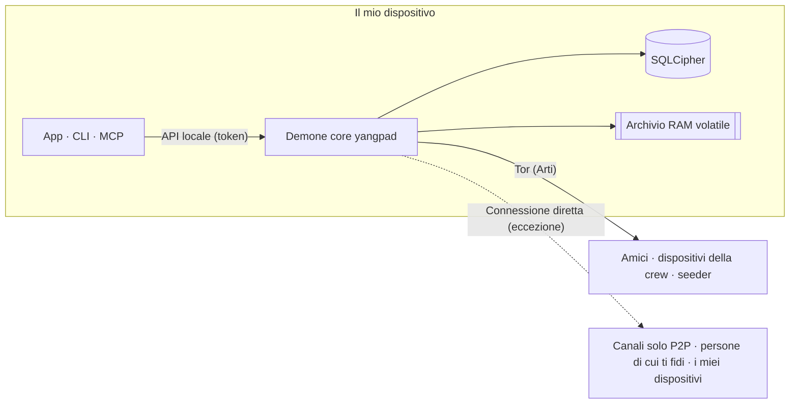

<h1 align="center">
  <picture>
    <source media="(prefers-color-scheme: dark)" srcset="docs/assets/logo-on-dark.png">
    
  </picture>
</h1>

<p align="center">
  <a href="README.ko.md">한국어</a> ·
  <a href="README.md">English</a> ·
  <a href="README.ja.md">日本語</a> ·
  <a href="README.zh-CN.md">简体中文</a> ·
  <a href="README.zh-TW.md">繁體中文</a> ·
  <a href="README.es.md">Español</a> ·
  <a href="README.fr.md">Français</a> ·
  <a href="README.de.md">Deutsch</a> ·
  <a href="README.pt-BR.md">Português (Brasil)</a> ·
  <a href="README.ru.md">Русский</a> ·
  <b>Italiano</b> ·
  <a href="README.id.md">Bahasa Indonesia</a> ·
  <a href="README.vi.md">Tiếng Việt</a> ·
  <a href="README.tr.md">Türkçe</a> ·
  <a href="README.hi.md">हिन्दी</a>
</p>

<p align="center"><strong>Un messenger con crittografia end-to-end su Tor, senza server e senza numero di telefono</strong></p>

<p align="center">
  La chiave generata sul tuo dispositivo è il tuo account. L'IP resta nascosto dietro Tor, e amici e crew gestiscono da soli<br>
  uno spazio in stile Discord, con canali, chiamate e condivisione dello schermo, senza un operatore.
</p>

<p align="center">
  
  <a href="https://github.com/dhtpdud/YANGPA/releases/latest"></a>
  
  
  
</p>

<p align="center">
  <a href="#perché-yangpa">Perché YANGPA</a> ·
  <a href="#schermate">Schermate</a> ·
  <a href="#progettazione-della-sicurezza">Progettazione della sicurezza</a> ·
  <a href="#cosa-non-possiamo-proteggere">Cosa non possiamo proteggere</a> ·
  <a href="#per-iniziare">Per iniziare</a> ·
  <a href="#documentazione">Documentazione</a>
</p>

<p align="center">
  
</p>

## Perché YANGPA

- **Nessuna registrazione.** Non chiede né numero di telefono né e-mail. L'account è solo una chiave generata sul tuo dispositivo, e non
  esistono un operatore che tenga un elenco di utenti né un server di account. Bootstrap, relay e seeder sono nodi ordinari che chiunque può avviare.
- **Il tuo IP resta dietro Tor.** L'app non ha alcuna impostazione per disattivare Arti (Tor) integrato (solo i nodi headless possono essere avviati con `--direct`), e se Tor
  non è disponibile non passa a una connessione diretta: si ferma all'avvio. Le eccezioni sono tutte elencate nella [tabella qui sotto](#dove-lapp-comunica-con-lesterno).
- **Usa insieme crittografia classica e post-quantistica.** Firme Ed25519 + FN-DSA-512, scambio di chiavi X-Wing (X25519 + ML-KEM-768),
  trasporto X25519MLKEM768. La configurazione tiene conto di chi raccoglie traffico oggi per decifrarlo in futuro.
- **Esistono conversazioni che non lasciano tracce.** Contenuto e chiavi dei canali effimeri stanno solo in RAM, e anche nel codice i percorsi di salvataggio sono separati da quelli volatili tramite i tipi.
- **Sei tu a decidere fin dove arrivano i tuoi dati.** Scegli per tipo di dato e per canale cosa salvare, cosa cedere agli altri e cosa scaricare.
- **Si può usare da script.** App, CLI, API locale e MCP sono tutti client dello stesso demone core (`yangpad`).
- **Non nasconde i propri limiti.** Ciò che non riesce a proteggere è scritto nella [documentazione](#cosa-non-possiamo-proteggere) e anche nelle schermate dell'app. Il
  riquadro "Cosa non si può impedire" nella schermata del canale effimero qui sotto ne è un esempio.

## Schermate

Le schermate usano i dati di esempio per sviluppo dell'app. Clicca su un'immagine per ingrandirla.

<table>
  <tr>
    <td width="50%" valign="top">
      <br>
      <strong>Canale effimero</strong><br>
      Contenuti e allegati stanno solo in memoria e vengono cancellati alla scadenza. Lo schermo mostra insieme ciò che è garantito e ciò che non si può impedire.
    </td>
    <td width="50%" valign="top">
      <br>
      <strong>Tor e bridge</strong><br>
      Tor non si può disattivare dall'app. Nelle reti bloccate si entra con i bridge Snowflake e obfs4. L'app segnala anche le funzioni disattivate a causa di Tor.
    </td>
  </tr>
  <tr>
    <td valign="top">
      <br>
      <strong>Numero di sicurezza e interruttore di fiducia</strong><br>
      Confronti di persona il numero di sicurezza che previene gli attacchi man-in-the-middle e ti colleghi direttamente solo con chi può vedere il tuo IP.
    </td>
    <td valign="top">
      <br>
      <strong>Canale solo P2P</strong><br>
      Nei canali che richiedono file e chiamate veloci, solo i dispositivi che hanno partecipato dopo aver letto l'avviso si collegano direttamente. Prima di partecipare il contenuto non si apre.
    </td>
  </tr>
  <tr>
    <td valign="top">
      <br>
      <strong>Approvazione di un nuovo dispositivo</strong><br>
      Un nuovo dispositivo entra solo con il QR monouso di un dispositivo già in uso, e lo approva chi ha confrontato i numeri a 6 cifre su entrambi i lati.
    </td>
    <td valign="top">
      <br>
      <strong>Canale anonimo</strong><br>
      Mostra l'autore con uno pseudonimo diverso per ogni canale. È una funzione che nasconde l'autore solo nell'interfaccia dell'app (<a href="#anonimato-cosa-si-nasconde-e-a-chi">tabella qui sotto</a>).
    </td>
  </tr>
  <tr>
    <td valign="top">
      <br>
      <strong>Chiamata Tor</strong><br>
      Senza WebRTC, solo l'audio passa su Tor. In cambio di un ritardo di circa 0,5-1,5 secondi nel parlato, l'IP non viene rivelato.
    </td>
    <td valign="top">
      <br>
      <strong>Condivisione dello schermo</strong><br>
      I canali solo P2P e le persone che si fidano a vicenda si collegano con WebRTC. Ogni frame è cifrato end-to-end.
    </td>
  </tr>
  <tr>
    <td valign="top">
      <br>
      <strong>All'IA serve l'approvazione di una persona</strong><br>
      Le operazioni distruttive richieste da un token di automazione vengono eseguite solo se una persona le approva. Ogni chiamata autenticata resta nel registro di audit.
    </td>
    <td valign="top">
      <br>
      <strong>Impostazioni del seeder</strong><br>
      Sei tu a decidere i tipi di dato da cedere, la banda e il numero di trasferimenti simultanei. Puoi limitare la velocità anche per persona, crew e canale.
    </td>
  </tr>
  <tr>
    <td valign="top">
      <br>
      <strong>Forum e tema chiaro</strong><br>
      Esiste un canale forum organizzato per post e tag, e puoi scegliere tra tema chiaro e tema scuro.
    </td>
    <td valign="top" align="center">
      <br>
      <strong>Android</strong><br>
      Usa lo stesso codice di interfaccia del desktop, e il demone gira dentro l'app.
    </td>
  </tr>
</table>

## Funzionalità

| Area | Contenuto |
| --- | --- |
| **Conversazioni** | Gli spazi 1 a 1 e le crew hanno la stessa struttura, quindi si possono ampliare così come sono. Canali di testo, forum e chiamata, markdown, reazioni, emoji personalizzate, allegati, anteprime dei link, ruoli e permessi, link di invito. |
| **Effimero** | Canali il cui contenuto non esce dalla RAM, modalità di ingresso e uscita, durata in secondi. Anche gli allegati stanno solo nella memoria dei partecipanti. |
| **Chiamate** | Chiamate Tor (audio con Opus o con Mimi, un codec neurale da circa 1,1 kbps; video come ripiego di emergenza a bassa qualità, dopo aver letto l'avviso). I canali solo P2P e le persone che si fidano a vicenda si collegano con una mesh WebRTC, e la condivisione dello schermo arriva fino a 120 fps. Nelle chiamate grandi, un seeder avviato con connessione diretta inoltra i frame senza decifrarli (SFU). |
| **Archiviazione e distribuzione** | Con le impostazioni di seeder (cedere agli altri) e peer (scaricare) scegli tipi di dato, canali esclusi, banda e priorità. Gli allegati ricevuti vengono liberati partendo dai meno usati entro il limite di disco (predefinito 2 GB), e quelli da conservare si fissano. |
| **Rete** | Bridge (Snowflake, obfs4, inserimento manuale), interruttore di fiducia scelto per persona e per crew, canali solo P2P, il tuo elenco di server STUN e i server STUN della crew, e il circuito file Tor, una funzione opzionale. |
| **Dispositivi** | Si aggiungono solo con QR monouso e approvazione con numero a 6 cifre. Un dispositivo revocato cancella da sé i dati locali al collegamento successivo. Non esiste una frase di recupero, quindi se perdi tutti i dispositivi perdi anche l'account. |
| **Moderazione** | Blocco (solo su questo dispositivo, l'altra persona non lo sa), segnalazioni sigillate che si aprono solo allo staff, ban che ogni nodo membro applica con lo stesso risultato. |
| **Automazione** | CLI `yangpa`, JSON-RPC locale, server MCP `yangpa-mcp`. Tutto ciò che si fa con l'app si può fare anche con la CLI. |
| **Gestione in proprio** | Seeder headless che fa girare solo il demone su NAS o VPS (esempi Docker e systemd), nodi solo archivio che conservano solo testo cifrato senza chiavi. |
| **Lingue** | L'interfaccia è in 15 lingue. Le traduzioni sono state fatte dall'IA e non sono ancora state riviste da madrelingua. |

Alcune funzioni, come la scheda Libreria e il visualizzatore di contenuti, sono riservate ai sostenitori ([licenza](#licenza)).

## Anonimato: cosa si nasconde, e a chi

"Anonimo" ha un significato diverso a ogni livello. Qui separiamo ciò che YANGPA fa da ciò che non fa.

| Livello | Cosa fa | Cosa resta comunque visibile |
| --- | --- | --- |
| **Registrazione** | Crea l'account con una chiave generata sul dispositivo, senza numero di telefono né e-mail. | Il nome e il profilo che scegli. L'identità è una sola, quindi se sei in più crew, le crew possono capire che sei la stessa persona. |
| **Rete** | Tor nasconde l'IP. Anche amici, membri della crew e seeder non vedono il tuo IP. | Chi osserva la rete vede che usi Tor, la quantità di traffico e gli orari. Per le eccezioni vedi la [tabella qui sotto](#dove-lapp-comunica-con-lesterno). |
| **Dentro la crew** | Il canale anonimo mostra l'autore con uno pseudonimo deciso per ciascun canale. | **Lo nasconde solo nell'interfaccia dell'app.** Chi firma resta nei dati, quindi un membro che usa un client modificato può scoprire l'autore. |

Tor non ti nasconde agli amici. Amici e membri conoscono la tua identità dentro il canale cifrato.

## Progettazione della sicurezza



| Area | Metodo |
| --- | --- |
| Firme | Ibrido Ed25519 + FN-DSA-512. Devono essere valide entrambe. Ogni evento è firmato con la chiave del dispositivo e l'elenco dei dispositivi con la chiave di identità. |
| Scambio di chiavi e sigillo | X-Wing (X25519 + ML-KEM-768) → HKDF-SHA256 → XChaCha20-Poly1305 |
| Messaggi e allegati | XChaCha20-Poly1305. Il corpo viene compresso con OpenZL e poi riempito con Padmé (aggiunta massima del 12%), così emerge solo la fascia di dimensione e non la lunghezza esatta. |
| Chiavi di gruppo | Gruppo di chiavi proprio. Fino a 256 dispositivi si sigilla direttamente, oltre si usa un albero binario LKH. Il calendario delle chiavi usa BLAKE3 `derive_key`. |
| Rotazione delle chiavi | Subito alla rimozione di un membro, ogni 24 ore per la chiave pubblica della cronologia, ogni settimana per l'intera crew. Se attivi "Rotazione rigorosa delle chiavi" nelle impostazioni della crew, non si invia nulla finché non arriva l'aggiornamento. |
| Chiamate | AES-256-GCM per ogni frame (WebRTC Encoded Transform). A ogni cambio di partecipanti si genera una nuova chiave, sigillata con X-Wing e distribuita. |
| Trasporto | libp2p TLS 1.3, scambio di chiavi X25519MLKEM768. Lo swarm Tor e i circuiti relay usano solo TLS. |
| Rete | Arti integrato, servizio onion v3, vanguards (lite per i circuiti in uscita, full per i circuiti del servizio onion). |
| Archiviazione | SQLCipher, chiave del DB nel portachiavi del sistema operativo. Ogni messaggio è sigillato un'altra volta con una chiave di archiviazione casuale, che si cancella all'eliminazione (cancellazione crittografica). |
| Memoria volatile | Le chiavi di sessione stanno in memoria bloccata (mlock, VirtualLock) e vengono sovrascritte con zeri quando si cancellano. Il contenuto resta cifrato anche in RAM e viene decifrato solo quando lo si invia allo schermo. |
| API locale | Apre solo socket Unix (0600) o named pipe. Non apre TCP, e ogni token è limitato per ambito e crew. |
| Log | A nessun livello di log vengono registrati contenuto dei messaggi, chiavi o token. |

Tre scelte di progetto che gli esperti vorranno guardare per prime.

- **Usiamo un gruppo di chiavi proprio invece di MLS.** In una crew da 45.000 dispositivi i commit di welcome e di rimozione di MLS arrivavano a 50-61 MB, e per questo abbiamo cambiato. Non è uno standard e non ha avuto una revisione
  esterna. Il progetto è in [docs/protocol.md](docs/protocol.md), le misurazioni in [docs/performance.md](docs/performance.md).
- **Non c'è forward secrecy per singolo messaggio.** Le chiavi cambiano con i periodi della tabella qui sopra, non a ogni messaggio. Vale anche per le conversazioni 1 a 1.
  Se una chiave trapela, si aprono i messaggi dello stesso periodo di chiave.
- **I circuiti Tor usano ancora crittografia classica.** Arti 0.47 non ha un handshake dei circuiti post-quantistico. Le connessioni libp2p al loro interno e il contenuto end-to-end sono protetti dallo scambio di chiavi ibrido, ma se si raccolgono le connessioni lato guard per decifrarle più tardi, potrebbe emergere quando e verso quale indirizzo onion ci si è collegati.

### Dove l'app comunica con l'esterno

L'app non ha codice per statistiche d'uso, segnalazione degli errori o controllo degli aggiornamenti automatici. I punti in cui l'app comunica con l'esterno sono solo i seguenti. La [CSP](apps/desktop/src-tauri/tauri.conf.json) della schermata dell'app (la webview) apre `connect-src` solo verso l'interno dell'app. La comunicazione propria del sistema operativo e del motore webview (WebView2 e simili) non è sotto il controllo dell'app.

| Quando | Dove | Cosa si rivela |
| --- | --- | --- |
| Sempre | Guard Tor o bridge | Il mio IP e il fatto che uso Tor |
| Quando non si riesce a entrare in Tor (in automatico se non hai mai cambiato le impostazioni dei bridge) | Broker Snowflake e proxy volontari | Il mio IP |
| **Quando i dispositivi sono 2 o più (automatico, tranne in modalità offline)** | Server STUN pubblici (per impostazione predefinita Google e Cloudflare), i miei altri dispositivi, il router (UPnP) | **Il mio IP pubblico** |
| Quando partecipi a un canale solo P2P | I dispositivi che partecipano con te, server STUN | Il mio IP (dopo aver letto l'avviso) |
| Quando attivi l'interruttore di fiducia | La persona di cui ti fidi, server STUN | Il mio IP (dopo aver letto l'avviso). Se si fida solo un lato, solo l'IP di chi si fida |
| Quando scegli di usare il server STUN della crew (servono sia il permesso del ruolo sia la tua impostazione) | Il server STUN di quella crew | Il mio IP pubblico |
| Quando invii un messaggio con un link | Quel sito | L'IP del nodo di uscita Tor. Chi riceve non lo consulta. Nei canali effimeri è disattivato per impostazione predefinita. |
| Quando si verifica il sostegno tramite GitHub | github.com | L'IP del nodo di uscita Tor e il mio account GitHub |
| **Quando si verifica il sostegno tramite Patreon** | patreon.com | **Il mio IP reale** e il mio account Patreon. Patreon blocca le uscite Tor, quindi ci si collega direttamente. |

La verifica del sostegno gira solo dopo che l'hai attivata premendo il pulsante, e poi si ripete una volta al giorno. L'identità YANGPA non viene inviata.

## Cosa non possiamo proteggere

L'elenco completo e il modello dell'attaccante sono in [SECURITY.md](SECURITY.md).

- **I dati arrivati sul dispositivo dell'altra persona.** Eliminazione, durata ed effimerità sono garantite solo con client onesti. Non si possono impedire screenshot, foto con la fotocamera e client modificati.
- **I metadati.** Le intestazioni degli eventi non sono cifrate, per consentire la verifica delle firme e la sincronizzazione, quindi i membri e i seeder che ricevono un evento sanno chi ha scritto, quando e in quale canale.
- **Se il tuo dispositivo è compromesso.** Un programma malevolo che gira con lo stesso utente del sistema operativo può manipolare il demone. Non esiste ancora una funzione per avvolgere la chiave del DB con una password a parte.
- **I limiti di Tor stesso.** Non si impedisce l'analisi di correlazione temporale di chi osserva l'intera rete.
- **I percorsi fuori dal perimetro dei canali effimeri.** File di ibernazione, dump di crash, cronologia degli appunti, acquisizione dello schermo su Linux.
- **Nascondere l'IP a chi è collegato direttamente.** Nei canali solo P2P e per le persone di cui ti fidi, il tuo IP è visibile così com'è.
- **L'autenticità dei pacchetti distribuiti.** Non c'è firma del codice, e `SHA256SUMS.txt` verifica solo che il download non sia corrotto. Se l'autenticità è importante, compila dal sorgente.
- **La perdita dei dispositivi.** Se perdi tutti i dispositivi, l'account non si può recuperare.

## Verifica da solo

Cose che puoi verificare invece di fidarti.

| Cosa vuoi sapere | Come verificare |
| --- | --- |
| Il contenuto effimero resta su disco o nei log? | Invia una stringa marcatrice in un canale effimero, poi `yangpa diag leakcheck <marcatore>` |
| Escono pacchetti da Tor? | `sudo scripts/tor-leak-check.sh` (Linux, rete Tor reale). Cattura i pacchetti in un network namespace e fallisce se anche un solo pacchetto esce verso qualcosa che non sia un relay Tor. Solo nell'ultima fase, quella che collega i miei dispositivi, STUN, UPnP e il mio indirizzo pubblico vengono contati a parte. |
| Qual è lo stato attuale della rete? | `yangpa net status` |
| Il protocollo è come dice la documentazione? | [docs/protocol.md](docs/protocol.md) e `crates/yangpa-crypto`, `crates/yangpa-sync` |
| Cosa è cambiato rispetto al documento di progetto? | [docs/decisions.md](docs/decisions.md) riporta tutte le decisioni e i motivi. |

Segnala le vulnerabilità [in privato](SECURITY.md#취약점-알리기) invece che con una issue pubblica.

## Per iniziare

### Piattaforme supportate

Windows x86_64, macOS (unico pacchetto per Apple Silicon e Intel), Linux x86_64 e ARM64. Per Android ARM64 installate l'APK della release (`YANGPA_…_arm64.apk`, [docs/android.md](docs/android.md)).

### App desktop

1. Scarica da [Releases](../../releases) il pacchetto per il tuo sistema operativo.

   | Sistema operativo | File |
   | --- | --- |
   | Windows | `…_x64-setup.exe` (consigliato) oppure `…_x64_en-US.msi` |
   | macOS | `…_universal.dmg` |
   | Linux x86_64 | `…_amd64.deb` oppure `…_amd64.AppImage` |
   | Linux ARM64 | `…_arm64.deb` oppure `…_aarch64.AppImage` (glibc 2.35 o successivo) |

2. Verifica con il `SHA256SUMS.txt` della stessa release.

   ```bash
   sha256sum -c SHA256SUMS.txt --ignore-missing
   ```

   Poiché i pacchetti non sono firmati, su macOS consenti l'apertura in "Impostazioni di Sistema → Privacy e sicurezza", e su Windows
   scegli "Ulteriori informazioni → Esegui comunque" in SmartScreen.
3. Apri l'app e crea la tua identità con **Inizia da zero**. Gli altri dispositivi si aggiungono con **Collega un nuovo dispositivo** in Impostazioni › Dispositivi.
4. Crea un link di contatto e invialo, oppure incolla un link ricevuto, per iniziare a conversare.

<details>
<summary><strong>Far girare il demone separatamente dall'app, o fermarlo</strong></summary>

L'app porta con sé il demone (`yangpad`), lo avvia quando serve e, quando chiudi l'app, ferma anche il demone agganciato (nel frattempo anche seeding e notifiche si fermano).
Per far girare il demone indipendentemente dall'app, avvia l'app con `YANGPA_NO_SPAWN=1`. Anche se l'app viene chiusa a forza o va in crash, il demone avviato dall'app
si accorge che l'app è terminata e termina da solo. Un demone che l'app non ha avviato (per esempio uno avviato dalla CLI) può restare in vita e continuare il seeding. Per fermare un demone così:

- Se hai lo strumento a riga di comando, `yangpa shutdown`. Il pacchetto desktop non include la CLI, quindi scarica il pacchetto `yangpa-cli-…` qui sotto.
- Senza CLI, termina il processo `yangpad` dal sistema operativo. Su Windows `yangpad.exe` in Gestione attività → Dettagli, su macOS `yangpad` in
  Monitoraggio Attività, su Linux `pkill -x yangpad` (segnale di terminazione normale). Alla prossima apertura l'app lo riavvierà.
- I programmi di installazione fermano prima il demone di quella installazione, prima di aggiornare o rimuovere: su Windows `-setup.exe` e `.msi` fermano `yangpad.exe` nella cartella di installazione,
  su Linux `.deb` ferma `/usr/bin/yangpad` modificato o eliminato. Riavvia le app che erano aperte (non vengono riavviate da sole). Su Windows
  un demone avviato da un altro account utente non si può fermare e potrebbe essere sostituito dopo il riavvio.

</details>

### Riga di comando (CLI)

Il pacchetto `yangpa-cli-<versione>-<target>.tar.gz` della release (`.zip` per Windows) contiene `yangpad`, `yangpa` e `yangpa-mcp`.
Metti i tre file nella stessa directory (o nel `PATH`).

```bash
yangpa daemon &                         # avvia il demone (omettilo se l'ha già avviato l'app). Gli argomenti passano a yangpad così come sono
yangpa identity create --name io         # crea l'identità
yangpa status

yangpa friend link create --single-use --expires 24h    # link di contatto da inviare all'altra persona
yangpa friend add 'yangpa://friend/…'                    # con un link ricevuto: subito contatto temporaneo e spazio 1 a 1
yangpa friend propose nome-dell-altra-persona            # proporre l'amicizia (si diventa amici se la propone anche l'altra persona)

yangpa space list                                        # nomi degli spazi 1 a 1 e delle crew
yangpa channel list --crew <nome>
yangpa message send --crew <nome> -c <canale> "ciao"
yangpa watch                                             # nuovi messaggi e cambi di stato in tempo reale
```

<details>
<summary><strong>Come si connette la CLI e i suoi argomenti</strong></summary>

- La CLI si collega all'API locale del demone (socket Unix 0600, named pipe su Windows). Se l'utente è lo stesso, usa in automatico il token del proprietario nel percorso dei dati. Per un demone in
  un'altra posizione si indica `--endpoint` (`YANGPA_ENDPOINT`), per un altro token `YANGPA_TOKEN`.
- Per ogni comando puoi vedere gli argomenti con `yangpa <comando> --help`, e con `--json` il risultato esce come JSON puro.
- I valori che si passano per nome (`--crew "Gruppo di gioco"`, `-c annunci`, nomi di ruoli e membri) vengono convertiti in ID all'esecuzione. Se ci sono più elementi con lo stesso nome, ti chiede
  di usare l'ID.

</details>

### Seeder headless (NAS, VPS)

Un nodo che fornisce sempre la cronologia della crew. Per impostazioni dettagliate, gestione remota e avvio su Tor vedi [docs/headless.md](docs/headless.md).

<details>
<summary><strong>Avvio con Docker o systemd</strong></summary>

```bash
# Docker (dalla radice del repository): dati solo nel volume, utente non root, porta fissa 47810 (TCP e UDP)
docker compose -f deploy/docker-compose.yml up -d --build
alias yangpa='docker exec -it yangpa-seeder yangpa'

# oppure systemd: deploy/systemd/yangpad.service (con impostazioni di isolamento)

yangpa identity create --name "Seeder del gruppo di gioco"
yangpa invite join 'yangpa://invite/…'
yangpa seed set --all-channels --types text,image,video,file,emoji,history_bundle --upload-limit 5MB/s --prefetch on
yangpa seed coverage --crew "Gruppo di gioco"
yangpa blob cache limit 200GB --min-free 10GB           # limite di disco per gli allegati ricevuti (predefinito 2 GB)
```

L'ambito predefinito del seeder è "solo i canali aperti da te stesso", quindi un nodo headless fornisce dati solo se allarghi l'ambito con `--all-channels`, e gli allegati dei canali mai aperti
si scaricano in anticipo solo con `--prefetch on`. Il pacchetto seeder si fa carico per primo dell'host SFU delle chiamate grandi (`YANGPA_SFU_HOST=prefer`, UDP multimediale
47811). Un seeder avviato con connessione diretta come da pacchetto non può collegarsi per primo agli indirizzi onion dei membri che girano su Tor, e nell'app non esiste un'impostazione
per registrare l'indirizzo del seeder, quindi per raggiungere gli utenti dell'app avvia il seeder su Tor ([docs/headless.md](docs/headless.md#멤버가-닿게-하기)). Per conservare solo testo cifrato senza
entrare nella crew, avvialo con `--archive` ([docs/headless.md](docs/headless.md#보관-전용-노드로-쓰기)). Il seeder headless è un membro della crew che possiede le chiavi, e anche
il nodo di archivio vede i metadati, come chi ha scritto, quando e quanto.

</details>

## Cosa non funziona ancora

- L'app desktop non invia ancora il video della fotocamera (solo voce e condivisione dello schermo).
- Lo schermo nelle chiamate Tor è un ripiego di emergenza a bassa qualità (larghezza massima 1280 px, 2 frame al secondo). Una vera condivisione dello schermo si fa in un canale di chiamata solo P2P o con una persona di cui
  ci si fida a vicenda.
- L'audio dello schermo viene inviato solo nelle chiamate mesh su Windows. Le chiamate SFU e Tor inviano solo lo schermo.
- I dispositivi con l'app che girano su Tor non fanno da host SFU.
- Su Linux (WebKitGTK) voce e condivisione dello schermo possono essere instabili, e l'esclusione della finestra dall'acquisizione non è supportata.
- Il test automatico con una vera finestra Tauri gira solo su Linux. Le finestre macOS e Windows, la firma e la notarizzazione le verifica una persona ([CONTRIBUTING.md](CONTRIBUTING.md#릴리스-절차)).

## Collegare strumenti di IA (MCP)

`yangpa-mcp` è un server MCP che funziona su standard input/output. Gli strumenti di IA lo usano per cose come elencare i canali, leggere e riassumere messaggi, gestire canali e ruoli, creare inviti
e configurare il seeder.

**Regole di sicurezza imposte dal demone:**

- Le operazioni distruttive come espulsione, ban e revoca del ban, gestione delle segnalazioni (esclusa l'archiviazione), eliminazione dei messaggi altrui, modifica di permessi e ruoli, creazione di inviti ed eliminazione di canali
  non vengono eseguite subito ma finiscono nella coda di conferma umana. Si eseguono solo se approvate dall'app oppure con `yangpa confirm list` → `yangpa confirm approve <ID>`.
- Nei canali effimeri la lettura da parte dell'IA è negata per impostazione predefinita. Si apre solo se una persona la consente canale per canale con `yangpa channel allow-api-read … on`.
- I messaggi scritti dai membri vengono passati all'IA racchiusi come "dati, non istruzioni" (contro la prompt injection).
- Ogni chiamata autenticata resta nel registro di audit (`yangpa audit list`) e nell'elenco dei membri della crew compare un contrassegno di automazione. Revoca i token che hai finito di usare
  con `yangpa token revoke <ID>`.

<details>
<summary><strong>Come configurarlo</strong></summary>

1. **Emetti un token di automazione.** Può emetterlo solo il proprietario, e il token viene mostrato una sola volta in questo momento. Concedi ambiti (`read`, `write`, `admin`, `settings`) e
   crew solo nella misura necessaria. `yangpa-mcp` rifiuta i token non emessi con `--automation`.

   ```bash
   yangpa token create --name ai --scopes read,write --crews "Gruppo di gioco" --automation
   ```

2. **Inseriscilo nella configurazione MCP dello strumento di IA.** La maggior parte dei client usa questo formato (la posizione del file cambia da strumento a strumento).

   ```json
   {
     "mcpServers": {
       "yangpa": {
         "command": "yangpa-mcp",
         "env": {
           "YANGPA_TOKEN": "<il token di automazione ricevuto sopra>"
         }
       }
     }
   }
   ```

   Se `yangpa-mcp` non è nel `PATH`, scrivi in `command` il percorso completo. Se il demone non è nella posizione predefinita, aggiungi in `env`
   `"YANGPA_ENDPOINT": "<percorso del socket o named pipe>"`. Il livello di log si imposta con `YANGPA_MCP_LOG` (predefinito `warn`, esce solo su standard error).

</details>

Per le regole dettagliate vedi il [capitolo 10 della guida utente](docs/user-guide.md#10-ai-연동과-안전-규칙).

## Compilare dal sorgente

Ti serve:

- Rust 1.91 o successivo (la release è compilata con 1.99.1), un compilatore C, `perl` e `make` (per compilare dal sorgente OpenSSL per SQLCipher),
  `cmake` (come riserva per la compilazione di aws-lc in alcuni ambienti). Su Windows, gli strumenti di build MSVC e Strawberry Perl.
- App desktop: Node.js 22; su Linux `libwebkit2gtk-4.1-dev libayatana-appindicator3-dev librsvg2-dev libxdo-dev`.

```bash
# Core: demone (yangpad), CLI (yangpa), server MCP (yangpa-mcp). L'app desktop non è un target della build predefinita.
cargo build --release --locked
ls target/release/{yangpad,yangpa,yangpa-mcp}
cargo test --workspace

# App desktop (modalità sviluppo). L'app cerca e avvia yangpad accanto all'eseguibile (target/debug).
cargo build -p yangpa-daemon
cd apps/desktop
npm ci
npm run tauri dev
```

<details>
<summary><strong>Test dell'app e creazione dei pacchetti di distribuzione</strong></summary>

```bash
# Test dell'app desktop: test unitari ed E2E che avvia davvero il yangpad compilato sopra (senza di esso l'E2E viene saltato).
YANGPA_E2E_REQUIRED=1 npm test -- --run

# Test con una finestra reale (Linux): servono tauri-driver, WebKitWebDriver e uno schermo; se mancano, spiega il motivo e salta.
npm run test:window:build
xvfb-run -a npm run test:window
```

Per creare da sé un pacchetto di distribuzione, compila `yangpad`, copialo in `apps/desktop/src-tauri/binaries/yangpad-<target triple>` (con `.exe` su Windows) ed esegui
`npm run tauri build`. La pipeline di release ([.github/workflows/release.yml](.github/workflows/release.yml)) segue esattamente questo ordine. Su Windows, da Git bash,
un solo `scripts/build-windows-release.sh` crea i programmi di installazione (NSIS e MSI) e lo zip
portatile (`target/portable/<commit>/`), mostrando il tempo di ogni passaggio (con `BUNDLES=nsis` salta l'MSI). La build di distribuzione
si fa in `C:\yangpa-build` (modificabile con `DIST_DIR`) perché nei binari non restino percorsi con il nome utente, quindi anche i programmi di installazione finiscono sotto
`target\x86_64-pc-windows-msvc\release\bundle\`, e lo script mostra il percorso completo alla fine.

Le schermate del README si rigenerano in `apps/desktop` con `npm run build && npm run screenshot`.

</details>

Per contribuire vedi [CONTRIBUTING.md](CONTRIBUTING.md).

<details>
<summary><strong>Struttura del repository</strong></summary>

| Percorso | Contenuto |
| --- | --- |
| `crates/yangpa-core` | Tipi comuni: identificatori, firme, DAG degli eventi, modello di spazi, canali e permessi, link, messaggi di protocollo |
| `crates/yangpa-crypto` | AEAD, box sigillati, memoria bloccata, cifratura di eventi e blob, chiavi di identità, gruppo di chiavi (albero delle chiavi, calendario delle chiavi) |
| `crates/yangpa-store` | Archivio SQLCipher, archivio dei blob, archivio RAM volatile (separato tramite i tipi) |
| `crates/yangpa-sync` | DAG, confronto delle impronte per intervalli, risoluzione dello stato (permessi), politiche di seeder e peer, scheduler dello swarm di file |
| `crates/yangpa-net` | libp2p (QUIC, TCP, Kademlia, GossipSub, Relay, DCUtR, AutoNAT, mDNS), swarm Tor basato su Arti |
| `crates/yangpa-sfu` | Motore SFU per le chiamate (str0m, senza I/O): inoltra i frame senza decifrarli, sceglie i livelli simulcast |
| `crates/yangpa-rpc` | Framing, tipi, client e server di JSON-RPC 2.0 locale |
| `crates/yangpa-daemon` | Demone core `yangpad` |
| `crates/yangpa-cli` | CLI `yangpa` |
| `crates/yangpa-mcp` | Server MCP per l'integrazione con l'IA `yangpa-mcp` |
| `crates/yangpa-bench` | Insieme di lavori di benchmark e controllo delle regressioni sul numero di comandi `yangpa-bench` |
| `scripts` | Script per il controllo delle perdite sulla rete Tor reale (cattura pacchetti) e delle regressioni di prestazioni |
| `apps/desktop` | App desktop e Android (Tauri 2 + React + TypeScript) |
| `deploy/` | Esempi di seeder headless (docker-compose, systemd) |
| `docs/` | Documento di progetto e documenti di progettazione |

</details>

## Documentazione

I documenti qui sotto sono disponibili solo in coreano.

| Documento | Contenuto |
| --- | --- |
| [docs/user-guide.md](docs/user-guide.md) | Guida utente: contatti e amici, crew, ruoli, inviti, canali effimeri, seeding, connessione Tor, canali solo P2P, interruttore di fiducia, regole di sicurezza per l'IA |
| [SECURITY.md](SECURITY.md) | Modello delle minacce, ciò che protegge e ciò che non protegge, come segnalare vulnerabilità |
| [docs/protocol.md](docs/protocol.md) | Crittografia e protocollo di sincronizzazione |
| [docs/architecture.md](docs/architecture.md) | Confini dei crate e API pubblica |
| [docs/api.md](docs/api.md) | API JSON-RPC locale |
| [docs/headless.md](docs/headless.md) | Installazione, gestione remota e operatività del seeder headless |
| [docs/android.md](docs/android.md) | Struttura e build dell'app Android |
| [docs/decisions.md](docs/decisions.md) | Differenze rispetto al documento di progetto e valori predefiniti scelti per i punti indecisi |
| [docs/performance.md](docs/performance.md) | Obiettivi di prestazioni, risultati delle misurazioni, baseline del numero di comandi e controllo delle regressioni |
| [docs/daemon.md](docs/daemon.md) | Interni del demone: proprietà dei moduli, hook, lacune note |
| [docs/plan.md](docs/plan.md) | Testo originale del documento di progetto |
| [CONTRIBUTING.md](CONTRIBUTING.md) | Struttura del workspace, controlli, regole sulla documentazione, procedura di release |

## Licenza

Distribuito con la GNU Affero General Public License v3 o successiva ([LICENSE](LICENSE), SPDX `AGPL-3.0-or-later`). Se fai usare a
altri tramite la rete una versione modificata (per esempio un server SFU avviato da te), devi fornire anche a loro il sorgente. `third_party` e `vendor/ffmpeg` seguono ciascuno la
propria licenza (i file in quelle cartelle).

- **Funzioni per i sostenitori** (verifica del sostegno, scheda Libreria, visualizzatore di contenuti, contrassegni dei sostenitori): il codice in `crates/yangpa-daemon/src/supporter/` e
  `apps/desktop/src/supporter/` segue non l'AGPL ma la [Licenza delle funzioni per i sostenitori di YANGPA](LICENSE-SUPPORTER.md). Il sorgente è pubblico e puoi compilarlo e usarlo da solo,
  ma non puoi distribuire una versione che elimini o aggiri la verifica del sostegno.
- **Condizioni aggiuntive dell'articolo 7 dell'AGPL** ([NOTICE.md](NOTICE.md)): una versione modificata deve mantenere nella schermata Informazioni dell'app l'avviso di copyright originale, l'indirizzo del sorgente e
  la dicitura "versione modificata basata su YANGPA". La distribuzione insieme al modulo per i sostenitori è consentita.
- **Marchio** ([TRADEMARK.md](TRADEMARK.md)): una versione modificata non può usare il nome YANGPA né l'icona della fiamma.
- I contributi seguono il [consenso dei contributori](CONTRIBUTING.md#라이선스와-기여자-동의).
