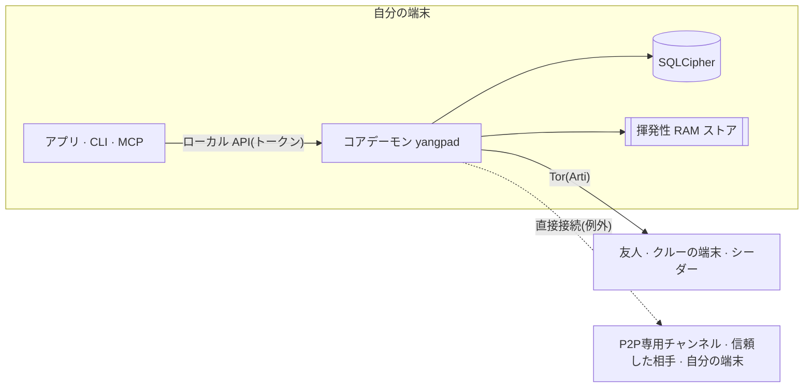

<h1 align="center">
  <picture>
    <source media="(prefers-color-scheme: dark)" srcset="docs/assets/logo-on-dark.png">
    
  </picture>
</h1>

<p align="center">
  <a href="README.md">한국어</a> ·
  <a href="README.en.md">English</a> ·
  <b>日本語</b> ·
  <a href="README.zh-CN.md">简体中文</a> ·
  <a href="README.zh-TW.md">繁體中文</a> ·
  <a href="README.es.md">Español</a> ·
  <a href="README.fr.md">Français</a> ·
  <a href="README.de.md">Deutsch</a> ·
  <a href="README.pt-BR.md">Português (Brasil)</a> ·
  <a href="README.ru.md">Русский</a> ·
  <a href="README.it.md">Italiano</a> ·
  <a href="README.id.md">Bahasa Indonesia</a> ·
  <a href="README.vi.md">Tiếng Việt</a> ·
  <a href="README.tr.md">Türkçe</a> ·
  <a href="README.hi.md">हिन्दी</a>
</p>

<p align="center"><strong>サーバーも電話番号も要らない、Tor 上のエンドツーエンド暗号化メッセンジャー</strong></p>

<p align="center">
  端末で作った鍵がそのままアカウントになります。IP は Tor で隠し、チャンネル・通話・画面共有を備えた<br>
  Discord 風の場を、運営会社なしで友人やクルー同士で動かします。
</p>

<p align="center">
  
  <a href="https://github.com/dhtpdud/YANGPA/releases/latest"></a>
  
  
  
</p>

<p align="center">
  <a href="#なぜyangpaか">なぜ YANGPA か</a> ·
  <a href="#画面">画面</a> ·
  <a href="#セキュリティ設計">セキュリティ設計</a> ·
  <a href="#守れないもの">守れないもの</a> ·
  <a href="#はじめに">はじめに</a> ·
  <a href="#ドキュメント">ドキュメント</a>
</p>

<p align="center">
  
</p>

## なぜYANGPAか

- **登録がありません。** 電話番号もメールアドレスも求めません。アカウントは自分の端末で作った鍵だけで、名簿を握る運営会社もアカウントサーバーもありません。ブートストラップ・リレー・シーダーも、誰でも立てられる一般のノードです。
- **IP を Tor の背後に置きます。** アプリには組み込みの Arti(Tor)をオフにする設定がなく(ヘッドレスノードだけ `--direct` で起動できます)、Tor を使えないときは直接接続に切り替えず、起動を止めます。例外は[下の表](#アプリが外部と通信する箇所)にすべて書きました。
- **従来の暗号と耐量子暗号を併用します。** 署名は Ed25519 + FN-DSA-512、鍵交換は X-Wing(X25519 + ML-KEM-768)、転送は X25519MLKEM768 です。今集めた通信を後から解読しようとする攻撃を想定した構成です。
- **残さない会話があります。** 揮発性チャンネルの内容と鍵は RAM にしかなく、コードでも保存経路と型で分けてあります。
- **自分のデータの範囲は自分で決めます。** 何を保存し、他人に提供し、取得するかを、データの種類とチャンネル単位で選びます。
- **スクリプトから扱えます。** アプリ・CLI・ローカル API・MCP はすべて同じコアデーモン(`yangpad`)のクライアントです。
- **限界を隠しません。** 守れないものを[ドキュメント](#守れないもの)にも、アプリ画面にも書きます。下の揮発性チャンネルの画面にある「防げないこと」がその例です。

## 画面

アプリの開発用サンプルデータで撮った画面です。画像をクリックすると大きく見られます。

<table>
  <tr>
    <td width="50%" valign="top">
      <br>
      <strong>揮発性チャンネル</strong><br>
      内容と添付はメモリにだけあり、寿命が来ると消えます。保証することと防げないことを画面に併記します。
    </td>
    <td width="50%" valign="top">
      <br>
      <strong>Tor とブリッジ</strong><br>
      アプリからは切れない Tor。遮断された回線では Snowflake・obfs4 ブリッジ経由で入ります。Tor のためにオフになる機能もそのまま知らせます。
    </td>
  </tr>
  <tr>
    <td valign="top">
      <br>
      <strong>安全番号と信頼スイッチ</strong><br>
      中間者攻撃を防ぐ安全番号を自分で照合し、IP を見せてよい相手だけを選んで直接接続します。
    </td>
    <td valign="top">
      <br>
      <strong>P2P専用チャンネル</strong><br>
      高速なファイル転送や通話が必要なチャンネルでは、警告を確認して参加した端末同士だけを直接つなぎます。参加するまで内容は開けません。
    </td>
  </tr>
  <tr>
    <td valign="top">
      <br>
      <strong>新しいデバイスの承認</strong><br>
      新しい端末は、使っている端末の使い捨て QR からしか入れず、双方の 6 桁の番号を突き合わせた人が許可します。
    </td>
    <td valign="top">
      <br>
      <strong>匿名チャンネル</strong><br>
      投稿者をチャンネルごとの仮名で表示します。アプリの画面上で隠すだけの機能です(<a href="#匿名性-誰から何を隠すのか">下の表</a>)。
    </td>
  </tr>
  <tr>
    <td valign="top">
      <br>
      <strong>Tor 通話</strong><br>
      WebRTC を使わず、音声だけを Tor で運びます。声が 0.5〜1.5 秒ほど遅れる代わりに IP が明らかになりません。
    </td>
    <td valign="top">
      <br>
      <strong>画面共有</strong><br>
      P2P専用チャンネルと、互いに信頼した相手とは WebRTC でつなぎます。フレームごとにエンドツーエンドで暗号化します。
    </td>
  </tr>
  <tr>
    <td valign="top">
      <br>
      <strong>AI には人の承認を</strong><br>
      自動化トークンが要求した破壊的な操作は、人が承認して初めて実行されます。認証した呼び出しはすべて監査ログに残ります。
    </td>
    <td valign="top">
      <br>
      <strong>シーダー設定</strong><br>
      提供するデータの種類、帯域幅、同時転送数を自分で決めます。人・クルー・チャンネルごとに速度も制限します。
    </td>
  </tr>
  <tr>
    <td valign="top">
      <br>
      <strong>フォーラムとライトテーマ</strong><br>
      投稿とタグで整理するフォーラムチャンネルがあり、ライトテーマとダークテーマを選べます。
    </td>
    <td valign="top" align="center">
      <br>
      <strong>Android</strong><br>
      デスクトップと同じ画面コードを使い、デーモンはアプリの中で動きます。
    </td>
  </tr>
</table>

## 機能

| 領域 | 内容 |
| --- | --- |
| **会話** | 1 対 1 のスペースとクルーが同じ構造なので、そのまま拡張できます。テキスト・フォーラム・通話チャンネル、マークダウン、リアクション、カスタム絵文字、添付、リンクプレビュー、ロール・権限、招待リンク。 |
| **揮発性** | 内容が RAM の外に出ないチャンネル、入室・退室方式、秒単位の寿命。添付も参加者のメモリにだけあります。 |
| **通話** | Tor 通話(音声は Opus または約 1.1kbps のニューラルコーデック Mimi、画面は警告を確認したうえでの緊急用低画質)。P2P専用チャンネルと互いに信頼した相手とは WebRTC メッシュでつなぎ、画面共有は最大 120fps です。大人数の通話では、直接接続で立てたシーダーがフレームを復号せずに中継します(SFU)。 |
| **保存・提供** | シーダー(他人に提供)・ピア(取得)の設定で、データの種類、チャンネルの除外、帯域幅、優先順位を選びます。受信した添付はディスク上限(既定 2GB)の範囲で、長く使っていないものから消し、残したいものはピン留めします。 |
| **ネットワーク** | ブリッジ(Snowflake・obfs4・手動入力)、人・クルーごとに選ぶ信頼スイッチ、P2P専用チャンネル、自分の STUN サーバー一覧とクルーの STUN サーバー、オプション機能の Tor ファイル回路。 |
| **デバイス** | 使い捨て QR と 6 桁番号の承認でのみ追加します。失効させた端末は次回の接続時に自らローカルデータを消去します。復元用フレーズがないため、すべての端末を失うとアカウントも失われます。 |
| **運営** | ブロック(この端末だけ、相手には通知されません)、運営陣だけが開ける封印通報、すべてのメンバーノードが同じ結果で適用する BAN。 |
| **自動化** | CLI `yangpa`、ローカル JSON-RPC、MCP サーバー `yangpa-mcp`。アプリでできることは CLI でもできます。 |
| **自前運用** | NAS・VPS でデーモンだけを動かすヘッドレスシーダー(Docker・systemd の例あり)、鍵を持たず暗号文だけを保管するアーカイブ専用ノード。 |
| **言語** | 画面は 15 言語です。翻訳は AI によるもので、ネイティブによる確認はまだです。 |

ライブラリタブやコンテンツビューアーなど一部の機能はサポーター専用です([ライセンス](#ライセンス))。

## 匿名性: 誰から何を隠すのか

「匿名」は層によって意味が違います。YANGPA がすることとしないことを分けて書きます。

| 層 | すること | それでも明らかになるもの |
| --- | --- | --- |
| **登録** | 電話番号・メールアドレスなしで、端末で作った鍵からアカウントを作ります。 | 自分で決めた名前とプロフィール。ID は 1 つなので、複数のクルーにいると、クルー同士が同じ人だと分かります。 |
| **ネットワーク** | Tor が IP を隠します。友人・クルーのメンバー・シーダーにも IP は見えません。 | 回線の観測者は、Tor を使っていることとトラフィック量・時刻を見ます。例外は[下の表](#アプリが外部と通信する箇所)。 |
| **クルー内** | 匿名チャンネルは、投稿者をチャンネルごとに決まる仮名で表示します。 | **アプリの画面上でだけ隠します。** 署名者はデータにそのまま残るため、改造したクライアントを使うメンバーは投稿者を知ることができます。 |

Tor は友人から自分を隠しません。友人とメンバーは、暗号化されたチャンネルの中で自分の ID を知っています。

## セキュリティ設計



| 領域 | 方式 |
| --- | --- |
| 署名 | Ed25519 + FN-DSA-512 のハイブリッド。両方が正しくないと通りません。すべてのイベントは端末鍵で、端末一覧は ID 鍵で署名します。 |
| 鍵交換・封印 | X-Wing(X25519 + ML-KEM-768) → HKDF-SHA256 → XChaCha20-Poly1305 |
| メッセージ・添付 | XChaCha20-Poly1305。本文は OpenZL で圧縮したあと Padmé でパディングし(増えるのは 12% 以下)、正確な長さではなくサイズ帯だけが見えます。 |
| グループ鍵 | 独自のキーグループ。256 台までは直接封印し、超えると LKH 二分木を使います。鍵スケジュールは BLAKE3 `derive_key` です。 |
| 鍵の交換 | メンバー削除時にすぐ、履歴公開鍵は 24 時間ごと、クルー全体は 1 週間ごとに更新します。クルー設定の「厳格なキーローテーション」をオンにすると、更新が届くまで送信しません。 |
| 通話 | フレームごとに AES-256-GCM(WebRTC Encoded Transform)。参加者が変わるたびに新しい鍵を作り、X-Wing で封印して配ります。 |
| 転送 | libp2p TLS 1.3、鍵交換は X25519MLKEM768。Tor スウォームとリレー回路は TLS のみを使います。 |
| ネットワーク | 組み込み Arti、onion サービス v3、vanguards(発信回路は lite、onion サービス回路は full)。 |
| 保存 | SQLCipher、DB 鍵は OS のキーストア。メッセージごとにランダムな保存鍵でもう一度封印し、削除時にその鍵を消します(暗号学的削除)。 |
| 揮発性メモリ | セッション鍵はロックしたメモリ(mlock・VirtualLock)に置き、消すときにゼロで上書きします。内容は RAM 上でも暗号文のままで、画面に送るときだけ復号します。 |
| ローカル API | Unix ソケット(0600)か named pipe だけを開きます。TCP は開かず、トークンごとに範囲とクルーを制限します。 |
| ログ | どのログレベルでも、メッセージ内容・鍵・トークンを残しません。 |

専門家がまず見るべき設計判断が 3 つあります。

- **MLS ではなく独自のキーグループを使います。** 4 万 5 千台のクルーで MLS のウェルカム・削除コミットが 50〜61MB まで膨らんだため変更しました。標準ではなく、外部のレビューも受けていません。設計は [docs/protocol.md](docs/protocol.md)、測定は [docs/performance.md](docs/performance.md) にあります。
- **メッセージ単位の前方秘匿性がありません。** 鍵は上の表の周期で更新され、メッセージごとには回りません。1 対 1 の会話も同じ構造です。鍵が漏れると、同じ鍵の期間のメッセージが開かれます。
- **Tor 回路はまだ従来の暗号です。** Arti 0.47 には耐量子の回路ハンドシェイクがありません。その中の libp2p 接続とエンドツーエンドの内容はハイブリッド鍵交換で守られますが、ガード側の接続を溜めておいて後から解読されると、いつどの onion アドレスに接続したかは明らかになりうります。

### アプリが外部と通信する箇所

アプリには利用統計、エラー報告、自動アップデート確認のコードがありません。アプリが外部と通信する箇所は次のものですべてです。アプリ画面(WebView)の [CSP](apps/desktop/src-tauri/tauri.conf.json) は `connect-src` をアプリ内部にだけ開けています。OS と WebView エンジン(WebView2 など)自身の通信はアプリでは制御できません。

| いつ | どこへ | 明らかになるもの |
| --- | --- | --- |
| 常時 | Tor ガードまたはブリッジ | 自分の IP と、Tor を使っているという事実 |
| Tor に入れないとき(ブリッジ設定を変更していなければ自動) | Snowflake ブローカーとボランティアのプロキシ | 自分の IP |
| **端末が 2 台以上のとき(自動、オフラインモードを除く)** | 公開 STUN サーバー(既定は Google・Cloudflare)、自分の他の端末、ルーター(UPnP) | **自分のグローバル IP** |
| P2P専用チャンネルに参加したとき | 一緒に参加した端末、STUN サーバー | 自分の IP(警告の確認後) |
| 信頼スイッチをオンにしたとき | 信頼した相手、STUN サーバー | 自分の IP(警告の確認後)。片方だけが信頼した場合は、信頼した側の IP だけ |
| クルーの STUN サーバーを使うことにしたとき(ロール権限と自分の設定の両方がオンである必要あり) | そのクルーの STUN サーバー | 自分のグローバル IP |
| リンクを含むメッセージを送るとき | そのサイト | Tor 出口ノードの IP。受信者は取得しません。揮発性チャンネルでは既定でオフです。 |
| GitHub でサポートを確認するとき | github.com | Tor 出口ノードの IP と自分の GitHub アカウント |
| **Patreon でサポートを確認するとき** | patreon.com | **自分の実際の IP** と自分の Patreon アカウント。Patreon が Tor 出口をブロックしているため直接接続します。 |

サポートの確認は、自分でボタンを押してオンにした後にだけ動き、その後は 1 日に 1 回再確認します。YANGPA の ID は送りません。

## 守れないもの

全体の一覧と攻撃者モデルは [SECURITY.md](SECURITY.md) にあります。

- **相手の端末に渡ったデータ。** 削除・寿命・揮発性は、正直なクライアントでしか守られません。スクリーンショット、カメラ撮影、改造したクライアントは防げません。
- **メタデータ。** イベントヘッダーは署名の確認と同期のため暗号化していないので、イベントを受け取るメンバーとシーダーは、誰がいつどのチャンネルに書いたかを知ります。
- **自分の端末が侵害された場合。** 同じ OS ユーザーで動く悪意あるプログラムは、デーモンを操作できます。DB 鍵を別のパスワードで包む機能はまだありません。
- **Tor 自体の限界。** 回線全体を見る観測者による時間相関分析は防げません。
- **揮発性チャンネルの範囲外の経路。** ハイバネーションファイル、クラッシュダンプ、クリップボード履歴、Linux での画面キャプチャ。
- **直接接続の相手から IP を隠すこと。** P2P専用チャンネルと信頼した相手には、自分の IP がそのまま見えます。
- **配布物の真正性。** コード署名がなく、`SHA256SUMS.txt` が確認できるのはダウンロード時の破損だけです。真正性が重要ならソースからビルドしてください。
- **端末の紛失。** すべての端末を失うと、アカウントは復元できません。

## 自分で確かめる

信じなくても確かめられるものです。

| 知りたいこと | 確認方法 |
| --- | --- |
| 揮発性の内容がディスク・ログに残るか | 揮発性チャンネルに目印の文字列を送ったあと `yangpa diag leakcheck <目印>` |
| Tor の外にパケットが漏れるか | `sudo scripts/tor-leak-check.sh`(Linux、実際の Tor 網)。ネットワーク名前空間でパケットを捕捉し、Tor リレー以外に出たパケットが 1 つでもあれば失敗します。自分の端末をつなぐ最後の段階だけは、STUN・UPnP・自分のグローバルアドレスを別に数えます。 |
| 今のネットワーク状態は | `yangpa net status` |
| プロトコルがドキュメントどおりか | [docs/protocol.md](docs/protocol.md) と `crates/yangpa-crypto`、`crates/yangpa-sync` |
| 企画書から何が変わったか | [docs/decisions.md](docs/decisions.md) に決定と理由をすべて書いています。 |

脆弱性は、公開 Issue ではなく[非公開で報告](SECURITY.md#취약점-알리기)してください。

## はじめに

### 対応プラットフォーム

Windows x86_64、macOS(Apple シリコン・Intel 共通)、Linux x86_64・ARM64。Android ARM64 はリリースの APK(`YANGPA_…_arm64.apk`)をインストールします([docs/android.md](docs/android.md))。

### デスクトップアプリ

1. [リリース](../../releases)から、お使いの OS に合ったパッケージをダウンロードします。

   | OS | ファイル |
   | --- | --- |
   | Windows | `…_x64-setup.exe`(推奨)または `…_x64_en-US.msi` |
   | macOS | `…_universal.dmg` |
   | Linux x86_64 | `…_amd64.deb` または `…_amd64.AppImage` |
   | Linux ARM64 | `…_arm64.deb` または `…_aarch64.AppImage`(glibc 2.35 以上) |

2. 同じリリースの `SHA256SUMS.txt` で確認します。

   ```bash
   sha256sum -c SHA256SUMS.txt --ignore-missing
   ```

   署名していないパッケージなので、macOS は「システム設定 → プライバシーとセキュリティ」で開くことを許可し、Windows は SmartScreen で「詳細情報 → 実行」を選びます。
3. アプリを開き、**新しく始める**で ID を作ります。他の端末は、設定 › デバイスの**新しいデバイスを接続**で追加します。
4. 連絡先リンクを作って送るか、受け取ったリンクを貼り付けて会話を始めます。

<details>
<summary><strong>デーモンをアプリと別に動かす・止める</strong></summary>

アプリはデーモン(`yangpad`)を同梱していて、必要なときに起動し、アプリを終了すると、つながっていたデーモンも止めます(その間はシーディングも通知も止まります)。
デーモンをアプリと関係なく動かし続けるには、アプリを `YANGPA_NO_SPAWN=1` で実行してください。アプリが強制終了したりクラッシュしたりしても、アプリが起動したデーモンはアプリの終了を検知して自分で終了します。アプリが起動していないデーモン(CLI で起動したもの)は残り、シーディングを続けることがあります。そのようなデーモンを止めるには:

- コマンドラインツールがあれば `yangpa shutdown`。デスクトップ版のパッケージには CLI が入っていないので、下の `yangpa-cli-…` パッケージをダウンロードしてください。
- CLI がなければ、OS から `yangpad` プロセスを終了します。Windows はタスクマネージャー → 詳細の `yangpad.exe`、macOS はアクティビティモニタの `yangpad`、Linux は `pkill -x yangpad`(正常終了シグナル)。次にアプリを開くと再び起動します。
- インストーラーは、更新・削除の前にそのインストールのデーモンを先に止めます: Windows の `-setup.exe`・`.msi` はインストールフォルダの `yangpad.exe` を、Linux の `.deb` は変更または削除される `/usr/bin/yangpad` を止めます。開いていたアプリは再起動してください(自動では再起動しません)。Windows で別のユーザーアカウントが起動したデーモンは止められないため、再起動後に置き換わることがあります。

</details>

### コマンドライン(CLI)

リリースの `yangpa-cli-<バージョン>-<ターゲット>.tar.gz`(Windows は `.zip`)に `yangpad`・`yangpa`・`yangpa-mcp` が入っています。
3 つのファイルを同じディレクトリ(または `PATH`)に置いてください。

```bash
yangpa daemon &                         # デーモンを起動(すでにアプリが起動していれば省略)。引数は yangpad にそのまま渡される
yangpa identity create --name 私         # ID を作る
yangpa status

yangpa friend link create --single-use --expires 24h    # 相手に送る連絡先リンク
yangpa friend add 'yangpa://friend/…'                    # 受け取ったリンクで、すぐに一時連絡先・1対1スペース
yangpa friend propose 相手の名前                         # 友達に昇格する(相手もすれば友達)

yangpa space list                                        # 1対1スペース・クルー名
yangpa channel list --crew <名前>
yangpa message send --crew <名前> -c <チャンネル> "こんにちは"
yangpa watch                                             # 新着メッセージ・状態の変化をリアルタイムで
```

<details>
<summary><strong>CLI の接続方式と引数</strong></summary>

- CLI はデーモンのローカル API(Unix ソケット 0600、Windows は named pipe)に接続します。同じユーザーであれば、データパスのオーナートークンを自動で使います。別の場所のデーモンは `--endpoint`(`YANGPA_ENDPOINT`)、別のトークンは `YANGPA_TOKEN` で指定します。
- すべてのコマンドは `yangpa <コマンド> --help` で引数を確認でき、`--json` を付けると結果を JSON のまま出力します。
- 名前で渡す値(`--crew "ゲーム仲間"`、`-c お知らせ`、ロール・メンバー名)は、実行時に ID へ変換します。同じ名前が複数あるときは ID を使うよう案内します。

</details>

### ヘッドレスシーダー(NAS・VPS)

クルーの記録を常に提供するノードです。詳しい設定・リモート管理・Tor での起動は [docs/headless.md](docs/headless.md)。

<details>
<summary><strong>Docker・systemd で起動する</strong></summary>

```bash
# Docker(リポジトリのルートで): データはボリュームのみ、非 root ユーザー、固定ポート 47810(TCP・UDP)
docker compose -f deploy/docker-compose.yml up -d --build
alias yangpa='docker exec -it yangpa-seeder yangpa'

# または systemd: deploy/systemd/yangpad.service(分離設定を含む)

yangpa identity create --name "ゲーム仲間シーダー"
yangpa invite join 'yangpa://invite/…'
yangpa seed set --all-channels --types text,image,video,file,emoji,history_bundle --upload-limit 5MB/s --prefetch on
yangpa seed coverage --crew "ゲーム仲間"
yangpa blob cache limit 200GB --min-free 10GB           # 受信した添付に使うディスク上限(既定 2GB)
```

既定のシーダー範囲は「本人が開いたチャンネルのみ」なので、ヘッドレスノードは `--all-channels` で範囲を広げないと提供せず、開いていないチャンネルの添付は `--prefetch on` でないと先に取得しません。シーダーパッケージは、大人数の通話の SFU ホストを優先して引き受けます(`YANGPA_SFU_HOST=prefer`、メディア UDP 47811)。パッケージどおり直接接続で立てたシーダーは、Tor で動いているメンバーの onion アドレスに先に接続できず、アプリにもシーダーのアドレスを登録する設定がないため、アプリのユーザーと届き合うようにするにはシーダーを Tor で起動します([docs/headless.md](docs/headless.md#멤버가-닿게-하기))。クルーに参加せず暗号文だけを保管するには `--archive` で起動します([docs/headless.md](docs/headless.md#보관-전용-노드로-쓰기))。ヘッドレスシーダーは鍵を持つクルーのメンバーであり、アーカイブノードも、誰がいつどれだけ書いたかといったメタデータは見えます。

</details>

## 現時点でできないこと

- デスクトップアプリはまだカメラ映像を送りません(音声・画面共有のみ)。
- Tor 通話の画面は緊急用の低画質です(横幅最大 1280px、毎秒 2 フレーム)。きちんとした画面共有は、P2P専用の通話チャンネルか、互いに信頼した相手と行います。
- 画面の音声は Windows のメッシュ通話でのみ送ります。SFU・Tor 通話は画面だけを送ります。
- Tor で動くアプリ端末は SFU ホストを引き受けません。
- Linux(WebKitGTK)の音声・画面共有は不安定なことがあり、ウィンドウキャプチャの除外に対応していません。
- 実際の Tauri ウィンドウの自動テストは Linux でのみ動きます。macOS・Windows のウィンドウと署名・公証は人が確認します([CONTRIBUTING.md](CONTRIBUTING.md#릴리스-절차))。

## AI ツールとの連携 (MCP)

`yangpa-mcp` は標準入出力で動く MCP サーバーです。AI ツールが、チャンネル一覧、メッセージの読み取り・要約、チャンネル・ロールの管理、招待、シーダー設定などをツールとして呼び出します。

**デーモンが強制する安全ルール:**

- キック・BAN・BAN 解除、通報の処理(却下を除く)、他人のメッセージの削除、権限・ロールの変更、招待の作成、チャンネルの削除といった破壊的な操作は、すぐには実行されず、人の確認待ちキューに入ります。アプリか `yangpa confirm list` → `yangpa confirm approve <ID>` で承認して初めて実行されます。
- 揮発性チャンネルは、AI の読み取りが既定で拒否されます。人がチャンネルごとに `yangpa channel allow-api-read … on` で許可して初めて開きます。
- メンバーが書いたメッセージは「指示ではなくデータ」として包んで AI に渡します(プロンプトインジェクション対策)。
- 認証したすべての呼び出しが監査ログ(`yangpa audit list`)に残り、クルーのメンバー一覧に自動化の表示が付きます。使い終えたトークンは `yangpa token revoke <ID>` で失効させてください。

<details>
<summary><strong>設定方法</strong></summary>

1. **自動化トークンを発行します。** オーナーだけが発行でき、トークンはこのとき一度だけ出力されます。範囲(`read`・`write`・`admin`・`settings`)とクルーは必要な分だけ与えてください。`yangpa-mcp` は `--automation` で発行していないトークンを拒否します。

   ```bash
   yangpa token create --name ai --scopes read,write --crews "ゲーム仲間" --automation
   ```

2. **AI ツールの MCP 設定に入れます。** 多くのクライアントが次の形式を使います(ファイルの場所はツールごとに異なります)。

   ```json
   {
     "mcpServers": {
       "yangpa": {
         "command": "yangpa-mcp",
         "env": {
           "YANGPA_TOKEN": "<上で受け取った自動化トークン>"
         }
       }
     }
   }
   ```

   `yangpa-mcp` が `PATH` にない場合は、`command` にフルパスを書きます。デーモンが既定の場所にない場合は、`env` に `"YANGPA_ENDPOINT": "<ソケットのパスまたは named pipe>"` を加えます。ログレベルは `YANGPA_MCP_LOG`(既定 `warn`、標準エラー出力にのみ出力)。

</details>

詳しいルールは[ユーザーガイド 10 章](docs/user-guide.md#10-ai-연동과-안전-규칙)。

## ソースからビルド

必要なもの:

- Rust 1.91 以上(リリースは 1.99.1 でビルド)、C コンパイラ、`perl`・`make`(SQLCipher 用の OpenSSL をソースからビルド)、`cmake`(一部の環境での aws-lc ビルドに備えて)。Windows は MSVC ビルドツールと Strawberry Perl。
- デスクトップアプリ: Node.js 22、Linux は `libwebkit2gtk-4.1-dev libayatana-appindicator3-dev librsvg2-dev libxdo-dev`。

```bash
# コア: デーモン(yangpad)・CLI(yangpa)・MCP サーバー(yangpa-mcp)。デスクトップアプリは既定のビルド対象ではありません。
cargo build --release --locked
ls target/release/{yangpad,yangpa,yangpa-mcp}
cargo test --workspace

# デスクトップアプリ(開発モード)。アプリは実行ファイルの隣(target/debug)の yangpad を探して起動します。
cargo build -p yangpa-daemon
cd apps/desktop
npm ci
npm run tauri dev
```

<details>
<summary><strong>アプリのテストと配布パッケージの作成</strong></summary>

```bash
# デスクトップアプリのテスト: 単体テストと、上でビルドした yangpad を実際に起動する E2E(なければ E2E はスキップ)。
YANGPA_E2E_REQUIRED=1 npm test -- --run

# 実ウィンドウのテスト(Linux): tauri-driver・WebKitWebDriver・ディスプレイが必要で、なければ理由を知らせてスキップ。
npm run test:window:build
xvfb-run -a npm run test:window
```

配布パッケージを自分で作るには、`yangpad` をビルドして `apps/desktop/src-tauri/binaries/yangpad-<ターゲットトリプル>`(Windows は `.exe`)にコピーしてから `npm run tauri build` を実行します。リリースパイプライン([.github/workflows/release.yml](.github/workflows/release.yml))がこの順序をそのまま踏みます。Windows では Git bash で `scripts/build-windows-release.sh` 一つで、インストーラー(NSIS・MSI)とポータブル zip(`target/portable/<コミット>/`)を作れ、段階ごとの所要時間が表示されます(`BUNDLES=nsis` なら MSI をスキップ)。配布ビルドは、バイナリにユーザー名を含むパスが残らないよう `C:\yangpa-build`(`DIST_DIR` で変更)で行うため、インストーラーもその下の `target\x86_64-pc-windows-msvc\release\bundle\` にでき、スクリプトが最後にフルパスを表示します。

README のスクリーンショットは、`apps/desktop` で `npm run build && npm run screenshot` で撮り直します。

</details>

貢献の方法は [CONTRIBUTING.md](CONTRIBUTING.md)。

<details>
<summary><strong>リポジトリ構成</strong></summary>

| パス | 内容 |
| --- | --- |
| `crates/yangpa-core` | 共通の型: 識別子、署名、イベント DAG、スペース・チャンネル・権限モデル、リンク、プロトコルメッセージ |
| `crates/yangpa-crypto` | AEAD・封印ボックス・ロックしたメモリ、イベント・ブロブの暗号化、ID 鍵、キーグループ(キーツリー・鍵スケジュール) |
| `crates/yangpa-store` | SQLCipher ストア、ブロブストア、揮発性 RAM ストア(型で分離) |
| `crates/yangpa-sync` | DAG、区間フィンガープリントの比較、状態の解決(権限)、シーダー・ピアのポリシー、ファイルスウォームのスケジューラー |
| `crates/yangpa-net` | libp2p(QUIC・TCP・Kademlia・GossipSub・Relay・DCUtR・AutoNAT・mDNS)、Arti ベースの Tor スウォーム |
| `crates/yangpa-sfu` | 通話 SFU エンジン(str0m、入出力なし): フレームを復号せずに転送、simulcast 層の選択 |
| `crates/yangpa-rpc` | ローカル JSON-RPC 2.0 のフレーミング・型・クライアント・サーバー |
| `crates/yangpa-daemon` | コアデーモン `yangpad` |
| `crates/yangpa-cli` | CLI `yangpa` |
| `crates/yangpa-mcp` | AI 連携 MCP サーバー `yangpa-mcp` |
| `crates/yangpa-bench` | 性能基準のワークロードとコマンド数の回帰検査 `yangpa-bench` |
| `scripts` | 実際の Tor 網での漏洩検査(パケットキャプチャ)・性能回帰検査のスクリプト |
| `apps/desktop` | デスクトップ・Android アプリ(Tauri 2 + React + TypeScript) |
| `deploy/` | ヘッドレスシーダーの例(docker-compose、systemd) |
| `docs/` | 企画書と設計ドキュメント |

</details>

## ドキュメント

以下のドキュメントは韓国語で書かれています。

| ドキュメント | 内容 |
| --- | --- |
| [docs/user-guide.md](docs/user-guide.md) | ユーザーガイド: 連絡先・友達、クルー、ロール、招待、揮発性チャンネル、シーディング、Tor 接続・P2P専用チャンネル・信頼スイッチ、AI の安全ルール |
| [SECURITY.md](SECURITY.md) | 脅威モデル、守れるものと守れないもの、脆弱性の報告 |
| [docs/protocol.md](docs/protocol.md) | 暗号と同期のプロトコル |
| [docs/architecture.md](docs/architecture.md) | クレートの境界と公開 API |
| [docs/api.md](docs/api.md) | ローカル JSON-RPC API |
| [docs/headless.md](docs/headless.md) | ヘッドレスシーダーの設置・リモート管理・運用 |
| [docs/android.md](docs/android.md) | Android アプリの構成とビルド |
| [docs/decisions.md](docs/decisions.md) | 企画書からの変更点、未決事項に入れた既定値 |
| [docs/performance.md](docs/performance.md) | 性能目標・測定結果・コマンド数の基準線と回帰検査 |
| [docs/daemon.md](docs/daemon.md) | デーモン内部: モジュールの所有、フック、既知の空白 |
| [docs/plan.md](docs/plan.md) | 企画書原文 |
| [CONTRIBUTING.md](CONTRIBUTING.md) | ワークスペース構成、検査、ドキュメント規則、リリース手順 |

## ライセンス

GNU Affero General Public License v3 またはそれ以降のバージョン([LICENSE](LICENSE)、SPDX `AGPL-3.0-or-later`)で配布します。改変版をネットワーク経由で他の人に使わせる場合(例: 自分で立てた SFU サーバー)、その人にもソースを提供する必要があります。`third_party` と `vendor/ffmpeg` は、それぞれのライセンス(そのフォルダ内のファイル)に従います。

- **サポーター機能**(サポート確認、ライブラリタブ、コンテンツビューアー、サポーター表示)のコードである `crates/yangpa-daemon/src/supporter/` と `apps/desktop/src/supporter/` は、AGPL ではなく [YANGPA サポーター機能ライセンス](LICENSE-SUPPORTER.md)に従います。ソースは公開されており、自分でビルドして自分だけで使うことはできますが、サポート確認を取り除いたり回避したりした版を配布することはできません。
- **AGPL 7 条の追加条件**([NOTICE.md](NOTICE.md)): 改変版は、アプリの情報画面に元の著作権表示とソースのアドレス、そして「YANGPA をもとに改変した版」という文言を残さなければなりません。サポーターモジュールとまとめて配布することは許可されています。
- **商標**([TRADEMARK.md](TRADEMARK.md)): 改変版は YANGPA の名前と炎のアイコンを使えません。
- 貢献は[コントリビューター同意](CONTRIBUTING.md#라이선스와-기여자-동의)に従います。
