<h1 align="center">
  <picture>
    <source media="(prefers-color-scheme: dark)" srcset="docs/assets/logo-on-dark.png">
    
  </picture>
</h1>

<p align="center">
  <a href="README.ko.md">한국어</a> ·
  <b>English</b> ·
  <a href="README.ja.md">日本語</a> ·
  <a href="README.zh-CN.md">简体中文</a> ·
  <a href="README.zh-TW.md">繁體中文</a> ·
  <a href="README.es.md">Español</a> ·
  <a href="README.fr.md">Français</a> ·
  <a href="README.de.md">Deutsch</a> ·
  <a href="README.pt-BR.md">Português (Brasil)</a> ·
  <a href="README.ru.md">Русский</a> ·
  <a href="README.it.md">Italiano</a> ·
  <a href="README.id.md">Bahasa Indonesia</a> ·
  <a href="README.vi.md">Tiếng Việt</a> ·
  <a href="README.tr.md">Türkçe</a> ·
  <a href="README.hi.md">हिन्दी</a>
</p>

<p align="center"><strong>An end-to-end encrypted messenger over Tor, with no servers and no phone numbers</strong></p>

<p align="center">
  A key generated on your device is your account. Tor hides your IP, and friends and crews run<br>
  a Discord-style space with channels, calls and screen share, with no operator in the middle.
</p>

<p align="center">
  
  <a href="https://github.com/dhtpdud/YANGPA/releases/latest"></a>
  
  
  
</p>

<p align="center">
  <a href="#why-yangpa">Why YANGPA</a> ·
  <a href="#screens">Screens</a> ·
  <a href="#security-design">Security design</a> ·
  <a href="#what-it-cant-protect">What it can't protect</a> ·
  <a href="#getting-started">Getting started</a> ·
  <a href="#documentation">Documentation</a>
</p>

<p align="center">
  
</p>

## Why YANGPA

- **There is no sign-up.** It asks for no phone number and no email. Your account is just a key generated on your device, and there is
  no operator holding a roster and no account server. Even bootstrap nodes, relays and seeders are ordinary nodes that anyone can run.
- **Your IP stays behind Tor.** The app has no setting to turn off the built-in Arti (Tor); only a headless node can be started with `--direct`.
  If Tor can't be used, the app stops starting instead of falling back to a direct connection. The exceptions are all listed in the [table below](#where-the-app-talks-to-the-outside).
- **It uses classical and post-quantum cryptography together.** Signatures are Ed25519 + FN-DSA-512, key exchange is X-Wing (X25519 + ML-KEM-768),
  and transport is X25519MLKEM768. The design takes into account attacks that collect traffic now to decrypt it later.
- **Some conversations leave no trace.** The content and keys of ephemeral channels exist only in RAM, and the code separates them from storage paths by type.
- **You decide how far your data goes.** You choose what to store, hand out to others and fetch, by data type and per channel.
- **You can script it.** The app, the CLI, the local API and MCP are all clients of the same core daemon (`yangpad`).
- **It doesn't hide its limits.** What it can't protect is written down in the [docs](#what-it-cant-protect) and in the app. The
  "What can't be prevented" note on the ephemeral channel screen below is one example.

## Screens

These screenshots use the app's development sample data. Click an image to enlarge it.

<table>
  <tr>
    <td width="50%" valign="top">
      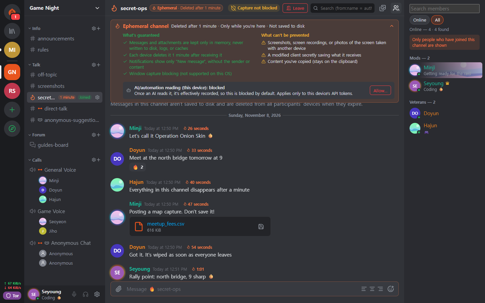<br>
      <strong>Ephemeral channel</strong><br>
      Content and attachments exist only in memory and are erased when their lifetime ends. The screen shows both what is guaranteed and what can't be prevented.
    </td>
    <td width="50%" valign="top">
      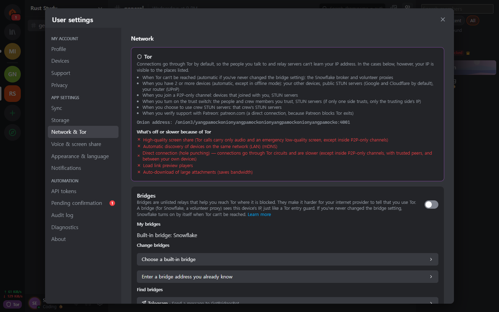<br>
      <strong>Tor and bridges</strong><br>
      Tor can't be turned off in the app. On blocked networks it connects through Snowflake or obfs4 bridges. It also tells you which features are off because of Tor.
    </td>
  </tr>
  <tr>
    <td valign="top">
      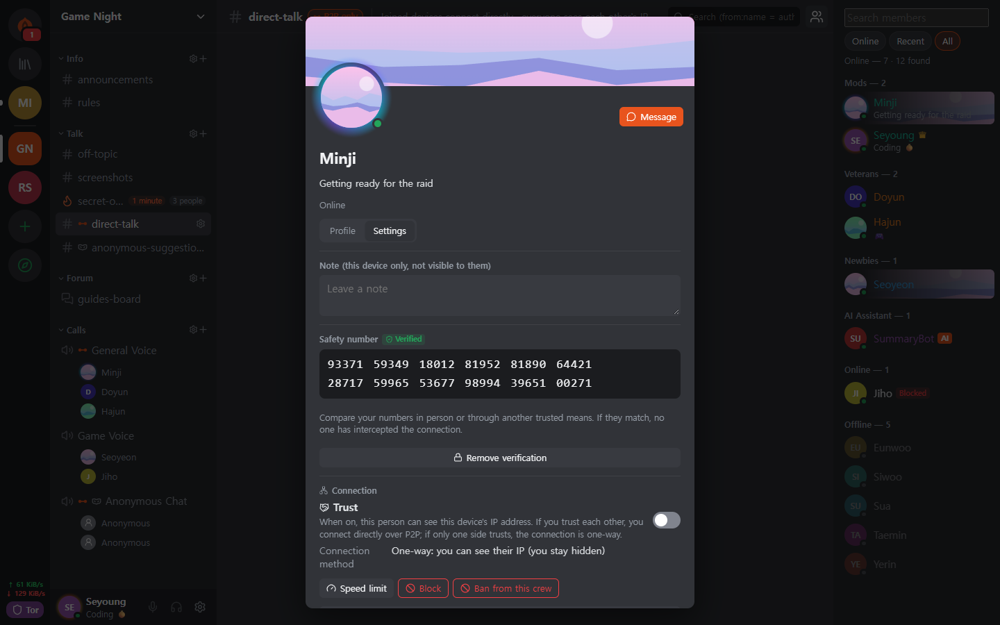<br>
      <strong>Safety number and trust switch</strong><br>
      You compare the safety number yourself to stop a man in the middle, and connect directly only with people you allow to see your IP.
    </td>
    <td valign="top">
      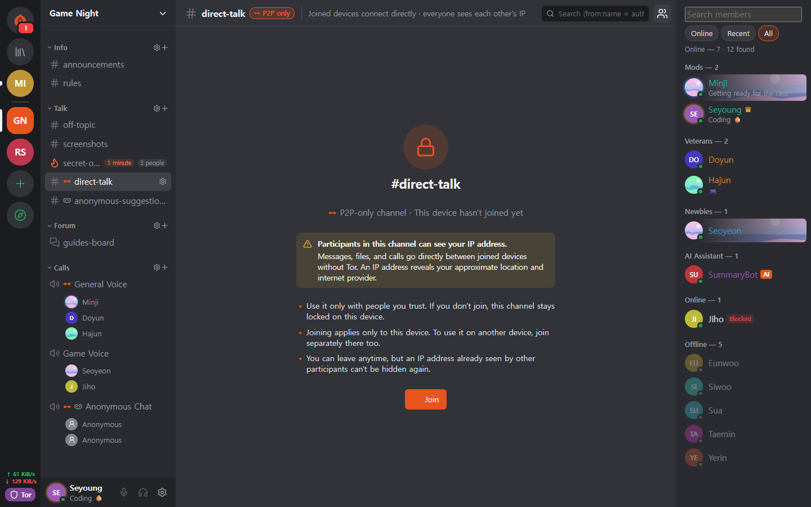<br>
      <strong>P2P-only channel</strong><br>
      In channels that need fast files and calls, only devices that joined after seeing the warning connect directly. The content stays closed until you join.
    </td>
  </tr>
  <tr>
    <td valign="top">
      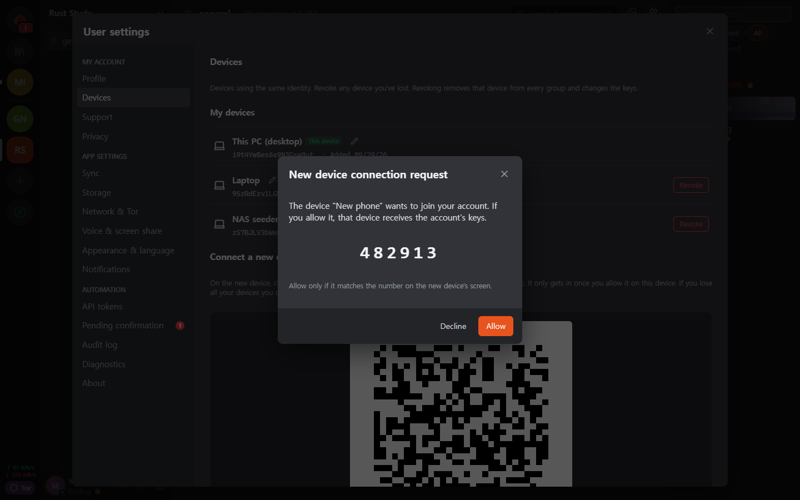<br>
      <strong>Approving a new device</strong><br>
      A new device can join only through a one-time QR code from a device you already use, and the person who matched the 6-digit numbers on both sides approves it.
    </td>
    <td valign="top">
      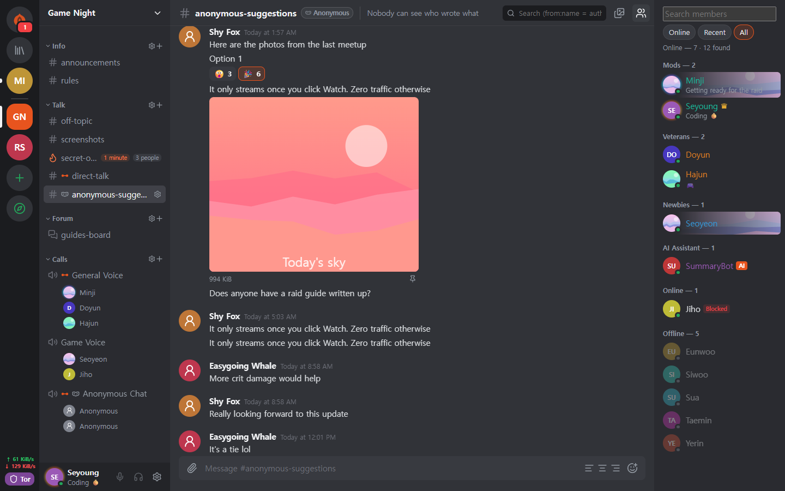<br>
      <strong>Anonymous channel</strong><br>
      Authors are shown under a per-channel pseudonym. It hides them only in the app's display (<a href="#anonymity-who-is-hidden-from-what">table below</a>).
    </td>
  </tr>
  <tr>
    <td valign="top">
      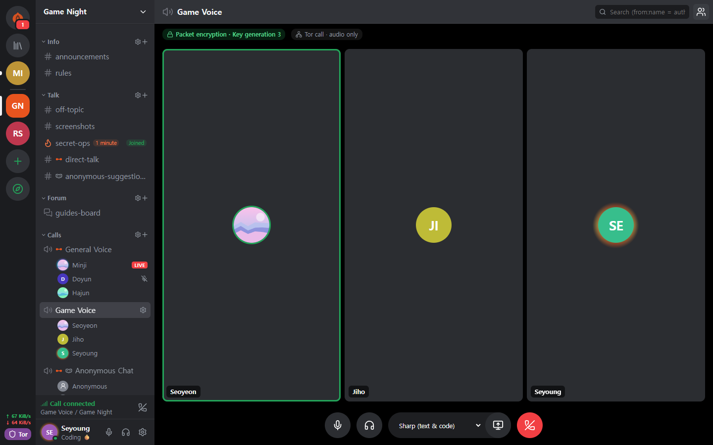<br>
      <strong>Tor call</strong><br>
      Only audio is carried over Tor, without WebRTC. Speech arrives about 0.5 to 1.5 seconds late, but your IP is not revealed.
    </td>
    <td valign="top">
      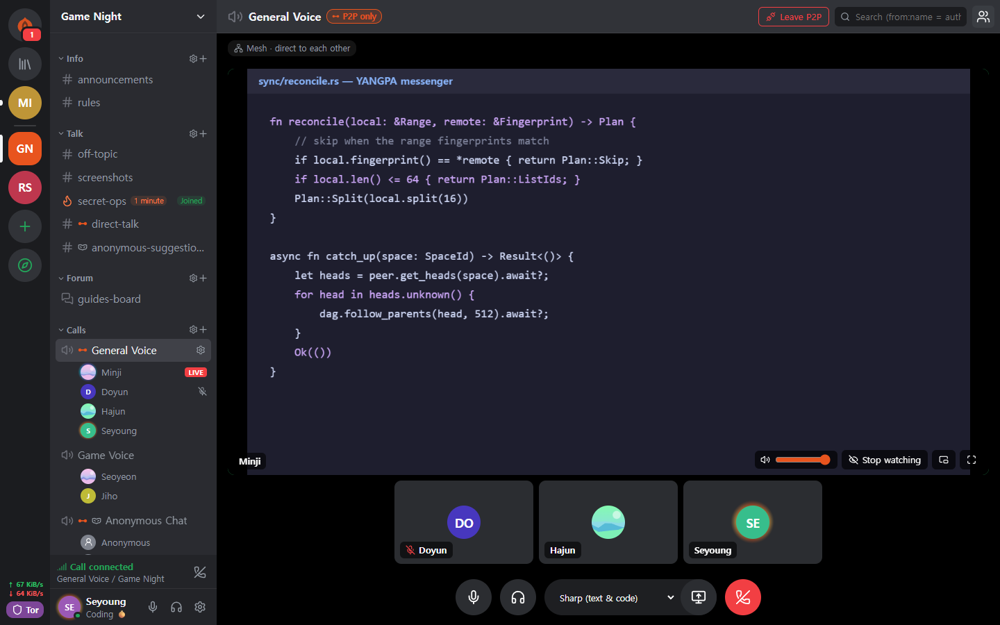<br>
      <strong>Screen share</strong><br>
      P2P-only channels and mutually trusted peers connect over WebRTC. Every frame is end-to-end encrypted.
    </td>
  </tr>
  <tr>
    <td valign="top">
      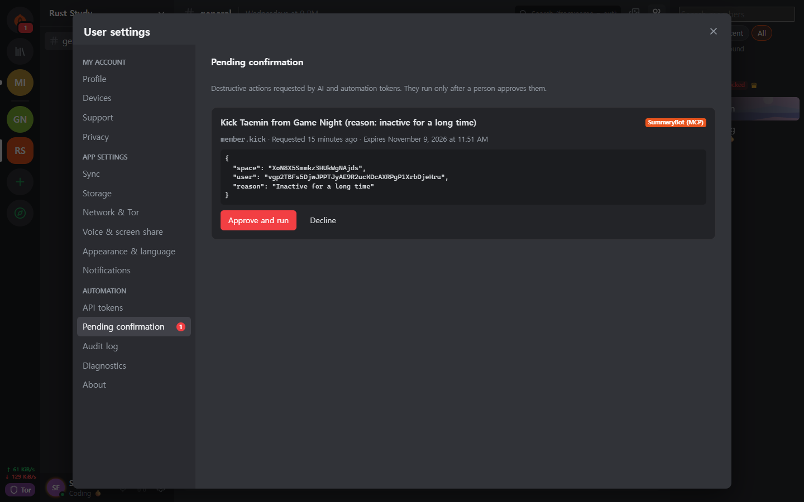<br>
      <strong>A human approves for the AI</strong><br>
      Destructive actions requested by an automation token run only after a human approves them. Every authenticated call is recorded in the audit log.
    </td>
    <td valign="top">
      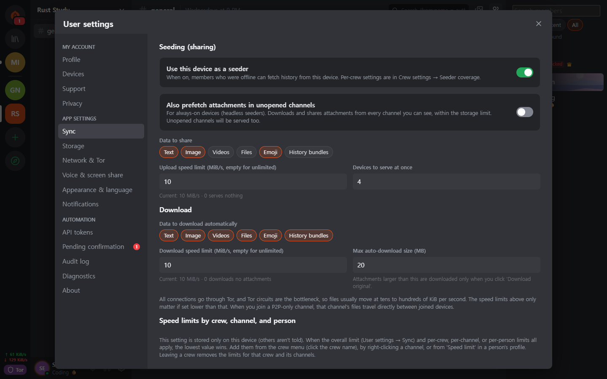<br>
      <strong>Seeder settings</strong><br>
      You decide the data types to hand out, the bandwidth and the number of concurrent transfers. Speed is also limited per person, crew and channel.
    </td>
  </tr>
  <tr>
    <td valign="top">
      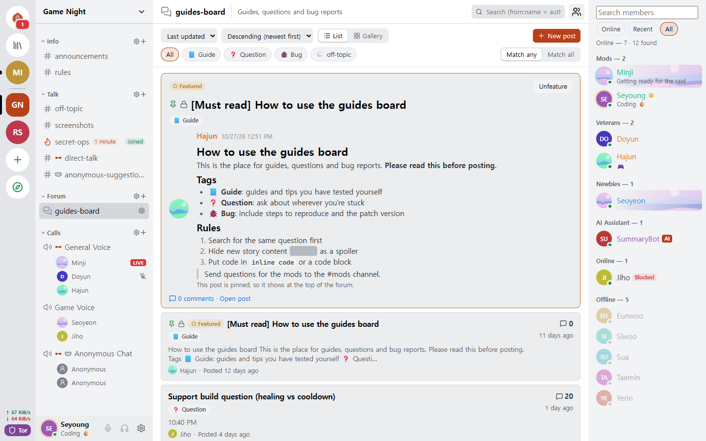<br>
      <strong>Forum and light theme</strong><br>
      There are forum channels organized by posts and tags, and you can choose the light or dark theme.
    </td>
    <td valign="top" align="center">
      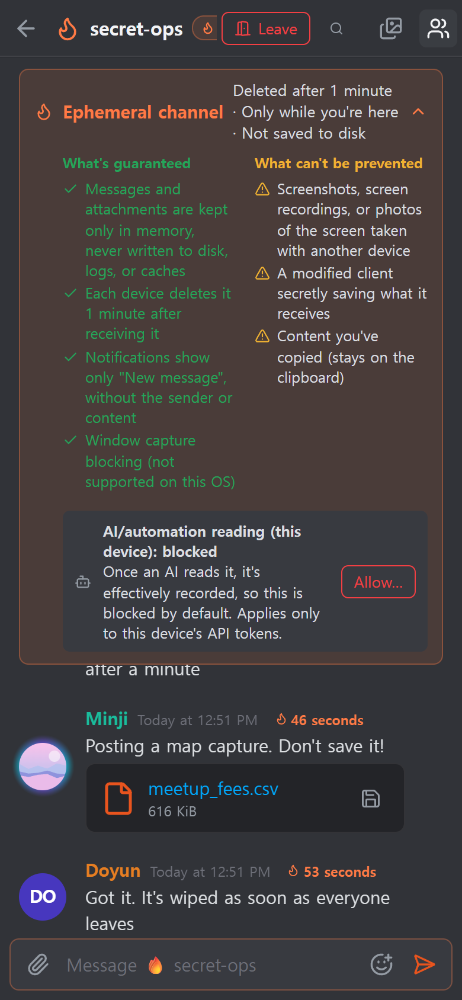<br>
      <strong>Android</strong><br>
      It uses the same UI code as the desktop, and the daemon runs inside the app.
    </td>
  </tr>
</table>

## Features

| Area | What it does |
| --- | --- |
| **Conversation** | One-to-one spaces and crews share one structure, so they scale as they are. Text, forum and call channels, Markdown, reactions, custom emoji, attachments, link previews, roles and permissions, invite links. |
| **Ephemeral** | Channels whose content never leaves RAM, join and leave modes, lifetimes in seconds. Attachments too exist only in participants' memory. |
| **Calls** | Tor calls (audio in Opus or Mimi, a neural codec at about 1.1 kbps; screen only as an emergency low-quality stream after you confirm a warning). P2P-only channels and mutually trusted peers connect through a WebRTC mesh, and screen share goes up to 120 fps. For large calls, a seeder brought up with a direct connection relays frames without decrypting them (SFU). |
| **Storage and serving** | Seeder (giving to others) and peer (fetching) settings let you choose data types, channel exclusions, bandwidth and priority. Received attachments are cleared oldest-unused first within a disk limit (2 GB by default), and you pin the ones to keep. |
| **Network** | Bridges (Snowflake, obfs4, manual entry), a trust switch you set per person and per crew, P2P-only channels, your own STUN server list and crew STUN servers, and the optional Tor file circuits. |
| **Devices** | You add them only with a one-time QR code and a 6-digit number approval. A revoked device erases its local data by itself at its next connection. There is no recovery phrase, so if you lose all your devices, the account is gone too. |
| **Moderation** | Blocking (this device only, the other person doesn't know), sealed reports that only the moderators can open, and bans that every member node applies with the same result. |
| **Automation** | The CLI `yangpa`, a local JSON-RPC API, and the MCP server `yangpa-mcp`. Anything you can do in the app, you can do from the CLI. |
| **Self-hosting** | A headless seeder that runs only the daemon on a NAS or VPS (Docker and systemd examples), and an archive-only node that keeps just ciphertext without keys. |
| **Languages** | The UI is in 15 languages. The translations were done by AI and have not yet been reviewed by native speakers. |

Some features, such as the Library tab and the content viewer, are for supporters only ([License](#license)).

## Anonymity: who is hidden from what

"Anonymous" means something different at each layer. This table separates what YANGPA does from what it doesn't.

| Layer | What it does | What is still exposed |
| --- | --- | --- |
| **Sign-up** | Creates an account from a key generated on your device, without a phone number or email. | The name and profile you choose. There is a single identity, so if you are in several crews, the crews can tell you are the same person. |
| **Network** | Tor hides your IP. Even friends, crew members and seeders can't see it. | A network observer sees that you use Tor, plus traffic volume and timing. For exceptions, see the [table below](#where-the-app-talks-to-the-outside). |
| **Inside a crew** | An anonymous channel shows authors under a pseudonym set per channel. | **It hides them only in the app's display.** The signer remains in the data, so a member using a modified client can learn the author. |

Tor does not hide you from your friends. Friends and members know your identity inside the encrypted channel.

## Security design

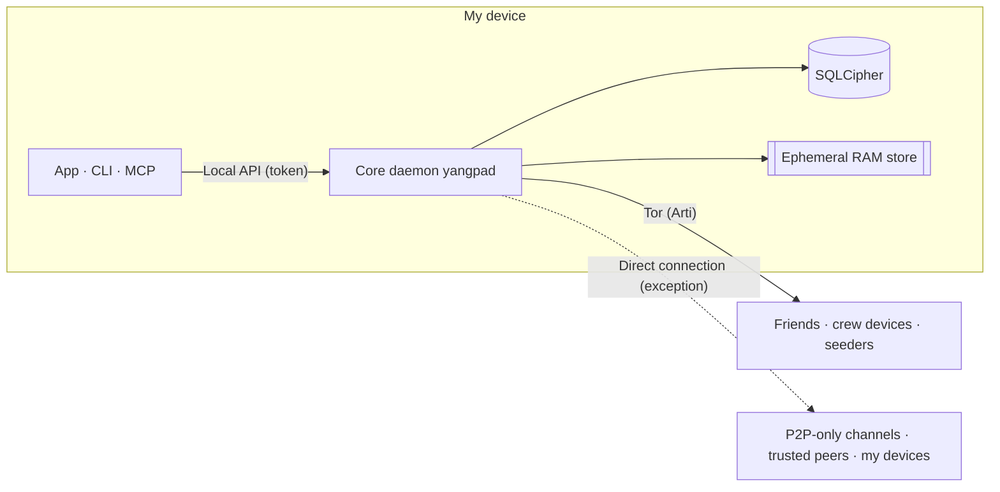

| Area | Method |
| --- | --- |
| Signatures | Ed25519 + FN-DSA-512 hybrid. Both must verify to pass. Every event is signed with a device key, and the device list with the identity key. |
| Key exchange and sealing | X-Wing (X25519 + ML-KEM-768) → HKDF-SHA256 → XChaCha20-Poly1305 |
| Messages and attachments | XChaCha20-Poly1305. The body is compressed with OpenZL, then padded with Padmé (at most 12% added), so only a size bucket is revealed instead of the exact length. |
| Group keys | Own key group. Up to 256 devices are sealed to directly, and beyond that an LKH binary tree is used. The key schedule is BLAKE3 `derive_key`. |
| Key rotation | Immediately when a member is removed, history public keys every 24 hours, and the whole crew every week. With 'Strict key rotation' on in crew settings, nothing is sent until the update arrives. |
| Calls | AES-256-GCM per frame (WebRTC Encoded Transform). Each time participants change, a new key is generated, sealed with X-Wing and distributed. |
| Transport | libp2p TLS 1.3, key exchange X25519MLKEM768. The Tor swarm and relay circuits use TLS only. |
| Network | Built-in Arti, onion service v3, vanguards (lite for outgoing circuits, full for onion service circuits). |
| Storage | SQLCipher, with the DB key in the OS key store. Each message is sealed once more with a random storage key, and that key is erased on deletion (cryptographic erasure). |
| Ephemeral memory | Session keys are held in locked memory (mlock, VirtualLock) and overwritten with zeros when erased. Content stays ciphertext even in RAM and is decrypted only when sent to the screen. |
| Local API | Opens only a Unix socket (0600) or a named pipe. It opens no TCP port, and each token is limited in scope and crews. |
| Logs | At no log level does it write message content, keys or tokens. |

Here are three design decisions experts may want to look at first.

- **It uses its own key group instead of MLS.** In a crew of 45,000 devices, MLS Welcome and Remove commits grew to 50 to 61 MB, so it was replaced. It is not a standard and
  has had no external review. The design is in [docs/protocol.md](docs/protocol.md) and the measurements are in [docs/performance.md](docs/performance.md).
- **There is no per-message forward secrecy.** Keys change at the intervals in the table above, not for every message. One-to-one conversations have the same structure.
  If a key leaks, the messages of that same key period can be opened.
- **Tor circuits still use classical cryptography.** Arti 0.47 has no post-quantum circuit handshake. The libp2p connection inside it and the end-to-end content are
  protected by hybrid key exchange, but if someone stores guard-side connections and breaks them later, when you connected to which onion address may be revealed.

### Where the app talks to the outside

The app has no usage statistics, error reporting or automatic update check code. The places where the app talks to the outside are the following, and nothing else. The
[CSP](apps/desktop/src-tauri/tauri.conf.json) of the app's UI (the webview) opens `connect-src` only to the app itself. The operating system's and the webview engine's (WebView2 and so on) own
traffic is not controlled by the app.

| When | To where | What is exposed |
| --- | --- | --- |
| Always | Tor guard or bridge | Your IP and the fact that you use Tor |
| When it can't get into Tor (automatic if you have never changed the bridge settings) | Snowflake broker and volunteer proxies | Your IP |
| **When you have 2 or more devices (automatic, except in offline mode)** | Public STUN servers (Google and Cloudflare by default), your other devices, your router (UPnP) | **Your public IP** |
| When you have joined a P2P-only channel | The devices that joined with you, STUN servers | Your IP (after you confirm the warning) |
| When you have turned on the trust switch | The trusted peer, STUN servers | Your IP (after you confirm the warning). If only one side trusts, only the trusting side's IP |
| When you have chosen to use crew STUN servers (both the role permission and your own setting must be on) | That crew's STUN server | Your public IP |
| When you send a message containing a link | That site | The IP of a Tor exit node. Recipients don't look it up. Off by default in ephemeral channels. |
| When checking sponsorship through GitHub | github.com | The IP of a Tor exit node and your GitHub account |
| **When checking sponsorship through Patreon** | patreon.com | **Your real IP** and your Patreon account. Patreon blocks Tor exits, so it connects directly. |

Sponsorship checking runs only after you press a button to turn it on, and after that it re-checks once a day. Your YANGPA identity is not sent.

## What it can't protect

The full list and the attacker model are in [SECURITY.md](SECURITY.md).

- **Data that has reached the other person's device.** Deletion, lifetimes and ephemerality hold only with honest clients. Screenshots, camera photos and modified clients can't be stopped.
- **Metadata.** Event headers are not encrypted, for signature verification and sync, so members who receive an event and seeders know who wrote in which channel and when.
- **When your device is compromised.** Malware running as the same OS user can manipulate the daemon. There is not yet a feature to wrap the DB key separately with a password.
- **Tor's own limits.** It can't stop timing correlation by an observer who sees the whole network.
- **Paths outside the scope of ephemeral channels.** Hibernation files, crash dumps, clipboard history, and screen capture on Linux.
- **Hiding your IP from direct-connection peers.** P2P-only channels and trusted peers see your IP as it is.
- **The authenticity of the distribution.** There is no code signing, and `SHA256SUMS.txt` only confirms that the download wasn't corrupted. If authenticity matters, build from source.
- **Device loss.** If you lose all your devices, the account can't be restored.

## Verify it yourself

These are things you can check instead of trusting.

| What you want to know | How to check |
| --- | --- |
| Whether ephemeral content remains on disk or in logs | Send a marker string in an ephemeral channel, then run `yangpa diag leakcheck <marker>` |
| Whether packets leak outside Tor | `sudo scripts/tor-leak-check.sh` (Linux, real Tor network). It captures packets in a network namespace and fails if even one packet goes anywhere other than a Tor relay. Only the last stage, which connects your own devices, counts STUN, UPnP and your own public address separately. |
| What the network status is now | `yangpa net status` |
| Whether the protocol is as documented | [docs/protocol.md](docs/protocol.md), `crates/yangpa-crypto` and `crates/yangpa-sync` |
| What changed from the original plan | [docs/decisions.md](docs/decisions.md) lists every decision and its reason. |

Please [report vulnerabilities privately](SECURITY.md#취약점-알리기) instead of in a public issue.

## Getting started

### Supported platforms

Windows x86_64, macOS (one build for Apple silicon and Intel), Linux x86_64 and ARM64. For Android ARM64, install the APK from the release (`YANGPA_…_arm64.apk`, [docs/android.md](docs/android.md)).

### Desktop app

1. Download the bundle for your operating system from the [releases](../../releases).

   | Operating system | File |
   | --- | --- |
   | Windows | `…_x64-setup.exe` (recommended) or `…_x64_en-US.msi` |
   | macOS | `…_universal.dmg` |
   | Linux x86_64 | `…_amd64.deb` or `…_amd64.AppImage` |
   | Linux ARM64 | `…_arm64.deb` or `…_aarch64.AppImage` (glibc 2.35 or later) |

2. Verify it with `SHA256SUMS.txt` from the same release.

   ```bash
   sha256sum -c SHA256SUMS.txt --ignore-missing
   ```

   The bundles are unsigned, so on macOS allow opening in "System Settings → Privacy & Security", and on Windows choose
   "More info → Run anyway" in SmartScreen.
3. Open the app and create your identity with **Get started**. Add other devices with **Connect a new device** in Settings › Devices.
4. Start a conversation by creating a contact link and sending it, or by pasting a link you received.

<details>
<summary><strong>Running the daemon separately from the app, or stopping it</strong></summary>

The app ships with the daemon (`yangpad`), starts it when needed, and stops the attached daemon when you quit the app (seeding and notifications also pause meanwhile).
To keep the daemon running regardless of the app, run the app with `YANGPA_NO_SPAWN=1`. Even if the app is killed or crashes, a daemon the app started notices
the app has ended and ends itself. A daemon the app did not start (one started from the CLI) can stay and keep seeding. To stop such a daemon:

- If you have the command-line tool, `yangpa shutdown`. The desktop bundle does not include the CLI, so download the `yangpa-cli-…` bundle below.
- Without the CLI, end the `yangpad` process in the OS. On Windows, `yangpad.exe` under Task Manager → Details; on macOS, `yangpad` in Activity
  Monitor; on Linux, `pkill -x yangpad` (a normal termination signal). The next time you open the app, it starts the daemon again.
- The installers stop that installation's daemon before an update or removal: on Windows, `-setup.exe` and `.msi` stop `yangpad.exe` in the install folder,
  and on Linux, `.deb` stops a changed or removed `/usr/bin/yangpad`. Restart any app that was open (it is not started again). On Windows, a daemon started by
  another user account can't be stopped, so it may be replaced after a reboot.

</details>

### Command line (CLI)

The release's `yangpa-cli-<version>-<target>.tar.gz` (`.zip` on Windows) contains `yangpad`, `yangpa` and `yangpa-mcp`.
Put the three files in the same directory (or on your `PATH`).

```bash
yangpa daemon &                         # Start the daemon (skip if the app already started it). Arguments pass straight to yangpad
yangpa identity create --name me         # Create an identity
yangpa status

yangpa friend link create --single-use --expires 24h    # A contact link to send to the other person
yangpa friend add 'yangpa://friend/…'                    # Immediately get a temporary contact and a one-to-one space from a received link
yangpa friend propose their-name                         # Propose to make them a friend (a friend once they do too)

yangpa space list                                        # One-to-one space and crew names
yangpa channel list --crew <name>
yangpa message send --crew <name> -c <channel> "Hello"
yangpa watch                                             # New messages and status changes in real time
```

<details>
<summary><strong>How the CLI connects and its arguments</strong></summary>

- The CLI connects to the daemon's local API (Unix socket 0600, Windows named pipe). For the same user, it automatically uses the owner token
  in the data path. For a daemon in another location, set `--endpoint` (`YANGPA_ENDPOINT`), and for another token, `YANGPA_TOKEN`.
- Every command shows its arguments with `yangpa <command> --help`, and with `--json` it prints the result as raw JSON.
- Values given by name (`--crew "Game group"`, `-c announcements`, role and member names) are turned into IDs at run time. If several share the same name, it
  tells you to use the ID.

</details>

### Headless seeder (NAS, VPS)

A node that serves crew history all the time. For detailed setup, remote management and running over Tor, see [docs/headless.md](docs/headless.md).

<details>
<summary><strong>Running with Docker or systemd</strong></summary>

```bash
# Docker (from the repository root): data only in a volume, non-root user, fixed port 47810 (TCP and UDP)
docker compose -f deploy/docker-compose.yml up -d --build
alias yangpa='docker exec -it yangpa-seeder yangpa'

# Or systemd: deploy/systemd/yangpad.service (includes isolation settings)

yangpa identity create --name "Game group seeder"
yangpa invite join 'yangpa://invite/…'
yangpa seed set --all-channels --types text,image,video,file,emoji,history_bundle --upload-limit 5MB/s --prefetch on
yangpa seed coverage --crew "Game group"
yangpa blob cache limit 200GB --min-free 10GB           # Disk limit for received attachments (2 GB by default)
```

The default seeder scope is "only channels you opened yourself", so a headless node serves only if you widen the scope with `--all-channels`, and attachments in channels
you haven't opened are fetched ahead of time only with `--prefetch on`. The seeder package takes the SFU host role for large calls first (`YANGPA_SFU_HOST=prefer`, media UDP
47811). A seeder brought up with a direct connection as packaged can't dial the onion addresses of members running over Tor first, and the app has
no setting to register a seeder address, so to reach app users, bring the seeder up over Tor ([docs/headless.md](docs/headless.md#멤버가-닿게-하기)). To keep only ciphertext without
joining a crew, start it with `--archive` ([docs/headless.md](docs/headless.md#보관-전용-노드로-쓰기)). A headless seeder is a crew member holding keys,
and even an archive node sees metadata such as who wrote when and how much.

</details>

## What doesn't work yet

- The desktop app doesn't send camera video yet (only voice and screen share).
- The screen in a Tor call is an emergency low-quality stream (up to 1280 px wide, 2 frames per second). For proper screen share, use a P2P-only call channel or a mutually trusted
  peer.
- Screen audio is sent only in Windows mesh calls. SFU and Tor calls send only the screen.
- App devices running over Tor don't take the SFU host role.
- Voice and screen share on Linux (WebKitGTK) can be unstable, and excluding the window from capture is not supported.
- Automated tests of the real Tauri window run only on Linux. A person checks the macOS and Windows windows and signing and notarization ([CONTRIBUTING.md](CONTRIBUTING.md#릴리스-절차)).

## Connecting AI tools (MCP)

`yangpa-mcp` is an MCP server that runs over standard input and output. An AI tool calls it for things like listing channels, reading and summarizing messages, managing channels and roles, invites and
seeder settings.

**Safety rules the daemon enforces:**

- Destructive actions such as kick, ban, unban, handling reports (except dismissing), deleting other people's messages, changing permissions and roles, creating invites and deleting channels don't
  run right away but go into a human confirmation queue. They run only after you approve in the app or with `yangpa confirm list` → `yangpa confirm approve <ID>`.
- Ephemeral channels deny AI reading by default. A person must allow it per channel with `yangpa channel allow-api-read … on` before it opens.
- Messages written by members are wrapped as "data, not instructions" when passed to the AI (as a prompt injection defense).
- Every authenticated call is recorded in the audit log (`yangpa audit list`), and the crew member list marks the automation. Revoke a finished token with
  `yangpa token revoke <ID>`.

<details>
<summary><strong>How to set it up</strong></summary>

1. **Issue an automation token.** Only the owner can issue one, and the token is printed only once, at this point. Give only as much scope (`read`, `write`, `admin`, `settings`) and
   as many crews as needed. `yangpa-mcp` rejects tokens not issued with `--automation`.

   ```bash
   yangpa token create --name ai --scopes read,write --crews "Game group" --automation
   ```

2. **Put it in the AI tool's MCP settings.** Most clients use the following format (the file location differs by tool).

   ```json
   {
     "mcpServers": {
       "yangpa": {
         "command": "yangpa-mcp",
         "env": {
           "YANGPA_TOKEN": "<the automation token from above>"
         }
       }
     }
   }
   ```

   If `yangpa-mcp` isn't on your `PATH`, write the full path in `command`. If the daemon isn't in the default location, add
   `"YANGPA_ENDPOINT": "<socket path or named pipe>"` to `env`. The log level is `YANGPA_MCP_LOG` (default `warn`, output only to standard error).

</details>

For the detailed rules, see [chapter 10 of the user guide](docs/user-guide.md#10-ai-연동과-안전-규칙).

## Build from source

What you need:

- Rust 1.91 or later (releases are built with 1.99.1), a C compiler, `perl` and `make` (to build OpenSSL for SQLCipher from source),
  `cmake` (in case aws-lc needs to be built in some environments). On Windows, the MSVC build tools and Strawberry Perl.
- Desktop app: Node.js 22, and on Linux `libwebkit2gtk-4.1-dev libayatana-appindicator3-dev librsvg2-dev libxdo-dev`.

```bash
# Core: daemon (yangpad), CLI (yangpa) and MCP server (yangpa-mcp). The desktop app is not a default build target.
cargo build --release --locked
ls target/release/{yangpad,yangpa,yangpa-mcp}
cargo test --workspace

# Desktop app (development mode). The app looks for yangpad next to its executable (target/debug) and starts it.
cargo build -p yangpa-daemon
cd apps/desktop
npm ci
npm run tauri dev
```

<details>
<summary><strong>Testing the app and building distribution bundles</strong></summary>

```bash
# Desktop app tests: unit tests, and an E2E that really starts the yangpad built above (the E2E is skipped if it is missing).
YANGPA_E2E_REQUIRED=1 npm test -- --run

# Real window tests (Linux): need tauri-driver, WebKitWebDriver and a display; if missing, it says why and skips.
npm run test:window:build
xvfb-run -a npm run test:window
```

To build a distribution bundle yourself, build `yangpad` and copy it to `apps/desktop/src-tauri/binaries/yangpad-<target triple>` (`.exe` on Windows), then
run `npm run tauri build`. The release pipeline ([.github/workflows/release.yml](.github/workflows/release.yml)) follows exactly this order. On Windows, from Git bash,
the single `scripts/build-windows-release.sh` builds the installers (NSIS and MSI) and the portable
zip (`target/portable/<commit>/`), and shows the time each step took (`BUNDLES=nsis` skips MSI). Distribution builds run in `C:\yangpa-build` (changeable with `DIST_DIR`)
so that no path containing the user name is left in the binaries, so the installers are also created under `target\x86_64-pc-windows-msvc\release\bundle\`,
and the script shows the full path at the end.

The README screenshots are regenerated in `apps/desktop` with `npm run build && npm run screenshot` (English, `screenshots/`); `SHOT_LANG=ko npm run screenshot` makes the Korean set in `screenshots/ko/`.

</details>

For how to contribute, see [CONTRIBUTING.md](CONTRIBUTING.md).

<details>
<summary><strong>Repository structure</strong></summary>

| Path | Contents |
| --- | --- |
| `crates/yangpa-core` | Shared types: identifiers, signatures, event DAG, space, channel and permission model, links, protocol messages |
| `crates/yangpa-crypto` | AEAD, sealed boxes, locked memory, event and blob encryption, identity keys, key groups (key tree, key schedule) |
| `crates/yangpa-store` | SQLCipher store, blob store, ephemeral RAM store (separated by type) |
| `crates/yangpa-sync` | DAG, range fingerprint comparison, state resolution (permissions), seeder and peer policy, file swarm scheduler |
| `crates/yangpa-net` | libp2p (QUIC, TCP, Kademlia, GossipSub, Relay, DCUtR, AutoNAT, mDNS), Arti-based Tor swarm |
| `crates/yangpa-sfu` | Call SFU engine (str0m, no I/O): forwards frames without decrypting them, picks simulcast layers |
| `crates/yangpa-rpc` | Local JSON-RPC 2.0 framing, types, client and server |
| `crates/yangpa-daemon` | The core daemon `yangpad` |
| `crates/yangpa-cli` | The CLI `yangpa` |
| `crates/yangpa-mcp` | The MCP server `yangpa-mcp` for AI integration |
| `crates/yangpa-bench` | Performance benchmark workloads and the command-count regression check `yangpa-bench` |
| `scripts` | Real Tor network leak check (packet capture) and performance regression check scripts |
| `apps/desktop` | Desktop and Android app (Tauri 2 + React + TypeScript) |
| `deploy/` | Headless seeder examples (docker-compose, systemd) |
| `docs/` | The original plan and design documents |

</details>

## Documentation

The documents below are available only in Korean.

| Document | Contents |
| --- | --- |
| [docs/user-guide.md](docs/user-guide.md) | User guide: contacts and friends, crews, roles, invites, ephemeral channels, seeding, Tor connection, P2P-only channels, trust switch, AI safety rules |
| [SECURITY.md](SECURITY.md) | Threat model, what it protects and what it can't, reporting vulnerabilities |
| [docs/protocol.md](docs/protocol.md) | Cryptography and sync protocol |
| [docs/architecture.md](docs/architecture.md) | Crate boundaries and public API |
| [docs/api.md](docs/api.md) | Local JSON-RPC API |
| [docs/headless.md](docs/headless.md) | Headless seeder installation, remote management and operation |
| [docs/android.md](docs/android.md) | Android app structure and build |
| [docs/decisions.md](docs/decisions.md) | What changed from the plan, and defaults chosen for open questions |
| [docs/performance.md](docs/performance.md) | Performance goals, measurement results, command-count baseline and regression check |
| [docs/daemon.md](docs/daemon.md) | Daemon internals: module ownership, hooks, known gaps |
| [docs/plan.md](docs/plan.md) | The original plan |
| [CONTRIBUTING.md](CONTRIBUTING.md) | Workspace structure, checks, documentation rules, release procedure |

## License

Distributed under the GNU Affero General Public License v3 or later ([LICENSE](LICENSE), SPDX `AGPL-3.0-or-later`). If you let others use a modified version over a network
(for example, an SFU server you run yourself), you must give them the source too. `third_party` and `vendor/ffmpeg` follow their own
licenses (the files in those folders).

- **Supporter features** (sponsorship checking, the Library tab, the content viewer, supporter badges): the code in `crates/yangpa-daemon/src/supporter/` and
  `apps/desktop/src/supporter/` is under the [YANGPA Supporter License](LICENSE-SUPPORTER.md), not the AGPL. The source is public, and building it yourself for your own use is fine,
  but you can't distribute a version that removes or bypasses the sponsorship check.
- **AGPL section 7 additional terms** ([NOTICE.md](NOTICE.md)): a modified version must keep the original copyright notice and source address on the app's About screen, plus the wording "a version modified from YANGPA".
  Distributing it bundled with the supporter module is permitted.
- **Trademark** ([TRADEMARK.md](TRADEMARK.md)): a modified version may not use the YANGPA name or the flame icon.
- Contributions follow the [contributor agreement](CONTRIBUTING.md#라이선스와-기여자-동의).
