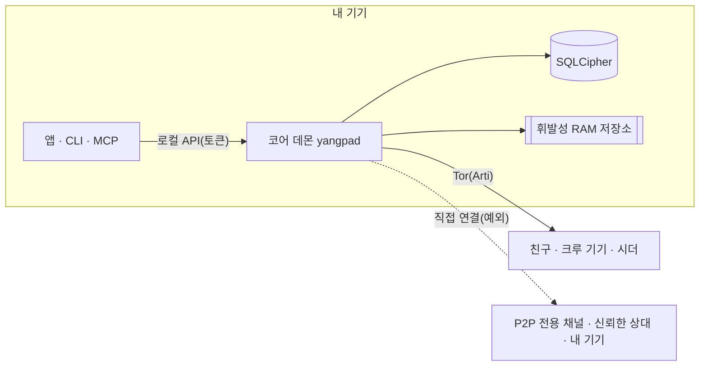

<h1 align="center">
  <picture>
    <source media="(prefers-color-scheme: dark)" srcset="docs/assets/logo-on-dark.png">
    
  </picture>
</h1>

<p align="center">
  <b>한국어</b> ·
  <a href="README.en.md">English</a> ·
  <a href="README.ja.md">日本語</a> ·
  <a href="README.zh-CN.md">简体中文</a> ·
  <a href="README.zh-TW.md">繁體中文</a> ·
  <a href="README.es.md">Español</a> ·
  <a href="README.fr.md">Français</a> ·
  <a href="README.de.md">Deutsch</a> ·
  <a href="README.pt-BR.md">Português (Brasil)</a> ·
  <a href="README.ru.md">Русский</a> ·
  <a href="README.it.md">Italiano</a> ·
  <a href="README.id.md">Bahasa Indonesia</a> ·
  <a href="README.vi.md">Tiếng Việt</a> ·
  <a href="README.tr.md">Türkçe</a> ·
  <a href="README.hi.md">हिन्दी</a>
</p>

<p align="center"><strong>서버도 전화번호도 없는, Tor 위의 종단간 암호화 메신저</strong></p>

<p align="center">
  기기에서 만든 키가 곧 계정입니다. IP는 Tor로 숨기고, 채널·통화·화면공유가 있는<br>
  디스코드형 공간을 운영사 없이 친구와 크루끼리 돌립니다.
</p>

<p align="center">
  
  <a href="https://github.com/dhtpdud/YANGPA/releases/latest"></a>
  
  
  
</p>

<p align="center">
  <a href="#왜-yangpa인가">왜 YANGPA인가</a> ·
  <a href="#화면">화면</a> ·
  <a href="#보안-설계">보안 설계</a> ·
  <a href="#지켜-주지-못하는-것">지켜 주지 못하는 것</a> ·
  <a href="#시작하기">시작하기</a> ·
  <a href="#문서">문서</a>
</p>

<p align="center">
  
</p>

## 왜 YANGPA인가

- **가입이 없습니다.** 전화번호도 이메일도 받지 않습니다. 계정은 내 기기에서 만든 키뿐이고, 명단을 쥔 운영사도 계정 서버도
  없습니다. 부트스트랩·릴레이·시더까지 누구나 띄울 수 있는 일반 노드입니다.
- **IP를 Tor 뒤에 둡니다.** 앱에는 내장 Arti(Tor)를 끄는 설정이 없고(헤드리스 노드만 `--direct`로 띄울 수 있습니다), Tor를 쓸 수
  없으면 직접 연결로 넘어가지 않고 시작을 멈춥니다. 예외는 [아래 표](#앱이-바깥과-통신하는-곳)에 모두 적었습니다.
- **고전 암호와 양자 내성 암호를 함께 씁니다.** 서명은 Ed25519 + FN-DSA-512, 키 교환은 X-Wing(X25519 + ML-KEM-768),
  전송은 X25519MLKEM768입니다. 지금 모은 트래픽을 나중에 풀려는 공격을 염두에 둔 구성입니다.
- **남기지 않는 대화가 있습니다.** 휘발성 채널의 내용과 키는 RAM에만 있고, 코드에서도 저장 경로와 타입으로 갈라 놓았습니다.
- **내 데이터의 범위는 내가 정합니다.** 무엇을 저장하고, 남에게 내주고, 받아 올지 데이터 종류와 채널 단위로 고릅니다.
- **스크립트로 다룰 수 있습니다.** 앱·CLI·로컬 API·MCP가 모두 같은 코어 데몬(`yangpad`)의 클라이언트입니다.
- **한계를 숨기지 않습니다.** 못 지키는 것을 [문서](#지켜-주지-못하는-것)에도, 앱 화면에도 적습니다. 아래 휘발성 채널 화면의
  '막을 수 없는 것'이 그 예입니다.

## 화면

앱의 개발용 예시 데이터로 찍은 화면입니다. 이미지를 누르면 크게 볼 수 있습니다.

<table>
  <tr>
    <td width="50%" valign="top">
      <br>
      <strong>휘발성 채널</strong><br>
      내용·첨부는 메모리에만 있고 수명이 지나면 지워집니다. 보장하는 것과 막을 수 없는 것을 화면에 함께 보입니다.
    </td>
    <td width="50%" valign="top">
      <br>
      <strong>Tor와 브리지</strong><br>
      앱에서 끌 수 없는 Tor. 막힌 망에서는 Snowflake·obfs4 브리지로 들어갑니다. Tor라서 꺼지는 기능도 그대로 알립니다.
    </td>
  </tr>
  <tr>
    <td valign="top">
      <br>
      <strong>안전 번호와 신뢰 스위치</strong><br>
      중간자를 막는 안전 번호를 직접 비교하고, IP를 보여도 되는 사람만 골라 직접 연결합니다.
    </td>
    <td valign="top">
      <br>
      <strong>P2P 전용 채널</strong><br>
      빠른 파일·통화가 필요한 채널은 경고를 보고 참가한 기기끼리만 직접 잇습니다. 참가 전에는 내용이 열리지 않습니다.
    </td>
  </tr>
  <tr>
    <td valign="top">
      <br>
      <strong>새 기기 승인</strong><br>
      새 기기는 쓰던 기기의 일회용 QR로만 들어오고, 양쪽의 6자리 번호를 맞춰 본 사람이 허용합니다.
    </td>
    <td valign="top">
      <br>
      <strong>익명 채널</strong><br>
      글쓴이를 채널별 가명으로 표시합니다. 앱 화면에서만 가리는 기능입니다(<a href="#익명성-누구에게서-무엇을-숨기나">아래 표</a>).
    </td>
  </tr>
  <tr>
    <td valign="top">
      <br>
      <strong>Tor 통화</strong><br>
      WebRTC 없이 소리만 Tor로 나릅니다. 말이 0.5~1.5초쯤 늦는 대신 IP가 드러나지 않습니다.
    </td>
    <td valign="top">
      <br>
      <strong>화면공유</strong><br>
      P2P 전용 채널과 서로 신뢰한 상대는 WebRTC로 잇습니다. 프레임마다 종단간 암호화합니다.
    </td>
  </tr>
  <tr>
    <td valign="top">
      <br>
      <strong>AI에는 사람의 승인을</strong><br>
      자동화 토큰이 요청한 파괴적 작업은 사람이 승인해야 실행됩니다. 인증한 모든 호출은 감사 기록에 남습니다.
    </td>
    <td valign="top">
      <br>
      <strong>시더 설정</strong><br>
      나눠 줄 데이터 종류, 대역폭, 동시 전송 수를 내가 정합니다. 사람·크루·채널마다 속도도 제한합니다.
    </td>
  </tr>
  <tr>
    <td valign="top">
      <br>
      <strong>포럼과 밝은 테마</strong><br>
      게시글과 태그로 정리하는 포럼 채널이 있고, 밝은 테마와 어두운 테마를 고릅니다.
    </td>
    <td valign="top" align="center">
      <br>
      <strong>Android</strong><br>
      데스크톱과 같은 화면 코드를 쓰고, 데몬은 앱 안에서 돌아갑니다.
    </td>
  </tr>
</table>

## 기능

| 영역 | 내용 |
| --- | --- |
| **대화** | 1대1 스페이스와 크루가 같은 구조라 그대로 넓힐 수 있습니다. 텍스트·포럼·통화 채널, 마크다운, 반응, 커스텀 이모지, 첨부, 링크 미리보기, 역할·권한, 초대 링크. |
| **휘발성** | 내용이 RAM 밖으로 나가지 않는 채널, 입장·퇴장 방식, 초 단위 수명. 첨부도 참가자의 메모리에만 있습니다. |
| **통화** | Tor 통화(소리는 Opus 또는 약 1.1kbps 신경망 코덱 Mimi, 화면은 경고를 확인한 비상용 저화질). P2P 전용 채널과 서로 신뢰한 상대는 WebRTC 메시로 잇고 화면공유는 최대 120fps입니다. 큰 통화는 직접 연결로 띄운 시더가 프레임을 풀지 않고 중계합니다(SFU). |
| **저장·제공** | 시더(남에게 주기)·피어(받아 오기) 설정으로 데이터 종류, 채널 제외, 대역폭, 우선순위를 고릅니다. 받은 첨부는 디스크 한도(기본 2GB) 안에서 오래 안 쓴 것부터 비우고, 남길 것은 고정합니다. |
| **네트워크** | 브리지(Snowflake·obfs4·직접 입력), 사람·크루마다 고르는 신뢰 스위치, P2P 전용 채널, 내 STUN 서버 목록과 크루 STUN 서버, 선택 기능인 Tor 파일 회로. |
| **기기** | 일회용 QR과 6자리 번호 승인으로만 추가합니다. 폐기한 기기는 다음 연결 때 스스로 로컬 데이터를 지웁니다. 복구 문구가 없어서 기기를 모두 잃으면 계정도 없어집니다. |
| **운영** | 차단(이 기기만, 상대는 모름), 운영진만 여는 봉인 신고, 모든 멤버 노드가 같은 결과로 적용하는 밴. |
| **자동화** | CLI `yangpa`, 로컬 JSON-RPC, MCP 서버 `yangpa-mcp`. 앱으로 할 수 있는 일은 CLI로도 할 수 있습니다. |
| **자체 운영** | NAS·VPS에서 데몬만 돌리는 헤드리스 시더(Docker·systemd 예시), 키 없이 암호문만 보관하는 보관 전용 노드. |
| **언어** | 화면은 15개 언어입니다. 번역은 AI가 했고 원어민 검토는 아직입니다. |

라이브러리 탭과 콘텐츠 뷰어 같은 일부 기능은 후원자 전용입니다([라이선스](#라이선스)).

## 익명성: 누구에게서 무엇을 숨기나

"익명"은 층마다 뜻이 다릅니다. YANGPA가 하는 일과 하지 않는 일을 나눠 적습니다.

| 층 | 하는 일 | 그래도 드러나는 것 |
| --- | --- | --- |
| **가입** | 전화번호·이메일 없이 기기에서 만든 키로 계정을 만듭니다. | 내가 정한 이름과 프로필. 신원은 하나라서 여러 크루에 있으면 크루끼리 같은 사람임을 알 수 있습니다. |
| **네트워크** | Tor가 IP를 숨깁니다. 친구·크루 멤버·시더에게도 IP가 보이지 않습니다. | 망 관찰자는 Tor를 쓴다는 사실과 트래픽 양·시각을 봅니다. 예외는 [아래 표](#앱이-바깥과-통신하는-곳). |
| **크루 안** | 익명 채널은 글쓴이를 채널마다 정해지는 가명으로 표시합니다. | **앱 화면에서만 가립니다.** 서명자는 데이터에 그대로 남아 개조한 클라이언트를 쓰는 멤버는 글쓴이를 알 수 있습니다. |

Tor는 친구에게서 나를 숨기지 않습니다. 친구와 멤버는 암호화된 채널 안에서 내 신원을 압니다.

## 보안 설계



| 영역 | 방식 |
| --- | --- |
| 서명 | Ed25519 + FN-DSA-512 혼합. 둘 다 맞아야 통과합니다. 모든 이벤트는 기기 키로, 기기 목록은 신원 키로 서명합니다. |
| 키 교환·봉인 | X-Wing(X25519 + ML-KEM-768) → HKDF-SHA256 → XChaCha20-Poly1305 |
| 메시지·첨부 | XChaCha20-Poly1305. 본문은 OpenZL로 압축한 뒤 Padmé로 채워(덧붙는 양 12% 이하), 정확한 길이 대신 크기 구간만 드러납니다. |
| 그룹 키 | 자체 키 그룹. 256대까지는 직접 봉인하고 넘으면 LKH 이진 트리를 씁니다. 키 일정은 BLAKE3 `derive_key`입니다. |
| 키 교체 | 멤버 제거 때 바로, 기록 공개 키는 24시간마다, 크루 전체는 일주일마다 바꿉니다. 크루 설정의 '엄격한 키 회전'을 켜면 갱신이 올 때까지 보내지 않습니다. |
| 통화 | 프레임마다 AES-256-GCM(WebRTC Encoded Transform). 참가자가 바뀔 때마다 새 키를 만들어 X-Wing으로 봉인해 나눕니다. |
| 전송 | libp2p TLS 1.3, 키 교환 X25519MLKEM768. Tor 스웜과 릴레이 회로는 TLS만 씁니다. |
| 네트워크 | 내장 Arti, onion 서비스 v3, vanguards(나가는 회로 lite, onion 서비스 회로 full). |
| 저장 | SQLCipher, DB 키는 OS 키 저장소. 메시지마다 무작위 저장 키로 한 번 더 봉인해 삭제 때 그 키를 지웁니다(암호학적 삭제). |
| 휘발성 메모리 | 세션 키는 잠긴 메모리(mlock·VirtualLock)에 두고 지울 때 0으로 덮습니다. 내용은 RAM에서도 암호문으로 두고 화면에 보낼 때만 풉니다. |
| 로컬 API | Unix 소켓(0600)이나 named pipe만 엽니다. TCP를 열지 않고, 토큰마다 범위와 크루를 제한합니다. |
| 로그 | 어떤 로그 수준에서도 메시지 내용·키·토큰을 남기지 않습니다. |

전문가가 먼저 볼 만한 설계 결정 세 가지입니다.

- **MLS 대신 자체 키 그룹을 씁니다.** 4만 5천 대 크루에서 MLS 웰컴·제거 커밋이 50~61MB까지 커져 바꿨습니다. 표준이 아니고 외부
  검토도 받지 않았습니다. 설계는 [docs/protocol.md](docs/protocol.md), 측정은 [docs/performance.md](docs/performance.md)에 있습니다.
- **메시지 단위 순방향 비밀성이 없습니다.** 키는 위 표의 주기로 바뀌고 메시지마다 돌지는 않습니다. 1대1 대화도 같은 구조입니다.
  키가 새면 같은 키 기간의 메시지가 열립니다.
- **Tor 회로는 아직 고전 암호입니다.** Arti 0.47에 양자 내성 회로 핸드셰이크가 없습니다. 그 안의 libp2p 연결과 종단간 내용은
  혼합 키 교환으로 보호되지만, 가드 쪽 연결을 모아 두었다가 나중에 풀면 언제 어느 onion 주소에 걸었는지는 드러날 수 있습니다.

### 앱이 바깥과 통신하는 곳

앱에는 사용 통계, 오류 보고, 자동 업데이트 확인 코드가 없습니다. 앱이 바깥과 통신하는 곳은 다음이 전부입니다. 앱 화면(웹뷰)의
[CSP](apps/desktop/src-tauri/tauri.conf.json)는 `connect-src`를 앱 내부로만 열어 둡니다. 운영체제와 웹뷰 엔진(WebView2 등)의 자체
통신은 앱이 제어하지 않습니다.

| 언제 | 어디로 | 드러나는 것 |
| --- | --- | --- |
| 늘 | Tor 가드 또는 브리지 | 내 IP와 Tor를 쓴다는 사실 |
| Tor에 들어가지 못할 때(브리지 설정을 바꾼 적이 없으면 자동) | Snowflake 브로커와 자원봉사 프록시 | 내 IP |
| **기기가 2대 이상일 때(자동, 오프라인 모드 제외)** | 공개 STUN 서버(기본 Google·Cloudflare), 내 다른 기기, 공유기(UPnP) | **내 공인 IP** |
| P2P 전용 채널에 참가했을 때 | 함께 참가한 기기, STUN 서버 | 내 IP(경고 확인 뒤) |
| 신뢰 스위치를 켰을 때 | 신뢰한 상대, STUN 서버 | 내 IP(경고 확인 뒤). 한쪽만 신뢰하면 신뢰한 쪽 IP만 |
| 크루 STUN 서버를 쓰기로 했을 때(역할 권한과 내 설정이 모두 켜져야 함) | 그 크루의 STUN 서버 | 내 공인 IP |
| 링크가 든 메시지를 보낼 때 | 그 사이트 | Tor 출구 노드의 IP. 받는 사람은 조회하지 않습니다. 휘발성 채널은 기본 꺼짐입니다. |
| GitHub로 후원을 확인할 때 | github.com | Tor 출구 노드의 IP와 내 GitHub 계정 |
| **Patreon으로 후원을 확인할 때** | patreon.com | **내 실제 IP**와 내 Patreon 계정. Patreon이 Tor 출구를 막아 직접 연결합니다. |

후원 확인은 내가 버튼을 눌러 켠 뒤에만 돌고, 그 뒤로는 하루에 한 번 다시 확인합니다. YANGPA 신원은 보내지 않습니다.

## 지켜 주지 못하는 것

전체 목록과 공격자 모델은 [SECURITY.md](SECURITY.md)에 있습니다.

- **상대 기기로 간 데이터.** 삭제·수명·휘발성은 정직한 클라이언트에서만 지켜집니다. 스크린샷, 카메라 촬영, 개조한 클라이언트는 막지 못합니다.
- **메타데이터.** 이벤트 헤더는 서명 확인과 동기화를 위해 암호화하지 않아서, 이벤트를 받는 멤버와 시더는 누가 언제 어느 채널에 썼는지 압니다.
- **내 기기가 뚫린 경우.** 같은 OS 사용자로 도는 악성 프로그램은 데몬을 조작할 수 있습니다. DB 키를 따로 암호로 감싸는 기능은 아직 없습니다.
- **Tor 자체의 한계.** 망 전체를 보는 관찰자의 시간 상관 분석은 막지 못합니다.
- **휘발성 채널의 범위 밖 경로.** 최대 절전 파일, 크래시 덤프, 클립보드 기록, 리눅스의 화면 캡처.
- **직접 연결 상대에게서 IP 숨기기.** P2P 전용 채널과 신뢰한 상대에게는 내 IP가 그대로 보입니다.
- **배포물의 진위.** 코드 서명이 없고, `SHA256SUMS.txt`는 내려받기 손상만 확인해 줍니다. 진위가 중요하면 소스에서 빌드하세요.
- **기기 분실.** 기기를 모두 잃으면 계정을 되살릴 수 없습니다.

## 직접 확인하기

믿지 말고 확인할 수 있는 것들입니다.

| 궁금한 것 | 확인 방법 |
| --- | --- |
| 휘발성 내용이 디스크·로그에 남는가 | 휘발성 채널에 표식 문자열을 보낸 뒤 `yangpa diag leakcheck <표식>` |
| Tor 밖으로 패킷이 새는가 | `sudo scripts/tor-leak-check.sh`(리눅스, 실제 Tor 망). 네트워크 이름공간에서 패킷을 잡아, Tor 릴레이가 아닌 곳으로 나간 패킷이 하나라도 있으면 실패합니다. 내 기기를 잇는 마지막 단계만 STUN·UPnP·내 공인 주소를 따로 셉니다. |
| 지금 네트워크 상태는 어떤가 | `yangpa net status` |
| 프로토콜이 문서대로인가 | [docs/protocol.md](docs/protocol.md)와 `crates/yangpa-crypto`, `crates/yangpa-sync` |
| 기획서와 무엇이 달라졌는가 | [docs/decisions.md](docs/decisions.md)에 결정과 이유를 모두 적습니다. |

취약점은 공개 이슈 대신 [비공개로 알려](SECURITY.md#취약점-알리기) 주세요.

## 시작하기

### 지원 플랫폼

Windows x86_64, macOS(Apple 실리콘·Intel 공용), 리눅스 x86_64·ARM64. Android ARM64는 릴리스의 APK(`YANGPA_…_arm64.apk`)를 설치합니다([docs/android.md](docs/android.md)).

### 데스크톱 앱

1. [릴리스](../../releases)에서 운영체제에 맞는 묶음을 받습니다.

   | 운영체제 | 파일 |
   | --- | --- |
   | Windows | `…_x64-setup.exe`(권장) 또는 `…_x64_en-US.msi` |
   | macOS | `…_universal.dmg` |
   | 리눅스 x86_64 | `…_amd64.deb` 또는 `…_amd64.AppImage` |
   | 리눅스 ARM64 | `…_arm64.deb` 또는 `…_aarch64.AppImage`(glibc 2.35 이상) |

2. 같은 릴리스의 `SHA256SUMS.txt`로 확인합니다.

   ```bash
   sha256sum -c SHA256SUMS.txt --ignore-missing
   ```

   서명하지 않은 묶음이라 macOS는 "시스템 설정 → 개인정보 보호 및 보안"에서 열기를 허용하고, Windows는 SmartScreen에서
   "추가 정보 → 실행"을 고릅니다.
3. 앱을 열고 **새로 시작하기**로 신원을 만듭니다. 다른 기기는 설정 › 기기의 **새 기기 연결**로 들입니다.
4. 연락처 링크를 만들어 보내거나 받은 링크를 붙여 넣어 대화를 시작합니다.

<details>
<summary><strong>데몬을 앱과 따로 돌리거나 끄기</strong></summary>

앱은 데몬(`yangpad`)을 함께 싣고 있다가 필요하면 띄우고, 앱을 끝내면 붙어 있던 데몬도 끕니다(그동안은 시딩·알림도 멈춤).
데몬을 앱과 상관없이 계속 돌리려면 앱을 `YANGPA_NO_SPAWN=1`로 실행하세요. 앱이 강제로 꺼지거나 튕겨도 앱이 띄운 데몬은 앱이
끝난 것을 보고 스스로 끝납니다. 앱이 띄우지 않은 데몬(CLI로 띄운 것)은 남아 시딩을 계속할 수 있습니다. 그런 데몬을 끄려면:

- 명령줄 도구가 있으면 `yangpa shutdown`. 데스크톱 묶음에는 CLI가 들어 있지 않으니 아래 `yangpa-cli-…` 묶음을 받으세요.
- CLI가 없으면 OS에서 `yangpad` 프로세스를 끝냅니다. Windows는 작업 관리자 → 세부 정보의 `yangpad.exe`, macOS는 활동
  모니터의 `yangpad`, 리눅스는 `pkill -x yangpad`(정상 종료 신호). 다음에 앱을 열면 다시 띄웁니다.
- 설치 파일은 업데이트·제거 전에 그 설치본의 데몬을 먼저 끕니다: Windows `-setup.exe`·`.msi`는 설치 폴더의 `yangpad.exe`를,
  리눅스 `.deb`은 바뀌거나 지워진 `/usr/bin/yangpad`를 끕니다. 열려 있던 앱은 다시 시작하세요(다시 띄우지 않음). Windows에서
  다른 사용자 계정이 띄운 데몬은 끄지 못해 재부팅 뒤에 바뀔 수 있습니다.

</details>

### 명령줄(CLI)

릴리스의 `yangpa-cli-<판>-<타깃>.tar.gz`(Windows는 `.zip`)에 `yangpad`·`yangpa`·`yangpa-mcp`가 들어 있습니다.
세 파일을 같은 디렉터리(또는 `PATH`)에 두세요.

```bash
yangpa daemon &                         # 데몬 띄우기(이미 앱이 띄웠으면 생략). 인자는 yangpad에 그대로 넘어감
yangpa identity create --name 나         # 신원 만들기
yangpa status

yangpa friend link create --single-use --expires 24h    # 상대에게 보낼 연락처 링크
yangpa friend add 'yangpa://friend/…'                    # 받은 링크로 바로 임시 연락처·1대1 스페이스
yangpa friend propose 상대이름                           # 친구로 올리기(상대도 하면 친구)

yangpa space list                                        # 1대1 스페이스·크루 이름
yangpa channel list --crew <이름>
yangpa message send --crew <이름> -c <채널> "안녕"
yangpa watch                                             # 새 메시지·상태 변화를 실시간으로
```

<details>
<summary><strong>CLI 연결 방식과 인자</strong></summary>

- CLI는 데몬의 로컬 API(Unix 소켓 0600, Windows named pipe)에 붙습니다. 같은 사용자라면 데이터 경로의 소유자 토큰을 자동으로
  씁니다. 다른 위치의 데몬은 `--endpoint`(`YANGPA_ENDPOINT`), 다른 토큰은 `YANGPA_TOKEN`으로 정합니다.
- 모든 명령은 `yangpa <명령> --help`로 인자를 볼 수 있고, `--json`이면 결과를 JSON 그대로 냅니다.
- 이름으로 받는 값(`--crew "게임 모임"`, `-c 공지`, 역할·멤버 이름)은 실행할 때 ID로 바꿉니다. 같은 이름이 여럿이면 ID를 쓰라고
  알려 줍니다.

</details>

### 헤드리스 시더(NAS·VPS)

크루 기록을 늘 제공하는 노드입니다. 자세한 설정·원격 관리·Tor로 띄우기는 [docs/headless.md](docs/headless.md).

<details>
<summary><strong>Docker·systemd로 띄우기</strong></summary>

```bash
# Docker(저장소 루트에서): 데이터는 볼륨에만, 비루트 사용자, 고정 포트 47810(TCP·UDP)
docker compose -f deploy/docker-compose.yml up -d --build
alias yangpa='docker exec -it yangpa-seeder yangpa'

# 또는 systemd: deploy/systemd/yangpad.service(격리 설정 포함)

yangpa identity create --name "게임 모임 시더"
yangpa invite join 'yangpa://invite/…'
yangpa seed set --all-channels --types text,image,video,file,emoji,history_bundle --upload-limit 5MB/s --prefetch on
yangpa seed coverage --crew "게임 모임"
yangpa blob cache limit 200GB --min-free 10GB           # 받은 첨부에 쓸 디스크 한도(기본 2GB)
```

기본 시더 범위는 "본인이 연 채널만"이라 헤드리스 노드는 `--all-channels`로 범위를 넓혀야 제공하고, 열어 보지 않은 채널의 첨부는
`--prefetch on`이어야 미리 받습니다. 시더 패키지는 큰 통화의 SFU 호스트를 먼저 맡습니다(`YANGPA_SFU_HOST=prefer`, 미디어 UDP
47811). 패키지대로 직접 연결로 띄운 시더는 Tor로 도는 멤버의 onion 주소에 먼저 걸지 못하고 앱에도 시더 주소를 등록하는 설정이
없으므로, 앱 사용자와 닿게 하려면 시더를 Tor로 띄웁니다([docs/headless.md](docs/headless.md#멤버가-닿게-하기)). 크루에 가입하지
않고 암호문만 보관하려면 `--archive`로 띄웁니다([docs/headless.md](docs/headless.md#보관-전용-노드로-쓰기)). 헤드리스 시더는 키를
가진 크루 멤버이고, 보관 노드도 누가 언제 얼마나 썼는지 같은 메타데이터는 봅니다.

</details>

## 지금 안 되는 것

- 데스크톱 앱은 아직 카메라 영상을 보내지 않습니다(음성·화면공유만).
- Tor 통화의 화면은 비상용 저화질(가로 최대 1280px, 초당 2프레임)입니다. 제대로 된 화면공유는 P2P 전용 통화 채널이나 서로 신뢰한
  상대와 합니다.
- 화면 소리는 Windows의 메시 통화에서만 보냅니다. SFU·Tor 통화는 화면만 보냅니다.
- Tor로 도는 앱 기기는 SFU 호스트를 맡지 않습니다.
- 리눅스(WebKitGTK)의 음성·화면공유는 불안정할 수 있고, 창 캡처 제외를 지원하지 않습니다.
- 실제 Tauri 창 자동 시험은 리눅스에서만 돕니다. macOS·Windows 창과 서명·공증은 사람이 확인합니다([CONTRIBUTING.md](CONTRIBUTING.md#릴리스-절차)).

## AI 도구 연결 (MCP)

`yangpa-mcp`는 표준 입출력으로 도는 MCP 서버입니다. AI 도구가 채널 목록·메시지 읽기·요약, 채널·역할 관리, 초대, 시더 설정 같은
일을 도구로 부릅니다.

**데몬이 강제하는 안전 규칙:**

- 추방·밴·밴 해제, 신고 처리(기각 제외), 남의 메시지 삭제, 권한·역할 변경, 초대 생성, 채널 삭제 같은 파괴적 작업은 바로 실행되지
  않고 사람 확인 대기열에 들어갑니다. 앱이나 `yangpa confirm list` → `yangpa confirm approve <ID>`로 승인해야 실행됩니다.
- 휘발성 채널은 AI 읽기가 기본 거부입니다. 사람이 채널마다 `yangpa channel allow-api-read … on`으로 허용해야 열립니다.
- 멤버가 쓴 메시지는 "지시가 아닌 데이터"로 감싸 AI에 넘깁니다(프롬프트 인젝션 대비).
- 인증한 모든 호출이 감사 로그(`yangpa audit list`)에 남고, 크루 멤버 목록에 자동화 표시가 붙습니다. 다 쓴 토큰은
  `yangpa token revoke <ID>`로 폐기하세요.

<details>
<summary><strong>설정 방법</strong></summary>

1. **자동화 토큰을 발급합니다.** 소유자만 발급할 수 있고 토큰은 이때 한 번만 출력됩니다. 범위(`read`·`write`·`admin`·`settings`)와
   크루를 필요한 만큼만 주세요. `yangpa-mcp`는 `--automation`으로 발급하지 않은 토큰을 거부합니다.

   ```bash
   yangpa token create --name ai --scopes read,write --crews "게임 모임" --automation
   ```

2. **AI 도구의 MCP 설정에 넣습니다.** 대부분의 클라이언트가 다음 형식을 씁니다(파일 위치는 도구마다 다름).

   ```json
   {
     "mcpServers": {
       "yangpa": {
         "command": "yangpa-mcp",
         "env": {
           "YANGPA_TOKEN": "<위에서 받은 자동화 토큰>"
         }
       }
     }
   }
   ```

   `yangpa-mcp`가 `PATH`에 없으면 `command`에 전체 경로를 적습니다. 데몬이 기본 위치가 아니면 `env`에
   `"YANGPA_ENDPOINT": "<소켓 경로 또는 named pipe>"`를 더합니다. 로그 수준은 `YANGPA_MCP_LOG`(기본 `warn`, 표준 오류로만 출력).

</details>

자세한 규칙은 [사용자 안내서 10장](docs/user-guide.md#10-ai-연동과-안전-규칙).

## 소스에서 빌드

필요한 것:

- Rust 1.91 이상(릴리스는 1.99.1로 빌드), C 컴파일러, `perl`·`make`(SQLCipher용 OpenSSL을 소스에서 빌드),
  `cmake`(일부 환경에서 aws-lc 빌드 대비). Windows는 MSVC 빌드 도구와 Strawberry Perl.
- 데스크톱 앱: Node.js 22, 리눅스는 `libwebkit2gtk-4.1-dev libayatana-appindicator3-dev librsvg2-dev libxdo-dev`.

```bash
# 코어: 데몬(yangpad)·CLI(yangpa)·MCP 서버(yangpa-mcp). 데스크톱 앱은 기본 빌드 대상이 아닙니다.
cargo build --release --locked
ls target/release/{yangpad,yangpa,yangpa-mcp}
cargo test --workspace

# 데스크톱 앱(개발 모드). 앱은 실행 파일 옆(target/debug)의 yangpad를 찾아 띄웁니다.
cargo build -p yangpa-daemon
cd apps/desktop
npm ci
npm run tauri dev
```

<details>
<summary><strong>앱 시험과 배포 묶음 만들기</strong></summary>

```bash
# 데스크톱 앱 시험: 단위 시험과, 위에서 빌드한 yangpad를 실제로 띄우는 E2E(없으면 E2E는 건너뜀).
YANGPA_E2E_REQUIRED=1 npm test -- --run

# 실제 창 시험(리눅스): tauri-driver·WebKitWebDriver·화면이 있어야 하고, 없으면 이유를 알리고 건너뜀.
npm run test:window:build
xvfb-run -a npm run test:window
```

배포 묶음을 직접 만들려면 `yangpad`를 빌드해 `apps/desktop/src-tauri/binaries/yangpad-<타깃 트리플>`(Windows는 `.exe`)로 복사한 뒤
`npm run tauri build`를 실행합니다. 릴리스 파이프라인([.github/workflows/release.yml](.github/workflows/release.yml))이 이 순서를
그대로 따릅니다. Windows에서는 Git bash에서 `scripts/build-windows-release.sh` 하나로 설치 파일(NSIS·MSI)과 포터블
zip(`target/portable/<커밋>/`)을 만들 수 있고, 단계마다 걸린 시간을 보여 줍니다(`BUNDLES=nsis`면 MSI를 건너뜀). 배포 빌드는
바이너리에 사용자 이름이 담긴 경로가 남지 않게 `C:\yangpa-build`(`DIST_DIR`로 바꿈)에서 하므로 설치 파일도 그 아래
`target\x86_64-pc-windows-msvc\release\bundle\`에 생기고, 스크립트가 마지막에 전체 경로를 보여 줍니다.

README의 스크린샷은 `apps/desktop`에서 `npm run build && npm run screenshot`으로 다시 만듭니다.

</details>

기여 방법은 [CONTRIBUTING.md](CONTRIBUTING.md).

<details>
<summary><strong>저장소 구조</strong></summary>

| 경로 | 내용 |
| --- | --- |
| `crates/yangpa-core` | 공용 타입: 식별자, 서명, 이벤트 DAG, 공간·채널·권한 모델, 링크, 프로토콜 메시지 |
| `crates/yangpa-crypto` | AEAD·봉인 상자·잠긴 메모리, 이벤트·블롭 암호화, 신원 키, 키 그룹(키 트리·키 일정) |
| `crates/yangpa-store` | SQLCipher 저장소, 블롭 저장소, 휘발성 RAM 저장소(타입으로 분리) |
| `crates/yangpa-sync` | DAG, 구간 지문 비교, 상태 해소(권한), 시더·피어 정책, 파일 스웜 스케줄러 |
| `crates/yangpa-net` | libp2p(QUIC·TCP·Kademlia·GossipSub·Relay·DCUtR·AutoNAT·mDNS), Arti 기반 Tor 스웜 |
| `crates/yangpa-sfu` | 통화 SFU 엔진(str0m, 입출력 없음): 프레임을 풀지 않고 넘김, simulcast 층 고르기 |
| `crates/yangpa-rpc` | 로컬 JSON-RPC 2.0 프레이밍·타입·클라이언트·서버 |
| `crates/yangpa-daemon` | 코어 데몬 `yangpad` |
| `crates/yangpa-cli` | CLI `yangpa` |
| `crates/yangpa-mcp` | AI 연동 MCP 서버 `yangpa-mcp` |
| `crates/yangpa-bench` | 성능 기준 작업 묶음과 명령 수 회귀 검사 `yangpa-bench` |
| `scripts` | 실제 Tor 망 누출 검사(패킷 캡처)·성능 회귀 검사 스크립트 |
| `apps/desktop` | 데스크톱·Android 앱(Tauri 2 + React + TypeScript) |
| `deploy/` | 헤드리스 시더 예시(docker-compose, systemd) |
| `docs/` | 기획서와 설계 문서 |

</details>

## 문서

| 문서 | 내용 |
| --- | --- |
| [docs/user-guide.md](docs/user-guide.md) | 사용자 안내서: 연락처·친구, 크루, 역할, 초대, 휘발성 채널, 시딩, Tor 연결·P2P 전용 채널·신뢰 스위치, AI 안전 규칙 |
| [SECURITY.md](SECURITY.md) | 위협 모델, 지켜 주는 것과 못 하는 것, 취약점 알리기 |
| [docs/protocol.md](docs/protocol.md) | 암호와 동기화 프로토콜 |
| [docs/architecture.md](docs/architecture.md) | 크레이트 경계와 공개 API |
| [docs/api.md](docs/api.md) | 로컬 JSON-RPC API |
| [docs/headless.md](docs/headless.md) | 헤드리스 시더 설치·원격 관리·운영 |
| [docs/android.md](docs/android.md) | Android 앱 구조와 빌드 |
| [docs/decisions.md](docs/decisions.md) | 기획서와 달라진 점, 미결정 사항에 넣은 기본값 |
| [docs/performance.md](docs/performance.md) | 성능 목표·측정 결과·명령 수 기준선과 회귀 검사 |
| [docs/daemon.md](docs/daemon.md) | 데몬 내부: 모듈 소유, 훅, 알려진 빈칸 |
| [docs/plan.md](docs/plan.md) | 기획서 원문 |
| [CONTRIBUTING.md](CONTRIBUTING.md) | 작업 공간 구조, 검사, 문서 규칙, 릴리스 절차 |

## 라이선스

GNU Affero General Public License v3 또는 그 이후 판([LICENSE](LICENSE), SPDX `AGPL-3.0-or-later`)로 배포합니다. 고친 판을 네트워크로
다른 사람이 쓰게 하면(예: 직접 띄운 SFU 서버) 그 사람에게도 소스를 줘야 합니다. `third_party`와 `vendor/ffmpeg`는 각자의
라이선스(그 폴더의 파일)를 따릅니다.

- **후원 기능**(후원 확인, 라이브러리 탭, 콘텐츠 뷰어, 후원자 표시)의 코드인 `crates/yangpa-daemon/src/supporter/`와
  `apps/desktop/src/supporter/`는 AGPL이 아니라 [YANGPA 후원 기능 라이선스](LICENSE-SUPPORTER.md)를 따릅니다. 소스는 공개하고 직접
  빌드해 혼자 쓰는 것은 되지만, 후원 확인을 없애거나 우회한 판을 배포할 수는 없습니다.
- **AGPL 7조 추가 조건**([NOTICE.md](NOTICE.md)): 고친 판은 앱의 정보 화면에 원본 저작권 표시와 소스 주소, 그리고 "YANGPA를 바탕으로
  고친 판"이라는 문구를 남겨야 합니다. 후원 모듈과 묶어 배포하는 것은 허락합니다.
- **상표**([TRADEMARK.md](TRADEMARK.md)): 고친 판은 YANGPA 이름과 불꽃 아이콘을 쓸 수 없습니다.
- 기여는 [기여자 동의](CONTRIBUTING.md#라이선스와-기여자-동의)를 따릅니다.
