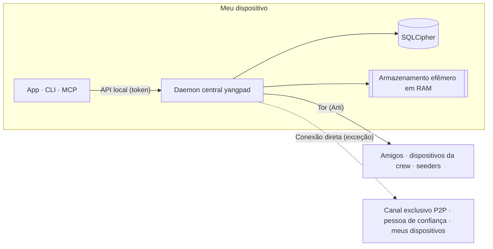

<h1 align="center">
  <picture>
    <source media="(prefers-color-scheme: dark)" srcset="docs/assets/logo-on-dark.png">
    
  </picture>
</h1>

<p align="center">
  <a href="README.ko.md">한국어</a> ·
  <a href="README.md">English</a> ·
  <a href="README.ja.md">日本語</a> ·
  <a href="README.zh-CN.md">简体中文</a> ·
  <a href="README.zh-TW.md">繁體中文</a> ·
  <a href="README.es.md">Español</a> ·
  <a href="README.fr.md">Français</a> ·
  <a href="README.de.md">Deutsch</a> ·
  <b>Português (Brasil)</b> ·
  <a href="README.ru.md">Русский</a> ·
  <a href="README.it.md">Italiano</a> ·
  <a href="README.id.md">Bahasa Indonesia</a> ·
  <a href="README.vi.md">Tiếng Việt</a> ·
  <a href="README.tr.md">Türkçe</a> ·
  <a href="README.hi.md">हिन्दी</a>
</p>

<p align="center"><strong>Mensageiro com criptografia de ponta a ponta sobre o Tor, sem servidor e sem número de telefone</strong></p>

<p align="center">
  A chave gerada no seu dispositivo é a sua conta. O IP fica escondido atrás do Tor, e amigos e crews<br>
  mantêm, sem operadora, espaços no estilo Discord com canais, chamadas e compartilhamento de tela.
</p>

<p align="center">
  
  <a href="https://github.com/dhtpdud/YANGPA/releases/latest"></a>
  
  
  
</p>

<p align="center">
  <a href="#por-que-o-yangpa">Por que o YANGPA</a> ·
  <a href="#capturas-de-tela">Capturas de tela</a> ·
  <a href="#design-de-segurança">Design de segurança</a> ·
  <a href="#o-que-o-yangpa-não-protege">O que o YANGPA não protege</a> ·
  <a href="#primeiros-passos">Primeiros passos</a> ·
  <a href="#documentação">Documentação</a>
</p>

<p align="center">
  
</p>

## Por que o YANGPA

- **Não há cadastro.** Não pedimos número de telefone nem e-mail. A conta é apenas uma chave gerada no seu dispositivo, e não existe
  operadora com uma lista de usuários nem servidor de contas. Bootstrap, relay e seeder são nós comuns que qualquer pessoa pode subir.
- **Seu IP fica atrás do Tor.** O app não tem configuração para desligar o Arti (Tor) embutido (só o nó headless pode subir com `--direct`), e,
  se o Tor não estiver disponível, ele não recorre à conexão direta: para de iniciar. As exceções estão todas na [tabela abaixo](#onde-o-app-se-comunica-com-o-exterior).
- **Usa criptografia clássica e pós-quântica juntas.** Assinatura Ed25519 + FN-DSA-512, troca de chaves X-Wing (X25519 + ML-KEM-768),
  transporte X25519MLKEM768. A combinação é pensada para ataques que coletam tráfego hoje para decifrá-lo depois.
- **Há conversas que não deixam rastro.** O conteúdo e as chaves dos canais efêmeros ficam só na RAM, e no código o caminho de
  armazenamento é separado por tipos.
- **Você decide o alcance dos seus dados.** O que guardar, o que fornecer a outros e o que buscar é escolhido por tipo de dado e por canal.
- **Dá para automatizar por script.** O app, a CLI, a API local e o MCP são todos clientes do mesmo daemon central (`yangpad`).
- **Não escondemos os limites.** O que não conseguimos proteger está na [documentação](#o-que-o-yangpa-não-protege) e também na tela do app. O
  "o que não dá para impedir" da tela do canal efêmero, mais abaixo, é um exemplo.

## Capturas de tela

Telas feitas com dados de exemplo de desenvolvimento do app. Clique na imagem para ampliar.

<table>
  <tr>
    <td width="50%" valign="top">
      <br>
      <strong>Canal efêmero</strong><br>
      Conteúdo e anexos ficam só na memória e são apagados quando o prazo acaba. O que é garantido e o que não dá para impedir aparecem juntos na tela.
    </td>
    <td width="50%" valign="top">
      <br>
      <strong>Tor e pontes</strong><br>
      O Tor não pode ser desligado no app. Em redes bloqueadas, a entrada é por pontes Snowflake e obfs4. Também informamos, sem rodeios, quais recursos são desativados por causa do Tor.
    </td>
  </tr>
  <tr>
    <td valign="top">
      <br>
      <strong>Número de segurança e botão de confiança</strong><br>
      Você compara pessoalmente o número de segurança, que barra o homem no meio, e conecta diretamente só com quem pode ver o seu IP.
    </td>
    <td valign="top">
      <br>
      <strong>Canal exclusivo P2P</strong><br>
      Em canais que precisam de arquivos e chamadas rápidos, só os dispositivos que viram o aviso e participaram se conectam diretamente. Antes de participar, o conteúdo não é aberto.
    </td>
  </tr>
  <tr>
    <td valign="top">
      <br>
      <strong>Aprovar novo dispositivo</strong><br>
      O novo dispositivo só entra por um QR de uso único de um dispositivo que você já usa, e quem comparou os números de 6 dígitos dos dois lados é quem permite.
    </td>
    <td valign="top">
      <br>
      <strong>Canal anônimo</strong><br>
      Mostra o autor com um pseudônimo por canal. É um recurso que oculta apenas na tela do app (<a href="#anonimato-de-quem-se-esconde-o-quê">tabela abaixo</a>).
    </td>
  </tr>
  <tr>
    <td valign="top">
      <br>
      <strong>Chamada Tor</strong><br>
      Só o áudio trafega pelo Tor, sem WebRTC. A fala chega com cerca de 0,5 a 1,5 s de atraso, mas em troca o IP não é revelado.
    </td>
    <td valign="top">
      <br>
      <strong>Compartilhamento de tela</strong><br>
      Canais exclusivos P2P e pessoas de confiança mútua se conectam por WebRTC. Cada quadro tem criptografia de ponta a ponta.
    </td>
  </tr>
  <tr>
    <td valign="top">
      <br>
      <strong>Para a IA, aprovação humana</strong><br>
      Ações destrutivas pedidas por um token de automação só são executadas com aprovação de uma pessoa. Todas as chamadas autenticadas ficam no registro de auditoria.
    </td>
    <td valign="top">
      <br>
      <strong>Configurações do seeder</strong><br>
      Você decide os tipos de dados a fornecer, a largura de banda e o número de transferências simultâneas. A velocidade também pode ser limitada por pessoa, crew e canal.
    </td>
  </tr>
  <tr>
    <td valign="top">
      <br>
      <strong>Fórum e tema claro</strong><br>
      Há canais de fórum organizados por postagens e tags, e você escolhe entre o tema claro e o escuro.
    </td>
    <td valign="top" align="center">
      <br>
      <strong>Android</strong><br>
      Usa o mesmo código de tela do desktop, e o daemon roda dentro do app.
    </td>
  </tr>
</table>

## Funcionalidades

| Área | Conteúdo |
| --- | --- |
| **Conversa** | Espaços 1:1 e crews têm a mesma estrutura, então crescem naturalmente. Canais de texto, fórum e chamada, Markdown, reações, emojis personalizados, anexos, pré-visualização de links, cargos e permissões, links de convite. |
| **Efêmero** | Canais cujo conteúdo nunca sai da RAM, modos de entrada e saída, validade em segundos. Os anexos também ficam só na memória dos participantes. |
| **Chamadas** | Chamada Tor (áudio em Opus ou no codec neural Mimi, de cerca de 1,1 kbps; tela em baixa qualidade de emergência, após confirmar o aviso). Canais exclusivos P2P e pessoas de confiança mútua se conectam por malha WebRTC, e o compartilhamento de tela chega a 120 fps. Em chamadas grandes, um seeder iniciado com conexão direta retransmite os quadros sem decifrá-los (SFU). |
| **Armazenar e fornecer** | Nas configurações de seeder (dar a outros) e de peer (buscar), você escolhe tipos de dados, canais excluídos, largura de banda e prioridade. Os anexos recebidos são removidos, dos menos usados para os mais usados, dentro do limite de disco (padrão: 2 GB), e o que deve ficar é fixado. |
| **Rede** | Pontes (Snowflake, obfs4, entrada manual), botão de confiança escolhido por pessoa e por crew, canais exclusivos P2P, sua lista de servidores STUN e servidores STUN da crew, e o circuito de arquivos Tor, que é opcional. |
| **Dispositivos** | Só se adicionam por QR de uso único e aprovação por número de 6 dígitos. Um dispositivo revogado apaga sozinho os dados locais na próxima conexão. Não há frase de recuperação, então, se você perder todos os dispositivos, a conta deixa de existir. |
| **Moderação** | Bloqueio (só neste dispositivo, a outra pessoa não sabe), denúncia selada que só a moderação abre, e banimento que todos os nós de membros aplicam com o mesmo resultado. |
| **Automação** | CLI `yangpa`, JSON-RPC local, servidor MCP `yangpa-mcp`. O que se faz no app também se faz pela CLI. |
| **Hospedagem própria** | Seeder headless que roda só o daemon em NAS ou VPS (exemplos de Docker e systemd), e nó de arquivamento dedicado, que guarda só texto cifrado, sem chaves. |
| **Idiomas** | A interface está em 15 idiomas. As traduções foram feitas por IA e ainda não passaram por revisão de falantes nativos. |

Alguns recursos, como a aba Biblioteca e o visualizador de conteúdo, são exclusivos para apoiadores ([licença](#licença)).

## Anonimato: de quem se esconde o quê

"Anônimo" significa coisas diferentes em cada camada. Descrevemos separadamente o que o YANGPA faz e o que não faz.

| Camada | O que faz | O que continua aparecendo |
| --- | --- | --- |
| **Cadastro** | Cria a conta com uma chave gerada no dispositivo, sem telefone nem e-mail. | O nome e o perfil que você definiu. A identidade é uma só, então, se você está em várias crews, elas podem saber que é a mesma pessoa. |
| **Rede** | O Tor esconde o IP. Nem amigos, membros da crew ou seeders veem o IP. | Quem observa a rede vê que você usa Tor, além do volume e do horário do tráfego. As exceções estão na [tabela abaixo](#onde-o-app-se-comunica-com-o-exterior). |
| **Dentro da crew** | O canal anônimo mostra o autor com um pseudônimo definido por canal. | **Só oculta na tela do app.** O signatário continua nos dados, então um membro que use um cliente modificado pode descobrir o autor. |

O Tor não esconde você dos amigos. Amigos e membros sabem a sua identidade dentro do canal criptografado.

## Design de segurança



| Área | Método |
| --- | --- |
| Assinatura | Híbrido Ed25519 + FN-DSA-512. As duas precisam ser válidas. Todo evento é assinado com a chave do dispositivo, e a lista de dispositivos com a chave de identidade. |
| Troca de chaves e selagem | X-Wing (X25519 + ML-KEM-768) → HKDF-SHA256 → XChaCha20-Poly1305 |
| Mensagens e anexos | XChaCha20-Poly1305. O corpo é comprimido com OpenZL e preenchido com Padmé (acréscimo de no máximo 12%), de modo que só a faixa de tamanho aparece, não o comprimento exato. |
| Chave de grupo | Grupo de chaves próprio. Até 256 dispositivos, a selagem é direta; acima disso, usa-se uma árvore binária LKH. O cronograma de chaves usa BLAKE3 `derive_key`. |
| Troca de chaves | Imediata quando um membro é removido, a cada 24 horas para a chave pública do histórico e a cada semana para a crew inteira. Com a "Rotação de chave estrita" ativada nas configurações da crew, nada é enviado até chegar a atualização. |
| Chamadas | AES-256-GCM por quadro (WebRTC Encoded Transform). Toda vez que os participantes mudam, uma nova chave é gerada, selada com X-Wing e distribuída. |
| Transporte | libp2p TLS 1.3, troca de chaves X25519MLKEM768. O swarm Tor e os circuitos de relay usam só TLS. |
| Rede | Arti embutido, serviço onion v3, vanguards (circuitos de saída em lite, circuitos de serviço onion em full). |
| Armazenamento | SQLCipher, com a chave do banco no cofre de chaves do SO. Cada mensagem é selada mais uma vez com uma chave de armazenamento aleatória, e essa chave é apagada na exclusão (exclusão criptográfica). |
| Memória efêmera | As chaves de sessão ficam em memória bloqueada (mlock, VirtualLock) e são sobrescritas com zeros ao apagar. O conteúdo permanece cifrado mesmo na RAM e só é decifrado ao enviar para a tela. |
| API local | Só abre socket Unix (0600) ou named pipe. Não abre TCP e limita o escopo e a crew de cada token. |
| Logs | Em nenhum nível de log são gravados conteúdo de mensagens, chaves ou tokens. |

Três decisões de design que os especialistas provavelmente vão querer ver primeiro.

- **Usamos um grupo de chaves próprio, em vez de MLS.** Em uma crew de 45 mil dispositivos, os commits de Welcome e de remoção do MLS chegavam a 50-61 MB, e por isso trocamos. Não é um padrão e não passou por
  revisão externa. O design está em [docs/protocol.md](docs/protocol.md) e as medições em [docs/performance.md](docs/performance.md).
- **Não há sigilo de encaminhamento (forward secrecy) por mensagem.** As chaves mudam no intervalo da tabela acima, mas não a cada mensagem. As conversas 1:1 têm a mesma estrutura.
  Se uma chave vazar, as mensagens daquele mesmo período de chave podem ser abertas.
- **Os circuitos Tor ainda usam criptografia clássica.** O Arti 0.47 não tem handshake de circuito pós-quântico. As conexões libp2p dentro dele e o conteúdo de ponta a ponta
  são protegidos pela troca de chaves híbrida, mas, se alguém coletar as conexões do lado do guard e as decifrar depois, pode descobrir quando e a qual endereço onion você se conectou.

### Onde o app se comunica com o exterior

O app não tem código de estatísticas de uso, relatório de erros nem verificação automática de atualização. Os pontos listados abaixo são todos os lugares onde o app se comunica com o exterior. O
[CSP](apps/desktop/src-tauri/tauri.conf.json) da tela do app (webview) abre `connect-src` só para dentro do app. A comunicação própria do sistema operacional e do
motor da webview (WebView2 etc.) não é controlada pelo app.

| Quando | Para onde | O que é revelado |
| --- | --- | --- |
| Sempre | Guard do Tor ou ponte | Seu IP e o fato de você usar Tor |
| Quando não é possível entrar no Tor (automático se você nunca mudou a configuração de pontes) | Broker Snowflake e proxies voluntários | Seu IP |
| **Quando há 2 ou mais dispositivos (automático, exceto no modo offline)** | Servidores STUN públicos (padrão: Google e Cloudflare), seus outros dispositivos, roteador (UPnP) | **Seu IP público** |
| Ao participar de um canal exclusivo P2P | Dispositivos que participaram junto, servidores STUN | Seu IP (após confirmar o aviso) |
| Ao ativar o botão de confiança | A pessoa de confiança, servidores STUN | Seu IP (após confirmar o aviso). Se só um lado confia, apenas o IP de quem confia |
| Ao decidir usar os servidores STUN da crew (a permissão de cargo e a sua configuração precisam estar ativadas) | Servidores STUN dessa crew | Seu IP público |
| Ao enviar mensagem com link | O site do link | O IP do nó de saída do Tor. O destinatário não faz a consulta. Em canais efêmeros, vem desativado por padrão. |
| Ao verificar o apoio pelo GitHub | github.com | O IP do nó de saída do Tor e a sua conta do GitHub |
| **Ao verificar o apoio pelo Patreon** | patreon.com | **Seu IP real** e a sua conta do Patreon. O Patreon bloqueia saídas do Tor, então a conexão é direta. |

A verificação de apoio só roda depois que você a ativa com o botão, e depois disso é refeita uma vez por dia. A identidade YANGPA não é enviada.

## O que o YANGPA não protege

A lista completa e o modelo de atacante estão em [SECURITY.md](SECURITY.md).

- **Dados que chegaram ao dispositivo da outra pessoa.** Exclusão, validade e caráter efêmero só são respeitados por clientes honestos. Capturas de tela, fotos com câmera e clientes modificados não podem ser impedidos.
- **Metadados.** Os cabeçalhos dos eventos não são criptografados, para permitir a verificação de assinatura e a sincronização, então membros e seeders que recebem o evento sabem quem escreveu, quando e em qual canal.
- **Dispositivo comprometido.** Um programa malicioso rodando com o mesmo usuário do SO pode manipular o daemon. Ainda não existe um recurso para proteger a chave do banco com uma senha à parte.
- **Limites do próprio Tor.** A análise de correlação temporal por um observador que vê a rede inteira não pode ser impedida.
- **Caminhos fora do alcance do canal efêmero.** Arquivo de hibernação, dumps de falha, histórico da área de transferência e captura de tela no Linux.
- **Esconder o IP de quem se conecta diretamente.** Canais exclusivos P2P e pessoas de confiança veem o seu IP como ele é.
- **Autenticidade dos pacotes distribuídos.** Não há assinatura de código, e o `SHA256SUMS.txt` só confirma que o download não foi corrompido. Se a autenticidade importa, compile a partir do código-fonte.
- **Perda de dispositivos.** Se você perder todos os dispositivos, não é possível recuperar a conta.

## Verifique você mesmo

Coisas que você pode conferir em vez de simplesmente confiar.

| O que você quer saber | Como verificar |
| --- | --- |
| O conteúdo efêmero fica no disco ou nos logs? | Envie uma string marcadora em um canal efêmero e rode `yangpa diag leakcheck <marcador>` |
| Algum pacote vaza para fora do Tor? | `sudo scripts/tor-leak-check.sh` (Linux, rede Tor real). Captura pacotes em um namespace de rede e falha se um único pacote sair para algo que não seja um relay Tor. Só a última etapa, que conecta os seus dispositivos, conta STUN, UPnP e o seu endereço público separadamente. |
| Como está a rede agora? | `yangpa net status` |
| O protocolo é como a documentação diz? | [docs/protocol.md](docs/protocol.md), `crates/yangpa-crypto` e `crates/yangpa-sync` |
| O que mudou em relação ao plano original? | [docs/decisions.md](docs/decisions.md) registra todas as decisões e os motivos. |

Para vulnerabilidades, em vez de abrir uma issue pública, [avise em particular](SECURITY.md#취약점-알리기).

## Primeiros passos

### Plataformas compatíveis

Windows x86_64, macOS (Apple Silicon e Intel, pacote único), Linux x86_64 e ARM64. No Android ARM64, instale o APK da release (`YANGPA_…_arm64.apk`, [docs/android.md](docs/android.md)).

### App para desktop

1. Baixe em [Releases](../../releases) o pacote do seu sistema operacional.

   | Sistema operacional | Arquivo |
   | --- | --- |
   | Windows | `…_x64-setup.exe` (recomendado) ou `…_x64_en-US.msi` |
   | macOS | `…_universal.dmg` |
   | Linux x86_64 | `…_amd64.deb` ou `…_amd64.AppImage` |
   | Linux ARM64 | `…_arm64.deb` ou `…_aarch64.AppImage` (glibc 2.35 ou superior) |

2. Confira com o `SHA256SUMS.txt` do mesmo release.

   ```bash
   sha256sum -c SHA256SUMS.txt --ignore-missing
   ```

   Como os pacotes não são assinados, no macOS permita a abertura em "Ajustes do Sistema → Privacidade e Segurança", e no Windows escolha
   "Mais informações → Executar assim mesmo" no SmartScreen.
3. Abra o app e crie sua identidade com **Começar do zero**. Outros dispositivos entram por **Conectar novo dispositivo**, em Configurações › Dispositivos.
4. Crie um link de contato e envie, ou cole um link recebido, para começar a conversar.

<details>
<summary><strong>Rodar o daemon separado do app ou encerrá-lo</strong></summary>

O app traz o daemon (`yangpad`) junto, inicia-o quando necessário e, ao fechar o app, encerra também o daemon que estava ligado a ele (nesse meio-tempo, seeding e notificações também param).
Para manter o daemon rodando independentemente do app, execute o app com `YANGPA_NO_SPAWN=1`. Mesmo que o app seja encerrado à força ou trave, o daemon iniciado pelo app percebe
o fim do app e se encerra sozinho. Um daemon que o app não iniciou (iniciado pela CLI) pode permanecer e continuar o seeding. Para encerrar esse daemon:

- Se você tem a ferramenta de linha de comando, `yangpa shutdown`. O pacote de desktop não inclui a CLI, então baixe o pacote `yangpa-cli-…` abaixo.
- Sem a CLI, encerre o processo `yangpad` pelo SO. No Windows, `yangpad.exe` em Gerenciador de Tarefas → Detalhes; no macOS, `yangpad` no Monitor de
  Atividade; no Linux, `pkill -x yangpad` (sinal de encerramento normal). Na próxima vez que você abrir o app, ele o inicia de novo.
- Os instaladores encerram primeiro o daemon dessa instalação antes de atualizar ou remover: no Windows, `-setup.exe` e `.msi` encerram o `yangpad.exe` da pasta de instalação;
  no Linux, o `.deb` encerra o `/usr/bin/yangpad` que foi alterado ou removido. Reinicie o app que estava aberto (ele não é reiniciado automaticamente). No Windows,
  um daemon iniciado por outra conta de usuário não pode ser encerrado e pode ser substituído só após reiniciar o computador.

</details>

### Linha de comando (CLI)

O `yangpa-cli-<versão>-<alvo>.tar.gz` do release (`.zip` no Windows) contém `yangpad`, `yangpa` e `yangpa-mcp`.
Coloque os três arquivos no mesmo diretório (ou no `PATH`).

```bash
yangpa daemon &                         # inicia o daemon (omita se o app já o iniciou). Os argumentos são repassados ao yangpad
yangpa identity create --name eu         # cria a identidade
yangpa status

yangpa friend link create --single-use --expires 24h    # link de contato para enviar à outra pessoa
yangpa friend add 'yangpa://friend/…'                    # com o link recebido, cria na hora um contato temporário e um espaço 1:1
yangpa friend propose nome-do-contato                           # propõe amizade (se a outra pessoa também propuser, vocês são amigos)

yangpa space list                                        # nomes de espaços 1:1 e crews
yangpa channel list --crew <nome>
yangpa message send --crew <nome> -c <canal> "oi"
yangpa watch                                             # novas mensagens e mudanças de estado em tempo real
```

<details>
<summary><strong>Como a CLI se conecta e seus argumentos</strong></summary>

- A CLI se conecta à API local do daemon (socket Unix 0600, named pipe no Windows). Com o mesmo usuário, usa automaticamente o token do dono
  do caminho de dados. Para um daemon em outro local, use `--endpoint` (`YANGPA_ENDPOINT`); para outro token, `YANGPA_TOKEN`.
- Todo comando mostra seus argumentos com `yangpa <comando> --help`, e com `--json` o resultado sai em JSON puro.
- Valores recebidos por nome (`--crew "Clube de jogos"`, `-c avisos`, nomes de cargos e membros) são convertidos em ID na hora da execução. Se houver vários com o mesmo nome,
  a CLI pede que você use o ID.

</details>

### Seeder headless (NAS e VPS)

Um nó que fornece sempre o histórico da crew. Para configuração detalhada, administração remota e como subir pelo Tor, veja [docs/headless.md](docs/headless.md).

<details>
<summary><strong>Subir com Docker ou systemd</strong></summary>

```bash
# Docker (na raiz do repositório): dados só no volume, usuário não root, porta fixa 47810 (TCP e UDP)
docker compose -f deploy/docker-compose.yml up -d --build
alias yangpa='docker exec -it yangpa-seeder yangpa'

# ou systemd: deploy/systemd/yangpad.service (inclui configurações de isolamento)

yangpa identity create --name "Seeder do Clube de jogos"
yangpa invite join 'yangpa://invite/…'
yangpa seed set --all-channels --types text,image,video,file,emoji,history_bundle --upload-limit 5MB/s --prefetch on
yangpa seed coverage --crew "Clube de jogos"
yangpa blob cache limit 200GB --min-free 10GB           # limite de disco para anexos recebidos (padrão: 2 GB)
```

O alcance padrão do seeder é "só os canais que você mesmo abriu", então um nó headless só fornece se ampliar o alcance com `--all-channels`, e os anexos de canais
nunca abertos só são baixados antecipadamente com `--prefetch on`. O pacote de seeder assume primeiro o papel de host SFU de chamadas grandes (`YANGPA_SFU_HOST=prefer`, UDP
de mídia 47811). Um seeder iniciado com conexão direta, como no pacote, não consegue se conectar primeiro ao endereço onion de membros que usam Tor, e o app também não tem
configuração para registrar o endereço do seeder, então, para alcançar usuários do app, suba o seeder pelo Tor ([docs/headless.md](docs/headless.md#멤버가-닿게-하기)). Para guardar só texto cifrado
sem entrar na crew, suba com `--archive` ([docs/headless.md](docs/headless.md#보관-전용-노드로-쓰기)). O seeder headless é um membro da crew que possui as chaves, e o nó de arquivamento também vê
metadados, como quem escreveu, quando e quanto.

</details>

## O que ainda não funciona

- O app para desktop ainda não envia vídeo de câmera (só voz e compartilhamento de tela).
- A tela em chamadas Tor é de emergência, em baixa qualidade (largura máxima de 1280 px, 2 quadros por segundo). Um compartilhamento de tela decente é feito em canais de chamada exclusivos P2P ou com
  pessoas de confiança mútua.
- O áudio da tela só é enviado em chamadas em malha no Windows. Chamadas SFU e Tor enviam só a tela.
- Dispositivos com o app que rodam pelo Tor não assumem o papel de host SFU.
- Voz e compartilhamento de tela no Linux (WebKitGTK) podem ser instáveis, e a exclusão da captura de janelas não é compatível.
- O teste automatizado com janela Tauri real só roda no Linux. Janelas no macOS e no Windows, assinatura e notarização são verificadas por pessoas ([CONTRIBUTING.md](CONTRIBUTING.md#릴리스-절차)).

## Conectar ferramentas de IA (MCP)

O `yangpa-mcp` é um servidor MCP que roda por entrada e saída padrão. Ferramentas de IA o chamam para tarefas como listar canais, ler e resumir mensagens, gerenciar canais e cargos, convites
e configurar o seeder.

**Regras de segurança aplicadas pelo daemon:**

- Ações destrutivas, como expulsar, banir, remover banimento, resolver denúncias (exceto rejeitar), excluir mensagens de outros, alterar permissões e cargos, criar convites e excluir canais, não são executadas
  na hora e entram em uma fila de confirmação humana. Só são executadas depois de aprovadas no app ou com `yangpa confirm list` → `yangpa confirm approve <ID>`.
- Canais efêmeros têm leitura por IA negada por padrão. Uma pessoa precisa liberar canal por canal com `yangpa channel allow-api-read … on`.
- As mensagens escritas por membros são entregues à IA embrulhadas como "dados, não instruções" (contra injeção de prompt).
- Todas as chamadas autenticadas ficam no registro de auditoria (`yangpa audit list`), e a lista de membros da crew ganha uma marca de automação. Revogue tokens que não usa mais com
  `yangpa token revoke <ID>`.

<details>
<summary><strong>Como configurar</strong></summary>

1. **Emita um token de automação.** Só o dono pode emitir, e o token é exibido apenas uma vez, nesse momento. Dê apenas os escopos (`read`, `write`, `admin`, `settings`) e
   as crews necessários. O `yangpa-mcp` recusa tokens que não foram emitidos com `--automation`.

   ```bash
   yangpa token create --name ai --scopes read,write --crews "Clube de jogos" --automation
   ```

2. **Coloque na configuração MCP da ferramenta de IA.** A maioria dos clientes usa o formato a seguir (o local do arquivo varia conforme a ferramenta).

   ```json
   {
     "mcpServers": {
       "yangpa": {
         "command": "yangpa-mcp",
         "env": {
           "YANGPA_TOKEN": "<token de automação recebido acima>"
         }
       }
     }
   }
   ```

   Se o `yangpa-mcp` não estiver no `PATH`, escreva o caminho completo em `command`. Se o daemon não estiver no local padrão, acrescente a `env`
   `"YANGPA_ENDPOINT": "<caminho do socket ou named pipe>"`. O nível de log é `YANGPA_MCP_LOG` (padrão `warn`, saída só no erro padrão).

</details>

Para as regras detalhadas, veja o [capítulo 10 do guia do usuário](docs/user-guide.md#10-ai-연동과-안전-규칙).

## Compilar a partir do código-fonte

O que você precisa:

- Rust 1.91 ou superior (o release é compilado com 1.99.1), um compilador C, `perl` e `make` (para compilar a partir do código-fonte o OpenSSL do SQLCipher),
  `cmake` (como precaução para a compilação do aws-lc em alguns ambientes). No Windows, ferramentas de build MSVC e Strawberry Perl.
- App para desktop: Node.js 22; no Linux, `libwebkit2gtk-4.1-dev libayatana-appindicator3-dev librsvg2-dev libxdo-dev`.

```bash
# Núcleo: daemon (yangpad), CLI (yangpa), servidor MCP (yangpa-mcp). O app para desktop não faz parte do build padrão.
cargo build --release --locked
ls target/release/{yangpad,yangpa,yangpa-mcp}
cargo test --workspace

# App para desktop (modo de desenvolvimento). O app procura o yangpad ao lado do executável (target/debug) e o inicia.
cargo build -p yangpa-daemon
cd apps/desktop
npm ci
npm run tauri dev
```

<details>
<summary><strong>Testes do app e geração dos pacotes de distribuição</strong></summary>

```bash
# Testes do app para desktop: testes unitários e E2E que inicia de verdade o yangpad compilado acima (sem ele, o E2E é ignorado).
YANGPA_E2E_REQUIRED=1 npm test -- --run

# Teste com janela real (Linux): exige tauri-driver, WebKitWebDriver e uma tela; se faltarem, informa o motivo e ignora.
npm run test:window:build
xvfb-run -a npm run test:window
```

Para gerar você mesmo os pacotes de distribuição, compile o `yangpad`, copie-o para `apps/desktop/src-tauri/binaries/yangpad-<target triple>` (`.exe` no Windows) e depois
execute `npm run tauri build`. O pipeline de release ([.github/workflows/release.yml](.github/workflows/release.yml)) segue exatamente essa ordem. No Windows, no Git bash,
um único `scripts/build-windows-release.sh` gera os instaladores (NSIS e MSI) e o zip portátil
(`target/portable/<commit>/`), mostrando o tempo gasto em cada etapa (com `BUNDLES=nsis`, o MSI é ignorado). O build de distribuição é feito em `C:\yangpa-build` (mude com `DIST_DIR`)
para que não fiquem nos binários caminhos com o nome de usuário; por isso os instaladores também ficam sob
`target\x86_64-pc-windows-msvc\release\bundle\`, e o script mostra o caminho completo no final.

As capturas de tela do README são refeitas em `apps/desktop` com `npm run build && npm run screenshot`.

</details>

Para saber como contribuir, veja [CONTRIBUTING.md](CONTRIBUTING.md).

<details>
<summary><strong>Estrutura do repositório</strong></summary>

| Caminho | Conteúdo |
| --- | --- |
| `crates/yangpa-core` | Tipos comuns: identificadores, assinaturas, DAG de eventos, modelo de espaços, canais e permissões, links, mensagens de protocolo |
| `crates/yangpa-crypto` | AEAD, caixa de selagem, memória bloqueada, criptografia de eventos e blobs, chave de identidade, grupo de chaves (árvore de chaves e cronograma de chaves) |
| `crates/yangpa-store` | Armazenamento SQLCipher, armazenamento de blobs, armazenamento efêmero em RAM (separado por tipos) |
| `crates/yangpa-sync` | DAG, comparação de impressões digitais por intervalo, resolução de estado (permissões), políticas de seeder e peer, escalonador do swarm de arquivos |
| `crates/yangpa-net` | libp2p (QUIC, TCP, Kademlia, GossipSub, Relay, DCUtR, AutoNAT, mDNS), swarm Tor baseado em Arti |
| `crates/yangpa-sfu` | Motor SFU de chamadas (str0m, sem E/S): repassa quadros sem decifrá-los, escolhe camadas simulcast |
| `crates/yangpa-rpc` | Enquadramento, tipos, cliente e servidor do JSON-RPC 2.0 local |
| `crates/yangpa-daemon` | Daemon central `yangpad` |
| `crates/yangpa-cli` | CLI `yangpa` |
| `crates/yangpa-mcp` | Servidor MCP de integração com IA `yangpa-mcp` |
| `crates/yangpa-bench` | Conjunto de tarefas de referência de desempenho e verificação de regressão do número de comandos `yangpa-bench` |
| `scripts` | Scripts de verificação de vazamentos na rede Tor real (captura de pacotes) e de regressão de desempenho |
| `apps/desktop` | App para desktop e Android (Tauri 2 + React + TypeScript) |
| `deploy/` | Exemplos de seeder headless (docker-compose, systemd) |
| `docs/` | Plano original e documentos de design |

</details>

## Documentação

Os documentos abaixo estão apenas em coreano.

| Documento | Conteúdo |
| --- | --- |
| [docs/user-guide.md](docs/user-guide.md) | Guia do usuário: contatos e amigos, crews, cargos, convites, canais efêmeros, seeding, conexão Tor, canais exclusivos P2P e botão de confiança, regras de segurança de IA |
| [SECURITY.md](SECURITY.md) | Modelo de ameaças, o que protege e o que não protege, como comunicar vulnerabilidades |
| [docs/protocol.md](docs/protocol.md) | Protocolo de criptografia e sincronização |
| [docs/architecture.md](docs/architecture.md) | Limites dos crates e API pública |
| [docs/api.md](docs/api.md) | API JSON-RPC local |
| [docs/headless.md](docs/headless.md) | Instalação, administração remota e operação do seeder headless |
| [docs/android.md](docs/android.md) | Estrutura e build do app Android |
| [docs/decisions.md](docs/decisions.md) | O que mudou em relação ao plano original e os valores padrão adotados em pontos indefinidos |
| [docs/performance.md](docs/performance.md) | Metas de desempenho, resultados de medição, linha de base do número de comandos e verificação de regressão |
| [docs/daemon.md](docs/daemon.md) | Interior do daemon: propriedade dos módulos, hooks, lacunas conhecidas |
| [docs/plan.md](docs/plan.md) | Texto original do plano |
| [CONTRIBUTING.md](CONTRIBUTING.md) | Estrutura do workspace, verificações, regras de documentação, procedimento de release |

## Licença

Distribuído sob a GNU Affero General Public License v3 ou posterior ([LICENSE](LICENSE), SPDX `AGPL-3.0-or-later`). Se você deixar outras pessoas usarem uma versão modificada
pela rede (por exemplo, um servidor SFU que você mesmo subiu), precisa fornecer o código-fonte a elas também. `third_party` e `vendor/ffmpeg` seguem as respectivas
licenças (os arquivos dessas pastas).

- Os **recursos para apoiadores** (verificação de apoio, aba Biblioteca, visualizador de conteúdo, distintivo de apoiador), cujo código está em `crates/yangpa-daemon/src/supporter/` e
  `apps/desktop/src/supporter/`, seguem a [Licença de recursos para apoiadores do YANGPA](LICENSE-SUPPORTER.md), e não a AGPL. O código-fonte é aberto e é permitido compilá-lo
  e usá-lo sozinho, mas não é permitido distribuir uma versão que remova ou contorne a verificação de apoio.
- **Condições adicionais da seção 7 da AGPL** ([NOTICE.md](NOTICE.md)): uma versão modificada deve manter, na tela de informações do app, o aviso de direitos autorais original, o endereço do código-fonte e
  a frase "versão modificada com base no YANGPA". É permitido distribuí-la junto com o módulo de apoiadores.
- **Marca** ([TRADEMARK.md](TRADEMARK.md)): versões modificadas não podem usar o nome YANGPA nem o ícone de chama.
- Contribuições seguem o [consentimento do colaborador](CONTRIBUTING.md#라이선스와-기여자-동의).
