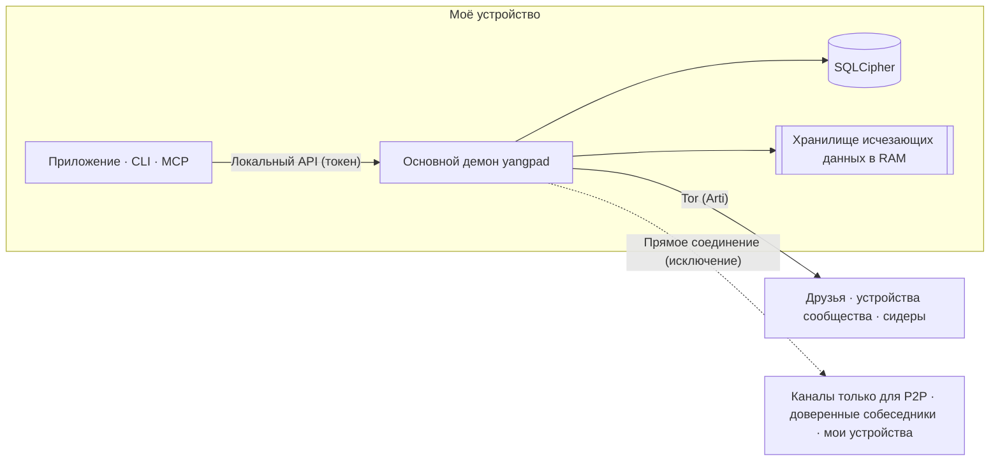

<h1 align="center">
  <picture>
    <source media="(prefers-color-scheme: dark)" srcset="docs/assets/logo-on-dark.png">
    
  </picture>
</h1>

<p align="center">
  <a href="README.ko.md">한국어</a> ·
  <a href="README.md">English</a> ·
  <a href="README.ja.md">日本語</a> ·
  <a href="README.zh-CN.md">简体中文</a> ·
  <a href="README.zh-TW.md">繁體中文</a> ·
  <a href="README.es.md">Español</a> ·
  <a href="README.fr.md">Français</a> ·
  <a href="README.de.md">Deutsch</a> ·
  <a href="README.pt-BR.md">Português (Brasil)</a> ·
  <b>Русский</b> ·
  <a href="README.it.md">Italiano</a> ·
  <a href="README.id.md">Bahasa Indonesia</a> ·
  <a href="README.vi.md">Tiếng Việt</a> ·
  <a href="README.tr.md">Türkçe</a> ·
  <a href="README.hi.md">हिन्दी</a>
</p>

<p align="center"><strong>Мессенджер со сквозным шифрованием поверх Tor — без серверов и без номера телефона</strong></p>

<p align="center">
  Ваш аккаунт — это ключ, созданный на вашем устройстве. IP скрыт за Tor, а пространство в духе Discord<br>
  с каналами, звонками и демонстрацией экрана друзья и сообщества запускают сами, без оператора.
</p>

<p align="center">
  
  <a href="https://github.com/dhtpdud/YANGPA/releases/latest"></a>
  
  
  
</p>

<p align="center">
  <a href="#почему-yangpa">Почему YANGPA</a> ·
  <a href="#скриншоты">Скриншоты</a> ·
  <a href="#модель-безопасности">Модель безопасности</a> ·
  <a href="#чего-yangpa-не-защищает">Чего YANGPA не защищает</a> ·
  <a href="#начало-работы">Начало работы</a> ·
  <a href="#документация">Документация</a>
</p>

<p align="center">
  
</p>

## Почему YANGPA

- **Регистрации нет.** Ни номер телефона, ни e-mail не запрашиваются. Аккаунт — только ключ, созданный на вашем устройстве; нет
  ни оператора со списком пользователей, ни сервера аккаунтов. Даже bootstrap-узлы, релеи и сидеры — обычные узлы, которые может
  поднять кто угодно.
- **IP остаётся за Tor.** В приложении нет настройки, которая отключает встроенный Arti (Tor); только безголовый узел можно
  запустить с `--direct`. Если Tor недоступен, приложение не переходит на прямое соединение, а останавливает запуск. Исключения
  перечислены в [таблице ниже](#куда-приложение-обращается-наружу).
- **Классическая и постквантовая криптография работают вместе.** Подписи — Ed25519 + FN-DSA-512, обмен ключами — X-Wing
  (X25519 + ML-KEM-768), транспорт — X25519MLKEM768. Схема рассчитана на атаки, при которых трафик собирают сейчас, чтобы
  расшифровать позже.
- **Есть разговоры, которые ничего не оставляют.** Содержимое и ключи исчезающих каналов хранятся только в RAM; в коде путь
  сохранения отделён от них на уровне типов.
- **Объём ваших данных определяете вы.** Что хранить, что отдавать другим и что забирать, вы выбираете по типам данных и по
  каналам.
- **Всё можно автоматизировать скриптами.** Приложение, CLI, локальный API и MCP — клиенты одного и того же основного демона
  (`yangpad`).
- **Мы не скрываем ограничений.** О том, что защитить нельзя, написано и в [документации](#чего-yangpa-не-защищает), и на экранах
  приложения. Пример — «Чему нельзя помешать» на показанном ниже экране исчезающего канала.

## Скриншоты

Скриншоты сделаны на демонстрационных данных приложения для разработки. Нажмите на изображение, чтобы увидеть его крупно.

<table>
  <tr>
    <td width="50%" valign="top">
      <br>
      <strong>Исчезающий канал</strong><br>
      Содержимое и вложения лежат только в памяти и стираются по истечении срока. Что гарантируется и чему нельзя помешать — показано прямо на экране.
    </td>
    <td width="50%" valign="top">
      <br>
      <strong>Tor и мосты</strong><br>
      Tor нельзя отключить в приложении. В заблокированных сетях вход идёт через мосты Snowflake и obfs4. Функции, отключённые из-за Tor, тоже честно перечислены.
    </td>
  </tr>
  <tr>
    <td valign="top">
      <br>
      <strong>Код безопасности и переключатель доверия</strong><br>
      Вы сами сверяете код безопасности, который защищает от посредника, и соединяетесь напрямую только с теми, кому можно показать свой IP.
    </td>
    <td valign="top">
      <br>
      <strong>Канал только для P2P</strong><br>
      В каналах, где нужны быстрые файлы и звонки, напрямую соединяются только устройства, присоединившиеся после прочтения предупреждения. До присоединения содержимое не открывается.
    </td>
  </tr>
  <tr>
    <td valign="top">
      <br>
      <strong>Подтверждение нового устройства</strong><br>
      Новое устройство попадает в аккаунт только по одноразовому QR-коду с уже используемого устройства, а разрешает вход тот, кто сверил шестизначные коды на обоих экранах.
    </td>
    <td valign="top">
      <br>
      <strong>Анонимный канал</strong><br>
      Автор показывается под псевдонимом, отдельным для каждого канала. Это скрытие только на экране приложения (<a href="#анонимность-от-кого-и-что-скрываем">таблица ниже</a>).
    </td>
  </tr>
  <tr>
    <td valign="top">
      <br>
      <strong>Звонок через Tor</strong><br>
      Без WebRTC, через Tor идёт только звук. Речь запаздывает примерно на 0,5–1,5 секунды, зато IP не раскрывается.
    </td>
    <td valign="top">
      <br>
      <strong>Демонстрация экрана</strong><br>
      Каналы только для P2P и взаимно доверенные собеседники соединяются через WebRTC. Каждый кадр шифруется сквозным шифрованием.
    </td>
  </tr>
  <tr>
    <td valign="top">
      <br>
      <strong>ИИ — только с одобрения человека</strong><br>
      Разрушительные действия, запрошенные токеном автоматизации, выполняются лишь после одобрения человеком. Все аутентифицированные вызовы попадают в журнал аудита.
    </td>
    <td valign="top">
      <br>
      <strong>Настройки сидера</strong><br>
      Типы раздаваемых данных, полосу пропускания и число одновременных передач определяете вы. Скорость можно ограничить для каждого человека, сообщества и канала.
    </td>
  </tr>
  <tr>
    <td valign="top">
      <br>
      <strong>Форум и светлая тема</strong><br>
      Есть каналы-форумы с публикациями и тегами, а тему можно выбрать светлую или тёмную.
    </td>
    <td valign="top" align="center">
      <br>
      <strong>Android</strong><br>
      Тот же код интерфейса, что и на десктопе; демон работает внутри приложения.
    </td>
  </tr>
</table>

## Возможности

| Область | Содержание |
| --- | --- |
| **Общение** | Личные пространства 1 на 1 и сообщества устроены одинаково, поэтому масштабируются без переделки. Текстовые каналы, форумы и каналы звонков, Markdown, реакции, собственные эмодзи, вложения, предпросмотр ссылок, роли и права, ссылки-приглашения. |
| **Исчезающие каналы** | Каналы, содержимое которых не покидает RAM; способы входа и выхода; срок жизни в секундах. Вложения тоже лежат только в памяти участников. |
| **Звонки** | Звонки через Tor (звук — Opus или нейросетевой кодек Mimi примерно на 1,1 кбит/с; видео — аварийное, низкого качества, после подтверждения предупреждения). Каналы только для P2P и взаимно доверенные собеседники соединяются через WebRTC-mesh, демонстрация экрана — до 120 кадров/с. Большие звонки ретранслирует сидер, поднятый с прямым соединением, не распаковывая кадры (SFU). |
| **Хранение и раздача** | В настройках сидера (раздача другим) и пира (получение) выбираются типы данных, исключённые каналы, полоса пропускания и приоритет. Полученные вложения укладываются в лимит диска (по умолчанию 2 ГБ): давно не использовавшиеся удаляются первыми, а то, что нужно сохранить, закрепляется. |
| **Сеть** | Мосты (Snowflake, obfs4, ручной ввод), переключатель доверия для каждого человека и сообщества, каналы только для P2P, ваш список STUN-серверов и STUN-серверы сообщества, опциональные файловые цепочки Tor. |
| **Устройства** | Добавляются только по одноразовому QR-коду и подтверждению шестизначного кода. Отозванное устройство при следующем подключении само стирает локальные данные. Фразы восстановления нет, поэтому если потеряны все устройства, пропадает и аккаунт. |
| **Модерация** | Блокировка (только на этом устройстве, собеседник не узнает), запечатанные жалобы, которые открывают только администраторы, и бан, который все узлы участников применяют с одним и тем же результатом. |
| **Автоматизация** | CLI `yangpa`, локальный JSON-RPC, MCP-сервер `yangpa-mcp`. Всё, что можно сделать в приложении, можно сделать и из CLI. |
| **Свой хостинг** | Безголовый сидер, в котором на NAS или VPS работает только демон (примеры для Docker и systemd), и архивный узел, который хранит лишь шифртекст, не имея ключей. |
| **Языки** | Интерфейс на 15 языках. Переводы выполнил ИИ, носители языка их пока не проверяли. |

Некоторые функции, например вкладка «Библиотека» и просмотр контента, доступны только спонсорам ([лицензия](#лицензия)).

## Анонимность: от кого и что скрываем

«Анонимность» на разных уровнях означает разное. Ниже раздельно описано, что YANGPA делает и чего не делает.

| Уровень | Что делает | Что всё равно раскрывается |
| --- | --- | --- |
| **Регистрация** | Создаёт аккаунт из ключа, сделанного на устройстве, без номера телефона и e-mail. | Выбранное вами имя и профиль. Личность одна, поэтому если вы состоите в нескольких сообществах, они могут понять, что это один и тот же человек. |
| **Сеть** | Tor скрывает IP. IP не виден ни друзьям, ни участникам сообщества, ни сидерам. | Наблюдатель в сети видит, что вы пользуетесь Tor, а также объём и время трафика. Исключения — в [таблице ниже](#куда-приложение-обращается-наружу). |
| **Внутри сообщества** | Анонимный канал показывает автора под псевдонимом, который назначается отдельно для каждого канала. | **Скрывает только на экране приложения.** Подписавший остаётся в данных, поэтому участник с модифицированным клиентом может узнать автора. |

Tor не скрывает вас от друзей. Друзья и участники знают вашу личность внутри зашифрованного канала.

## Модель безопасности



| Область | Способ |
| --- | --- |
| Подпись | Гибрид Ed25519 + FN-DSA-512. Проходит только при совпадении обеих. Каждое событие подписывается ключом устройства, а список устройств — ключом личности. |
| Обмен ключами и запечатывание | X-Wing (X25519 + ML-KEM-768) → HKDF-SHA256 → XChaCha20-Poly1305 |
| Сообщения и вложения | XChaCha20-Poly1305. Текст сжимается OpenZL и дополняется по схеме Padmé (добавка не больше 12 %), поэтому раскрывается только диапазон размера, а не точная длина. |
| Групповой ключ | Собственная группа ключей. До 256 устройств ключ запечатывается напрямую, выше — двоичное дерево LKH. Расписание ключей строится на BLAKE3 `derive_key`. |
| Смена ключей | Сразу при удалении участника; открытый ключ истории — каждые 24 часа; всё сообщество — раз в неделю. Если включить в настройках сообщества «Строгая смена ключей», сообщения не отправляются, пока не придёт обновление. |
| Звонки | AES-256-GCM для каждого кадра (WebRTC Encoded Transform). При каждой смене состава участников создаётся новый ключ, который запечатывается X-Wing и раздаётся. |
| Транспорт | libp2p TLS 1.3, обмен ключами X25519MLKEM768. Tor-рой и релейные цепочки используют только TLS. |
| Сеть | Встроенный Arti, onion-сервисы v3, vanguards (исходящие цепочки — lite, цепочки onion-сервиса — full). |
| Хранение | SQLCipher, ключ БД — в хранилище ключей ОС. Каждое сообщение дополнительно запечатывается случайным ключом хранения, и при удалении этот ключ стирается (криптографическое удаление). |
| Исчезающая память | Сеансовые ключи лежат в заблокированной памяти (mlock, VirtualLock) и при очистке перезаписываются нулями. Содержимое и в RAM хранится шифртекстом и расшифровывается только при передаче на экран. |
| Локальный API | Открываются только сокет Unix (0600) или именованный канал. TCP не открывается, а у каждого токена ограничены область действия и сообщества. |
| Журнал | На любом уровне журнала не записываются ни содержимое сообщений, ни ключи, ни токены. |

Три проектных решения, на которые специалисту стоит посмотреть в первую очередь.

- **Вместо MLS используется собственная группа ключей.** В сообществе из 45 тысяч устройств welcome- и remove-коммиты MLS
  вырастали до 50–61 МБ, поэтому мы это заменили. Схема не стандартизирована и внешней проверке не подвергалась. Дизайн описан в
  [docs/protocol.md](docs/protocol.md), измерения — в [docs/performance.md](docs/performance.md).
- **Нет прямой секретности для каждого сообщения.** Ключи меняются с периодичностью из таблицы выше, но не на каждое сообщение.
  Личные чаты устроены так же. Если ключ утечёт, откроются сообщения за тот же период действия ключа.
- **Цепочки Tor пока на классической криптографии.** В Arti 0.47 нет постквантового рукопожатия цепочек. Вложенное в них
  соединение libp2p и содержимое со сквозным шифрованием защищены гибридным обменом ключами, но если собрать соединения со
  стороны гарда и расшифровать позже, может раскрыться, когда и к какому onion-адресу вы обращались.

### Куда приложение обращается наружу

В приложении нет кода сбора статистики, отчётов об ошибках и проверки автообновлений. Ниже перечислены все места, где
приложение обращается наружу. [CSP](apps/desktop/src-tauri/tauri.conf.json) экрана приложения (веб-представления) открывает
`connect-src` только для внутренних ресурсов приложения. Собственный сетевой трафик операционной системы и движка веб-представления
(WebView2 и т. п.) приложение не контролирует.

| Когда | Куда | Что раскрывается |
| --- | --- | --- |
| Всегда | Гард Tor или мост | Мой IP и то, что я пользуюсь Tor |
| Когда не удаётся войти в Tor (автоматически, если настройки мостов не менялись) | Брокер Snowflake и волонтёрские прокси | Мой IP |
| **Когда у вас 2 устройства или больше (автоматически, кроме автономного режима)** | Публичные STUN-серверы (по умолчанию Google и Cloudflare), мои другие устройства, роутер (UPnP) | **Мой публичный IP** |
| При присоединении к каналу только для P2P | Устройства, присоединившиеся вместе со мной, STUN-серверы | Мой IP (после подтверждения предупреждения) |
| При включении переключателя доверия | Доверенный собеседник, STUN-серверы | Мой IP (после подтверждения предупреждения). Если доверяет только одна сторона — только IP доверяющей стороны |
| Когда решено использовать STUN-серверы сообщества (нужно, чтобы были включены и право роли, и моя настройка) | STUN-серверы этого сообщества | Мой публичный IP |
| При отправке сообщения со ссылкой | Этот сайт | IP выходного узла Tor. Получатель ссылку не запрашивает. В исчезающих каналах по умолчанию выключено. |
| При проверке поддержки через GitHub | github.com | IP выходного узла Tor и мой аккаунт GitHub |
| **При проверке поддержки через Patreon** | patreon.com | **Мой настоящий IP** и мой аккаунт Patreon. Patreon блокирует выходные узлы Tor, поэтому соединение прямое. |

Проверка поддержки запускается, только если вы сами включили её кнопкой, и затем повторяется раз в сутки. Личность YANGPA не отправляется.

## Чего YANGPA не защищает

Полный список и модель злоумышленника — в [SECURITY.md](SECURITY.md).

- **Данные, которые попали на чужое устройство.** Удаление, срок жизни и исчезновение соблюдаются только честным клиентом.
  Скриншоты, съёмку на камеру и модифицированные клиенты предотвратить нельзя.
- **Метаданные.** Заголовки событий не шифруются, чтобы можно было проверять подписи и синхронизироваться, поэтому участники и
  сидеры, получающие событие, знают, кто, когда и в какой канал писал.
- **Если ваше устройство взломано.** Вредоносная программа под тем же пользователем ОС может управлять демоном. Отдельной защиты
  ключа БД паролем пока нет.
- **Пределы самого Tor.** Корреляционный анализ по времени со стороны наблюдателя, который видит всю сеть, предотвратить нельзя.
- **Пути за пределами исчезающих каналов.** Файл гибернации, дампы сбоев, история буфера обмена, захват экрана в Linux.
- **Скрытие IP от тех, с кем соединение прямое.** Участникам каналов только для P2P и доверенным собеседникам ваш IP виден как есть.
- **Подлинность дистрибутивов.** Подписи кода нет, а `SHA256SUMS.txt` подтверждает лишь отсутствие повреждений при скачивании.
  Если подлинность важна, собирайте из исходников.
- **Потеря устройств.** Если потеряны все устройства, аккаунт восстановить нельзя.

## Проверьте сами

То, что можно не принимать на веру, а проверить.

| Что интересует | Как проверить |
| --- | --- |
| Остаётся ли содержимое исчезающих каналов на диске или в журнале | Отправьте в исчезающий канал строку-метку, затем `yangpa diag leakcheck <метка>` |
| Утекают ли пакеты за пределы Tor | `sudo scripts/tor-leak-check.sh` (Linux, настоящая сеть Tor). Пакеты перехватываются в сетевом пространстве имён, и если хоть один ушёл не на реле Tor, проверка не проходит. Только на последнем этапе, где соединяются мои устройства, STUN, UPnP и мой публичный адрес считаются отдельно. |
| Каково сейчас состояние сети | `yangpa net status` |
| Соответствует ли протокол документации | [docs/protocol.md](docs/protocol.md), `crates/yangpa-crypto` и `crates/yangpa-sync` |
| Что изменилось по сравнению с исходным планом | [docs/decisions.md](docs/decisions.md) — там записаны все решения и их причины. |

Об уязвимостях сообщайте [не в публичных задачах, а в частном порядке](SECURITY.md#취약점-알리기).

## Начало работы

### Поддерживаемые платформы

Windows x86_64, macOS (универсальная сборка для Apple Silicon и Intel), Linux x86_64 и ARM64. Для Android ARM64 установите APK из релиза (`YANGPA_…_arm64.apk`, [docs/android.md](docs/android.md)).

### Десктопное приложение

1. Скачайте подходящий вашей ОС пакет из [релизов](../../releases).

   | ОС | Файл |
   | --- | --- |
   | Windows | `…_x64-setup.exe` (рекомендуется) или `…_x64_en-US.msi` |
   | macOS | `…_universal.dmg` |
   | Linux x86_64 | `…_amd64.deb` или `…_amd64.AppImage` |
   | Linux ARM64 | `…_arm64.deb` или `…_aarch64.AppImage` (glibc 2.35 и выше) |

2. Проверьте по `SHA256SUMS.txt` из того же релиза.

   ```bash
   sha256sum -c SHA256SUMS.txt --ignore-missing
   ```

   Пакеты не подписаны, поэтому в macOS разрешите открытие в «Системные настройки → Конфиденциальность и безопасность», а в
   Windows в SmartScreen выберите «Подробнее → Выполнить в любом случае».
3. Откройте приложение и создайте личность кнопкой **Начать заново**. Другие устройства добавляются через «Подключить новое
   устройство» в разделе «Настройки › Устройства».
4. Создайте ссылку-контакт и отправьте её либо вставьте полученную ссылку, чтобы начать разговор.

<details>
<summary><strong>Запуск демона отдельно от приложения и его остановка</strong></summary>

Приложение поставляется вместе с демоном (`yangpad`), запускает его по необходимости и при выходе останавливает связанный с
ним демон (пока он остановлен, сидирование и уведомления тоже не работают). Чтобы демон продолжал работать независимо от
приложения, запускайте приложение с `YANGPA_NO_SPAWN=1`. Если приложение принудительно закрыто или упало, запущенный им демон
замечает это и завершается сам. Демон, запущенный не приложением (через CLI), остаётся и может продолжать сидирование. Чтобы
остановить такой демон:

- Если есть инструмент командной строки, `yangpa shutdown`. В десктопный пакет CLI не входит, поэтому скачайте пакет
  `yangpa-cli-…` ниже.
- Если CLI нет, завершите процесс `yangpad` средствами ОС. В Windows это `yangpad.exe` во вкладке «Подробности» диспетчера
  задач, в macOS — `yangpad` в «Мониторинге системы», в Linux — `pkill -x yangpad` (обычный сигнал завершения). При следующем
  открытии приложение запустит его снова.
- Установщики перед обновлением и удалением сначала останавливают демон этой установки: Windows `-setup.exe` и `.msi` —
  `yangpad.exe` в папке установки, Linux `.deb` — заменяемый или удаляемый `/usr/bin/yangpad`. Открытое приложение
  перезапустите (демон заново не запускается). В Windows демон, запущенный другой учётной записью, остановить нельзя, и он
  может смениться после перезагрузки.

</details>

### Командная строка (CLI)

В релизном `yangpa-cli-<версия>-<цель>.tar.gz` (для Windows — `.zip`) лежат `yangpad`, `yangpa` и `yangpa-mcp`.
Положите все три файла в один каталог (или в `PATH`).

```bash
yangpa daemon &                         # Запустить демон (пропустите, если его уже запустило приложение). Аргументы передаются в yangpad как есть
yangpa identity create --name me        # Создать личность
yangpa status

yangpa friend link create --single-use --expires 24h    # Ссылка-контакт, которую нужно отправить собеседнику
yangpa friend add 'yangpa://friend/…'                    # Сразу создать временный контакт и пространство 1 на 1 по полученной ссылке
yangpa friend propose имя_собеседника                    # Предложить дружбу (если собеседник сделает то же, вы друзья)

yangpa space list                                        # Пространства 1 на 1 и названия сообществ
yangpa channel list --crew <имя>
yangpa message send --crew <имя> -c <канал> "Привет"
yangpa watch                                             # Новые сообщения и изменения состояния в реальном времени
```

<details>
<summary><strong>Способ подключения CLI и аргументы</strong></summary>

- CLI подключается к локальному API демона (сокет Unix 0600, именованный канал Windows). Для того же пользователя он
  автоматически берёт токен владельца из пути данных. Демон в другом месте задаётся через `--endpoint` (`YANGPA_ENDPOINT`),
  другой токен — через `YANGPA_TOKEN`.
- Аргументы любой команды можно посмотреть через `yangpa <команда> --help`, а с `--json` результат выводится как JSON.
- Значения, заданные именами (`--crew "Игровая компания"`, `-c объявления`, имена ролей и участников), при выполнении
  преобразуются в ID. Если одно и то же имя встречается несколько раз, будет предложено использовать ID.

</details>

### Безголовый сидер (NAS, VPS)

Узел, который постоянно раздаёт историю сообщества. Подробности настройки, удалённого управления и запуска через Tor — в [docs/headless.md](docs/headless.md).

<details>
<summary><strong>Запуск через Docker и systemd</strong></summary>

```bash
# Docker (из корня репозитория): данные только в томе, непривилегированный пользователь, фиксированный порт 47810 (TCP и UDP)
docker compose -f deploy/docker-compose.yml up -d --build
alias yangpa='docker exec -it yangpa-seeder yangpa'

# Или systemd: deploy/systemd/yangpad.service (с настройками изоляции)

yangpa identity create --name "Сидер игровой компании"
yangpa invite join 'yangpa://invite/…'
yangpa seed set --all-channels --types text,image,video,file,emoji,history_bundle --upload-limit 5MB/s --prefetch on
yangpa seed coverage --crew "Игровая компания"
yangpa blob cache limit 200GB --min-free 10GB           # Лимит диска под полученные вложения (по умолчанию 2 ГБ)
```

По умолчанию сидер раздаёт «только каналы, открытые вами самим», поэтому безголовому узлу нужно расширить охват через
`--all-channels`, а вложения неоткрытых каналов заранее загружаются только при `--prefetch on`. Пакет сидера в первую очередь
берёт на себя роль SFU-хоста для больших звонков (`YANGPA_SFU_HOST=prefer`, медиа-UDP 47811). Сидер, поднятый по умолчанию с
прямым соединением, не может первым обратиться к onion-адресу участника, работающего через Tor, а в приложении нет настройки,
которая регистрирует адрес сидера, поэтому чтобы сидер был доступен пользователям приложения, его нужно запускать через Tor
([docs/headless.md](docs/headless.md#멤버가-닿게-하기)). Чтобы хранить только шифртекст, не вступая в сообщество, запустите
его с `--archive` ([docs/headless.md](docs/headless.md#보관-전용-노드로-쓰기)). Безголовый сидер — участник сообщества с ключами,
а архивный узел тоже видит метаданные: кто, когда и сколько писал.

</details>

## Чего пока нет

- Десктопное приложение пока не передаёт видео с камеры (только голос и демонстрацию экрана).
- Экран в звонке через Tor — аварийный, низкого качества (до 1280 px по ширине, 2 кадра в секунду). Полноценная демонстрация
  экрана возможна в канале звонков только для P2P или со взаимно доверенным собеседником.
- Звук экрана передаётся только в mesh-звонках на Windows. В звонках через SFU и Tor передаётся только изображение.
- Устройства приложения, работающие через Tor, не берут на себя роль SFU-хоста.
- Голос и демонстрация экрана в Linux (WebKitGTK) могут работать нестабильно, а исключение окна из захвата не поддерживается.
- Автоматические тесты с настоящим окном Tauri работают только в Linux. Окна macOS и Windows, а также подпись и нотаризацию проверяет человек ([CONTRIBUTING.md](CONTRIBUTING.md#릴리스-절차)).

## Подключение ИИ-инструментов (MCP)

`yangpa-mcp` — MCP-сервер, работающий через стандартный ввод-вывод. ИИ-инструмент вызывает его как инструменты для таких задач,
как список каналов, чтение и пересказ сообщений, управление каналами и ролями, приглашения и настройка сидера.

**Правила безопасности, которые обеспечивает демон:**

- Разрушительные действия — исключение, бан и разбан, обработка жалоб (кроме отклонения), удаление чужих сообщений, смена прав
  и ролей, создание приглашений, удаление канала — не выполняются сразу, а попадают в очередь ожидания подтверждения человеком.
  Выполнятся они только после одобрения в приложении или через `yangpa confirm list` → `yangpa confirm approve <ID>`.
- Чтение исчезающих каналов ИИ по умолчанию запрещено. Открывается только если человек разрешил его для каждого канала через
  `yangpa channel allow-api-read … on`.
- Сообщения участников передаются ИИ в обёртке «данные, а не инструкции» (защита от prompt injection).
- Все аутентифицированные вызовы попадают в журнал аудита (`yangpa audit list`), а в списке участников сообщества появляется
  пометка об автоматизации. Использованный токен отзывайте через `yangpa token revoke <ID>`.

<details>
<summary><strong>Как настроить</strong></summary>

1. **Выпустите токен автоматизации.** Выпустить его может только владелец, и токен выводится один раз, в этот момент. Давайте
   область действия (`read`, `write`, `admin`, `settings`) и сообщества только в нужном объёме. `yangpa-mcp` отвергает токены,
   выпущенные без `--automation`.

   ```bash
   yangpa token create --name ai --scopes read,write --crews "Игровая компания" --automation
   ```

2. **Добавьте в настройки MCP вашего ИИ-инструмента.** Большинство клиентов используют такой формат (расположение файла у
   каждого инструмента своё).

   ```json
   {
     "mcpServers": {
       "yangpa": {
         "command": "yangpa-mcp",
         "env": {
           "YANGPA_TOKEN": "<токен автоматизации, полученный выше>"
         }
       }
     }
   }
   ```

   Если `yangpa-mcp` нет в `PATH`, укажите в `command` полный путь. Если демон находится не в стандартном месте, добавьте в `env`
   `"YANGPA_ENDPOINT": "<путь к сокету или именованный канал>"`. Уровень журнала задаётся через `YANGPA_MCP_LOG` (по умолчанию
   `warn`, вывод только в стандартный поток ошибок).

</details>

Подробные правила — в [главе 10 руководства пользователя](docs/user-guide.md#10-ai-연동과-안전-규칙).

## Сборка из исходников

Что нужно:

- Rust 1.91 или новее (релиз собран на 1.99.1), компилятор C, `perl` и `make` (для сборки OpenSSL для SQLCipher из исходников),
  `cmake` (на случай сборки aws-lc в некоторых средах). В Windows — инструменты сборки MSVC и Strawberry Perl.
- Десктопное приложение: Node.js 22, в Linux — `libwebkit2gtk-4.1-dev libayatana-appindicator3-dev librsvg2-dev libxdo-dev`.

```bash
# Ядро: демон (yangpad), CLI (yangpa), MCP-сервер (yangpa-mcp). Десктопное приложение не входит в сборку по умолчанию.
cargo build --release --locked
ls target/release/{yangpad,yangpa,yangpa-mcp}
cargo test --workspace

# Десктопное приложение (режим разработки). Приложение ищет и запускает yangpad рядом с исполняемым файлом (target/debug).
cargo build -p yangpa-daemon
cd apps/desktop
npm ci
npm run tauri dev
```

<details>
<summary><strong>Тесты приложения и сборка дистрибутивов</strong></summary>

```bash
# Тесты десктопного приложения: модульные тесты и E2E, который реально запускает собранный выше yangpad (без него E2E пропускается).
YANGPA_E2E_REQUIRED=1 npm test -- --run

# Тест с настоящим окном (Linux): нужны tauri-driver, WebKitWebDriver и экран; если их нет, тест сообщает причину и пропускается.
npm run test:window:build
xvfb-run -a npm run test:window
```

Чтобы собрать дистрибутив самостоятельно, соберите `yangpad`, скопируйте его в
`apps/desktop/src-tauri/binaries/yangpad-<target triple>` (в Windows с `.exe`) и выполните `npm run tauri build`. Релизный конвейер
([.github/workflows/release.yml](.github/workflows/release.yml)) следует ровно этому порядку. В Windows одним
`scripts/build-windows-release.sh` в Git bash можно собрать установщики (NSIS и MSI) и портативный zip
(`target/portable/<коммит>/`), а по ходу выводится время каждого этапа (при `BUNDLES=nsis` MSI пропускается). Релизная сборка
идёт в `C:\yangpa-build` (меняется через `DIST_DIR`), чтобы в бинарниках не оставались пути с именем пользователя, поэтому и
установщики появляются под ним, в `target\x86_64-pc-windows-msvc\release\bundle\`, а скрипт в конце показывает полный путь.

Скриншоты в README пересоздаются в `apps/desktop` командой `npm run build && npm run screenshot`.

</details>

О том, как внести вклад, — в [CONTRIBUTING.md](CONTRIBUTING.md).

<details>
<summary><strong>Структура репозитория</strong></summary>

| Путь | Содержание |
| --- | --- |
| `crates/yangpa-core` | Общие типы: идентификаторы, подписи, DAG событий, модель пространств, каналов и прав, ссылки, сообщения протокола |
| `crates/yangpa-crypto` | AEAD, запечатанные контейнеры, заблокированная память, шифрование событий и блобов, ключи личности, группа ключей (дерево ключей и расписание ключей) |
| `crates/yangpa-store` | Хранилище SQLCipher, хранилище блобов, хранилище исчезающих данных в RAM (разделено на уровне типов) |
| `crates/yangpa-sync` | DAG, сравнение отпечатков диапазонов, разрешение состояния (права), политики сидера и пира, планировщик файлового роя |
| `crates/yangpa-net` | libp2p (QUIC, TCP, Kademlia, GossipSub, Relay, DCUtR, AutoNAT, mDNS), Tor-рой на основе Arti |
| `crates/yangpa-sfu` | Движок SFU для звонков (str0m, без ввода-вывода): передаёт кадры, не распаковывая их, выбирает слои simulcast |
| `crates/yangpa-rpc` | Фрейминг, типы, клиент и сервер локального JSON-RPC 2.0 |
| `crates/yangpa-daemon` | Основной демон `yangpad` |
| `crates/yangpa-cli` | CLI `yangpa` |
| `crates/yangpa-mcp` | MCP-сервер для интеграции с ИИ `yangpa-mcp` |
| `crates/yangpa-bench` | Набор эталонных задач для измерения производительности и проверка регрессии по числу команд `yangpa-bench` |
| `scripts` | Скрипты проверки утечек в настоящей сети Tor (перехват пакетов) и проверки регрессии производительности |
| `apps/desktop` | Десктопное и Android-приложение (Tauri 2 + React + TypeScript) |
| `deploy/` | Примеры безголового сидера (docker-compose, systemd) |
| `docs/` | Исходный план и проектная документация |

</details>

## Документация

Документы ниже существуют только на корейском языке.

| Документ | Содержание |
| --- | --- |
| [docs/user-guide.md](docs/user-guide.md) | Руководство пользователя: контакты и друзья, сообщества, роли, приглашения, исчезающие каналы, сидирование, подключение через Tor, каналы только для P2P и переключатель доверия, правила безопасности для ИИ |
| [SECURITY.md](SECURITY.md) | Модель угроз, что защищается и что нет, как сообщить об уязвимости |
| [docs/protocol.md](docs/protocol.md) | Криптография и протокол синхронизации |
| [docs/architecture.md](docs/architecture.md) | Границы крейтов и публичный API |
| [docs/api.md](docs/api.md) | Локальный JSON-RPC API |
| [docs/headless.md](docs/headless.md) | Установка, удалённое управление и эксплуатация безголового сидера |
| [docs/android.md](docs/android.md) | Устройство и сборка приложения для Android |
| [docs/decisions.md](docs/decisions.md) | Что изменилось по сравнению с планом, значения по умолчанию для нерешённых вопросов |
| [docs/performance.md](docs/performance.md) | Цели по производительности, результаты измерений, базовые значения по числу команд и проверка регрессии |
| [docs/daemon.md](docs/daemon.md) | Внутреннее устройство демона: владение модулями, хуки, известные пробелы |
| [docs/plan.md](docs/plan.md) | Исходный текст плана |
| [CONTRIBUTING.md](CONTRIBUTING.md) | Структура рабочего пространства, проверки, правила документации, порядок выпуска релизов |

## Лицензия

Распространяется по GNU Affero General Public License v3 или более поздней версии ([LICENSE](LICENSE), SPDX
`AGPL-3.0-or-later`). Если вы даёте другим людям пользоваться изменённой версией по сети (например, поднятым вами
SFU-сервером), вы должны передать исходный код и им. `third_party` и `vendor/ffmpeg` подчиняются собственным лицензиям (файлы в
этих папках).

- **Функции для спонсоров** (проверка поддержки, вкладка «Библиотека», просмотр контента, отметки спонсоров): их код в
  `crates/yangpa-daemon/src/supporter/` и `apps/desktop/src/supporter/` подчиняется не AGPL, а
  [лицензии функций поддержки YANGPA](LICENSE-SUPPORTER.md). Исходный код открыт, и собирать его самостоятельно для личного
  использования можно, но распространять версию с удалённой или обойдённой проверкой поддержки нельзя.
- **Дополнительные условия по разделу 7 AGPL** ([NOTICE.md](NOTICE.md)): изменённая версия должна оставить на информационном
  экране приложения исходное уведомление об авторских правах, адрес исходного кода и фразу «изменённая версия на основе
  YANGPA». Распространять её вместе с модулем поддержки разрешено.
- **Товарный знак** ([TRADEMARK.md](TRADEMARK.md)): изменённые версии не вправе использовать название YANGPA и значок
  с пламенем.
- Вклад регулируется [согласием участника](CONTRIBUTING.md#라이선스와-기여자-동의).
