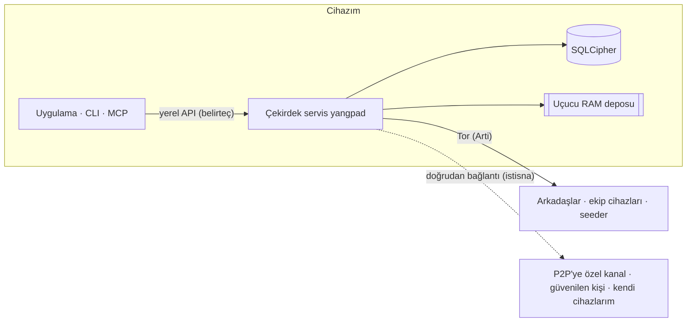

<h1 align="center">
  <picture>
    <source media="(prefers-color-scheme: dark)" srcset="docs/assets/logo-on-dark.png">
    
  </picture>
</h1>

<p align="center">
  <a href="README.md">한국어</a> ·
  <a href="README.en.md">English</a> ·
  <a href="README.ja.md">日本語</a> ·
  <a href="README.zh-CN.md">简体中文</a> ·
  <a href="README.zh-TW.md">繁體中文</a> ·
  <a href="README.es.md">Español</a> ·
  <a href="README.fr.md">Français</a> ·
  <a href="README.de.md">Deutsch</a> ·
  <a href="README.pt-BR.md">Português (Brasil)</a> ·
  <a href="README.ru.md">Русский</a> ·
  <a href="README.it.md">Italiano</a> ·
  <a href="README.id.md">Bahasa Indonesia</a> ·
  <a href="README.vi.md">Tiếng Việt</a> ·
  <b>Türkçe</b> ·
  <a href="README.hi.md">हिन्दी</a>
</p>

<p align="center"><strong>Sunucusuz, telefon numarasız, Tor üzerinde uçtan uca şifreli mesajlaşma uygulaması</strong></p>

<p align="center">
  Hesabınız, cihazınızda üretilen anahtardır. IP adresinizi Tor ile saklar; kanalları, aramaları ve ekran paylaşımı olan<br>
  Discord tarzı alanları bir işletmeci olmadan arkadaşlarınızla ve ekibinizle çalıştırırsınız.
</p>

<p align="center">
  
  <a href="https://github.com/dhtpdud/YANGPA/releases/latest"></a>
  
  
  
</p>

<p align="center">
  <a href="#neden-yangpa">Neden YANGPA</a> ·
  <a href="#ekran-görüntüleri">Ekran görüntüleri</a> ·
  <a href="#güvenlik-tasarımı">Güvenlik tasarımı</a> ·
  <a href="#koruyamadığı-şeyler">Koruyamadığı şeyler</a> ·
  <a href="#başlarken">Başlarken</a> ·
  <a href="#belgeler">Belgeler</a>
</p>

<p align="center">
  
</p>

## Neden YANGPA

- **Kayıt yok.** Telefon numarası da e-posta da istenmez. Hesap yalnızca cihazınızda üretilen anahtardır; kullanıcı listesini elinde tutan bir işletmeci ya da hesap sunucusu yoktur. Bootstrap, röle ve seeder dahil herkesin ayağa kaldırabileceği sıradan düğümlerdir.
- **IP adresiniz Tor'un arkasında.** Uygulamada yerleşik Arti'yi (Tor) kapatan bir ayar yoktur (yalnızca başsız düğüm `--direct` ile başlatılabilir) ve Tor kullanılamıyorsa doğrudan bağlantıya geçmek yerine başlatma durur. İstisnaların tamamı [aşağıdaki tabloda](#uygulamanın-dışarıyla-iletişim-kurduğu-yerler) yazılıdır.
- **Klasik ve kuantum sonrası şifrelemeyi birlikte kullanır.** İmza Ed25519 + FN-DSA-512, anahtar değişimi X-Wing (X25519 + ML-KEM-768), aktarım X25519MLKEM768'dir. Bugün toplanan trafiği ileride çözmeye çalışan saldırılar göz önünde tutularak kurulmuş bir yapıdır.
- **İz bırakmayan konuşmalar var.** Uçucu kanalların içeriği ve anahtarları yalnızca RAM'dedir; kodda da depolama yolu ve tip düzeyinde ayrılmıştır.
- **Verinizin kapsamını siz belirlersiniz.** Neyi saklayacağınızı, başkalarına vereceğinizi ve alacağınızı veri türü ve kanal bazında seçersiniz.
- **Betikle yönetilebilir.** Uygulama, CLI, yerel API ve MCP aynı çekirdek servisin (`yangpad`) istemcileridir.
- **Sınırları gizlemez.** Koruyamadıklarını [belgelerde](#koruyamadığı-şeyler) de uygulama ekranında da yazar. Aşağıdaki uçucu kanal ekranındaki "engellenemeyenler" bunun bir örneğidir.

## Ekran görüntüleri

Uygulamanın geliştirme amaçlı örnek verileriyle alınmış ekranlardır. Büyütmek için görsele tıklayın.

<table>
  <tr>
    <td width="50%" valign="top">
      <br>
      <strong>Uçucu kanal</strong><br>
      İçerik ve ekler yalnızca bellekte durur, süresi dolunca silinir. Garanti edilenler ile engellenemeyenler ekranda birlikte gösterilir.
    </td>
    <td width="50%" valign="top">
      <br>
      <strong>Tor ve köprüler</strong><br>
      Uygulamadan kapatılamayan Tor. Engelli ağlarda Snowflake ve obfs4 köprüleriyle girilir. Tor yüzünden kapanan özellikler de olduğu gibi bildirilir.
    </td>
  </tr>
  <tr>
    <td valign="top">
      <br>
      <strong>Güvenlik numarası ve güven anahtarı</strong><br>
      Ortadaki adamı engelleyen güvenlik numarasını kendiniz karşılaştırırsınız; IP adresinizi görmesinde sakınca olmayan kişilerle doğrudan bağlanırsınız.
    </td>
    <td valign="top">
      <br>
      <strong>P2P'ye özel kanal</strong><br>
      Hızlı dosya ve arama gereken kanallarda yalnızca uyarıyı görüp katılan cihazlar doğrudan bağlanır. Katılmadan önce içerik açılmaz.
    </td>
  </tr>
  <tr>
    <td valign="top">
      <br>
      <strong>Yeni cihaz onayı</strong><br>
      Yeni cihaz yalnızca kullandığınız cihazın tek kullanımlık QR kodu ile girer; iki taraftaki 6 haneli numarayı karşılaştıran kişi izin verir.
    </td>
    <td valign="top">
      <br>
      <strong>Anonim kanal</strong><br>
      Yazarı kanala özel bir takma adla gösterir. Yalnızca uygulama ekranında gizleyen bir özelliktir (<a href="#anonimlik-kimden-neyi-saklıyor">aşağıdaki tablo</a>).
    </td>
  </tr>
  <tr>
    <td valign="top">
      <br>
      <strong>Tor araması</strong><br>
      WebRTC olmadan yalnızca sesi Tor üzerinden taşır. Konuşma yaklaşık 0,5–1,5 sn gecikir, karşılığında IP adresiniz görünmez.
    </td>
    <td valign="top">
      <br>
      <strong>Ekran paylaşımı</strong><br>
      P2P'ye özel kanallar ve karşılıklı güvenilen kişilerle WebRTC üzerinden bağlanılır. Her kare uçtan uca şifrelenir.
    </td>
  </tr>
  <tr>
    <td valign="top">
      <br>
      <strong>Yapay zekâ için insan onayı</strong><br>
      Otomasyon belirtecinin istediği yıkıcı işlemler yalnızca bir insan onaylarsa çalışır. Doğrulanmış tüm çağrılar denetim kaydına yazılır.
    </td>
    <td valign="top">
      <br>
      <strong>Seeder ayarları</strong><br>
      Paylaşılacak veri türlerini, bant genişliğini ve eşzamanlı aktarım sayısını siz belirlersiniz. Kişi, ekip ve kanal başına hız da sınırlanır.
    </td>
  </tr>
  <tr>
    <td valign="top">
      <br>
      <strong>Forum ve açık tema</strong><br>
      Gönderi ve etiketlerle düzenlenen forum kanalları vardır; açık ve koyu tema arasından seçersiniz.
    </td>
    <td valign="top" align="center">
      <br>
      <strong>Android</strong><br>
      Masaüstüyle aynı ekran kodunu kullanır; servis uygulamanın içinde çalışır.
    </td>
  </tr>
</table>

## Özellikler

| Alan | İçerik |
| --- | --- |
| **Sohbet** | Bire bir alanlar ve ekipler aynı yapıdadır, bu yüzden olduğu gibi genişletilebilir. Metin, forum ve arama kanalları, markdown, tepkiler, özel emojiler, ekler, bağlantı önizlemeleri, roller ve izinler, davet bağlantıları. |
| **Uçucu** | İçeriğin RAM dışına çıkmadığı kanallar, giriş ve çıkış biçimleri, saniye cinsinden ömür. Ekler de yalnızca katılımcıların belleğinde durur. |
| **Arama** | Tor araması (ses Opus ya da yaklaşık 1,1 kbps'lik sinir ağı kodeki Mimi ile; ekran, uyarı onaylandıktan sonra acil durum amaçlı düşük kalitede). P2P'ye özel kanallar ve karşılıklı güvenilen kişilerle WebRTC mesh kurulur ve ekran paylaşımı en fazla 120 fps'tir. Büyük aramalarda doğrudan bağlantıyla açılmış bir seeder kareleri çözmeden aktarır (SFU). |
| **Saklama ve sunma** | Seeder (başkalarına verme) ve peer (alma) ayarlarıyla veri türünü, kanal hariç tutmayı, bant genişliğini ve önceliği seçersiniz. Alınan ekler disk sınırı (varsayılan 2 GB) içinde en uzun süredir kullanılmayandan başlayarak boşaltılır; saklanacaklar sabitlenir. |
| **Ağ** | Köprüler (Snowflake, obfs4, elle giriş), kişi ve ekip başına seçilen güven anahtarı, P2P'ye özel kanallar, kendi STUN sunucu listeniz ve ekip STUN sunucuları, isteğe bağlı Tor dosya devresi. |
| **Cihazlar** | Yalnızca tek kullanımlık QR ve 6 haneli numara onayıyla eklenir. İptal edilen cihaz bir sonraki bağlantıda yerel verisini kendisi siler. Kurtarma ifadesi olmadığı için tüm cihazlar kaybedilirse hesap da yok olur. |
| **Yönetim** | Engelleme (yalnızca bu cihazda, karşı taraf bilmez), yalnızca moderatörlerin açabildiği mühürlü şikâyetler, tüm üye düğümlerinin aynı sonuçla uyguladığı yasaklama. |
| **Otomasyon** | CLI `yangpa`, yerel JSON-RPC, MCP sunucusu `yangpa-mcp`. Uygulamayla yapılabilen her şey CLI ile de yapılabilir. |
| **Kendi barındırma** | NAS veya VPS'te yalnızca servisi çalıştıran başsız seeder (Docker ve systemd örnekleri), anahtarsız yalnızca şifreli metni saklayan arşive özel düğüm. |
| **Dil** | Arayüz 15 dildedir. Çeviriler yapay zekâ ile yapılmıştır, anadili konuşanlarca henüz gözden geçirilmemiştir. |

Kitaplık sekmesi ve içerik görüntüleyici gibi bazı özellikler yalnızca destekçilere açıktır ([lisans](#lisans)).

## Anonimlik: kimden neyi saklıyor

"Anonim" her katmanda başka anlama gelir. YANGPA'nın yaptıklarını ve yapmadıklarını ayrı ayrı yazıyorum.

| Katman | Yaptığı | Yine de açığa çıkan |
| --- | --- | --- |
| **Kayıt** | Telefon numarası ve e-posta olmadan, cihazda üretilen anahtarla hesap oluşturur. | Seçtiğiniz ad ve profil. Kimlik tektir; bu yüzden birden fazla ekipteyseniz ekipler sizin aynı kişi olduğunuzu anlayabilir. |
| **Ağ** | Tor IP adresinizi saklar. Arkadaşlar, ekip üyeleri ve seeder'lar bile IP adresinizi görmez. | Ağ gözlemcisi Tor kullandığınızı, trafik miktarını ve zamanını görür. İstisnalar [aşağıdaki tabloda](#uygulamanın-dışarıyla-iletişim-kurduğu-yerler). |
| **Ekip içi** | Anonim kanal, yazarı kanal başına belirlenen bir takma adla gösterir. | **Yalnızca uygulama ekranında gizler.** İmzalayan veride olduğu gibi kalır, değiştirilmiş istemci kullanan bir üye yazarı öğrenebilir. |

Tor sizi arkadaşlarınızdan saklamaz. Arkadaşlar ve üyeler, şifreli kanalın içinde kimliğinizi bilir.

## Güvenlik tasarımı



| Alan | Yöntem |
| --- | --- |
| İmza | Ed25519 + FN-DSA-512 hibrit. İkisi de doğru olmalıdır. Tüm olaylar cihaz anahtarıyla, cihaz listesi kimlik anahtarıyla imzalanır. |
| Anahtar değişimi ve mühürleme | X-Wing (X25519 + ML-KEM-768) → HKDF-SHA256 → XChaCha20-Poly1305 |
| Mesaj ve ekler | XChaCha20-Poly1305. Gövde OpenZL ile sıkıştırılır, ardından Padmé ile doldurulur (eklenen miktar en fazla %12); kesin uzunluk yerine yalnızca boyut aralığı görünür. |
| Grup anahtarı | Kendi anahtar grubumuz. 256 cihaza kadar doğrudan mühürlenir, aşıldığında LKH ikili ağacı kullanılır. Anahtar çizelgesi BLAKE3 `derive_key` ile yapılır. |
| Anahtar yenileme | Üye çıkarılınca hemen, geçmiş açık anahtarı 24 saatte bir, ekibin tamamı haftada bir değiştirilir. Ekip ayarlarında "Katı anahtar döndürme" açılırsa güncelleme gelene kadar gönderim yapılmaz. |
| Arama | Her kare AES-256-GCM ile (WebRTC Encoded Transform). Katılımcılar değiştikçe yeni anahtar üretilir, X-Wing ile mühürlenip dağıtılır. |
| Aktarım | libp2p TLS 1.3, anahtar değişimi X25519MLKEM768. Tor swarm'ı ve röle devreleri yalnızca TLS kullanır. |
| Ağ | Yerleşik Arti, onion servisi v3, vanguards (giden devrelerde lite, onion servis devrelerinde full). |
| Depolama | SQLCipher, DB anahtarı işletim sisteminin anahtar deposunda. Her mesaj ayrıca rastgele bir depolama anahtarıyla bir kez daha mühürlenir ve silerken o anahtar silinir (kriptografik silme). |
| Uçucu bellek | Oturum anahtarları kilitli bellekte (mlock, VirtualLock) tutulur ve silinirken sıfırlanır. İçerik RAM'de de şifreli metin olarak durur, yalnızca ekrana gönderilirken çözülür. |
| Yerel API | Yalnızca Unix soketi (0600) veya named pipe açar. TCP açmaz, her belirtecin kapsamı ve ekibi sınırlıdır. |
| Günlük | Hiçbir günlük düzeyinde mesaj içeriği, anahtar ve belirteç kaydedilmez. |

Uzmanların önce bakmak isteyebileceği üç tasarım kararı:

- **MLS yerine kendi anahtar grubumuzu kullanıyoruz.** 45 bin cihazlı bir ekipte MLS Welcome ve Remove commit'leri 50–61 MB'a çıktığı için değiştirdik. Standart değildir ve harici inceleme görmemiştir. Tasarım [docs/protocol.md](docs/protocol.md)'de, ölçümler [docs/performance.md](docs/performance.md)'de.
- **Mesaj başına ileri gizlilik yoktur.** Anahtarlar yukarıdaki tablodaki aralıklarla değişir, her mesajda dönmez. Bire bir sohbet de aynı yapıdadır. Anahtar sızarsa aynı anahtar dönemindeki mesajlar açılır.
- **Tor devreleri henüz klasik şifrelemeyle çalışıyor.** Arti 0.47'de kuantum sonrası devre el sıkışması yok. İçindeki libp2p bağlantısı ve uçtan uca içerik hibrit anahtar değişimiyle korunur; ancak gard tarafı bağlantılar toplanıp sonradan çözülürse hangi onion adresine ne zaman bağlanıldığı açığa çıkabilir.

### Uygulamanın dışarıyla iletişim kurduğu yerler

Uygulamada kullanım istatistiği, hata raporu ya da otomatik güncelleme denetimi kodu yoktur. Uygulamanın dışarıyla iletişim kurduğu yerlerin tamamı şunlardır. Uygulama ekranının (web görünümü) [CSP](apps/desktop/src-tauri/tauri.conf.json)'si `connect-src`'yi yalnızca uygulamanın içine açar. İşletim sisteminin ve web görünümü motorunun (WebView2 vb.) kendi iletişimini uygulama denetlemez.

| Ne zaman | Nereye | Açığa çıkan |
| --- | --- | --- |
| Her zaman | Tor gard'ı veya köprü | IP adresim ve Tor kullandığım |
| Tor'a girilemediğinde (köprü ayarını hiç değiştirmediyseniz otomatik) | Snowflake aracısı ve gönüllü proxy | IP adresim |
| **2 veya daha fazla cihazım olduğunda (otomatik, çevrimdışı mod hariç)** | Herkese açık STUN sunucusu (varsayılan Google ve Cloudflare), diğer cihazlarım, modem (UPnP) | **Genel IP adresim** |
| P2P'ye özel bir kanala katıldığımda | Birlikte katılan cihazlar, STUN sunucusu | IP adresim (uyarı onaylandıktan sonra) |
| Güven anahtarını açtığımda | Güvenilen kişi, STUN sunucusu | IP adresim (uyarı onaylandıktan sonra). Yalnızca bir taraf güveniyorsa yalnızca güvenen tarafın IP adresi |
| Ekip STUN sunucularını kullanmayı seçtiğimde (hem rol izni hem benim ayarım açık olmalı) | O ekibin STUN sunucusu | Genel IP adresim |
| Bağlantı içeren bir mesaj gönderdiğimde | O site | Tor çıkış düğümünün IP adresi. Alıcı sorgulama yapmaz. Uçucu kanallarda varsayılan olarak kapalıdır. |
| GitHub ile destek doğrulanırken | github.com | Tor çıkış düğümünün IP adresi ve GitHub hesabım |
| **Patreon ile destek doğrulanırken** | patreon.com | **Gerçek IP adresim** ve Patreon hesabım. Patreon Tor çıkışlarını engellediği için doğrudan bağlanılır. |

Destek doğrulaması yalnızca düğmeye basıp açtıktan sonra çalışır, sonrasında günde bir kez yeniden doğrulanır. YANGPA kimliği gönderilmez.

## Koruyamadığı şeyler

Tam liste ve saldırgan modeli [SECURITY.md](SECURITY.md)'de.

- **Karşı tarafın cihazına giden veri.** Silme, ömür ve uçuculuk yalnızca dürüst istemcilerde korunur. Ekran görüntüsü, kamerayla çekim ve değiştirilmiş istemci engellenemez.
- **Meta veri.** Olay başlıkları imza doğrulaması ve senkronizasyon için şifrelenmediğinden, olayları alan üyeler ve seeder'lar kimin ne zaman hangi kanala yazdığını bilir.
- **Cihazımın ele geçirilmesi.** Aynı işletim sistemi kullanıcısıyla çalışan kötü amaçlı bir program servisi yönlendirebilir. DB anahtarını ayrıca bir parolayla saran bir özellik henüz yok.
- **Tor'un kendi sınırları.** Tüm ağı gören bir gözlemcinin zaman korelasyonu analizi engellenemez.
- **Uçucu kanalın kapsamı dışındaki yollar.** Hazırda bekletme dosyası, çökme dökümü, pano geçmişi, Linux'ta ekran yakalama.
- **Doğrudan bağlanılan kişiden IP adresini saklamak.** P2P'ye özel kanallarda ve güvenilen kişilere IP adresim olduğu gibi görünür.
- **Dağıtım paketlerinin özgünlüğü.** Kod imzası yoktur ve `SHA256SUMS.txt` yalnızca indirme sırasındaki bozulmayı doğrular. Özgünlük önemliyse kaynaktan derleyin.
- **Cihaz kaybı.** Tüm cihazlar kaybedilirse hesap geri getirilemez.

## Kendiniz doğrulayın

İnanmanıza gerek yok, doğrulayabileceğiniz şeyler:

| Merak edilen | Doğrulama yolu |
| --- | --- |
| Uçucu içerik diske veya günlüğe kalıyor mu | Uçucu kanala bir işaret dizesi gönderin, ardından `yangpa diag leakcheck <işaret>` |
| Paketler Tor dışına sızıyor mu | `sudo scripts/tor-leak-check.sh` (Linux, gerçek Tor ağı). Ağ ad alanında paketleri yakalar; Tor rölesi olmayan bir yere giden tek bir paket bile varsa başarısız olur. Yalnızca kendi cihazlarımı bağlayan son adımda STUN, UPnP ve genel adresim ayrıca sayılır. |
| Şu anki ağ durumu nedir | `yangpa net status` |
| Protokol belgedeki gibi mi | [docs/protocol.md](docs/protocol.md) ve `crates/yangpa-crypto`, `crates/yangpa-sync` |
| Plana göre neler değişti | [docs/decisions.md](docs/decisions.md)'de tüm kararlar ve gerekçeleri yazılıdır. |

Güvenlik açıklarını herkese açık issue yerine [gizli olarak bildirin](SECURITY.md#취약점-알리기).

## Başlarken

### Desteklenen platformlar

Windows x86_64, macOS (Apple silikon ve Intel ortak), Linux x86_64 ve ARM64. Android ARM64 için sürümdeki APK'yı kurun (`YANGPA_…_arm64.apk`, [docs/android.md](docs/android.md)).

### Masaüstü uygulaması

1. [Sürümler](../../releases) sayfasından işletim sisteminize uygun paketi indirin.

   | İşletim sistemi | Dosya |
   | --- | --- |
   | Windows | `…_x64-setup.exe` (önerilir) veya `…_x64_en-US.msi` |
   | macOS | `…_universal.dmg` |
   | Linux x86_64 | `…_amd64.deb` veya `…_amd64.AppImage` |
   | Linux ARM64 | `…_arm64.deb` veya `…_aarch64.AppImage` (glibc 2.35 ve üzeri) |

2. Aynı sürümdeki `SHA256SUMS.txt` ile doğrulayın.

   ```bash
   sha256sum -c SHA256SUMS.txt --ignore-missing
   ```

   Paketler imzasız olduğundan macOS'ta "Sistem Ayarları → Gizlilik ve Güvenlik"ten açmaya izin verin, Windows'ta SmartScreen'de "Ek bilgi → Yine de çalıştır"ı seçin.
3. Uygulamayı açın ve **Sıfırdan başla** ile kimliğinizi oluşturun. Diğer cihazlar Ayarlar › Cihazlar'daki **Yeni cihaz bağla** ile eklenir.
4. Kişi bağlantısı oluşturup gönderin ya da aldığınız bağlantıyı yapıştırarak sohbeti başlatın.

<details>
<summary><strong>Servisi uygulamadan ayrı çalıştırmak veya kapatmak</strong></summary>

Uygulama servisi (`yangpad`) beraberinde taşır, gerektiğinde başlatır ve uygulama kapanınca ona bağlı servisi de kapatır (bu sürede seed'leme ve bildirimler de durur). Servisin uygulamadan bağımsız çalışmaya devam etmesi için uygulamayı `YANGPA_NO_SPAWN=1` ile çalıştırın. Uygulama zorla kapansa ya da çökse bile uygulamanın başlattığı servis, uygulamanın bittiğini görüp kendiliğinden biter. Uygulamanın başlatmadığı servis (CLI ile başlatılan) kalıp seed'lemeye devam edebilir. Böyle bir servisi kapatmak için:

- Komut satırı aracı varsa `yangpa shutdown`. Masaüstü paketinde CLI yoktur; aşağıdaki `yangpa-cli-…` paketini indirin.
- CLI yoksa işletim sisteminden `yangpad` işlemini sonlandırın. Windows'ta Görev Yöneticisi → Ayrıntılar'daki `yangpad.exe`, macOS'ta Etkinlik Monitörü'ndeki `yangpad`, Linux'ta `pkill -x yangpad` (normal sonlandırma sinyali). Uygulamayı bir sonraki açışınızda yeniden başlatılır.
- Kurulum dosyaları güncelleme veya kaldırmadan önce o kurulumun servisini önce kapatır: Windows `-setup.exe` ve `.msi` kurulum klasöründeki `yangpad.exe`'yi, Linux `.deb` değişen veya silinen `/usr/bin/yangpad`'i kapatır. Açık olan uygulamayı yeniden başlatın (yeniden başlatılmaz). Windows'ta başka bir kullanıcı hesabının başlattığı servis kapatılamaz ve yeniden başlatmadan sonra değişebilir.

</details>

### Komut satırı (CLI)

Sürümdeki `yangpa-cli-<sürüm>-<hedef>.tar.gz` (Windows'ta `.zip`) içinde `yangpad`, `yangpa` ve `yangpa-mcp` bulunur. Üç dosyayı aynı dizine (veya `PATH` üzerine) koyun.

```bash
yangpa daemon &                         # Servisi başlat (uygulama zaten başlattıysa atla). Argümanlar yangpad'e olduğu gibi geçer
yangpa identity create --name ben       # Kimlik oluştur
yangpa status

yangpa friend link create --single-use --expires 24h    # Karşı tarafa gönderilecek kişi bağlantısı
yangpa friend add 'yangpa://friend/…'                    # Alınan bağlantıyla hemen geçici kişi ve bire bir alan
yangpa friend propose karsi-taraf                        # Arkadaş olarak öner (karşı taraf da yaparsa arkadaş olunur)

yangpa space list                                        # Bire bir alanlar ve ekip adları
yangpa channel list --crew <ad>
yangpa message send --crew <ad> -c <kanal> "merhaba"
yangpa watch                                             # Yeni mesajlar ve durum değişiklikleri canlı olarak
```

<details>
<summary><strong>CLI bağlantı biçimi ve argümanlar</strong></summary>

- CLI servisin yerel API'sine (Unix soketi 0600, Windows named pipe) bağlanır. Aynı kullanıcıysanız veri yolundaki sahip belirtecini otomatik kullanır. Başka konumdaki servis için `--endpoint` (`YANGPA_ENDPOINT`), başka belirteç için `YANGPA_TOKEN` kullanılır.
- Tüm komutların argümanları `yangpa <komut> --help` ile görülür; `--json` verilirse sonuç JSON olarak olduğu gibi verilir.
- Adla verilen değerler (`--crew "Oyun Grubu"`, `-c duyuru`, rol ve üye adları) çalıştırılırken ID'ye çevrilir. Aynı adda birden fazla varsa ID kullanmanızı söyler.

</details>

### Başsız seeder (NAS, VPS)

Ekip kayıtlarını sürekli sunan bir düğümdür. Ayrıntılı kurulum, uzaktan yönetim ve Tor ile başlatma için [docs/headless.md](docs/headless.md).

<details>
<summary><strong>Docker ve systemd ile başlatma</strong></summary>

```bash
# Docker (depo kökünden): veri yalnızca birimde, root olmayan kullanıcı, sabit port 47810 (TCP ve UDP)
docker compose -f deploy/docker-compose.yml up -d --build
alias yangpa='docker exec -it yangpa-seeder yangpa'

# veya systemd: deploy/systemd/yangpad.service (yalıtım ayarlarıyla birlikte)

yangpa identity create --name "Oyun Grubu seeder'ı"
yangpa invite join 'yangpa://invite/…'
yangpa seed set --all-channels --types text,image,video,file,emoji,history_bundle --upload-limit 5MB/s --prefetch on
yangpa seed coverage --crew "Oyun Grubu"
yangpa blob cache limit 200GB --min-free 10GB           # Alınan ekler için disk sınırı (varsayılan 2 GB)
```

Varsayılan seeder kapsamı "yalnızca kendi açtığı kanallar" olduğundan başsız düğüm `--all-channels` ile kapsamı genişletmeden sunmaz; açılıp bakılmamış kanalların ekleri de `--prefetch on` olmadan önceden alınmaz. Seeder paketi büyük aramaların SFU sunucusu görevini öncelikle üstlenir (`YANGPA_SFU_HOST=prefer`, medya UDP 47811). Pakette olduğu gibi doğrudan bağlantıyla başlatılan seeder, Tor ile çalışan üyelerin onion adresine ilk bağlantıyı kuramaz ve uygulamada seeder adresini kaydeden bir ayar da yoktur; bu yüzden uygulama kullanıcılarına ulaşmasını istiyorsanız seeder'ı Tor ile başlatın ([docs/headless.md](docs/headless.md#멤버가-닿게-하기)). Ekibe katılmadan yalnızca şifreli metni saklamak için `--archive` ile başlatın ([docs/headless.md](docs/headless.md#보관-전용-노드로-쓰기)). Başsız seeder anahtara sahip bir ekip üyesidir ve arşiv düğümü de kimin ne zaman ne kadar yazdığı gibi meta verileri görür.

</details>

## Şu an çalışmayanlar

- Masaüstü uygulaması henüz kamera görüntüsü göndermez (yalnızca ses ve ekran paylaşımı).
- Tor aramasında ekran acil durum amaçlı düşük kalitededir (en fazla 1280px genişlik, saniyede 2 kare). Düzgün ekran paylaşımı P2P'ye özel arama kanalı veya karşılıklı güvenilen kişilerle yapılır.
- Ekran sesi yalnızca Windows'taki mesh aramalarında gönderilir. SFU ve Tor aramalarında yalnızca ekran gönderilir.
- Tor ile çalışan uygulama cihazları SFU sunucusu görevini üstlenmez.
- Linux'ta (WebKitGTK) ses ve ekran paylaşımı kararsız olabilir; pencere yakalamayı hariç tutma desteklenmez.
- Gerçek Tauri penceresiyle otomatik test yalnızca Linux'ta çalışır. macOS ve Windows pencereleri ile imzalama ve noter onayını bir insan doğrular ([CONTRIBUTING.md](CONTRIBUTING.md#릴리스-절차)).

## Yapay zekâ araçlarını bağlama (MCP)

`yangpa-mcp`, standart girdi/çıktı üzerinden çalışan bir MCP sunucusudur. Yapay zekâ araçları kanal listesi, mesaj okuma ve özetleme, kanal ve rol yönetimi, davet, seeder ayarı gibi işleri araç olarak çağırır.

**Servisin zorunlu kıldığı güvenlik kuralları:**

- Atma, yasaklama, yasağı kaldırma, şikâyet işleme (reddetme hariç), başkasının mesajını silme, izin ve rol değiştirme, davet oluşturma, kanal silme gibi yıkıcı işlemler hemen çalışmaz, insan onayı kuyruğuna girer. Uygulamadan ya da `yangpa confirm list` → `yangpa confirm approve <ID>` ile onaylanmalıdır.
- Uçucu kanallarda yapay zekâ okuması varsayılan olarak reddedilir. Kanal başına bir insanın `yangpa channel allow-api-read … on` ile izin vermesi gerekir.
- Üyelerin yazdığı mesajlar "talimat değil veri" olarak sarılıp yapay zekâya verilir (prompt injection'a karşı).
- Doğrulanmış tüm çağrılar denetim günlüğüne (`yangpa audit list`) kaydedilir ve ekip üye listesinde otomasyon işareti görünür. İşi biten belirteci `yangpa token revoke <ID>` ile iptal edin.

<details>
<summary><strong>Kurulum yöntemi</strong></summary>

1. **Otomasyon belirteci oluşturun.** Yalnızca sahibi oluşturabilir ve belirteç bu sırada yalnızca bir kez gösterilir. Kapsamı (`read`, `write`, `admin`, `settings`) ve ekibi gerektiği kadar verin. `yangpa-mcp`, `--automation` ile oluşturulmamış belirteçleri reddeder.

   ```bash
   yangpa token create --name ai --scopes read,write --crews "Oyun Grubu" --automation
   ```

2. **Yapay zekâ aracının MCP ayarına ekleyin.** Çoğu istemci şu biçimi kullanır (dosya konumu araca göre değişir).

   ```json
   {
     "mcpServers": {
       "yangpa": {
         "command": "yangpa-mcp",
         "env": {
           "YANGPA_TOKEN": "<yukarıda alınan otomasyon belirteci>"
         }
       }
     }
   }
   ```

   `yangpa-mcp` `PATH` üzerinde değilse `command`'a tam yolu yazın. Servis varsayılan konumda değilse `env`'e `"YANGPA_ENDPOINT": "<soket yolu veya named pipe>"` ekleyin. Günlük düzeyi `YANGPA_MCP_LOG` ile ayarlanır (varsayılan `warn`, yalnızca standart hataya yazılır).

</details>

Ayrıntılı kurallar [kullanıcı kılavuzu 10. bölüm](docs/user-guide.md#10-ai-연동과-안전-규칙)'de.

## Kaynaktan derleme

Gerekenler:

- Rust 1.91 veya üzeri (sürümler 1.99.1 ile derlenir), bir C derleyicisi, `perl` ve `make` (SQLCipher için OpenSSL'i kaynaktan derlemek üzere), `cmake` (bazı ortamlarda aws-lc derlemesine karşı). Windows'ta MSVC derleme araçları ve Strawberry Perl.
- Masaüstü uygulaması: Node.js 22; Linux'ta `libwebkit2gtk-4.1-dev libayatana-appindicator3-dev librsvg2-dev libxdo-dev`.

```bash
# Çekirdek: servis (yangpad), CLI (yangpa), MCP sunucusu (yangpa-mcp). Masaüstü uygulaması varsayılan derleme hedefi değildir.
cargo build --release --locked
ls target/release/{yangpad,yangpa,yangpa-mcp}
cargo test --workspace

# Masaüstü uygulaması (geliştirme modu). Uygulama, çalıştırılabilir dosyanın yanındaki (target/debug) yangpad'i bulup başlatır.
cargo build -p yangpa-daemon
cd apps/desktop
npm ci
npm run tauri dev
```

<details>
<summary><strong>Uygulama testi ve dağıtım paketi oluşturma</strong></summary>

```bash
# Masaüstü uygulaması testi: birim testleri ve yukarıda derlenen yangpad'i gerçekten başlatan E2E (yoksa E2E atlanır).
YANGPA_E2E_REQUIRED=1 npm test -- --run

# Gerçek pencere testi (Linux): tauri-driver, WebKitWebDriver ve bir ekran gerekir; yoksa nedenini bildirip atlar.
npm run test:window:build
xvfb-run -a npm run test:window
```

Dağıtım paketini kendiniz oluşturmak için `yangpad`'i derleyip `apps/desktop/src-tauri/binaries/yangpad-<hedef üçlüsü>` (Windows'ta `.exe`) olarak kopyalayın, ardından `npm run tauri build` çalıştırın. Sürüm hattı ([.github/workflows/release.yml](.github/workflows/release.yml)) bu sırayı aynen izler. Windows'ta Git bash'ten tek bir `scripts/build-windows-release.sh` ile kurulum dosyası (NSIS ve MSI) ile taşınabilir zip (`target/portable/<commit>/`) oluşturulabilir ve her adımın süresi gösterilir (`BUNDLES=nsis` ise MSI atlanır). Dağıtım derlemesi, ikili dosyada kullanıcı adı içeren yollar kalmasın diye `C:\yangpa-build`'de (`DIST_DIR` ile değiştirilir) yapıldığından kurulum dosyaları da onun altındaki `target\x86_64-pc-windows-msvc\release\bundle\` içinde oluşur ve betik sonunda tam yolu gösterir.

README'deki ekran görüntüleri `apps/desktop` içinde `npm run build && npm run screenshot` ile yeniden oluşturulur.

</details>

Katkı yöntemi için [CONTRIBUTING.md](CONTRIBUTING.md).

<details>
<summary><strong>Depo yapısı</strong></summary>

| Yol | İçerik |
| --- | --- |
| `crates/yangpa-core` | Ortak tipler: tanımlayıcılar, imzalar, olay DAG'ı, alan, kanal ve izin modeli, bağlantılar, protokol mesajları |
| `crates/yangpa-crypto` | AEAD, mühür kutusu, kilitli bellek, olay ve blob şifreleme, kimlik anahtarları, anahtar grubu (anahtar ağacı, anahtar çizelgesi) |
| `crates/yangpa-store` | SQLCipher deposu, blob deposu, uçucu RAM deposu (tiple ayrılmış) |
| `crates/yangpa-sync` | DAG, aralık parmak izi karşılaştırması, durum çözümleme (izinler), seeder ve peer politikası, dosya swarm zamanlayıcısı |
| `crates/yangpa-net` | libp2p (QUIC, TCP, Kademlia, GossipSub, Relay, DCUtR, AutoNAT, mDNS), Arti tabanlı Tor swarm'ı |
| `crates/yangpa-sfu` | Arama SFU motoru (str0m, girdi/çıktısız): kareleri çözmeden iletir, simulcast katmanı seçer |
| `crates/yangpa-rpc` | Yerel JSON-RPC 2.0 çerçeveleme, tipler, istemci ve sunucu |
| `crates/yangpa-daemon` | Çekirdek servis `yangpad` |
| `crates/yangpa-cli` | CLI `yangpa` |
| `crates/yangpa-mcp` | Yapay zekâ entegrasyonu MCP sunucusu `yangpa-mcp` |
| `crates/yangpa-bench` | Performans referans iş paketi ve komut sayısı regresyon denetimi `yangpa-bench` |
| `scripts` | Gerçek Tor ağında sızıntı denetimi (paket yakalama) ve performans regresyon denetimi betikleri |
| `apps/desktop` | Masaüstü ve Android uygulaması (Tauri 2 + React + TypeScript) |
| `deploy/` | Başsız seeder örnekleri (docker-compose, systemd) |
| `docs/` | Plan belgesi ve tasarım belgeleri |

</details>

## Belgeler

Aşağıdaki belgeler yalnızca Korece yazılmıştır.

| Belge | İçerik |
| --- | --- |
| [docs/user-guide.md](docs/user-guide.md) | Kullanıcı kılavuzu: kişiler ve arkadaşlar, ekipler, roller, davetler, uçucu kanallar, seed'leme, Tor bağlantısı, P2P'ye özel kanallar, güven anahtarı, yapay zekâ güvenlik kuralları |
| [SECURITY.md](SECURITY.md) | Tehdit modeli, korudukları ve koruyamadıkları, güvenlik açığı bildirme |
| [docs/protocol.md](docs/protocol.md) | Şifreleme ve senkronizasyon protokolü |
| [docs/architecture.md](docs/architecture.md) | Crate sınırları ve genel API |
| [docs/api.md](docs/api.md) | Yerel JSON-RPC API'si |
| [docs/headless.md](docs/headless.md) | Başsız seeder kurulumu, uzaktan yönetim ve işletim |
| [docs/android.md](docs/android.md) | Android uygulamasının yapısı ve derlemesi |
| [docs/decisions.md](docs/decisions.md) | Plana göre değişenler, kararsız konulara konan varsayılanlar |
| [docs/performance.md](docs/performance.md) | Performans hedefleri, ölçüm sonuçları, komut sayısı referansı ve regresyon denetimi |
| [docs/daemon.md](docs/daemon.md) | Servisin içi: modül sahipliği, kancalar, bilinen boşluklar |
| [docs/plan.md](docs/plan.md) | Plan belgesinin aslı |
| [CONTRIBUTING.md](CONTRIBUTING.md) | Çalışma alanı yapısı, denetimler, belge kuralları, sürüm yayınlama prosedürü |

## Lisans

GNU Affero General Public License v3 veya sonraki sürümü ([LICENSE](LICENSE), SPDX `AGPL-3.0-or-later`) ile dağıtılır. Değiştirilmiş sürümü ağ üzerinden başkalarının kullanımına açarsanız (örneğin kendi çalıştırdığınız SFU sunucusu) onlara da kaynağı vermeniz gerekir. `third_party` ve `vendor/ffmpeg`, kendi lisanslarına (o klasörlerdeki dosyalar) tabidir.

- **Destek özellikleri** (destek doğrulaması, kitaplık sekmesi, içerik görüntüleyici, destekçi işareti) kodu olan `crates/yangpa-daemon/src/supporter/` ve `apps/desktop/src/supporter/`, AGPL'ye değil [YANGPA destek özellikleri lisansı](LICENSE-SUPPORTER.md)na tabidir. Kaynak açıktır ve kendiniz derleyip tek başınıza kullanabilirsiniz; ancak destek doğrulamasını kaldıran veya atlayan bir sürümü dağıtamazsınız.
- **AGPL 7. madde ek koşulları** ([NOTICE.md](NOTICE.md)): Değiştirilmiş sürüm, uygulamanın hakkında ekranında özgün telif hakkı bildirimini ve kaynak adresini, ayrıca "YANGPA'yı temel alan değiştirilmiş sürüm" ifadesini bırakmalıdır. Destek modülüyle birlikte dağıtılmasına izin verilir.
- **Ticari marka** ([TRADEMARK.md](TRADEMARK.md)): Değiştirilmiş sürümler YANGPA adını ve alev simgesini kullanamaz.
- Katkılar [katkıda bulunan onayı](CONTRIBUTING.md#라이선스와-기여자-동의)na tabidir.
