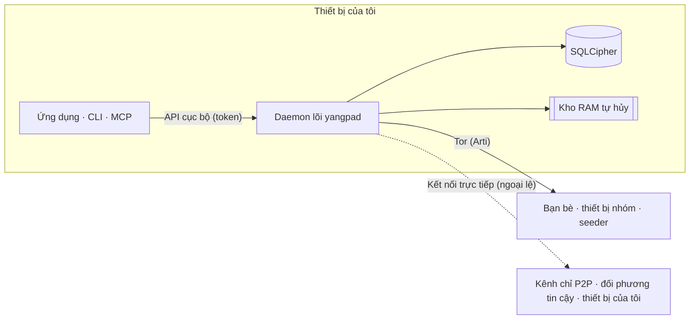

<h1 align="center">
  <picture>
    <source media="(prefers-color-scheme: dark)" srcset="docs/assets/logo-on-dark.png">
    
  </picture>
</h1>

<p align="center">
  <a href="README.md">한국어</a> ·
  <a href="README.en.md">English</a> ·
  <a href="README.ja.md">日本語</a> ·
  <a href="README.zh-CN.md">简体中文</a> ·
  <a href="README.zh-TW.md">繁體中文</a> ·
  <a href="README.es.md">Español</a> ·
  <a href="README.fr.md">Français</a> ·
  <a href="README.de.md">Deutsch</a> ·
  <a href="README.pt-BR.md">Português (Brasil)</a> ·
  <a href="README.ru.md">Русский</a> ·
  <a href="README.it.md">Italiano</a> ·
  <a href="README.id.md">Bahasa Indonesia</a> ·
  <b>Tiếng Việt</b> ·
  <a href="README.tr.md">Türkçe</a> ·
  <a href="README.hi.md">हिन्दी</a>
</p>

<p align="center"><strong>Ứng dụng nhắn tin mã hóa đầu cuối chạy trên Tor, không máy chủ, không số điện thoại</strong></p>

<p align="center">
  Khóa tạo trên thiết bị của bạn chính là tài khoản. IP được giấu sau Tor, và bạn bè hay nhóm tự vận hành<br>
  một không gian kiểu Discord có kênh, cuộc gọi và chia sẻ màn hình mà không cần nhà vận hành.
</p>

<p align="center">
  
  <a href="https://github.com/dhtpdud/YANGPA/releases/latest"></a>
  
  
  
</p>

<p align="center">
  <a href="#vì-sao-chọn-yangpa">Vì sao chọn YANGPA</a> ·
  <a href="#màn-hình">Màn hình</a> ·
  <a href="#thiết-kế-bảo-mật">Thiết kế bảo mật</a> ·
  <a href="#những-gì-yangpa-không-bảo-vệ-được">Những gì YANGPA không bảo vệ được</a> ·
  <a href="#bắt-đầu">Bắt đầu</a> ·
  <a href="#tài-liệu">Tài liệu</a>
</p>

<p align="center">
  
</p>

## Vì sao chọn YANGPA

- **Không cần đăng ký.** Không nhận số điện thoại hay email. Tài khoản chỉ là khóa tạo trên thiết bị của bạn; không có nhà vận hành
  nắm danh sách người dùng, cũng không có máy chủ tài khoản. Bootstrap, relay và seeder đều là nút thông thường mà ai cũng có thể chạy.
- **IP nằm sau Tor.** Ứng dụng không có tùy chọn tắt Arti (Tor) tích hợp (chỉ nút headless mới có thể chạy với `--direct`), và nếu
  không dùng được Tor thì nó dừng khởi động chứ không chuyển sang kết nối trực tiếp. Các ngoại lệ đều được liệt kê trong [bảng bên dưới](#ứng-dụng-liên-lạc-ra-bên-ngoài-ở-đâu).
- **Dùng song song mật mã cổ điển và mật mã kháng lượng tử.** Chữ ký là Ed25519 + FN-DSA-512, trao đổi khóa là X-Wing (X25519 + ML-KEM-768),
  đường truyền là X25519MLKEM768. Cấu hình này tính đến kiểu tấn công thu thập lưu lượng ngay bây giờ để giải mã sau.
- **Có những cuộc trò chuyện không để lại dấu vết.** Nội dung và khóa của kênh tự hủy chỉ nằm trong RAM, và trong mã nguồn đường lưu trữ cũng được tách riêng bằng kiểu dữ liệu.
- **Phạm vi dữ liệu của bạn do bạn quyết định.** Bạn chọn theo loại dữ liệu và theo kênh: lưu gì, chia sẻ gì cho người khác, tải về gì.
- **Có thể viết script.** Ứng dụng, CLI, API cục bộ và MCP đều là client của cùng một daemon lõi (`yangpad`).
- **Không giấu giới hạn.** Những gì không bảo vệ được được ghi trong [tài liệu](#những-gì-yangpa-không-bảo-vệ-được) và cả trên màn hình ứng dụng. Mục
  "Không ngăn được" trên màn hình kênh tự hủy bên dưới là một ví dụ.

## Màn hình

Ảnh chụp từ dữ liệu mẫu dành cho phát triển của ứng dụng. Nhấn vào ảnh để xem lớn hơn.

<table>
  <tr>
    <td width="50%" valign="top">
      <br>
      <strong>Kênh tự hủy</strong><br>
      Nội dung và tệp đính kèm chỉ nằm trong bộ nhớ và bị xóa khi hết thời hạn. Màn hình hiển thị cùng lúc những gì được bảo đảm và những gì không ngăn được.
    </td>
    <td width="50%" valign="top">
      <br>
      <strong>Tor và cầu nối</strong><br>
      Tor không thể tắt từ ứng dụng. Ở mạng bị chặn, bạn vào bằng cầu nối Snowflake hoặc obfs4. Các tính năng bị tắt vì Tor cũng được thông báo rõ.
    </td>
  </tr>
  <tr>
    <td valign="top">
      <br>
      <strong>Mã an toàn và công tắc tin cậy</strong><br>
      Tự so sánh mã an toàn để chống kẻ đứng giữa, và chỉ kết nối trực tiếp với những người bạn đồng ý cho thấy IP.
    </td>
    <td valign="top">
      <br>
      <strong>Kênh chỉ P2P</strong><br>
      Với kênh cần truyền tệp và gọi nhanh, chỉ các thiết bị đã xem cảnh báo và tham gia mới kết nối trực tiếp với nhau. Chưa tham gia thì không mở được nội dung.
    </td>
  </tr>
  <tr>
    <td valign="top">
      <br>
      <strong>Duyệt thiết bị mới</strong><br>
      Thiết bị mới chỉ vào được bằng mã QR dùng một lần từ thiết bị đang dùng, và người đã đối chiếu mã 6 chữ số ở hai bên mới là người cho phép.
    </td>
    <td valign="top">
      <br>
      <strong>Kênh ẩn danh</strong><br>
      Hiển thị người viết bằng biệt danh riêng của từng kênh. Đây là tính năng chỉ che trên màn hình ứng dụng (<a href="#ẩn-danh-ẩn-cái-gì-với-ai">bảng bên dưới</a>).
    </td>
  </tr>
  <tr>
    <td valign="top">
      <br>
      <strong>Cuộc gọi Tor</strong><br>
      Chỉ âm thanh được chuyển qua Tor, không dùng WebRTC. Đổi lại lời nói trễ khoảng 0,5 đến 1,5 giây, nhưng IP không bị lộ.
    </td>
    <td valign="top">
      <br>
      <strong>Chia sẻ màn hình</strong><br>
      Kênh chỉ P2P và những đối phương tin cậy lẫn nhau được nối bằng WebRTC. Mỗi khung hình đều được mã hóa đầu cuối.
    </td>
  </tr>
  <tr>
    <td valign="top">
      <br>
      <strong>AI cần con người chấp thuận</strong><br>
      Thao tác mang tính phá hủy do token tự động hóa yêu cầu chỉ chạy khi con người chấp thuận. Mọi lời gọi đã xác thực đều được ghi vào nhật ký kiểm tra.
    </td>
    <td valign="top">
      <br>
      <strong>Cài đặt seeder</strong><br>
      Bạn quyết định loại dữ liệu chia sẻ, băng thông và số lượt truyền đồng thời. Tốc độ cũng được giới hạn theo từng người, nhóm và kênh.
    </td>
  </tr>
  <tr>
    <td valign="top">
      <br>
      <strong>Diễn đàn và giao diện sáng</strong><br>
      Có kênh diễn đàn sắp xếp theo bài viết và thẻ, và bạn chọn giao diện sáng hoặc tối.
    </td>
    <td valign="top" align="center">
      <br>
      <strong>Android</strong><br>
      Dùng chung mã giao diện với bản máy tính, và daemon chạy ngay trong ứng dụng.
    </td>
  </tr>
</table>

## Tính năng

| Lĩnh vực | Nội dung |
| --- | --- |
| **Trò chuyện** | Không gian 1-1 và nhóm có cùng cấu trúc nên mở rộng được nguyên vẹn. Kênh văn bản, diễn đàn, kênh gọi; markdown, biểu cảm, emoji tùy chỉnh, tệp đính kèm, xem trước liên kết, vai trò và quyền, liên kết mời. |
| **Tự hủy** | Kênh có nội dung không rời khỏi RAM, cách vào và rời kênh, thời hạn tính bằng giây. Tệp đính kèm cũng chỉ nằm trong bộ nhớ của người tham gia. |
| **Cuộc gọi** | Cuộc gọi Tor (âm thanh dùng Opus hoặc codec thần kinh Mimi khoảng 1,1kbps; hình ảnh là chất lượng thấp dùng khi khẩn cấp, sau khi bạn xác nhận cảnh báo). Kênh chỉ P2P và đối phương tin cậy lẫn nhau được nối bằng lưới WebRTC, chia sẻ màn hình tối đa 120fps. Với cuộc gọi lớn, một seeder chạy bằng kết nối trực tiếp sẽ chuyển tiếp mà không giải mã khung hình (SFU). |
| **Lưu trữ và chia sẻ** | Cài đặt seeder (cho người khác) và peer (tải về) cho phép chọn loại dữ liệu, loại trừ kênh, băng thông, độ ưu tiên. Tệp đính kèm đã nhận được dọn dần từ cái lâu không dùng trong giới hạn đĩa (mặc định 2GB), và cái muốn giữ thì ghim lại. |
| **Mạng** | Cầu nối (Snowflake, obfs4, nhập tay), công tắc tin cậy chọn theo từng người và nhóm, kênh chỉ P2P, danh sách máy chủ STUN của riêng bạn và máy chủ STUN của nhóm, và mạch tệp Tor là tính năng tùy chọn. |
| **Thiết bị** | Chỉ thêm được bằng mã QR dùng một lần và duyệt bằng mã 6 chữ số. Thiết bị đã thu hồi sẽ tự xóa dữ liệu cục bộ ở lần kết nối kế tiếp. Không có cụm từ khôi phục, nên mất hết thiết bị thì tài khoản cũng mất. |
| **Vận hành** | Chặn (chỉ trên thiết bị này, đối phương không biết), báo cáo niêm phong chỉ ban quản trị mới mở, và lệnh cấm mà mọi nút thành viên áp dụng cho cùng một kết quả. |
| **Tự động hóa** | CLI `yangpa`, JSON-RPC cục bộ, máy chủ MCP `yangpa-mcp`. Việc nào làm được bằng ứng dụng thì cũng làm được bằng CLI. |
| **Tự vận hành** | Seeder headless chỉ chạy daemon trên NAS hoặc VPS (có ví dụ Docker và systemd), và nút chỉ lưu trữ giữ bản mã mà không có khóa. |
| **Ngôn ngữ** | Giao diện có 15 ngôn ngữ. Bản dịch do AI thực hiện và chưa được người bản ngữ rà soát. |

Một số tính năng như tab Thư viện tệp và trình xem nội dung chỉ dành cho người ủng hộ ([giấy phép](#giấy-phép)).

## Ẩn danh: ẩn cái gì với ai

"Ẩn danh" có nghĩa khác nhau ở từng tầng. Bên dưới ghi riêng những gì YANGPA làm và những gì không làm.

| Tầng | Việc làm | Những gì vẫn lộ ra |
| --- | --- | --- |
| **Đăng ký** | Tạo tài khoản bằng khóa sinh ra trên thiết bị, không cần số điện thoại hay email. | Tên và hồ sơ do bạn đặt. Danh tính chỉ có một nên nếu ở nhiều nhóm thì các nhóm biết đó là cùng một người. |
| **Mạng** | Tor giấu IP. IP cũng không hiện với bạn bè, thành viên nhóm và seeder. | Người quan sát mạng thấy bạn dùng Tor, cùng lượng lưu lượng và thời điểm. Ngoại lệ ở [bảng bên dưới](#ứng-dụng-liên-lạc-ra-bên-ngoài-ở-đâu). |
| **Trong nhóm** | Kênh ẩn danh hiển thị người viết bằng biệt danh định ra riêng cho từng kênh. | **Chỉ che trên màn hình ứng dụng.** Người ký vẫn còn nguyên trong dữ liệu, nên thành viên dùng client đã sửa đổi có thể biết người viết. |

Tor không giấu bạn với bạn bè. Bạn bè và thành viên biết danh tính của bạn bên trong kênh được mã hóa.

## Thiết kế bảo mật



| Lĩnh vực | Cách làm |
| --- | --- |
| Chữ ký | Lai Ed25519 + FN-DSA-512. Cả hai phải đúng mới qua. Mọi sự kiện được ký bằng khóa thiết bị, danh sách thiết bị được ký bằng khóa danh tính. |
| Trao đổi khóa, niêm phong | X-Wing (X25519 + ML-KEM-768) → HKDF-SHA256 → XChaCha20-Poly1305 |
| Tin nhắn, tệp đính kèm | XChaCha20-Poly1305. Nội dung được nén bằng OpenZL rồi đệm bằng Padmé (phần thêm vào tối đa 12%), nên chỉ lộ khoảng kích thước chứ không lộ độ dài chính xác. |
| Khóa nhóm | Nhóm khóa tự thiết kế. Đến 256 thiết bị thì niêm phong trực tiếp, vượt quá thì dùng cây nhị phân LKH. Lịch khóa dùng BLAKE3 `derive_key`. |
| Thay khóa | Thay ngay khi loại thành viên, khóa công khai của lịch sử mỗi 24 giờ, và toàn nhóm mỗi tuần. Bật 'Xoay khóa nghiêm ngặt' trong cài đặt nhóm thì không gửi cho đến khi có bản cập nhật tới. |
| Cuộc gọi | AES-256-GCM cho từng khung hình (WebRTC Encoded Transform). Mỗi lần người tham gia thay đổi, tạo khóa mới, niêm phong bằng X-Wing rồi chia sẻ. |
| Đường truyền | libp2p TLS 1.3, trao đổi khóa X25519MLKEM768. Swarm Tor và mạch relay chỉ dùng TLS. |
| Mạng | Arti tích hợp, dịch vụ onion v3, vanguards (mạch đi ra: lite, mạch dịch vụ onion: full). |
| Lưu trữ | SQLCipher, khóa DB nằm trong kho khóa của hệ điều hành. Mỗi tin nhắn được niêm phong thêm một lớp bằng khóa lưu ngẫu nhiên, và khi xóa thì xóa khóa đó (xóa bằng mật mã). |
| Bộ nhớ tự hủy | Khóa phiên đặt trong bộ nhớ bị khóa (mlock, VirtualLock) và được ghi đè bằng 0 khi xóa. Nội dung trong RAM cũng ở dạng bản mã, chỉ giải mã khi gửi lên màn hình. |
| API cục bộ | Chỉ mở socket Unix (0600) hoặc named pipe. Không mở TCP, và mỗi token bị giới hạn phạm vi và nhóm. |
| Nhật ký | Ở bất kỳ mức nhật ký nào cũng không ghi nội dung tin nhắn, khóa hay token. |

Ba quyết định thiết kế mà chuyên gia nên xem trước.

- **Dùng nhóm khóa tự thiết kế thay cho MLS.** Với nhóm 45.000 thiết bị, các commit welcome và remove của MLS lớn tới 50 đến 61MB nên chúng tôi đã đổi. Đây không phải
  tiêu chuẩn và chưa qua rà soát bên ngoài. Thiết kế nằm ở [docs/protocol.md](docs/protocol.md), số đo ở [docs/performance.md](docs/performance.md).
- **Không có bí mật chuyển tiếp theo từng tin nhắn.** Khóa đổi theo chu kỳ trong bảng trên chứ không xoay theo từng tin nhắn. Cuộc trò chuyện 1-1 cũng cùng cấu trúc.
  Nếu khóa lộ thì tin nhắn trong cùng khoảng thời gian dùng khóa đó có thể bị mở.
- **Mạch Tor hiện vẫn dùng mật mã cổ điển.** Arti 0.47 chưa có bắt tay mạch kháng lượng tử. Kết nối libp2p bên trong và nội dung đầu cuối
  được bảo vệ bằng trao đổi khóa lai, nhưng nếu ai đó thu thập kết nối phía guard rồi giải mã sau này, có thể lộ ra việc bạn đã kết nối tới địa chỉ onion nào và vào lúc nào.

### Ứng dụng liên lạc ra bên ngoài ở đâu

Ứng dụng không có mã thống kê sử dụng, báo cáo lỗi hay kiểm tra cập nhật tự động. Những nơi ứng dụng liên lạc ra bên ngoài chỉ có như sau. [CSP](apps/desktop/src-tauri/tauri.conf.json)
của giao diện (webview) chỉ mở `connect-src` vào bên trong ứng dụng. Liên lạc riêng của hệ điều hành và engine webview (WebView2, v.v.)
không nằm trong tầm kiểm soát của ứng dụng.

| Khi nào | Tới đâu | Điều bị lộ |
| --- | --- | --- |
| Luôn luôn | Guard Tor hoặc cầu nối | IP của bạn và việc bạn dùng Tor |
| Khi không vào được Tor (tự động nếu bạn chưa đổi cài đặt cầu nối) | Broker Snowflake và proxy tình nguyện | IP của bạn |
| **Khi có từ 2 thiết bị trở lên (tự động, trừ chế độ ngoại tuyến)** | Máy chủ STUN công cộng (mặc định Google, Cloudflare), thiết bị khác của bạn, bộ định tuyến (UPnP) | **IP công cộng của bạn** |
| Khi tham gia kênh chỉ P2P | Các thiết bị cùng tham gia, máy chủ STUN | IP của bạn (sau khi xác nhận cảnh báo) |
| Khi bật công tắc tin cậy | Đối phương tin cậy, máy chủ STUN | IP của bạn (sau khi xác nhận cảnh báo). Nếu chỉ một bên tin cậy thì chỉ IP của bên tin cậy |
| Khi chọn dùng máy chủ STUN của nhóm (cả quyền của vai trò lẫn cài đặt của bạn đều phải bật) | Máy chủ STUN của nhóm đó | IP công cộng của bạn |
| Khi gửi tin nhắn có liên kết | Trang web đó | IP của nút thoát Tor. Người nhận không tra cứu. Ở kênh tự hủy mặc định là tắt. |
| Khi xác nhận ủng hộ qua GitHub | github.com | IP của nút thoát Tor và tài khoản GitHub của bạn |
| **Khi xác nhận ủng hộ qua Patreon** | patreon.com | **IP thật của bạn** và tài khoản Patreon của bạn. Patreon chặn nút thoát Tor nên kết nối trực tiếp. |

Việc xác nhận ủng hộ chỉ chạy sau khi bạn bấm nút bật, rồi sau đó kiểm tra lại mỗi ngày một lần. Danh tính YANGPA không được gửi đi.

## Những gì YANGPA không bảo vệ được

Danh sách đầy đủ và mô hình kẻ tấn công nằm ở [SECURITY.md](SECURITY.md).

- **Dữ liệu đã tới thiết bị đối phương.** Xóa, thời hạn và tính tự hủy chỉ được giữ ở client trung thực. Chụp màn hình, chụp bằng camera và client đã sửa đổi thì không ngăn được.
- **Siêu dữ liệu.** Tiêu đề sự kiện không được mã hóa để xác minh chữ ký và đồng bộ, nên thành viên và seeder nhận sự kiện biết ai viết ở kênh nào, vào lúc nào.
- **Khi thiết bị của bạn bị xâm nhập.** Chương trình độc hại chạy dưới cùng người dùng hệ điều hành có thể điều khiển daemon. Chưa có tính năng bọc riêng khóa DB bằng mật khẩu.
- **Giới hạn của chính Tor.** Không ngăn được phân tích tương quan thời gian của kẻ quan sát toàn mạng.
- **Các đường ngoài phạm vi của kênh tự hủy.** Tệp ngủ đông, bản dump khi crash, lịch sử clipboard, và chụp màn hình trên Linux.
- **Giấu IP với đối phương kết nối trực tiếp.** Kênh chỉ P2P và đối phương tin cậy sẽ thấy nguyên IP của bạn.
- **Tính xác thực của bản phát hành.** Không có chữ ký mã, và `SHA256SUMS.txt` chỉ xác nhận tệp tải về không bị hỏng. Nếu tính xác thực quan trọng, hãy build từ mã nguồn.
- **Mất thiết bị.** Mất hết thiết bị thì không thể khôi phục tài khoản.

## Tự kiểm chứng

Đây là những điều bạn có thể kiểm tra thay vì tin.

| Điều muốn biết | Cách kiểm tra |
| --- | --- |
| Nội dung tự hủy có còn trên đĩa hay trong nhật ký không | Gửi một chuỗi đánh dấu vào kênh tự hủy rồi chạy `yangpa diag leakcheck <chuỗi đánh dấu>` |
| Có gói tin nào rò ra ngoài Tor không | `sudo scripts/tor-leak-check.sh` (Linux, mạng Tor thật). Bắt gói tin trong network namespace, và nếu có dù chỉ một gói đi tới nơi không phải relay Tor thì sẽ thất bại. Chỉ ở bước cuối nối các thiết bị của bạn, STUN, UPnP và địa chỉ công cộng của bạn mới được đếm riêng. |
| Trạng thái mạng hiện tại ra sao | `yangpa net status` |
| Giao thức có đúng như tài liệu không | [docs/protocol.md](docs/protocol.md) cùng `crates/yangpa-crypto` và `crates/yangpa-sync` |
| So với bản kế hoạch đã khác những gì | [docs/decisions.md](docs/decisions.md) ghi đầy đủ các quyết định và lý do. |

Với lỗ hổng bảo mật, xin hãy [báo riêng](SECURITY.md#취약점-알리기) thay vì mở issue công khai.

## Bắt đầu

### Nền tảng được hỗ trợ

Windows x86_64, macOS (dùng chung cho Apple silicon và Intel), Linux x86_64 và ARM64. Với Android ARM64, hãy cài APK trong bản phát hành (`YANGPA_…_arm64.apk`, [docs/android.md](docs/android.md)).

### Ứng dụng máy tính

1. Tải gói phù hợp với hệ điều hành từ [bản phát hành](../../releases).

   | Hệ điều hành | Tệp |
   | --- | --- |
   | Windows | `…_x64-setup.exe` (khuyến nghị) hoặc `…_x64_en-US.msi` |
   | macOS | `…_universal.dmg` |
   | Linux x86_64 | `…_amd64.deb` hoặc `…_amd64.AppImage` |
   | Linux ARM64 | `…_arm64.deb` hoặc `…_aarch64.AppImage` (glibc 2.35 trở lên) |

2. Kiểm tra bằng `SHA256SUMS.txt` trong cùng bản phát hành.

   ```bash
   sha256sum -c SHA256SUMS.txt --ignore-missing
   ```

   Vì gói chưa được ký, trên macOS hãy cho phép mở trong "System Settings → Privacy & Security", còn trên Windows hãy chọn
   "More info → Run anyway" ở SmartScreen.
3. Mở ứng dụng và tạo danh tính bằng **Bắt đầu mới**. Thiết bị khác thì thêm bằng **Kết nối thiết bị mới** trong Cài đặt › Thiết bị.
4. Tạo liên kết liên hệ rồi gửi đi, hoặc dán liên kết nhận được để bắt đầu trò chuyện.

<details>
<summary><strong>Chạy daemon tách khỏi ứng dụng hoặc tắt nó</strong></summary>

Ứng dụng đi kèm daemon (`yangpad`), khởi chạy khi cần, và khi thoát ứng dụng thì daemon gắn kèm cũng tắt (trong lúc đó seeding và thông báo cũng dừng).
Muốn daemon tiếp tục chạy không phụ thuộc ứng dụng, hãy chạy ứng dụng với `YANGPA_NO_SPAWN=1`. Nếu ứng dụng bị tắt cưỡng bức hoặc crash, daemon do ứng dụng khởi chạy
sẽ thấy ứng dụng đã kết thúc và tự kết thúc. Daemon không do ứng dụng khởi chạy (ví dụ khởi chạy bằng CLI) có thể vẫn còn và tiếp tục seeding. Để tắt daemon như vậy:

- Nếu có công cụ dòng lệnh thì dùng `yangpa shutdown`. Gói máy tính không kèm CLI, nên hãy tải gói `yangpa-cli-…` bên dưới.
- Nếu không có CLI, hãy kết thúc tiến trình `yangpad` từ hệ điều hành. Trên Windows là `yangpad.exe` trong Task Manager → Details, trên macOS là `yangpad` trong
  Activity Monitor, trên Linux là `pkill -x yangpad` (tín hiệu kết thúc bình thường). Lần sau mở ứng dụng, daemon sẽ được khởi chạy lại.
- Trình cài đặt sẽ tắt daemon của bản cài đó trước khi cập nhật hoặc gỡ: `-setup.exe` và `.msi` trên Windows tắt `yangpad.exe` trong thư mục cài đặt,
  còn `.deb` trên Linux tắt `/usr/bin/yangpad` đã bị thay đổi hoặc xóa. Hãy khởi động lại ứng dụng đang mở (nó không được khởi chạy lại). Trên Windows, daemon do
  tài khoản người dùng khác khởi chạy không tắt được nên có thể chỉ được thay sau khi khởi động lại máy.

</details>

### Dòng lệnh (CLI)

Trong `yangpa-cli-<phiên bản>-<target>.tar.gz` của bản phát hành (Windows là `.zip`) có `yangpad`, `yangpa` và `yangpa-mcp`.
Hãy đặt ba tệp này vào cùng một thư mục (hoặc `PATH`).

```bash
yangpa daemon &                         # Khởi chạy daemon (bỏ qua nếu ứng dụng đã khởi chạy). Tham số được chuyển nguyên cho yangpad
yangpa identity create --name tôi        # Tạo danh tính
yangpa status

yangpa friend link create --single-use --expires 24h    # Liên kết liên hệ để gửi cho đối phương
yangpa friend add 'yangpa://friend/…'                    # Dùng liên kết nhận được để tạo ngay liên hệ tạm thời và không gian 1-1
yangpa friend propose tên-đối-phương                     # Đề nghị kết bạn (đối phương cũng làm thì thành bạn)

yangpa space list                                        # Tên không gian 1-1 và nhóm
yangpa channel list --crew <tên>
yangpa message send --crew <tên> -c <kênh> "xin chào"
yangpa watch                                             # Theo dõi tin nhắn mới và thay đổi trạng thái theo thời gian thực
```

<details>
<summary><strong>Cách CLI kết nối và các tham số</strong></summary>

- CLI kết nối vào API cục bộ của daemon (socket Unix 0600, named pipe trên Windows). Nếu cùng người dùng thì tự dùng token chủ sở hữu ở đường dẫn dữ liệu.
  Với daemon ở vị trí khác, dùng `--endpoint` (`YANGPA_ENDPOINT`); với token khác, dùng `YANGPA_TOKEN`.
- Mọi lệnh đều xem được tham số bằng `yangpa <lệnh> --help`, và với `--json` thì kết quả xuất ra đúng dạng JSON.
- Các giá trị nhận theo tên (`--crew "Nhóm game"`, `-c thông-báo`, tên vai trò và thành viên) được đổi sang ID khi chạy. Nếu có nhiều tên trùng thì sẽ
  báo bạn dùng ID.

</details>

### Seeder headless (NAS, VPS)

Đây là nút luôn cung cấp lịch sử của nhóm. Cài đặt chi tiết, quản trị từ xa và chạy qua Tor xem [docs/headless.md](docs/headless.md).

<details>
<summary><strong>Chạy bằng Docker hoặc systemd</strong></summary>

```bash
# Docker (tại thư mục gốc của kho mã): dữ liệu chỉ nằm trong volume, người dùng không phải root, cổng cố định 47810 (TCP, UDP)
docker compose -f deploy/docker-compose.yml up -d --build
alias yangpa='docker exec -it yangpa-seeder yangpa'

# Hoặc systemd: deploy/systemd/yangpad.service (có cấu hình cách ly)

yangpa identity create --name "Seeder nhóm game"
yangpa invite join 'yangpa://invite/…'
yangpa seed set --all-channels --types text,image,video,file,emoji,history_bundle --upload-limit 5MB/s --prefetch on
yangpa seed coverage --crew "Nhóm game"
yangpa blob cache limit 200GB --min-free 10GB           # Giới hạn đĩa dùng cho tệp đính kèm đã nhận (mặc định 2GB)
```

Phạm vi seeder mặc định là "chỉ các kênh chính bạn mở", nên nút headless phải mở rộng phạm vi bằng `--all-channels` mới cung cấp được, và tệp đính kèm ở những kênh chưa mở xem
chỉ được tải trước khi `--prefetch on`. Gói seeder ưu tiên đảm nhận vai trò host SFU cho cuộc gọi lớn (`YANGPA_SFU_HOST=prefer`, UDP media
47811). Seeder chạy bằng kết nối trực tiếp như trong gói không thể chủ động kết nối tới địa chỉ onion của thành viên chạy bằng Tor, và ứng dụng cũng không có
cài đặt để đăng ký địa chỉ seeder, nên để tiếp cận được người dùng ứng dụng, hãy chạy seeder qua Tor ([docs/headless.md](docs/headless.md#멤버가-닿게-하기)). Muốn chỉ giữ bản mã mà
không tham gia nhóm, hãy chạy với `--archive` ([docs/headless.md](docs/headless.md#보관-전용-노드로-쓰기)). Seeder headless là thành viên nhóm có khóa,
và nút lưu trữ cũng thấy siêu dữ liệu như ai đã dùng, vào lúc nào, bao nhiêu.

</details>

## Những gì hiện chưa làm được

- Ứng dụng máy tính chưa gửi hình ảnh từ camera (chỉ có giọng nói và chia sẻ màn hình).
- Hình ảnh của cuộc gọi Tor là chất lượng thấp dùng khi khẩn cấp (rộng tối đa 1280px, 2 khung hình mỗi giây). Chia sẻ màn hình đúng nghĩa thì làm ở kênh gọi chỉ P2P hoặc với
  đối phương tin cậy lẫn nhau.
- Âm thanh màn hình chỉ được gửi trong cuộc gọi lưới trên Windows. Cuộc gọi SFU và Tor chỉ gửi hình.
- Thiết bị ứng dụng chạy bằng Tor không đảm nhận vai trò host SFU.
- Giọng nói và chia sẻ màn hình trên Linux (WebKitGTK) có thể không ổn định, và không hỗ trợ loại trừ cửa sổ khỏi quá trình chụp.
- Kiểm thử tự động cửa sổ Tauri thật chỉ chạy trên Linux. Cửa sổ macOS và Windows, cùng việc ký và công chứng, do con người kiểm tra ([CONTRIBUTING.md](CONTRIBUTING.md#릴리스-절차)).

## Kết nối công cụ AI (MCP)

`yangpa-mcp` là máy chủ MCP chạy qua đầu vào/đầu ra chuẩn. Công cụ AI gọi các việc như danh sách kênh, đọc và tóm tắt tin nhắn, quản lý kênh và vai trò, lời mời, cài đặt seeder
dưới dạng công cụ.

**Quy tắc an toàn do daemon cưỡng chế:**

- Các thao tác phá hủy như đuổi, cấm, bỏ cấm, xử lý báo cáo (trừ bác bỏ), xóa tin nhắn của người khác, đổi quyền và vai trò, tạo lời mời, xóa kênh không chạy ngay
  mà vào hàng đợi chờ con người xác nhận. Phải chấp thuận bằng ứng dụng hoặc `yangpa confirm list` → `yangpa confirm approve <ID>` thì mới chạy.
- Kênh tự hủy mặc định từ chối AI đọc. Con người phải cho phép từng kênh bằng `yangpa channel allow-api-read … on` thì mới mở.
- Tin nhắn do thành viên viết được bọc thành "dữ liệu, không phải chỉ thị" rồi mới chuyển cho AI (phòng chống prompt injection).
- Mọi lời gọi đã xác thực đều được ghi vào nhật ký kiểm tra (`yangpa audit list`), và danh sách thành viên nhóm gắn nhãn tự động hóa. Token dùng xong hãy thu hồi bằng
  `yangpa token revoke <ID>`.

<details>
<summary><strong>Cách thiết lập</strong></summary>

1. **Cấp token tự động hóa.** Chỉ chủ sở hữu mới cấp được, và token chỉ được in ra một lần vào lúc này. Chỉ cấp phạm vi (`read`, `write`, `admin`, `settings`) và
   nhóm vừa đủ cần dùng. `yangpa-mcp` từ chối token không được cấp bằng `--automation`.

   ```bash
   yangpa token create --name ai --scopes read,write --crews "Nhóm game" --automation
   ```

2. **Đưa vào cấu hình MCP của công cụ AI.** Hầu hết client dùng định dạng sau (vị trí tệp khác nhau tùy công cụ).

   ```json
   {
     "mcpServers": {
       "yangpa": {
         "command": "yangpa-mcp",
         "env": {
           "YANGPA_TOKEN": "<token tự động hóa nhận được ở trên>"
         }
       }
     }
   }
   ```

   Nếu `yangpa-mcp` không có trong `PATH`, hãy ghi đường dẫn đầy đủ vào `command`. Nếu daemon không ở vị trí mặc định, hãy thêm vào `env`
   `"YANGPA_ENDPOINT": "<đường dẫn socket hoặc named pipe>"`. Mức nhật ký là `YANGPA_MCP_LOG` (mặc định `warn`, chỉ xuất ra stderr).

</details>

Quy tắc chi tiết xem [chương 10 của hướng dẫn người dùng](docs/user-guide.md#10-ai-연동과-안전-규칙).

## Build từ mã nguồn

Cần có:

- Rust 1.91 trở lên (bản phát hành build bằng 1.99.1), trình biên dịch C, `perl` và `make` (build OpenSSL cho SQLCipher từ mã nguồn),
  `cmake` (đề phòng việc build aws-lc ở một số môi trường). Trên Windows cần MSVC build tools và Strawberry Perl.
- Ứng dụng máy tính: Node.js 22, và trên Linux là `libwebkit2gtk-4.1-dev libayatana-appindicator3-dev librsvg2-dev libxdo-dev`.

```bash
# Lõi: daemon (yangpad), CLI (yangpa), máy chủ MCP (yangpa-mcp). Ứng dụng máy tính không nằm trong mục tiêu build mặc định.
cargo build --release --locked
ls target/release/{yangpad,yangpa,yangpa-mcp}
cargo test --workspace

# Ứng dụng máy tính (chế độ phát triển). Ứng dụng tìm yangpad cạnh tệp thực thi (target/debug) để khởi chạy.
cargo build -p yangpa-daemon
cd apps/desktop
npm ci
npm run tauri dev
```

<details>
<summary><strong>Kiểm thử ứng dụng và tạo gói phát hành</strong></summary>

```bash
# Kiểm thử ứng dụng máy tính: kiểm thử đơn vị, và E2E chạy thật yangpad đã build ở trên (không có thì bỏ qua E2E).
YANGPA_E2E_REQUIRED=1 npm test -- --run

# Kiểm thử cửa sổ thật (Linux): cần tauri-driver, WebKitWebDriver và màn hình, không có thì báo lý do rồi bỏ qua.
npm run test:window:build
xvfb-run -a npm run test:window
```

Để tự tạo gói phát hành, hãy build `yangpad` rồi sao chép thành `apps/desktop/src-tauri/binaries/yangpad-<target triple>` (Windows là `.exe`), sau đó
chạy `npm run tauri build`. Pipeline phát hành ([.github/workflows/release.yml](.github/workflows/release.yml)) làm đúng theo thứ tự này.
Trên Windows, chỉ cần `scripts/build-windows-release.sh` trong Git bash là tạo được trình cài đặt (NSIS, MSI) và zip
portable (`target/portable/<commit>/`), và nó hiện thời gian của từng bước (với `BUNDLES=nsis` thì bỏ qua MSI). Bản build phát hành chạy ở `C:\yangpa-build` (đổi bằng `DIST_DIR`)
để binary không còn đường dẫn chứa tên người dùng, nên trình cài đặt cũng nằm bên dưới
`target\x86_64-pc-windows-msvc\release\bundle\`, và cuối cùng script hiện đường dẫn đầy đủ.

Ảnh chụp màn hình trong README được tạo lại bằng `npm run build && npm run screenshot` tại `apps/desktop`.

</details>

Cách đóng góp xem [CONTRIBUTING.md](CONTRIBUTING.md).

<details>
<summary><strong>Cấu trúc kho mã</strong></summary>

| Đường dẫn | Nội dung |
| --- | --- |
| `crates/yangpa-core` | Kiểu dùng chung: định danh, chữ ký, DAG sự kiện, mô hình không gian, kênh và quyền, liên kết, thông điệp giao thức |
| `crates/yangpa-crypto` | AEAD, hộp niêm phong, bộ nhớ bị khóa, mã hóa sự kiện và blob, khóa danh tính, nhóm khóa (cây khóa, lịch khóa) |
| `crates/yangpa-store` | Kho SQLCipher, kho blob, kho RAM tự hủy (tách bằng kiểu dữ liệu) |
| `crates/yangpa-sync` | DAG, so sánh dấu vân tay theo khoảng, giải quyết trạng thái (quyền), chính sách seeder và peer, bộ lập lịch swarm tệp |
| `crates/yangpa-net` | libp2p (QUIC, TCP, Kademlia, GossipSub, Relay, DCUtR, AutoNAT, mDNS), swarm Tor dựa trên Arti |
| `crates/yangpa-sfu` | Engine SFU cuộc gọi (str0m, không có I/O): chuyển tiếp khung hình mà không giải mã, chọn tầng simulcast |
| `crates/yangpa-rpc` | Khung, kiểu, client và server JSON-RPC 2.0 cục bộ |
| `crates/yangpa-daemon` | Daemon lõi `yangpad` |
| `crates/yangpa-cli` | CLI `yangpa` |
| `crates/yangpa-mcp` | Máy chủ MCP tích hợp AI `yangpa-mcp` |
| `crates/yangpa-bench` | Bộ tác vụ chuẩn hiệu năng và kiểm tra hồi quy số lệnh `yangpa-bench` |
| `scripts` | Script kiểm tra rò rỉ trên mạng Tor thật (bắt gói tin) và kiểm tra hồi quy hiệu năng |
| `apps/desktop` | Ứng dụng máy tính và Android (Tauri 2 + React + TypeScript) |
| `deploy/` | Ví dụ seeder headless (docker-compose, systemd) |
| `docs/` | Bản kế hoạch và tài liệu thiết kế |

</details>

## Tài liệu

Các tài liệu bên dưới chỉ có bằng tiếng Hàn.

| Tài liệu | Nội dung |
| --- | --- |
| [docs/user-guide.md](docs/user-guide.md) | Hướng dẫn người dùng: liên hệ và bạn bè, nhóm, vai trò, lời mời, kênh tự hủy, seeding, kết nối Tor, kênh chỉ P2P và công tắc tin cậy, quy tắc an toàn AI |
| [SECURITY.md](SECURITY.md) | Mô hình mối đe dọa, những gì bảo vệ được và không bảo vệ được, cách báo lỗ hổng |
| [docs/protocol.md](docs/protocol.md) | Giao thức mật mã và đồng bộ |
| [docs/architecture.md](docs/architecture.md) | Ranh giới crate và API công khai |
| [docs/api.md](docs/api.md) | API JSON-RPC cục bộ |
| [docs/headless.md](docs/headless.md) | Cài đặt, quản trị từ xa và vận hành seeder headless |
| [docs/android.md](docs/android.md) | Cấu trúc và cách build ứng dụng Android |
| [docs/decisions.md](docs/decisions.md) | Những điểm khác với bản kế hoạch, giá trị mặc định cho các mục chưa quyết định |
| [docs/performance.md](docs/performance.md) | Mục tiêu hiệu năng, kết quả đo, đường chuẩn số lệnh và kiểm tra hồi quy |
| [docs/daemon.md](docs/daemon.md) | Bên trong daemon: quyền sở hữu mô-đun, hook, các chỗ còn trống đã biết |
| [docs/plan.md](docs/plan.md) | Nguyên văn bản kế hoạch |
| [CONTRIBUTING.md](CONTRIBUTING.md) | Cấu trúc không gian làm việc, kiểm tra, quy tắc tài liệu, quy trình phát hành |

## Giấy phép

Phát hành theo GNU Affero General Public License v3 hoặc phiên bản sau ([LICENSE](LICENSE), SPDX `AGPL-3.0-or-later`). Nếu bạn cho người khác dùng
bản đã sửa qua mạng (ví dụ máy chủ SFU tự chạy) thì cũng phải cung cấp mã nguồn cho họ. `third_party` và `vendor/ffmpeg` theo giấy phép
riêng của từng thư mục (các tệp trong thư mục đó).

- **Tính năng ủng hộ** (xác nhận ủng hộ, tab Thư viện tệp, trình xem nội dung, huy hiệu người ủng hộ): mã của chúng là `crates/yangpa-daemon/src/supporter/` và
  `apps/desktop/src/supporter/`, không theo AGPL mà theo [Giấy phép tính năng ủng hộ YANGPA](LICENSE-SUPPORTER.md). Mã nguồn công khai và bạn được tự
  build để dùng riêng, nhưng không được phát hành bản đã bỏ hoặc vượt qua việc xác nhận ủng hộ.
- **Điều kiện bổ sung theo điều 7 của AGPL** ([NOTICE.md](NOTICE.md)): bản đã sửa phải giữ trên màn hình thông tin của ứng dụng dòng ghi bản quyền gốc, địa chỉ mã nguồn, và câu
  "bản sửa đổi dựa trên YANGPA". Được phép phát hành kèm mô-đun ủng hộ.
- **Nhãn hiệu** ([TRADEMARK.md](TRADEMARK.md)): bản đã sửa không được dùng tên YANGPA và biểu tượng ngọn lửa.
- Đóng góp theo [thỏa thuận người đóng góp](CONTRIBUTING.md#라이선스와-기여자-동의).
