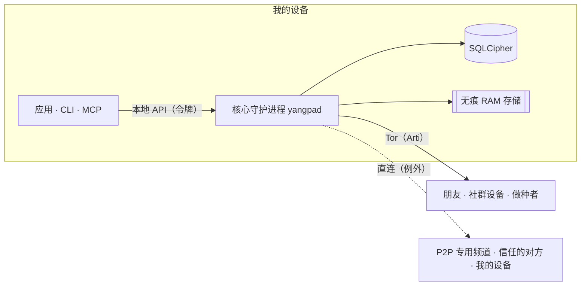

<h1 align="center">
  <picture>
    <source media="(prefers-color-scheme: dark)" srcset="docs/assets/logo-on-dark.png">
    
  </picture>
</h1>

<p align="center">
  <a href="README.ko.md">한국어</a> ·
  <a href="README.md">English</a> ·
  <a href="README.ja.md">日本語</a> ·
  <b>简体中文</b> ·
  <a href="README.zh-TW.md">繁體中文</a> ·
  <a href="README.es.md">Español</a> ·
  <a href="README.fr.md">Français</a> ·
  <a href="README.de.md">Deutsch</a> ·
  <a href="README.pt-BR.md">Português (Brasil)</a> ·
  <a href="README.ru.md">Русский</a> ·
  <a href="README.it.md">Italiano</a> ·
  <a href="README.id.md">Bahasa Indonesia</a> ·
  <a href="README.vi.md">Tiếng Việt</a> ·
  <a href="README.tr.md">Türkçe</a> ·
  <a href="README.hi.md">हिन्दी</a>
</p>

<p align="center"><strong>没有服务器，也不需要手机号：运行在 Tor 之上的端到端加密通讯工具</strong></p>

<p align="center">
  在设备上生成的密钥就是你的账号。IP 由 Tor 隐藏，带有频道、通话和屏幕共享的<br>
  Discord 式空间，由你和朋友、社群自己运转，没有运营方。
</p>

<p align="center">
  
  <a href="https://github.com/dhtpdud/YANGPA/releases/latest"></a>
  
  
  
</p>

<p align="center">
  <a href="#为什么选择-yangpa">为什么选择 YANGPA</a> ·
  <a href="#截图">截图</a> ·
  <a href="#安全设计">安全设计</a> ·
  <a href="#无法保护的内容">无法保护的内容</a> ·
  <a href="#开始使用">开始使用</a> ·
  <a href="#文档">文档</a>
</p>

<p align="center">
  
</p>

## 为什么选择 YANGPA

- **无需注册。** 不收集手机号，也不收集邮箱。账号只是你在自己设备上生成的密钥，没有掌握名单的运营方，也没有账号服务器。引导节点、中继、做种者都是任何人都能启动的普通节点。
- **IP 藏在 Tor 之后。** 应用里没有关闭内置 Arti（Tor）的设置（只有无界面节点可以用 `--direct` 启动）；无法使用 Tor 时，也不会转为直连，而是停止启动。例外情况全部列在[下表](#应用与外界通信的位置)中。
- **同时使用经典密码学和抗量子密码学。** 签名为 Ed25519 + FN-DSA-512，密钥交换为 X-Wing（X25519 + ML-KEM-768），传输为 X25519MLKEM768。这一组合针对的是“先收集现在的流量、以后再破解”的攻击。
- **有不留痕迹的对话。** 无痕频道的内容和密钥只存在于 RAM 中，代码里也通过存储路径和类型把它们隔离开。
- **你的数据范围由你决定。** 存储什么、提供给别人什么、拉取什么，可按数据类型和频道逐一选择。
- **可以用脚本操作。** 应用、CLI、本地 API、MCP 都是同一个核心守护进程（`yangpad`）的客户端。
- **不隐瞒局限。** 做不到的事，[文档](#无法保护的内容)里写了，应用界面里也写了。下方无痕频道截图中的“无法防范的事”就是一例。

## 截图

这些截图使用的是应用的开发用示例数据。点击图片可以放大查看。

<table>
  <tr>
    <td width="50%" valign="top">
      <br>
      <strong>无痕频道</strong><br>
      内容和附件只存在于内存中，到期后即被删除。能保证什么、无法防范什么，都一起显示在界面上。
    </td>
    <td width="50%" valign="top">
      <br>
      <strong>Tor 与网桥</strong><br>
      应用里无法关闭 Tor。在被封锁的网络中，通过 Snowflake、obfs4 网桥接入。因 Tor 而关闭的功能也会如实告知。
    </td>
  </tr>
  <tr>
    <td valign="top">
      <br>
      <strong>安全码与信任开关</strong><br>
      亲自比对用于防范中间人的安全码，只和允许看到你 IP 的人直接连接。
    </td>
    <td valign="top">
      <br>
      <strong>P2P 专用频道</strong><br>
      需要快速传文件、通话的频道，只有看过警告并加入的设备之间才会直接连接。加入之前无法查看内容。
    </td>
  </tr>
  <tr>
    <td valign="top">
      <br>
      <strong>新设备批准</strong><br>
      新设备只能通过正在使用的设备生成的一次性二维码加入，由核对过双方 6 位数字的人来允许。
    </td>
    <td valign="top">
      <br>
      <strong>匿名频道</strong><br>
      发帖者以各频道独立的化名显示。这只是在应用界面上遮盖的功能（<a href="#匿名性对谁隐藏什么">见下表</a>）。
    </td>
  </tr>
  <tr>
    <td valign="top">
      <br>
      <strong>Tor 通话</strong><br>
      不使用 WebRTC，只通过 Tor 传输声音。说话会延迟 0.5~1.5 秒左右，但不会暴露 IP。
    </td>
    <td valign="top">
      <br>
      <strong>屏幕共享</strong><br>
      P2P 专用频道和互相信任的对方通过 WebRTC 连接。每一帧都进行端到端加密。
    </td>
  </tr>
  <tr>
    <td valign="top">
      <br>
      <strong>AI 需要人的批准</strong><br>
      自动化令牌请求的破坏性操作，必须由人批准后才会执行。所有经过认证的调用都会留在审计记录中。
    </td>
    <td valign="top">
      <br>
      <strong>做种者设置</strong><br>
      要分享的数据类型、带宽、并发传输数都由你决定。也可以按人、社群、频道限制速度。
    </td>
  </tr>
  <tr>
    <td valign="top">
      <br>
      <strong>论坛与浅色主题</strong><br>
      有以帖子和标签整理内容的论坛频道，可以选择浅色或深色主题。
    </td>
    <td valign="top" align="center">
      <br>
      <strong>Android</strong><br>
      与桌面端使用相同的界面代码，守护进程在应用内运行。
    </td>
  </tr>
</table>

## 功能

| 领域 | 内容 |
| --- | --- |
| **对话** | 私信空间和社群结构相同，因此可以直接扩展。文字、论坛、通话频道，Markdown，回应，自定义表情，附件，链接预览，角色与权限，邀请链接。 |
| **无痕** | 内容不会离开 RAM 的频道，进入/退出方式，以秒为单位的存活时间。附件也只存在于参与者的内存中。 |
| **通话** | Tor 通话（声音为 Opus 或约 1.1kbps 的神经网络编解码器 Mimi，画面是确认警告后使用的应急低画质）。P2P 专用频道和互相信任的对方通过 WebRTC 网状连接，屏幕共享最高 120fps。大型通话由直连启动的做种者不解密帧、直接中继（SFU）。 |
| **存储与提供** | 通过做种者（分享给别人）和对等节点（拉取）设置，选择数据类型、排除频道、带宽、优先级。收到的附件在磁盘上限（默认 2GB）内，从最久未使用的开始清理，想保留的可以固定。 |
| **网络** | 网桥（Snowflake、obfs4、手动输入），按人、按社群选择的信任开关，P2P 专用频道，我的 STUN 服务器列表和社群 STUN 服务器，可选功能 Tor 文件线路。 |
| **设备** | 只能通过一次性二维码和 6 位数字批准来添加。已作废的设备会在下次连接时自行清除本地数据。没有恢复短语，所以失去全部设备后账号也就不复存在。 |
| **运营** | 屏蔽（仅此设备，对方不知情），仅管理团队可打开的密封举报，所有成员节点以相同结果执行的封禁。 |
| **自动化** | CLI `yangpa`，本地 JSON-RPC，MCP 服务器 `yangpa-mcp`。应用能做的事，CLI 也能做。 |
| **自行运营** | 在 NAS、VPS 上只运行守护进程的无界面做种者（附 Docker、systemd 示例），不持有密钥、只保存密文的存档专用节点。 |
| **语言** | 界面支持 15 种语言。翻译由 AI 完成，尚未经过母语者审阅。 |

文件库标签页和内容查看器等部分功能仅限赞助者使用（[许可证](#许可证)）。

## 匿名性：对谁隐藏什么

“匿名”在不同层面含义不同。这里分别写明 YANGPA 做什么、不做什么。

| 层面 | 做什么 | 仍会暴露的内容 |
| --- | --- | --- |
| **注册** | 无需手机号、邮箱，用设备上生成的密钥创建账号。 | 你自己设定的名字和资料。身份只有一个，所以如果加入了多个社群，各社群之间能知道是同一个人。 |
| **网络** | Tor 隐藏 IP。朋友、社群成员、做种者也看不到你的 IP。 | 网络观察者能看到你在使用 Tor，以及流量大小和时间。例外见[下表](#应用与外界通信的位置)。 |
| **社群内** | 匿名频道用各频道独立确定的化名显示发帖者。 | **只在应用界面上遮盖。** 签名者仍保留在数据中，使用改造过的客户端的成员可以知道发帖者是谁。 |

Tor 不会对朋友隐藏你。朋友和成员在加密频道内知道你的身份。

## 安全设计



| 领域 | 方式 |
| --- | --- |
| 签名 | Ed25519 + FN-DSA-512 混合。两者都通过才算通过。所有事件由设备密钥签名，设备列表由身份密钥签名。 |
| 密钥交换与封装 | X-Wing（X25519 + ML-KEM-768）→ HKDF-SHA256 → XChaCha20-Poly1305 |
| 消息与附件 | XChaCha20-Poly1305。正文用 OpenZL 压缩后再以 Padmé 填充（附加量不超过 12%），因此只暴露大小区间，而非精确长度。 |
| 群组密钥 | 自有密钥组。256 台以内直接封装，超过则使用 LKH 二叉树。密钥调度使用 BLAKE3 `derive_key`。 |
| 密钥更换 | 移除成员时立即更换，历史公开密钥每 24 小时更换，整个社群每周更换。在社群设置中开启“严格密钥轮换”后，在更新到达之前不会发送。 |
| 通话 | 每一帧使用 AES-256-GCM（WebRTC Encoded Transform）。每当参与者变化，就生成新密钥，用 X-Wing 封装后分发。 |
| 传输 | libp2p TLS 1.3，密钥交换为 X25519MLKEM768。Tor 集群和中继线路只使用 TLS。 |
| 网络 | 内置 Arti，onion 服务 v3，vanguards（出站线路为 lite，onion 服务线路为 full）。 |
| 存储 | SQLCipher，数据库密钥存放在操作系统密钥库。每条消息再用随机存储密钥封装一次，删除时销毁该密钥（密码学删除）。 |
| 无痕内存 | 会话密钥放在锁定内存（mlock、VirtualLock）中，清除时用 0 覆盖。内容在 RAM 中也保持为密文，仅在发送到界面时才解密。 |
| 本地 API | 只开放 Unix 套接字（0600）或 named pipe。不开放 TCP，每个令牌都限制范围和社群。 |
| 日志 | 在任何日志级别下都不记录消息内容、密钥、令牌。 |

以下是专家最值得先看的三项设计决策。

- **使用自有密钥组，而非 MLS。** 在 4.5 万台设备的社群中，MLS 的 Welcome 和移除 Commit 增大到 50~61MB，因此作了更换。它不是标准，也未经外部评审。设计见 [docs/protocol.md](docs/protocol.md)，测量见 [docs/performance.md](docs/performance.md)。
- **没有逐条消息的前向保密。** 密钥按上表的周期更换，不会随每条消息轮换。私信也是同样的结构。密钥泄露后，同一密钥周期内的消息可以被打开。
- **Tor 线路目前仍是经典密码学。** Arti 0.47 没有抗量子的线路握手。其内部的 libp2p 连接和端到端内容由混合密钥交换保护，但如果收集守卫一侧的连接、以后再破解，可能会暴露你在何时连接了哪个 onion 地址。

### 应用与外界通信的位置

应用中没有使用统计、错误报告、自动检查更新的代码。应用与外界的通信仅限于以下几处。应用界面（WebView）的 [CSP](apps/desktop/src-tauri/tauri.conf.json) 将 `connect-src` 仅向应用内部开放。操作系统和 WebView 引擎（WebView2 等）自身的通信不受应用控制。

| 何时 | 去向 | 暴露的内容 |
| --- | --- | --- |
| 始终 | Tor 守卫或网桥 | 我的 IP 和正在使用 Tor 这一事实 |
| 无法接入 Tor 时（未更改过网桥设置则自动） | Snowflake 中介和志愿者代理 | 我的 IP |
| **有 2 台以上设备时（自动，离线模式除外）** | 公共 STUN 服务器（默认 Google、Cloudflare）、我的其他设备、路由器（UPnP） | **我的公网 IP** |
| 加入 P2P 专用频道时 | 一同加入的设备、STUN 服务器 | 我的 IP（确认警告后） |
| 开启信任开关时 | 信任的对方、STUN 服务器 | 我的 IP（确认警告后）。只有单方信任时，仅信任方的 IP 暴露 |
| 选择使用社群 STUN 服务器时（角色权限和我的设置都必须开启） | 该社群的 STUN 服务器 | 我的公网 IP |
| 发送含链接的消息时 | 该网站 | Tor 出口节点的 IP。接收者不会去查询。无痕频道默认关闭。 |
| 通过 GitHub 确认赞助时 | github.com | Tor 出口节点的 IP 和我的 GitHub 账号 |
| **通过 Patreon 确认赞助时** | patreon.com | **我的真实 IP** 和我的 Patreon 账号。Patreon 封锁 Tor 出口，因此直接连接。 |

赞助确认只会在我点击按钮开启之后运行，之后每天重新确认一次。不会发送 YANGPA 身份。

## 无法保护的内容

完整清单和攻击者模型见 [SECURITY.md](SECURITY.md)。

- **已经到达对方设备的数据。** 删除、存活时间、无痕只在诚实的客户端上才有效。无法阻止截屏、用相机拍摄、改造过的客户端。
- **元数据。** 为了验证签名和同步，事件头部没有加密，因此接收事件的成员和做种者知道谁在何时写在了哪个频道。
- **我的设备被攻破的情况。** 以同一操作系统用户运行的恶意程序可以操控守护进程。目前还没有用密码单独包裹数据库密钥的功能。
- **Tor 自身的局限。** 无法抵御能观察整个网络的观察者所做的时间关联分析。
- **无痕频道范围之外的路径。** 休眠文件、崩溃转储、剪贴板历史记录，以及 Linux 上的屏幕捕获。
- **对直连对方隐藏 IP。** 在 P2P 专用频道和信任的对方面前，我的 IP 是直接可见的。
- **发行文件的真伪。** 没有代码签名，`SHA256SUMS.txt` 只能确认下载过程中是否损坏。如果真伪很重要，请从源码构建。
- **设备丢失。** 失去全部设备后，无法恢复账号。

## 自行验证

以下这些不必相信，可以亲自确认。

| 想确认的事 | 确认方法 |
| --- | --- |
| 无痕内容是否会留在磁盘、日志中 | 在无痕频道发送一个标记字符串，然后运行 `yangpa diag leakcheck <标记>` |
| 数据包是否会泄漏到 Tor 之外 | `sudo scripts/tor-leak-check.sh`（Linux，真实 Tor 网络）。在网络命名空间中抓包，只要有哪怕一个数据包发往非 Tor 中继的地方就算失败。只有连接我自己设备的最后一步，会把 STUN、UPnP、我的公网地址单独统计。 |
| 当前网络状态如何 | `yangpa net status` |
| 协议是否与文档一致 | [docs/protocol.md](docs/protocol.md) 以及 `crates/yangpa-crypto`、`crates/yangpa-sync` |
| 与策划书相比有哪些变化 | [docs/decisions.md](docs/decisions.md) 记录了全部决定及其理由。 |

发现漏洞时，请不要公开提 issue，而是[私下告知](SECURITY.md#취약점-알리기)。

## 开始使用

### 支持的平台

Windows x86_64，macOS（Apple 芯片、Intel 通用），Linux x86_64、ARM64。Android ARM64 请安装发布中的 APK（`YANGPA_…_arm64.apk`，[docs/android.md](docs/android.md)）。

### 桌面应用

1. 从[发布页](../../releases)下载适合你操作系统的安装包。

   | 操作系统 | 文件 |
   | --- | --- |
   | Windows | `…_x64-setup.exe`（推荐）或 `…_x64_en-US.msi` |
   | macOS | `…_universal.dmg` |
   | Linux x86_64 | `…_amd64.deb` 或 `…_amd64.AppImage` |
   | Linux ARM64 | `…_arm64.deb` 或 `…_aarch64.AppImage`（glibc 2.35 及以上） |

2. 用同一发布中的 `SHA256SUMS.txt` 进行校验。

   ```bash
   sha256sum -c SHA256SUMS.txt --ignore-missing
   ```

   安装包没有签名，因此在 macOS 上要在“系统设置 → 隐私与安全性”中允许打开，在 Windows 上要在 SmartScreen 中选择“更多信息 → 仍要运行”。
3. 打开应用，点击**全新开始**创建身份。其他设备通过设置 › 设备中的**连接新设备**加入。
4. 生成联系人链接发给对方，或粘贴收到的链接来开始对话。

<details>
<summary><strong>将守护进程与应用分开运行或将其关闭</strong></summary>

应用自带守护进程（`yangpad`），需要时启动，退出应用时也会关闭随之启动的守护进程（期间做种和通知也会停止）。
想让守护进程不受应用影响地持续运行，请用 `YANGPA_NO_SPAWN=1` 运行应用。即使应用被强制关闭或崩溃，由应用启动的守护进程也会察觉应用已结束而自行结束。不是由应用启动的守护进程（通过 CLI 启动的）会保留下来，可以继续做种。要关闭这样的守护进程：

- 如果有命令行工具，运行 `yangpa shutdown`。桌面安装包中不含 CLI，请下载下面的 `yangpa-cli-…` 包。
- 没有 CLI 时，在操作系统中结束 `yangpad` 进程。Windows 在任务管理器 → 详细信息中结束 `yangpad.exe`，macOS 在活动监视器中结束 `yangpad`，Linux 运行 `pkill -x yangpad`（正常终止信号）。下次打开应用时会重新启动。
- 安装程序在更新、卸载前会先关闭该安装版本的守护进程：Windows 的 `-setup.exe`、`.msi` 会关闭安装目录中的 `yangpad.exe`，Linux 的 `.deb` 会关闭被替换或删除的 `/usr/bin/yangpad`。已打开的应用请重新启动（不会自动重新启动）。在 Windows 上，其他用户账号启动的守护进程无法关闭，重启后可能会被替换。

</details>

### 命令行（CLI）

发布页的 `yangpa-cli-<版本>-<目标>.tar.gz`（Windows 为 `.zip`）中包含 `yangpad`、`yangpa`、`yangpa-mcp`。
请把这三个文件放在同一目录（或 `PATH`）中。

```bash
yangpa daemon &                         # 启动守护进程（应用已启动则省略）。参数原样传给 yangpad
yangpa identity create --name 我         # 创建身份
yangpa status

yangpa friend link create --single-use --expires 24h    # 发给对方的联系人链接
yangpa friend add 'yangpa://friend/…'                    # 用收到的链接直接建立临时联系人和私信空间
yangpa friend propose 对方名称                           # 提议成为好友（对方也提议则成为好友）

yangpa space list                                        # 私信空间和社群名称
yangpa channel list --crew <名称>
yangpa message send --crew <名称> -c <频道> "你好"
yangpa watch                                             # 实时查看新消息和状态变化
```

<details>
<summary><strong>CLI 的连接方式和参数</strong></summary>

- CLI 连接到守护进程的本地 API（Unix 套接字 0600，Windows 为 named pipe）。同一用户会自动使用数据路径所有者的令牌。其他位置的守护进程用 `--endpoint`（`YANGPA_ENDPOINT`）指定，其他令牌用 `YANGPA_TOKEN` 指定。
- 所有命令都可以用 `yangpa <命令> --help` 查看参数，加上 `--json` 则原样输出 JSON 结果。
- 以名称传入的值（`--crew "游戏小组"`、`-c 公告`、角色和成员名称）会在执行时转换为 ID。如果有多个同名项，会提示改用 ID。

</details>

### 无界面做种者（NAS、VPS）

这是持续提供社群记录的节点。详细设置、远程管理、通过 Tor 启动见 [docs/headless.md](docs/headless.md)。

<details>
<summary><strong>用 Docker、systemd 启动</strong></summary>

```bash
# Docker（在仓库根目录）：数据只放在卷中，非 root 用户，固定端口 47810（TCP、UDP）
docker compose -f deploy/docker-compose.yml up -d --build
alias yangpa='docker exec -it yangpa-seeder yangpa'

# 或 systemd：deploy/systemd/yangpad.service（含隔离设置）

yangpa identity create --name "游戏小组做种者"
yangpa invite join 'yangpa://invite/…'
yangpa seed set --all-channels --types text,image,video,file,emoji,history_bundle --upload-limit 5MB/s --prefetch on
yangpa seed coverage --crew "游戏小组"
yangpa blob cache limit 200GB --min-free 10GB           # 收到的附件所用的磁盘上限（默认 2GB）
```

默认的做种范围是“只包含本人打开过的频道”，因此无界面节点必须用 `--all-channels` 扩大范围才会提供，没有打开过的频道的附件需要 `--prefetch on` 才会预先下载。做种者套件会优先承担大型通话的 SFU 主机（`YANGPA_SFU_HOST=prefer`，媒体 UDP 47811）。按套件原样以直连方式启动的做种者，无法先去连接通过 Tor 运行的成员的 onion 地址，应用里也没有登记做种者地址的设置，因此要让应用用户能连上，需要让做种者通过 Tor 启动（[docs/headless.md](docs/headless.md#멤버가-닿게-하기)）。如果想不加入社群、只保存密文，请用 `--archive` 启动（[docs/headless.md](docs/headless.md#보관-전용-노드로-쓰기)）。无界面做种者是持有密钥的社群成员，存档节点也能看到谁在何时写了多少之类的元数据。

</details>

## 目前做不到的事

- 桌面应用目前还不发送摄像头视频（只有语音和屏幕共享）。
- Tor 通话的画面是应急用的低画质（宽度最大 1280px，每秒 2 帧）。正常的屏幕共享请在 P2P 专用通话频道或与互相信任的对方之间进行。
- 屏幕声音只在 Windows 的网状通话中发送。SFU、Tor 通话只发送画面。
- 通过 Tor 运行的应用设备不会承担 SFU 主机。
- Linux（WebKitGTK）上的语音和屏幕共享可能不稳定，也不支持将窗口排除在捕获之外。
- 真实 Tauri 窗口的自动测试只在 Linux 上运行。macOS、Windows 窗口以及签名、公证由人工确认（[CONTRIBUTING.md](CONTRIBUTING.md#릴리스-절차)）。

## 连接 AI 工具（MCP）

`yangpa-mcp` 是通过标准输入输出运行的 MCP 服务器。AI 工具可以把查看频道列表、读取和总结消息、管理频道和角色、邀请、做种者设置等事务作为工具来调用。

**守护进程强制执行的安全规则：**

- 踢出、封禁、解除封禁，处理举报（驳回除外），删除他人消息，更改权限、角色，创建邀请，删除频道等破坏性操作不会立即执行，而是进入人工确认队列。必须在应用中，或通过 `yangpa confirm list` → `yangpa confirm approve <ID>` 批准后才会执行。
- 无痕频道默认拒绝 AI 读取。必须由人按频道用 `yangpa channel allow-api-read … on` 允许才会开放。
- 成员写的消息会被包装成“数据，而非指令”再交给 AI（防范提示注入）。
- 所有经过认证的调用都会记录在审计日志（`yangpa audit list`）中，社群成员列表里会带上自动化标记。用完的令牌请用 `yangpa token revoke <ID>` 作废。

<details>
<summary><strong>设置方法</strong></summary>

1. **签发自动化令牌。** 只有所有者可以签发，令牌只在此时输出一次。范围（`read`、`write`、`admin`、`settings`）和社群只给所需的最小范围。`yangpa-mcp` 会拒绝不是用 `--automation` 签发的令牌。

   ```bash
   yangpa token create --name ai --scopes read,write --crews "游戏小组" --automation
   ```

2. **写入 AI 工具的 MCP 配置。** 大多数客户端使用如下格式（文件位置因工具而异）。

   ```json
   {
     "mcpServers": {
       "yangpa": {
         "command": "yangpa-mcp",
         "env": {
           "YANGPA_TOKEN": "<上面得到的自动化令牌>"
         }
       }
     }
   }
   ```

   如果 `PATH` 中没有 `yangpa-mcp`，请在 `command` 中写完整路径。如果守护进程不在默认位置，请在 `env` 中加上 `"YANGPA_ENDPOINT": "<套接字路径或 named pipe>"`。日志级别通过 `YANGPA_MCP_LOG` 设置（默认 `warn`，仅输出到标准错误）。

</details>

详细规则见[用户指南第 10 章](docs/user-guide.md#10-ai-연동과-안전-규칙)。

## 从源码构建

需要：

- Rust 1.91 及以上（发布版本用 1.99.1 构建），C 编译器，`perl`、`make`（从源码构建 SQLCipher 所需的 OpenSSL），`cmake`（用于在部分环境中备用构建 aws-lc）。Windows 需要 MSVC 构建工具和 Strawberry Perl。
- 桌面应用：Node.js 22，Linux 需要 `libwebkit2gtk-4.1-dev libayatana-appindicator3-dev librsvg2-dev libxdo-dev`。

```bash
# 核心：守护进程（yangpad）、CLI（yangpa）、MCP 服务器（yangpa-mcp）。桌面应用不是默认构建目标。
cargo build --release --locked
ls target/release/{yangpad,yangpa,yangpa-mcp}
cargo test --workspace

# 桌面应用（开发模式）。应用会在可执行文件旁（target/debug）查找 yangpad 并启动。
cargo build -p yangpa-daemon
cd apps/desktop
npm ci
npm run tauri dev
```

<details>
<summary><strong>应用测试与制作发行包</strong></summary>

```bash
# 桌面应用测试：单元测试，以及真实启动上面构建的 yangpad 的 E2E（没有则跳过 E2E）。
YANGPA_E2E_REQUIRED=1 npm test -- --run

# 真实窗口测试（Linux）：需要 tauri-driver、WebKitWebDriver 和显示环境，没有则说明原因并跳过。
npm run test:window:build
xvfb-run -a npm run test:window
```

要自行制作发行包，请先构建 `yangpad`，复制为 `apps/desktop/src-tauri/binaries/yangpad-<目标三元组>`（Windows 为 `.exe`），再运行 `npm run tauri build`。发布流水线（[.github/workflows/release.yml](.github/workflows/release.yml)）完全遵循这一顺序。在 Windows 上，可以在 Git bash 中用 `scripts/build-windows-release.sh` 一步生成安装文件（NSIS、MSI）和便携版 zip（`target/portable/<提交>/`），并显示每个步骤所用的时间（`BUNDLES=nsis` 则跳过 MSI）。为避免二进制文件中残留含用户名的路径，发布构建在 `C:\yangpa-build`（可用 `DIST_DIR` 更改）下进行，因此安装文件也生成在其下的 `target\x86_64-pc-windows-msvc\release\bundle\`，脚本最后会显示完整路径。

README 中的截图可在 `apps/desktop` 中用 `npm run build && npm run screenshot` 重新生成。

</details>

贡献方式见 [CONTRIBUTING.md](CONTRIBUTING.md)。

<details>
<summary><strong>仓库结构</strong></summary>

| 路径 | 内容 |
| --- | --- |
| `crates/yangpa-core` | 公共类型：标识符、签名、事件 DAG、空间、频道、权限模型、链接、协议消息 |
| `crates/yangpa-crypto` | AEAD、封装盒、锁定内存，事件、blob 加密，身份密钥，密钥组（密钥树、密钥调度） |
| `crates/yangpa-store` | SQLCipher 存储，blob 存储，无痕 RAM 存储（以类型隔离） |
| `crates/yangpa-sync` | DAG，区间指纹比对，状态解析（权限），做种者、对等节点策略，文件集群调度器 |
| `crates/yangpa-net` | libp2p（QUIC、TCP、Kademlia、GossipSub、Relay、DCUtR、AutoNAT、mDNS），基于 Arti 的 Tor 集群 |
| `crates/yangpa-sfu` | 通话 SFU 引擎（str0m，无输入输出）：不解密帧直接转发，选择 simulcast 层 |
| `crates/yangpa-rpc` | 本地 JSON-RPC 2.0 的帧格式、类型、客户端、服务器 |
| `crates/yangpa-daemon` | 核心守护进程 `yangpad` |
| `crates/yangpa-cli` | CLI `yangpa` |
| `crates/yangpa-mcp` | AI 集成 MCP 服务器 `yangpa-mcp` |
| `crates/yangpa-bench` | 性能基准任务集和命令数回归检查 `yangpa-bench` |
| `scripts` | 真实 Tor 网络泄漏检查（抓包）、性能回归检查脚本 |
| `apps/desktop` | 桌面、Android 应用（Tauri 2 + React + TypeScript） |
| `deploy/` | 无界面做种者示例（docker-compose、systemd） |
| `docs/` | 策划书和设计文档 |

</details>

## 文档

以下文档只有韩文版。

| 文档 | 内容 |
| --- | --- |
| [docs/user-guide.md](docs/user-guide.md) | 用户指南：联系人与好友，社群，角色，邀请，无痕频道，做种，Tor 连接、P2P 专用频道、信任开关，AI 安全规则 |
| [SECURITY.md](SECURITY.md) | 威胁模型，能保护与不能保护的内容，报告漏洞 |
| [docs/protocol.md](docs/protocol.md) | 加密与同步协议 |
| [docs/architecture.md](docs/architecture.md) | crate 边界和公开 API |
| [docs/api.md](docs/api.md) | 本地 JSON-RPC API |
| [docs/headless.md](docs/headless.md) | 无界面做种者的安装、远程管理、运营 |
| [docs/android.md](docs/android.md) | Android 应用的结构与构建 |
| [docs/decisions.md](docs/decisions.md) | 与策划书的差异，为未决事项设定的默认值 |
| [docs/performance.md](docs/performance.md) | 性能目标、测量结果、命令数基线与回归检查 |
| [docs/daemon.md](docs/daemon.md) | 守护进程内部：模块归属、钩子、已知空缺 |
| [docs/plan.md](docs/plan.md) | 策划书原文 |
| [CONTRIBUTING.md](CONTRIBUTING.md) | 工作区结构、检查、文档规范、发布流程 |

## 许可证

以 GNU Affero General Public License v3 或其后续版本（[LICENSE](LICENSE)，SPDX `AGPL-3.0-or-later`）发布。如果让他人通过网络使用你修改过的版本（例如自行运行的 SFU 服务器），就必须向对方提供源码。`third_party` 和 `vendor/ffmpeg` 遵循各自的许可证（该文件夹中的文件）。

- **赞助功能**（赞助确认、文件库标签页、内容查看器、赞助者标识）的代码 `crates/yangpa-daemon/src/supporter/` 和 `apps/desktop/src/supporter/` 不适用 AGPL，而遵循 [YANGPA 赞助功能许可证](LICENSE-SUPPORTER.md)。源码公开，自行构建并自己使用是允许的，但不能分发去除或绕过赞助确认的版本。
- **AGPL 第 7 条附加条款**（[NOTICE.md](NOTICE.md)）：修改版必须在应用的“关于”界面保留原始版权声明和源码地址，以及“基于 YANGPA 修改的版本”这一文字。允许与赞助模块捆绑分发。
- **商标**（[TRADEMARK.md](TRADEMARK.md)）：修改版不得使用 YANGPA 名称和火焰图标。
- 贡献遵循[贡献者同意书](CONTRIBUTING.md#라이선스와-기여자-동의)。
