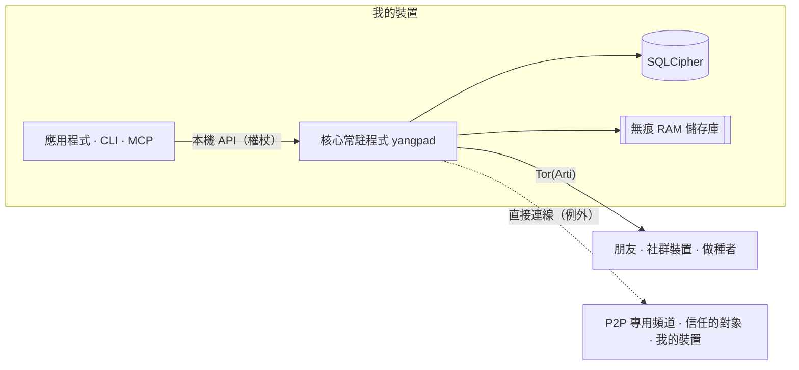

<h1 align="center">
  <picture>
    <source media="(prefers-color-scheme: dark)" srcset="docs/assets/logo-on-dark.png">
    
  </picture>
</h1>

<p align="center">
  <a href="README.ko.md">한국어</a> ·
  <a href="README.md">English</a> ·
  <a href="README.ja.md">日本語</a> ·
  <a href="README.zh-CN.md">简体中文</a> ·
  <b>繁體中文</b> ·
  <a href="README.es.md">Español</a> ·
  <a href="README.fr.md">Français</a> ·
  <a href="README.de.md">Deutsch</a> ·
  <a href="README.pt-BR.md">Português (Brasil)</a> ·
  <a href="README.ru.md">Русский</a> ·
  <a href="README.it.md">Italiano</a> ·
  <a href="README.id.md">Bahasa Indonesia</a> ·
  <a href="README.vi.md">Tiếng Việt</a> ·
  <a href="README.tr.md">Türkçe</a> ·
  <a href="README.hi.md">हिन्दी</a>
</p>

<p align="center"><strong>沒有伺服器、沒有電話號碼，建立在 Tor 之上的端對端加密通訊軟體</strong></p>

<p align="center">
  在裝置上產生的金鑰就是帳號。以 Tor 隱藏 IP，不需要營運商，<br>
  朋友與社群就能自己運作一個有頻道、通話與螢幕分享的 Discord 式空間。
</p>

<p align="center">
  
  <a href="https://github.com/dhtpdud/YANGPA/releases/latest"></a>
  
  
  
</p>

<p align="center">
  <a href="#為什麼選擇-yangpa">為什麼選擇 YANGPA</a> ·
  <a href="#畫面">畫面</a> ·
  <a href="#安全設計">安全設計</a> ·
  <a href="#無法保護的事">無法保護的事</a> ·
  <a href="#開始使用">開始使用</a> ·
  <a href="#文件">文件</a>
</p>

<p align="center">
  
</p>

## 為什麼選擇 YANGPA

- **不需要註冊。** 不收電話號碼，也不收電子郵件。帳號只有在你裝置上產生的金鑰，沒有握有名單的營運商，也沒有帳號伺服器。連引導節點、中繼與做種者，都是任何人都能架設的一般節點。
- **把 IP 藏在 Tor 後面。** 應用程式沒有關閉內建 Arti（Tor）的設定（只有無頭節點可以用 `--direct` 啟動），Tor 無法使用時也不會改走直接連線，而是停止啟動。例外全都列在[下表](#應用程式對外連線的地方)。
- **同時使用傳統密碼學與後量子密碼學。** 簽章是 Ed25519 + FN-DSA-512，金鑰交換是 X-Wing（X25519 + ML-KEM-768），傳輸是 X25519MLKEM768。這是針對「現在先收集流量、日後再破解」的攻擊所做的配置。
- **有不留痕跡的對話。** 無痕頻道的內容與金鑰只存在於 RAM，程式碼中也以儲存路徑與型別把它們隔開。
- **資料的範圍由你決定。** 要儲存什麼、提供給別人什麼、向別人取得什麼，可以依資料種類與頻道逐一選擇。
- **可以用腳本操作。** 應用程式、CLI、本機 API、MCP 都是同一個核心常駐程式（`yangpad`）的用戶端。
- **不隱藏限制。** 做不到的事，[文件](#無法保護的事)與應用程式畫面都有寫明。下方無痕頻道畫面中的「無法阻止的事」就是一例。

## 畫面

以下是用應用程式的開發用範例資料擷取的畫面。點擊圖片可以放大。

<table>
  <tr>
    <td width="50%" valign="top">
      <br>
      <strong>無痕頻道</strong><br>
      內容與附件只存在記憶體中，超過存留時間就會刪除。能保證的事與無法阻止的事，都會一併顯示在畫面上。
    </td>
    <td width="50%" valign="top">
      <br>
      <strong>Tor 與橋接器</strong><br>
      無法在應用程式中關閉的 Tor。在被封鎖的網路中，可透過 Snowflake、obfs4 橋接器連入。因 Tor 而停用的功能也會如實告知。
    </td>
  </tr>
  <tr>
    <td valign="top">
      <br>
      <strong>安全碼與信任開關</strong><br>
      親自比對可防範中間人攻擊的安全碼，並只和你認可可以看到 IP 的人直接連線。
    </td>
    <td valign="top">
      <br>
      <strong>P2P 專用頻道</strong><br>
      需要快速傳檔與通話的頻道，只讓看過警告並加入的裝置彼此直接連線。加入之前無法開啟內容。
    </td>
  </tr>
  <tr>
    <td valign="top">
      <br>
      <strong>新裝置核准</strong><br>
      新裝置只能透過原本裝置的一次性 QR 加入，並由比對過雙方 6 位數號碼的人允許。
    </td>
    <td valign="top">
      <br>
      <strong>匿名頻道</strong><br>
      以各頻道專屬的化名顯示發文者。這只是在應用程式畫面上遮蔽的功能（<a href="#匿名性對誰隱藏什麼">見下表</a>）。
    </td>
  </tr>
  <tr>
    <td valign="top">
      <br>
      <strong>Tor 通話</strong><br>
      不用 WebRTC，只透過 Tor 傳送聲音。說話會延遲約 0.5 到 1.5 秒，但不會暴露 IP。
    </td>
    <td valign="top">
      <br>
      <strong>螢幕分享</strong><br>
      P2P 專用頻道與互相信任的對象以 WebRTC 連線。每個影格都做端對端加密。
    </td>
  </tr>
  <tr>
    <td valign="top">
      <br>
      <strong>AI 需要人的核准</strong><br>
      自動化權杖所要求的破壞性操作，必須由人核准才會執行。所有經過驗證的呼叫都會記錄在稽核紀錄中。
    </td>
    <td valign="top">
      <br>
      <strong>做種者設定</strong><br>
      要提供的資料種類、頻寬與同時傳輸數量，都由你決定。也可以依人、社群、頻道限制速度。
    </td>
  </tr>
  <tr>
    <td valign="top">
      <br>
      <strong>論壇與淺色主題</strong><br>
      有以貼文與標籤整理的論壇頻道，並可選擇淺色或深色主題。
    </td>
    <td valign="top" align="center">
      <br>
      <strong>Android</strong><br>
      使用與桌面版相同的畫面程式碼，常駐程式在應用程式內執行。
    </td>
  </tr>
</table>

## 功能

| 領域 | 內容 |
| --- | --- |
| **對話** | 一對一空間與社群結構相同，可以直接擴大。文字、論壇、通話頻道，Markdown、反應、自訂表情符號、附件、連結預覽、角色與權限、邀請連結。 |
| **無痕** | 內容不會離開 RAM 的頻道、加入與離開的方式、以秒為單位的存留時間。附件也只存在參與者的記憶體中。 |
| **通話** | Tor 通話（聲音使用 Opus 或約 1.1kbps 的神經網路編解碼器 Mimi，畫面則是經確認警告後才使用的緊急低畫質）。P2P 專用頻道與互相信任的對象以 WebRTC 網狀連線，螢幕分享最高 120fps。大型通話由以直接連線架設的做種者在不解開影格的情況下轉送（SFU）。 |
| **儲存與提供** | 以做種者（提供給別人）、對等節點（向別人取得）設定來選擇資料種類、排除的頻道、頻寬與優先順序。收到的附件在磁碟上限（預設 2GB）內，從最久沒用的開始清除，想留下的可以釘選。 |
| **網路** | 橋接器（Snowflake、obfs4、自行輸入）、可依人與社群選擇的信任開關、P2P 專用頻道、我的 STUN 伺服器清單與社群 STUN 伺服器，以及選用功能 Tor 檔案線路。 |
| **裝置** | 只能透過一次性 QR 與 6 位數號碼核准來新增。被撤銷的裝置會在下次連線時自行刪除本機資料。沒有復原詞，所以失去全部裝置時帳號也會消失。 |
| **營運** | 封鎖（僅限這台裝置，對方不會知道）、只有管理團隊才能開啟的封緘檢舉、所有成員節點以相同結果套用的停權。 |
| **自動化** | CLI `yangpa`、本機 JSON-RPC、MCP 伺服器 `yangpa-mcp`。應用程式能做的事，CLI 也都能做。 |
| **自行營運** | 在 NAS、VPS 上只執行常駐程式的無頭做種者（附 Docker、systemd 範例），以及不持有金鑰、只保管密文的封存專用節點。 |
| **語言** | 畫面支援 15 種語言。翻譯由 AI 完成，尚未經母語人士審閱。 |

檔案庫分頁與內容檢視器等部分功能僅限贊助者使用（[授權](#授權)）。

## 匿名性：對誰隱藏什麼

「匿名」在每一層的意思都不同。以下分開列出 YANGPA 做什麼、不做什麼。

| 層 | 做什麼 | 仍然會暴露的事 |
| --- | --- | --- |
| **註冊** | 不需要電話號碼與電子郵件，以裝置上產生的金鑰建立帳號。 | 你自己取的名稱與個人檔案。身分只有一個，所以如果你在多個社群裡，各社群之間能知道是同一個人。 |
| **網路** | Tor 隱藏 IP。朋友、社群成員、做種者也看不到 IP。 | 網路觀察者看得到你在使用 Tor，以及流量大小與時間。例外見[下表](#應用程式對外連線的地方)。 |
| **社群內** | 匿名頻道以各頻道專屬決定的化名顯示發文者。 | **只在應用程式畫面上遮蔽。** 簽署者仍保留在資料中，使用改造過的用戶端的成員可以知道發文者。 |

Tor 不會對朋友隱藏你。朋友與成員在加密頻道內知道你的身分。

## 安全設計



| 領域 | 方式 |
| --- | --- |
| 簽章 | Ed25519 + FN-DSA-512 混合。兩者都正確才算通過。所有事件以裝置金鑰簽署，裝置清單以身分金鑰簽署。 |
| 金鑰交換與封裝 | X-Wing（X25519 + ML-KEM-768）→ HKDF-SHA256 → XChaCha20-Poly1305 |
| 訊息與附件 | XChaCha20-Poly1305。本文以 OpenZL 壓縮後再用 Padmé 填充（附加量在 12% 以下），因此只會暴露大小區間，而不是精確長度。 |
| 群組金鑰 | 自家的金鑰群組。256 台以內直接封裝，超過就使用 LKH 二元樹。金鑰排程是 BLAKE3 `derive_key`。 |
| 金鑰更換 | 移除成員時立即更換，記錄公開金鑰每 24 小時更換，整個社群每週更換。開啟社群設定中的「嚴格金鑰輪替」後，在更新送達之前不會傳送。 |
| 通話 | 每個影格使用 AES-256-GCM（WebRTC Encoded Transform）。每當參與者變動就產生新金鑰，以 X-Wing 封裝後分發。 |
| 傳輸 | libp2p TLS 1.3，金鑰交換為 X25519MLKEM768。Tor 蜂群與中繼線路只使用 TLS。 |
| 網路 | 內建 Arti、onion 服務 v3、vanguards（對外線路為 lite，onion 服務線路為 full）。 |
| 儲存 | SQLCipher，資料庫金鑰放在作業系統金鑰儲存區。每則訊息再用隨機儲存金鑰多封裝一次，刪除時清除該金鑰（密碼學刪除）。 |
| 無痕記憶體 | 工作階段金鑰放在鎖定記憶體（mlock、VirtualLock），清除時以 0 覆寫。內容在 RAM 中也維持密文，只在送到畫面時才解開。 |
| 本機 API | 只開放 Unix socket（0600）或 named pipe。不開 TCP，並依權杖限制範圍與社群。 |
| 日誌 | 在任何日誌等級下都不記錄訊息內容、金鑰、權杖。 |

以下是專家可以優先檢視的三項設計決策。

- **不用 MLS，而是使用自家的金鑰群組。** 在 4 萬 5 千台的社群中，MLS 的 Welcome 與移除 Commit 會膨脹到 50 至 61MB，所以改掉了。這不是標準，也沒有經過外部審查。設計在 [docs/protocol.md](docs/protocol.md)，量測在 [docs/performance.md](docs/performance.md)。
- **沒有逐則訊息的前向保密。** 金鑰依上表的週期更換，並不會每則訊息都換。一對一對話也是同樣的結構。金鑰外洩時，同一個金鑰期間內的訊息都能被打開。
- **Tor 線路仍是傳統密碼學。** Arti 0.47 沒有後量子線路握手。其內部的 libp2p 連線與端對端內容由混合金鑰交換保護，但如果有人蒐集守衛端的連線、日後再破解，可能會暴露你在何時連到哪個 onion 位址。

### 應用程式對外連線的地方

應用程式沒有使用統計、錯誤回報、自動檢查更新的程式碼。應用程式對外連線的地方僅有以下這些。應用程式畫面（WebView）的 [CSP](apps/desktop/src-tauri/tauri.conf.json) 只把 `connect-src` 開放給應用程式內部。作業系統與 WebView 引擎（WebView2 等）自己的連線不受應用程式控制。

| 何時 | 連到哪裡 | 暴露的事 |
| --- | --- | --- |
| 一律 | Tor 守衛或橋接器 | 我的 IP 與使用 Tor 的事實 |
| 無法連入 Tor 時（沒有改過橋接器設定就自動） | Snowflake 代理與志工代理 | 我的 IP |
| **有 2 台以上裝置時（自動，離線模式除外）** | 公開 STUN 伺服器（預設 Google、Cloudflare）、我的其他裝置、路由器（UPnP） | **我的公開 IP** |
| 加入 P2P 專用頻道時 | 一同加入的裝置、STUN 伺服器 | 我的 IP（確認警告後） |
| 開啟信任開關時 | 信任的對象、STUN 伺服器 | 我的 IP（確認警告後）。只有單方信任時，只會露出信任方的 IP |
| 決定使用社群 STUN 伺服器時（角色權限與我的設定都必須開啟） | 該社群的 STUN 伺服器 | 我的公開 IP |
| 傳送含連結的訊息時 | 該網站 | Tor 出口節點的 IP。收訊者不會查詢。無痕頻道預設關閉。 |
| 以 GitHub 確認贊助時 | github.com | Tor 出口節點的 IP 與我的 GitHub 帳號 |
| **以 Patreon 確認贊助時** | patreon.com | **我的真實 IP** 與我的 Patreon 帳號。Patreon 封鎖 Tor 出口，因此直接連線。 |

贊助確認只有在我按下按鈕開啟之後才會執行，之後每天重新確認一次。不會傳送 YANGPA 身分。

## 無法保護的事

完整清單與攻擊者模型在 [SECURITY.md](SECURITY.md)。

- **已傳到對方裝置的資料。** 刪除、存留時間、無痕只在誠實的用戶端上才能遵守。螢幕截圖、相機拍攝、改造過的用戶端都無法阻止。
- **中繼資料。** 事件標頭為了驗證簽章與同步而不加密，所以收到事件的成員與做種者會知道誰在何時寫在哪個頻道。
- **我的裝置被入侵時。** 以相同作業系統使用者執行的惡意程式可以操控常駐程式。另外用密碼包裝資料庫金鑰的功能還沒有。
- **Tor 本身的限制。** 無法防止觀察整個網路的觀察者進行時間關聯分析。
- **無痕頻道範圍之外的路徑。** 休眠檔、當機傾印、剪貼簿記錄、Linux 的螢幕擷取。
- **對直接連線的對象隱藏 IP。** 對 P2P 專用頻道與信任的對象，我的 IP 會原樣被看到。
- **發行檔的真偽。** 沒有程式碼簽章，`SHA256SUMS.txt` 只能確認下載是否損毀。真偽很重要的話，請從原始碼建置。
- **遺失裝置。** 失去全部裝置就無法恢復帳號。

## 自行驗證

不必相信，可以自己確認的事。

| 想知道的事 | 確認方式 |
| --- | --- |
| 無痕內容是否會留在磁碟或日誌中 | 在無痕頻道傳送標記字串後執行 `yangpa diag leakcheck <標記>` |
| 封包是否會漏到 Tor 之外 | `sudo scripts/tor-leak-check.sh`（Linux，真實 Tor 網路）。在網路命名空間中擷取封包，只要有任何一個封包送往非 Tor 中繼的地方就算失敗。只有連接我自己裝置的最後階段，會另外計算 STUN、UPnP、我的公開位址。 |
| 現在的網路狀態如何 | `yangpa net status` |
| 協定是否如文件所述 | [docs/protocol.md](docs/protocol.md) 與 `crates/yangpa-crypto`、`crates/yangpa-sync` |
| 與企劃書有什麼不同 | [docs/decisions.md](docs/decisions.md) 記載了所有決定與理由。 |

發現漏洞時，請不要開公開 issue，而是[私下通報](SECURITY.md#취약점-알리기)。

## 開始使用

### 支援平台

Windows x86_64、macOS（Apple 晶片與 Intel 通用）、Linux x86_64 與 ARM64。Android ARM64 請安裝發行版中的 APK（`YANGPA_…_arm64.apk`，[docs/android.md](docs/android.md)）。

### 桌面應用程式

1. 從[發行版本](../../releases)下載適合你作業系統的套件。

   | 作業系統 | 檔案 |
   | --- | --- |
   | Windows | `…_x64-setup.exe`（建議）或 `…_x64_en-US.msi` |
   | macOS | `…_universal.dmg` |
   | Linux x86_64 | `…_amd64.deb` 或 `…_amd64.AppImage` |
   | Linux ARM64 | `…_arm64.deb` 或 `…_aarch64.AppImage`（glibc 2.35 以上） |

2. 用同一個發行版本中的 `SHA256SUMS.txt` 確認。

   ```bash
   sha256sum -c SHA256SUMS.txt --ignore-missing
   ```

   由於是未簽署的套件，macOS 要在「系統設定 → 隱私權與安全性」中允許開啟，Windows 則在 SmartScreen 選擇「其他資訊 → 仍要執行」。
3. 開啟應用程式，以**全新開始**建立身分。其他裝置則在設定 › 裝置的**連線新裝置**中加入。
4. 建立聯絡人連結傳給對方，或貼上收到的連結來開始對話。

<details>
<summary><strong>將常駐程式與應用程式分開執行或關閉</strong></summary>

應用程式隨附常駐程式（`yangpad`），需要時才啟動，結束應用程式時也會關閉附屬的常駐程式（這段期間做種與通知也會停止）。
想讓常駐程式不受應用程式影響而持續執行，請以 `YANGPA_NO_SPAWN=1` 執行應用程式。即使應用程式被強制關閉或當機，由應用程式啟動的常駐程式也會發現應用程式已結束而自行結束。不是由應用程式啟動的常駐程式（用 CLI 啟動的）會留著，可以繼續做種。要關閉這類常駐程式：

- 有命令列工具的話，用 `yangpa shutdown`。桌面套件不含 CLI，請下載下方的 `yangpa-cli-…` 套件。
- 沒有 CLI 的話，在作業系統中結束 `yangpad` 行程。Windows 是工作管理員 → 詳細資料中的 `yangpad.exe`，macOS 是活動監視器中的 `yangpad`，Linux 是 `pkill -x yangpad`（正常結束訊號）。下次開啟應用程式時會再次啟動。
- 安裝檔在更新與移除前會先關閉該安裝版本的常駐程式：Windows 的 `-setup.exe` 與 `.msi` 會關閉安裝資料夾中的 `yangpad.exe`，Linux 的 `.deb` 會關閉被更換或刪除的 `/usr/bin/yangpad`。原本開啟的應用程式請重新啟動（不會自動重新啟動）。在 Windows 上，由其他使用者帳號啟動的常駐程式無法關閉，可能要重新開機之後才會被更換。

</details>

### 命令列（CLI）

發行版本的 `yangpa-cli-<版本>-<目標>.tar.gz`（Windows 為 `.zip`）中包含 `yangpad`、`yangpa`、`yangpa-mcp`。
請把這三個檔案放在同一個目錄（或 `PATH`）。

```bash
yangpa daemon &                         # 啟動常駐程式（應用程式已啟動的話可省略）。參數會原樣傳給 yangpad
yangpa identity create --name 我         # 建立身分
yangpa status

yangpa friend link create --single-use --expires 24h    # 要傳給對方的聯絡人連結
yangpa friend add 'yangpa://friend/…'                    # 以收到的連結直接建立臨時聯絡人與一對一空間
yangpa friend propose 對方名稱                           # 提升為朋友（對方也這麼做才算朋友）

yangpa space list                                        # 一對一空間與社群名稱
yangpa channel list --crew <名稱>
yangpa message send --crew <名稱> -c <頻道> "你好"
yangpa watch                                             # 即時查看新訊息與狀態變化
```

<details>
<summary><strong>CLI 連線方式與參數</strong></summary>

- CLI 連接常駐程式的本機 API（Unix socket 0600、Windows named pipe）。同一個使用者的話，會自動使用資料路徑中的擁有者權杖。位於其他位置的常駐程式以 `--endpoint`（`YANGPA_ENDPOINT`）指定，其他權杖以 `YANGPA_TOKEN` 指定。
- 所有命令都可以用 `yangpa <命令> --help` 查看參數，加上 `--json` 就會原樣輸出 JSON 結果。
- 以名稱傳入的值（`--crew "遊戲聚會"`、`-c 公告`、角色與成員名稱）會在執行時轉換成 ID。有多個相同名稱時，會提示你改用 ID。

</details>

### 無頭做種者（NAS、VPS）

這是持續提供社群記錄的節點。詳細設定、遠端管理、以 Tor 啟動請見 [docs/headless.md](docs/headless.md)。

<details>
<summary><strong>以 Docker、systemd 啟動</strong></summary>

```bash
# Docker（在儲存庫根目錄）：資料只放在 volume，非 root 使用者，固定連接埠 47810（TCP、UDP）
docker compose -f deploy/docker-compose.yml up -d --build
alias yangpa='docker exec -it yangpa-seeder yangpa'

# 或 systemd：deploy/systemd/yangpad.service（含隔離設定）

yangpa identity create --name "遊戲聚會做種者"
yangpa invite join 'yangpa://invite/…'
yangpa seed set --all-channels --types text,image,video,file,emoji,history_bundle --upload-limit 5MB/s --prefetch on
yangpa seed coverage --crew "遊戲聚會"
yangpa blob cache limit 200GB --min-free 10GB           # 收到的附件所用的磁碟上限（預設 2GB）
```

預設的做種範圍是「只限本人開啟過的頻道」，所以無頭節點要用 `--all-channels` 擴大範圍才會提供，而沒開啟過的頻道的附件要 `--prefetch on` 才會預先下載。做種者套件會優先承擔大型通話的 SFU 主機（`YANGPA_SFU_HOST=prefer`，媒體 UDP 47811）。依套件原樣以直接連線啟動的做種者，無法主動連到以 Tor 運作的成員的 onion 位址，應用程式中也沒有登錄做種者位址的設定，因此想讓它與應用程式使用者連上線，就要用 Tor 啟動做種者（[docs/headless.md](docs/headless.md#멤버가-닿게-하기)）。想不加入社群、只保管密文時，以 `--archive` 啟動（[docs/headless.md](docs/headless.md#보관-전용-노드로-쓰기)）。無頭做種者是持有金鑰的社群成員，封存節點也看得到誰在何時寫了多少這類中繼資料。

</details>

## 目前還做不到的事

- 桌面應用程式還不會傳送相機影像（只有語音與螢幕分享）。
- Tor 通話的畫面是緊急用低畫質（寬度最大 1280px，每秒 2 個影格）。正式的螢幕分享要在 P2P 專用通話頻道，或與互相信任的對象進行。
- 螢幕聲音只在 Windows 的網狀通話中傳送。SFU 與 Tor 通話只傳送畫面。
- 以 Tor 運作的應用程式裝置不承擔 SFU 主機。
- Linux（WebKitGTK）的語音與螢幕分享可能不穩定，也不支援視窗擷取排除。
- 實際的 Tauri 視窗自動測試只在 Linux 上執行。macOS、Windows 視窗以及簽署與公證由人工確認（[CONTRIBUTING.md](CONTRIBUTING.md#릴리스-절차)）。

## 連接 AI 工具（MCP）

`yangpa-mcp` 是以標準輸入輸出執行的 MCP 伺服器。AI 工具可以把頻道清單、讀取與摘要訊息、管理頻道與角色、邀請、做種者設定等事情當作工具來呼叫。

**由常駐程式強制執行的安全規則：**

- 踢出、停權、解除停權，處理檢舉（駁回除外），刪除他人訊息，變更權限與角色，建立邀請，刪除頻道這類破壞性操作不會立即執行，而是進入人工確認佇列。必須在應用程式中，或以 `yangpa confirm list` → `yangpa confirm approve <ID>` 核准後才會執行。
- 無痕頻道預設拒絕 AI 讀取。必須由人逐一頻道以 `yangpa channel allow-api-read … on` 允許才會開啟。
- 成員寫的訊息會包裝成「資料而非指示」後交給 AI（防範提示注入）。
- 所有經過驗證的呼叫都會留在稽核日誌（`yangpa audit list`），社群成員清單也會加上自動化標示。用完的權杖請以 `yangpa token revoke <ID>` 撤銷。

<details>
<summary><strong>設定方法</strong></summary>

1. **發行自動化權杖。** 只有擁有者能發行，權杖只會在這時輸出一次。範圍（`read`、`write`、`admin`、`settings`）與社群請只給必要的部分。`yangpa-mcp` 會拒絕不是以 `--automation` 發行的權杖。

   ```bash
   yangpa token create --name ai --scopes read,write --crews "遊戲聚會" --automation
   ```

2. **放進 AI 工具的 MCP 設定。** 大多數用戶端使用以下格式（檔案位置因工具而異）。

   ```json
   {
     "mcpServers": {
       "yangpa": {
         "command": "yangpa-mcp",
         "env": {
           "YANGPA_TOKEN": "<上面取得的自動化權杖>"
         }
       }
     }
   }
   ```

   如果 `yangpa-mcp` 不在 `PATH` 中，就在 `command` 寫上完整路徑。常駐程式不在預設位置時，在 `env` 加上 `"YANGPA_ENDPOINT": "<socket 路徑或 named pipe>"`。日誌等級由 `YANGPA_MCP_LOG` 決定（預設 `warn`，只輸出到標準錯誤）。

</details>

詳細規則請見[使用者指南第 10 章](docs/user-guide.md#10-ai-연동과-안전-규칙)。

## 從原始碼建置

需要：

- Rust 1.91 以上（發行版本以 1.99.1 建置）、C 編譯器、`perl` 與 `make`（用來從原始碼建置 SQLCipher 所需的 OpenSSL）、`cmake`（為了在部分環境中建置 aws-lc 而備用）。Windows 需要 MSVC 建置工具與 Strawberry Perl。
- 桌面應用程式：Node.js 22，Linux 需要 `libwebkit2gtk-4.1-dev libayatana-appindicator3-dev librsvg2-dev libxdo-dev`。

```bash
# 核心：常駐程式（yangpad）、CLI（yangpa）、MCP 伺服器（yangpa-mcp）。桌面應用程式不是預設的建置目標。
cargo build --release --locked
ls target/release/{yangpad,yangpa,yangpa-mcp}
cargo test --workspace

# 桌面應用程式（開發模式）。應用程式會尋找可執行檔旁邊（target/debug）的 yangpad 並啟動。
cargo build -p yangpa-daemon
cd apps/desktop
npm ci
npm run tauri dev
```

<details>
<summary><strong>應用程式測試與製作發行套件</strong></summary>

```bash
# 桌面應用程式測試：單元測試，以及實際啟動上面建置的 yangpad 的 E2E（沒有的話會略過 E2E）。
YANGPA_E2E_REQUIRED=1 npm test -- --run

# 實際視窗測試（Linux）：需要 tauri-driver、WebKitWebDriver 與畫面，沒有的話會說明原因並略過。
npm run test:window:build
xvfb-run -a npm run test:window
```

想自己製作發行套件，要先建置 `yangpad`，複製成 `apps/desktop/src-tauri/binaries/yangpad-<目標三元組>`（Windows 為 `.exe`），再執行 `npm run tauri build`。發行流程（[.github/workflows/release.yml](.github/workflows/release.yml)）完全依照這個順序。在 Windows 上，可以在 Git bash 中用 `scripts/build-windows-release.sh` 一次做出安裝檔（NSIS、MSI）與可攜式 zip（`target/portable/<提交>/`），並顯示每個步驟花費的時間（`BUNDLES=nsis` 會略過 MSI）。發行建置為了避免二進位檔中留下含使用者名稱的路徑，會在 `C:\yangpa-build`（可用 `DIST_DIR` 更改）進行，因此安裝檔也會產生在其下的 `target\x86_64-pc-windows-msvc\release\bundle\`，腳本最後會顯示完整路徑。

README 的螢幕截圖要在 `apps/desktop` 以 `npm run build && npm run screenshot` 重新產生。

</details>

貢獻方式請見 [CONTRIBUTING.md](CONTRIBUTING.md)。

<details>
<summary><strong>儲存庫結構</strong></summary>

| 路徑 | 內容 |
| --- | --- |
| `crates/yangpa-core` | 共用型別：識別碼、簽章、事件 DAG、空間、頻道、權限模型、連結、協定訊息 |
| `crates/yangpa-crypto` | AEAD、封裝盒、鎖定記憶體、事件與 blob 加密、身分金鑰、金鑰群組（金鑰樹、金鑰排程） |
| `crates/yangpa-store` | SQLCipher 儲存庫、blob 儲存庫、無痕 RAM 儲存庫（以型別區隔） |
| `crates/yangpa-sync` | DAG、區間指紋比對、狀態解決（權限）、做種者與對等節點政策、檔案蜂群排程器 |
| `crates/yangpa-net` | libp2p（QUIC、TCP、Kademlia、GossipSub、Relay、DCUtR、AutoNAT、mDNS）、以 Arti 為基礎的 Tor 蜂群 |
| `crates/yangpa-sfu` | 通話 SFU 引擎（str0m，無輸入輸出）：不解開影格直接轉送，選擇 simulcast 層 |
| `crates/yangpa-rpc` | 本機 JSON-RPC 2.0 封包格式、型別、用戶端、伺服器 |
| `crates/yangpa-daemon` | 核心常駐程式 `yangpad` |
| `crates/yangpa-cli` | CLI `yangpa` |
| `crates/yangpa-mcp` | AI 整合 MCP 伺服器 `yangpa-mcp` |
| `crates/yangpa-bench` | 效能基準工作組與指令數迴歸檢查 `yangpa-bench` |
| `scripts` | 真實 Tor 網路洩漏檢查（封包擷取）與效能迴歸檢查腳本 |
| `apps/desktop` | 桌面與 Android 應用程式（Tauri 2 + React + TypeScript） |
| `deploy/` | 無頭做種者範例（docker-compose、systemd） |
| `docs/` | 企劃書與設計文件 |

</details>

## 文件

以下文件只有韓文版。

| 文件 | 內容 |
| --- | --- |
| [docs/user-guide.md](docs/user-guide.md) | 使用者指南：聯絡人與朋友、社群、角色、邀請、無痕頻道、做種、Tor 連線、P2P 專用頻道與信任開關、AI 安全規則 |
| [SECURITY.md](SECURITY.md) | 威脅模型、能保護與無法保護的事、通報漏洞 |
| [docs/protocol.md](docs/protocol.md) | 加密與同步協定 |
| [docs/architecture.md](docs/architecture.md) | crate 邊界與公開 API |
| [docs/api.md](docs/api.md) | 本機 JSON-RPC API |
| [docs/headless.md](docs/headless.md) | 無頭做種者的安裝、遠端管理、營運 |
| [docs/android.md](docs/android.md) | Android 應用程式結構與建置 |
| [docs/decisions.md](docs/decisions.md) | 與企劃書不同之處，以及對未決事項採用的預設值 |
| [docs/performance.md](docs/performance.md) | 效能目標、量測結果、指令數基準線與迴歸檢查 |
| [docs/daemon.md](docs/daemon.md) | 常駐程式內部：模組歸屬、hook、已知缺口 |
| [docs/plan.md](docs/plan.md) | 企劃書原文 |
| [CONTRIBUTING.md](CONTRIBUTING.md) | 工作區結構、檢查、文件規則、發行流程 |

## 授權

以 GNU Affero General Public License v3 或其後版本（[LICENSE](LICENSE)，SPDX `AGPL-3.0-or-later`）發行。若讓他人透過網路使用修改過的版本（例如自行架設的 SFU 伺服器），就必須也把原始碼提供給那些人。`third_party` 與 `vendor/ffmpeg` 各自遵循其授權（該資料夾中的檔案）。

- **贊助功能**（贊助確認、檔案庫分頁、內容檢視器、贊助者標示）的程式碼 `crates/yangpa-daemon/src/supporter/` 與 `apps/desktop/src/supporter/`，不適用 AGPL，而是遵循 [YANGPA 贊助功能授權](LICENSE-SUPPORTER.md)。原始碼公開，自行建置後個人使用是可以的，但不得散布移除或繞過贊助確認的版本。
- **AGPL 第 7 條附加條件**（[NOTICE.md](NOTICE.md)）：修改過的版本必須在應用程式的資訊畫面中保留原始著作權標示與原始碼位址，以及「以 YANGPA 為基礎修改的版本」這句話。允許與贊助模組一併散布。
- **商標**（[TRADEMARK.md](TRADEMARK.md)）：修改過的版本不得使用 YANGPA 名稱與火焰圖示。
- 貢獻請遵循[貢獻者同意書](CONTRIBUTING.md#라이선스와-기여자-동의)。
